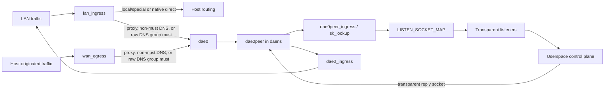

# Linux capture datapaths

Linux capture delivers traffic to the shared userspace policy and outbound path. [Control plane](./control-plane.md) describes that path; [NFQUEUE](./nfqueue.md) describes TC held-first-packet UDP.

## Linux TUN Endpoint

`backend: tun; direct: endpoint` selects the daemon-owned Linux TUN path. The
[global reference](../reference/global.md#linux-tun-endpoint) gives the full syntax,
required resource values, validation and exact five RPDB rules. TUN is a real FD
consumer of the existing scoped Stack, canonical Router, DNS projector and
outbound flow initializers. It creates no TC hooks, NFQUEUE, `dae0` or `daens`,
and does not depend on the `ebpf` feature. It rejects `--mock-ebpf`.

A single `TunDevice` owns `/dev/net/tun`, opened `O_RDWR|O_NONBLOCK|O_CLOEXEC`.
`TUNSETIFF` requests `IFF_TUN|IFF_NO_PI|IFF_TUN_EXCL`; `TUNGETIFF` verifies actual
TUN/NO_PI and rejects multi-queue, VNET_HDR and NAPI. The creation-only EXCL bit is
not required in readback. `TUNSETOFFLOAD(0)` selects complete ordinary L3 packets
with software checksums. There is one reader/writer, no duplicate/inherited FD,
persistent device, external-FD input or pre-existing-link adoption.

### Setup and readiness

1. Complete static/runtime admission, take the real instance lock and initialize
   the required exact bypass mark M. `prepare_dns_bind(&Config)` resolves and
   retains the enabled bind endpoint's actual `SocketAddr` candidates; disabled
   listening returns `None`. Fund runtime/RX storage and one non-HOST
   `PacketScope` with its original owner before any link or routing mutation.
2. Verify the required mark on actual TCP/UDP sockets, subscribe to rtnetlink and
   snapshot. Refuse occupied name/table/all five priorities and unsupported
   RPDB/main/default topology. Create the private setup receipt and persist the
   create intent before the exclusive TUN ioctl. Record
   actual netns cookie, ifindex and attachment incarnation immediately; set MTU,
   explicit addresses, owned-link sysctls and UP, recording ACK/readback.
   After the UP ACK, wait for the exact owned link, permanent host addresses and
   local host routes before installing any guard or rule. IPv6 NODAD still queues
   local-route work; only its absent `/128` route may wait on notifications, within
   one two-second deadline covering every readback. Conflicting or foreign
   topology and malformed observations fail immediately, before diversion.
3. Write each mutation intent ahead of installing capture-prefix blackholes
   (static, metric 32760) and the five rules. Do not install unicast capture yet:
   selected prefixes are contained while Endpoint startup is incomplete.
4. Pass the already-funded scope and original owner to
   `PacketEndpoints::start_driven(plane, scopes, udp_capacity,
   prepared_dns_addresses)`. The final argument is the retained
   `Option<PreparedDnsBind>` containing endpoint and resolved candidates, not a
   boolean or a request to resolve again. Keep the unique `PacketDriver` servicing
   timers/output while waiting for `owner.poll_ready`, including failed-startup
   cleanup. DNS bind, software flags and subscription authorizations must be ready.
5. Read back link/address/rules, install and read back metric-1024 capture
   routes, then establish the final `Topology::admit_tun` subscription and full
   snapshot while retaining the old watch. Only after successful final admission
   open the shared gate, call `capture_ready()`, and report `TUN datapath ready`,
   lifecycle Running and sd_notify READY. Close cannot lose this readiness race.

The receipt at `<data_dir>/state/tun-<netns_cookie>-<instance_nonce>.json` is
create-new, mode 0600 and nonsymlink. It journals full source SHA, PID/starttime,
actual namespace/link/attachment identity and exact address/route/rule keys with
Intent/Acknowledged/Removed states, persisting and fsyncing each transition.
Only confirmed instance-owned objects can be removed. Ambiguity retains the
receipt and object; a receipt never authorizes adoption or automatic recovery.

Active capture routes use metric 1024 in both families, while static blackhole
guards retain metric 32760. Linux normalizes IPv6 metric 0, and IPv4 route delete
with metric 0 is a wildcard; choosing 1024 is a deliberate representation
adjustment from the initial metric-0 design. Exclusive create, readback and exact
delete all include table, family, prefix, output interface and metric, preventing
active-route removal from selecting its guard.

The operator keeps main/WAN/LAN routes, source addresses, forwarding, NAT and
firewall stable. Enabled families need a valid non-TUN main uplink and source;
main/default must not refer to TUN through unicast, multipath, nexthop, VRF or lwt
paths. Additional early/local rules, VRF/l3mdev and unknown selectors/actions are
refused rather than approximated. Route/address/link/rule changes, ENOBUFS,
interrupted/unknown dumps or replaced ifindex cause sticky invalidation and close
capture. Subscription is not an atomic fence against arbitrary concurrent root
route writes, and retained guards are not a whole-host firewall kill switch.

### FD packet pipeline

Kernel egress appears on FD read; FD write injects a **new interface-ingress
packet**, never the original skb. Host- and Transit-generated TCP/UDP selected by
capture follow actual FD read → `receive_with_source` in the registered scope →
Stack → canonical initializer/Router → real outbound → generated output lease →
same FD write. Direct explicitly terminates and makes a new dial. Policy sees the
captured L3 source/destination/DSCP; scope, tuple, mark and TUN address authenticate
neither Host origin nor process identity. No pre-DNAT/pre-SNAT or original-socket
semantics are recovered. Capture/reply legs must not rewrite that policy input.

RX uses one funded 65576-byte buffer, full software checksum verification and one
ingress timestamp per turn. Length mismatch, truncation or unexpected negotiated
representation is never shortened into a valid Stack packet. Borrowed UDP is
accepted/copied through the existing funded ingress before the next read. The
source callback only checks the live reverse consumer for this scope/attachment;
it never writes the FD, blocks or re-enters the scope mutex.

The owner services driver deadlines before and after bounded RX. RX is limited to
32 syscall attempts/packets, 1 MiB or 1 ms per turn; EINTR counts, time is checked
at most every eight packets, and one final full record may exceed the byte bound
by at most 65575 bytes. TX alternates the first Control/Bulk class, services at
most 32 outputs per class and preserves fixed pending lease cells, with its own
bounded syscall/byte/time turn. Limits are scheduler bounds, not preemptible
syscall deadlines. Pending output is retried before new exports of that class.

| TUN write result | Ownership |
| --- | --- |
| Full packet length | Kernel accepted this one record; release the lease outside the scope lock. This is neither remote delivery nor TCP ACK. |
| EAGAIN/EWOULDBLOCK | Retain the same lease, bytes, scope and FlowId at its class head; register writable and retry that record. |
| EINTR | Retain the same lease; retry/yield within the finite syscall budget. |
| Zero or short write | Fatal packet-boundary violation; never write a suffix or replay the whole packet. Preserve the reported partial outcome and dispose local ownership explicitly. |
| Other error | Fatal owner I/O failure; no backend fallback or replay through another executor. An ambiguous submission stays ambiguous. |

Readiness is cleared only after EAGAIN. Idle waits register readable, writable
only for blocked pending output, topology/driver/close/supervisor wakers and the
earliest real driver deadline, then recheck. No flow/deadline/pending work means
no periodic dataplane timer; TUN has no XSK CQ/FILL fallback. No scope/config/Router
or projection lock crosses an await.

### Stop and failure custody

Normal operator stop first closes admission, removes metric-1024 capture routes so
prefixes hit guards, and stops FD RX while retaining setup/watcher/FD/driver.
`endpoints.close()` closes protocol admission before DNS/command admission stops.
No new protocol output is sent: pending/closing leases are explicitly disposed
outside locks while driver service and `owner.poll_join_plane` continue until
TCP/UDP initializers, sources/receivers, retirement, DNS and original scope owners
actually join. `shutdown_wait_connections` supplies no natural-completion grace.

After the supervisor returns its real `(ControlPlane, result)`, close the only FD,
confirm owned-link disappearance, and remove only receipt-backed objects still
proven to belong to this instance. Once business cleanup succeeds, remove P+4
first, then guards/table and bypass/return rules, and finally the receipt. This
explicit stop restores ordinary main routing. Software policy cleanup and the
existing API/subscription shutdown follow.

Runtime failure, crash or unconfirmed cleanup retains blackholes/rules and the
receipt and returns an error. Stop sources and inspect exact ownership before
operator cleanup; do not restart by deleting a name/table blindly. Drop only
closes local admission/endpoints, disposes local leases, returns driving rights
and closes the FD; it performs no rtnetlink cleanup or successful-cleanup ack.
The original supervisor retains joined cleanup on its original Tokio runtime,
which an embedder must keep alive. There is no automatic FD reopen, resource
adoption, TC/XDP fallback or Native continuation. HostFacts (S-b), pre-import
Native (S-c) and FD-read captured return (S-d) remain unimplemented; this S-a
Endpoint path does not complete E6.4.

## Full-XDP startup

The default remains TC when `datapath` is absent. Full-XDP is an explicit daemon backend, not the XSK fixture or a TC/NFQUEUE/TUN fallback:

```dae
global {
    dial_mode: ip
    nfqueue_enable: false
    so_mark_from_dae: 0x100
}
datapath {
    backend: xdp
    direct: core
    interface {
        dut0: lan
        dut1: wan
    }
}
routing {
    fallback: direct
}
```

Use `direct: endpoint` to terminate Direct TCP/UDP through the existing packet Endpoint and outbound relay; `direct: core` preserves transit through the Core forwarding owner and input-context kernel FIB. `lan`/`wan` (`Lan`/`Wan` in the model) describe interface roles, not execution profiles. XDP selection requires `backend: xdp` and an explicit Direct profile; invalid admission is rejected before kernel attachment. Do not combine this selection with the TC `global.lan_interface`/`wan_interface` settings. All RX queues of every selected interface are opened, with one ring owner per queue and one routing-domain owner across ports/queues. Backend, profile and device changes require restart; firewall/NAT policy uses transactional generation publication, retaining the previous policy on rejected updates.

Before startup, provision an exact effective-bypass-mark RPDB rule before `main`, selecting a dedicated table with a default route for every enabled source-address family through an **uncaptured** uplink. `so_mark_from_dae` supplies that mark (the example uses `0x100`); it is not `CLASSIFIED_MARK` and cannot restore an original captured skb. Captured Ethernet ports must be unnumbered, including IPv6 link-local addresses. Core transit routes and neighbors belong in the kernel routing domain. Stock native continuation, nonzero native rule marks, unsupported socket/process predicates and native local/wildcard-listener assumptions are not silently translated to Core or Endpoint: a FIB Local result alone is not local-socket authority. DNS53 still follows canonical policy.

Captured physical roots and bypass-table Ethernet uplinks must be administratively
up, standalone and have carrier (`IFF_UP | IFF_LOWER_UP`); captured logical
interfaces must remain unnumbered. Some native drivers renegotiate carrier when
the first XDP program attaches. After its own attachments, honk waits on netlink
notifications for only the captured physical roots to regain carrier, with one
10-second deadline across all roots and final admission. Other topology refusals
remain immediate, including a down or carrier-less bypass uplink. An expired
carrier wait names the interface and reports `no carrier after XDP attach`;
startup fails with the existing guard custody. Later link notifications still
close capture and require restart.

During that startup wait only, the existing native IPv6 `ff00::/8` multicast
route may carry the sole `RTNH_F_LINKDOWN` flag when its output is a captured
physical root still awaiting carrier. A recovered root, a logical-only output,
additional flags or unsupported route facts remain refusals. Final strict
admission still requires the multicast route's flags to be zero.

The marked-table preflight proves **output-route isolation**, not the remote network's
asymmetric return path. Own unconnected UDP, fragmented replies, IPv4 options and
IPv6 extension-header replies do not receive the connected-socket native exemption;
if they arrive on a captured port, the selected packet policy still applies. Keep
their return path on the uncaptured uplink: this unsupported topology is not made
equivalent by XDP socket-lookup helpers. Wildcard lookup alone cannot distinguish
transit from LocalInput. Route/address/link/rule notification loss or change closes
capture; this is not an atomic kernel route-mutation fence.

Endpoint reply identities use a shared 4096-entry table keyed by logical scope and
source IP. Reclamation considers only entries no longer retained by protocol state,
TIME_WAIT, initializer/source receivers, DNS work or queued/exported output. A live
owner's identity cannot be replaced by a conflicting MAC/VLAN claim; an unknown RST
cannot learn or poison a peer. Quiescent conflicts retain their 60-second hold even
under table pressure. Full tables of retained owners reject new peers rather than
stealing a reply path. Complete VLAN TCI is captured with exported output, including
TX-credit waits. Firewall/NAT predicates requiring unavailable original MAC/process
provenance are rejected before capture admission.

Every captured logical realm must have MTU at least 1280, including Core profiles
that may hand traffic to Endpoint; incompatible realms reject before attachment.
Captured ingress uses one of two contracts selected before attachment. A physical
device with verified RX VLAN stripping disabled and no recovered-tag requirement
uses wire-only decoding: ingress device/queue authority comes from its owned XSK,
and inline L2 facts come from the received bytes; no metadata prefix is read or
fabricated. The metadata-required path keeps the 32-byte v2 producer record and
uses the real device-bound `bpf_xdp_metadata_rx_vlan_tag` kfunc, resolved through
kernel BTF. Veth requires this path because local RX-off flags do not constrain
its peer's TX tag insertion. One recovered tag plus inline tags may total at most
two; missing/malformed metadata never triggers a fallback to wire-only mode.
Minimum-frame padding permits four additional bytes per **inline** VLAN tag.

Device facts and the topology subscription are revalidated before readiness.
Generic `data_meta` capability is not advertised: a required metadata-adjustment
failure drops the frame and is counted separately from captures; the runtime
samples that counter at most once per second and fails capture closed when it
observes a failure, without claiming a hard one-second bound or arbitrary-driver
preflight proof. Device-bound programs require real-ingress verification, not
`BPF_PROG_TEST_RUN`.

L2 group addresses cannot grant unicast IP a native socket exemption. Existing
native ARP/ND and IP special-address handling remains; directed broadcasts come
from at most 64 exact local-table `RTN_BROADCAST` routes, never suffix guesses.

Explicit XDP selection defaults to forced AF_XDP ZeroCopy for every selected
queue; `datapath.xsk_mode: copy` remains an explicitly supported mode. The default
backend is still TC. Every RX queue must have a corresponding TX queue; shared
preflight checks device/frame commitments before any guard attaches. Queue
admission then rechecks device facts and verifies the actual bind result; a late
failure retains fail-closed guard custody rather than retrying Copy or another
backend. Omitted and explicit ZeroCopy have the same device setup; changing the
effective mode requires restart. Existing omitted-mode XDP configurations must
add `xsk_mode: copy` to preserve their previous Copy behavior; see the
[configuration migration note](../reference/global.md#capture-backend-selection).


Start a freshly built real daemon with `honk-core -c config.dae --bpf-pin-root <private-bpffs-directory>`, without `--mock-ebpf`. Readiness is `XDP datapath ready`. The XDP path creates neither TC hooks, NFQUEUE, `dae0` nor `daens`. Software checksums remain the default.

SG/multi-buffer capability advertisement and successful binding are not runtime
proof of jumbo traffic. The manual veth smoke exercises MTU 1500 and 9000 in Copy
mode: each UDP reply must arrive as one complete datagram, and the jumbo cases
also require complete, unfragmented IP packets larger than 4096 bytes in both
directions at the client interface. Physical-NIC zero-copy, jumbo performance
and DMA release still need their own evidence.

Endpoint output is generated directly into one reserved UMEM frame only for admitted realms whose checked `14 + 4 * vlan_count + logical_mtu.max(1280)` fits `FRAME_SIZE`, without relaxing the physical-port maximum. Jumbo/ineligible realms retain CPU output and whole-chain SG, even for control packets. Application UDP first packets/fragments, unfragmented and zero-length datagrams and controller DNS replies remain real funded CPU output; older CPU prefixes cannot be bypassed by later direct fragments, with the ordering rechecked atomically under the scope lock.

`Port::transmit_generated(class, max_length, generate)` reserves actual single-frame/ring/sidecar capacity before invoking its synchronous generator; scope credit is also reserved before Stack emission. Private guards cancel unpublished reservations on no output, error or panic. Original FlowId retention is installed under the scope mutex, then exact peer/header completion runs unlocked without await or RX service. Only the actual length, padded with zeroes to the Ethernet minimum, is published at the unshifted frame base; published ownership survives later errors until real CQ. CPU and direct Endpoint owners share mixed exact-scope CQ batch return. The existing 32 considered outputs/class/realm and 64 CQ-descriptor bounds, independent ACK/retransmission/CQ lifetimes, E3.1 handoff and process-lifetime UMEM charges remain. Eligible driver turns skip only CPU pulling and finalize timers/events/close/deadlines after direct emission; they add no busy polling. Only one intermediate Endpoint CPU-IP-frame-to-UMEM copy is removed, not TCP payload/checksum or relay copies; this is not universal UDP zero-copy, a resident-memory reduction or measured gains.

XDP owns canonical in-memory routing, domain and health publication, not a Mock or TC backend. The native API reports datapath kind `userspace` without claiming hardware counters or program/attachment inventory; actual capture admission comes from the runtime's shared gate. Kernel witness recording and TC/listener/token APIs are unsupported. Software flag publication remains canonical; only native UDP staging and witness admission are skipped for this backend.

Fixed aggregate counters distinguish queue/credit/capacity refusals from native-ID
history precision loss and successful peer reclamation. Only actual refusal
episodes emit a warning; recurring pressure is summarized at debug level rather
than logged per packet.
At debug level, the same sampler reports each queue's kernel socket statistics,
ring indices and port counters at most once per second. Read errors stay explicit;
empty-ring encounters and wakeup errors are not additive packet-loss counts.

### Event and bounded adaptive service

`datapath.poll_mode` selects Event or adaptive policy; both start in Event. Adaptive requires a matching exact-executable/counting/device/offload/parameter calibration, sustained separate RX or TX PPS across at least two complete nonoverlapping windows, real pollable device obligations and shared process quota. Unknown source receipts, asynchronous SYN/Initializing/DNS admission, queue refusals, descriptors, CQ and empty probes are not qualification. TX counts complete producer publications, including generated and SG packets, not a send method's returned success or descriptor count. Parameter bounds and the candidate/qualified record are in the [global reference](../reference/global.md).

The same capture Runtime services drivers, timers, completion/FILL, control, bounded RX/TX and close. A pending real policy reader stays pinned beside that service; blocked-ready alone does not spin. Each active interval ends with settlement and cooperative Event re-evaluation/yield. Quota replenishes only when an actual owner boundary observes elapsed time; there is no idle quota/sample timer. Required Event fallback deadlines for real device visibility/completion obligations remain.

Every selected device, metadata/veth included, has a cold-funded retained ethtool descriptor and bounded query buffers. Actual active bits are queried before each bounded Busy probe round; query/compare time is charged inside the interval. A mutation during a round is observed at the next scan, not atomically excluded. MONOTONIC-before/BOOTTIME/MONOTONIC-after samples intersect their offset intervals; ordinary overlapping uncertainty permits qualification, while disjoint/error/backwards/long-gap observations clear it. Reported resolution and non-atomic-read uncertainty cannot prove that a smaller suspend was absent. Protocol Instant and final scoped publication/authority checks retain their original semantics.

Event startup emits reproducible executable/context/counting identities even without calibration, and a complete numeric block adds its parameter digest. A candidate record can therefore bind a preregistered manifest before measurements exist; only the explicit laboratory CLI flag admits that candidate. Qualified status remains a privileged, externally reviewed evidence assertion, not runtime scientific certification. No unmeasured throughput or energy benefit is implied, and an unqualified platform remains Event.

The ignored `xdp::tests::driven_kernel::adaptive` entries
`actual_owner_clock_budget_fairness_and_live_features` (Copy) and
`actual_zerocopy_owner_clock_budget_fairness_and_live_features` (ZeroCopy) run
the same complete fixture. A Core owner and a separate Endpoint owner share one
process ledger, including every reconstruction of the Endpoint owner. A single
45-second absolute deadline starts before initialization and includes traffic,
clock/publication gaps, real socket app/retransmission/timer/close work, every
queue's progress, both Core egress devices, same-thread fairness, quota/debt,
independent publication, actual feature mutation/restoration, retained-query
`ENODEV` and joined cleanup. The ZeroCopy entry requires actual `igb` driver
identity, exactly queues `[0, 1]` and actual ZeroCopy on every bound port,
including every reconstruction.

The separate recent-kernel igb rig requires six igb NICs on three closed hubs,
two KVM vCPUs and 1536 MiB, a read-only host root and one private writable
export. It uses no host TAP, bridge or socket network backend. Each capture
device must read back two combined queues, UDP IPv4 hash fields `sdfn` and a
two-queue RSS indirection table (`ethtool -N DEV rx-flow-hash udp4 sdfn` and
`ethtool -X DEV equal 2`). The producer varies 64 UDP source ports; only actual
per-queue RX advancement satisfies the queue witness. Under
`HONK_XDP_ARTIFACT_ROOT`, `adaptive-runtime.bindings.jsonl` and matching
`adaptive-runtime.binding ` stdout records retain five startup events: A once
and B four times. Each records its actual capture incarnation (`startup_id`),
namespace/inode, driver, device/ifindex, configured mode and every observed
queue bind mode. `adaptive-runtime.joined` is written only after actual peer,
scope/CQ, socket, worker and OS-thread joins, exact guard detach and owned-pin
cleanup. This source coverage requires a passing rig execution before any run
is accepted; it establishes no virtio equivalence, physical-NIC performance or
DMA-release result. Existing Copy and virtio Event profiles remain separate.


Stop traffic sources before removing custody. Normal shutdown reports `XDP admission closed; UMEM retained until process exit`; the netdev XDP attachment remains a fail-closed guard, with `guard`/`data` program pins under `<bpf-pin-root>/xdp-<ifindex>/`. An invalid CQ/completion is fatal, not a successful drain: unreturned buffers and their owners remain retained through process exit. Startup refuses an interface that still has an XDP attachment. After stopping sources and verifying the attached program ID belongs to this instance's guard, remove that attachment (`ip link set dev <interface> xdp off`), then only its owned pins. There is no automatic zero-resident hot reopen: retained UMEM remains charged against the process-lifetime **512 MiB** ceiling; close and empty rings are not DMA-release evidence.

`.github/ci/xdp-daemon-smoke.sh` runs inside the complete floor/recent disposable-VM gate with prebuilt matching daemon, Core and XSK test executables; it remains directly runnable in a provisioned guest. It requires guest root, Linux 6.12+, namespaces, AF_XDP/native-XDP veth, bpffs, iproute2, nft, ethtool and Python 3, and performs no builds/installations/downloads. Every Core/VLAN/jumbo scenario combines actual capture counters and peer payload checks with a private native-forwarding drop fence. Shutdown compares the attached program to the owned guard ID and tests selected traffic refusal against a same-path positive baseline before owned detach. The gate also covers asymmetric queues, native control traffic, padded VLAN frames and an omitted-datapath real TC startup/traffic/reload cycle. Passing these virtual scenarios is not physical-NIC, all-queue/RSS or performance certification.

The smoke keeps daemon state on its private `/run` tmpfs, then archives it after
shutdown. Its guest cgroup2 mount lives outside `/sys`, so `ip netns exec` cannot
hide the hierarchy when remounting sysfs for the TC regression.

## Namespace and hook architecture

The ordinary proxy path redirects packets through an isolated network namespace instead of relying on a host-side TPROXY rule:



### Namespace lifecycle

A throwaway thread calls `unshare(CLONE_NEWNET)`, opens `/proc/thread-self/ns/net`, and hands the resulting `OwnedFd` to the process. That FD pins `daens` for the process lifetime. `/var/run/netns/daens` is only a best-effort compatibility bind mount; the engine does not use it as the namespace owner.

Rtnetlink creates `dae0`/`dae0peer` as an L2 netkit pair when the kernel supports it, otherwise as a veth pair. It moves `dae0peer` by namespace FD and configures links, addresses, neighbors, policy rules, and routes. The addresses are:

| Side | IPv4 | IPv6 |
| --- | --- | --- |
| Host `dae0` | `169.254.0.1/32` | `fd00:686f:6e6b::1/64` |
| `daens` `dae0peer` | `169.254.0.11/32` | `fd00:686f:6e6b::2/64` |

The IPv4 endpoints are separate `/32` addresses, not a shared `/30`. Link-scope routes and static neighbors make the peer reachable. In `daens`, fwmark `TPROXY_MARK` selects table `100`, whose IPv4 and IPv6 local default routes deliver packets to local transparent sockets.

The process otherwise remains in the host namespace. `with_daens_netns` serializes each switch with a process-wide mutex. It saves `/proc/thread-self/ns/net`, enters `daens`, runs a fully synchronous closure, and restores the saved namespace on every return or panic path. The closure must never cross `.await` because `setns(2)` is per-thread. A failed restore aborts the process rather than leaving a worker to originate later dials from `daens`.

### Interface hook sets

Each link's [framing classification](../reference/global.md#interface-semantics) selects `_l2` or `_l3`; all variants are preloaded before the BPF logger starts, so reconciliation creates only TCX links and never loads a program.

Each configured name resolves to a canonical root: a member of a bond or bridge resolves to that master, a bond that is a bridge port resolves to the bridge, and a member of any other master resolves to it, except that `vrf` and `openvswitch` members stay themselves. Supported nesting is one bond/bridge level, plus a bond that is a bridge port; any other bond/bridge nesting, or an interface that is its own master, refuses only that configured entry as `unsupported_type`. Other entries still bind at startup and reconcile normally. Roots are planned independently. A root named only in `lan_interface` is LAN, only in `wan_interface` is WAN, and in both is shared LAN/WAN:

| Root role | Hooks |
| --- | --- |
| LAN | `lan_ingress` + `lan_egress` |
| WAN | `wan_ingress` + `wan_egress` |
| Shared LAN/WAN | `lan_ingress` + `wan_egress`; `lan_egress` and `wan_ingress` are skipped |

The role is per interface, so one shared interface in a multi-LAN configuration no longer changes the hooks of the other LAN interfaces. Traffic may bypass a bridge master's hooks, so a LAN bridge root also binds every port (LAN role; a WAN name never upgrades it). A bond root binds only its logical master with the role's hooks from the table, never its members. A bond that is a LAN bridge port stays one logical LAN port with `lan_ingress` + `lan_egress`, without expanding its members. For LAN `br0` and WAN `bond0` with `bond0` in `br0`, the bridge is shared LAN/WAN while `bond0` and the other ports remain LAN. A WAN-only deployment (no `lan_interface`) installs no LAN hooks.

Bond interception covers the normal software skb path through the logical master's TC hooks. Bonding decides which received frames reach the master before honk classifies them; honk does not take over an inactive member's frame ahead of that decision. Raw `AF_PACKET` injection directly on a member and TC-bypassing paths, including hardware offload that bypasses these hooks, are outside this boundary.

For intercepted LAN TCP and non-DNS UDP on a bond, `REDIRECT_TRACK` captures the master ifindex; eligible LAN UDP `CLIENT_REPLY_TRACK` entries keep that same index. Replies return through master TX (`dev_queue_xmit`), letting bonding select the current egress member. WAN-local interception captures the master ifindex with `from_wan=1` and returns replies through master RX (`BPF_F_INGRESS`) to the host socket; it does not require `CLIENT_REPLY_TRACK`. Active-member changes and member hotplug require no honk member hooks. A WAN-local reply is addressed to the bond's MAC as read at capture, so `fail_over_mac=active` (the kernel forces it when a member cannot set its MAC) is unsupported and unverified: if failover changes the bond MAC, later replies on an existing flow are no longer delivered to the host socket as local.

`lan_ingress` classifies forwarded client traffic. `wan_egress` independently classifies traffic created by the host. The reverse-direction ingress/egress hooks refresh existing connection state where the topology provides separate directions. Only a forward TCP SYN publishes TCP state: a reverse-direction pure SYN neither creates nor refreshes it.

On Linux 6.12+, honk creates interface hooks as FD-owned TCX BPF links, appended after any other TCX programs; startup, rebind and shutdown drop only owned links. honk neither creates nor deletes `clsact` qdiscs or legacy filters on physical interfaces; remove unwanted leftovers manually. Startup recreates the stale `dae0`/`dae0peer` pair. Kernel options are listed in [Getting started](../how-to-start.md#kernel-configuration).

Mark-preserving, unguarded passes return `TC_ACT_UNSPEC` (`-1`, TCX `NEXT`), including reverse refresh and DNS skip, so subsequent TCX programs can run. `TC_ACT_PIPE` is not continuation on the floor kernel. Mark writers, including explicit WAN zero, and LAN classified/pending or WAN exact socket-mark/classified ownership guards return `TC_ACT_OK` (`0`, TCX `PASS`) and terminate the chain.

Frames that belong to another device also continue with `NEXT`, so later TCX programs and legacy `clsact`/`cls_bpf` filters on the same device see them:

- **VLAN-tagged frames.** On an Ethernet (`_l2`) parent, `lan_ingress` and `wan_egress` leave frames whose still-present tag has a non-zero VID to the VLAN device, whose own hook classifies the untagged frame; redirecting them into `daens` would drop them there as `PACKET_OTHERHOST`. Only these two hooks skip; the reverse hooks `lan_egress` and `wan_ingress` still refresh connection state. A VID 0 priority tag is delivered by the parent and classified normally. `_l3` programs see a tag only on frames they parse as Ethernet ([framing](../reference/global.md#interface-semantics)).
- **Unsupported LAN ingress frames.** A non-IP EtherType (ARP, MACsec) or an IP packet with an unsupported L4 protocol (GRE, IPIP, ESP, ICMPv4, ICMPv6 other than Redirect) is returned as `NEXT` without `CLASSIFIED_MARK`, so an upper device such as `macsec0` classifies its own decrypted frames. NDP Redirects, non-initial fragments and malformed packets keep the terminal classified `PASS`, as does an untagged frame that already carries `CLASSIFIED_MARK` or the pending mark: the ownership guard runs before parsing.

### Interface reconciliation

One `InterfaceBindings` owner holds the preloaded program FDs and one FD-owned TCX link per owned `(ifindex, direction)`. Startup opens the rtnetlink subscription, reads one topology snapshot (an interrupted link dump is retried, up to three attempts), derives the plan, resolves `local_ip`, loads the BPF object, then binds. Configured-entry behavior is defined in [Interface semantics](../reference/global.md#interface-semantics). Startup fails only when the topology cannot be read (any error other than an interrupted dump fails at once), the default route cannot be read while an entry is `auto`, any of the eight TC variants cannot be preloaded (even one for an unused family), or an internal link (`dae0`/`dae0peer`, cgroup, `sk_lookup`) fails; a zero `dae0`/`dae0peer` ifindex or all-zero `dae0peer` MAC counts as a failure. The startup sequence is one function shared with the real-eBPF VM tests, and completes before datapath admission or READY.

`/proc/thread-self/net/route` is read only when an entry is `auto`; a read error does not mean "no default route" (fatal at startup; later it is a reconcile failure that keeps the current bindings).

The [API reference](../reference/api.md#native-api) defines the `interface_binding` degradation and its reason priority. Reconcile-level failures preserve the bindings and degradation from the most recently completed apply/commit round.

`IfaceWatcher` takes over the rtnetlink subscription that startup opened before its topology dump; a 60-second tick backs up event delivery, and an unconditional initial reconcile covers changes during startup. If the subscription or its poll registration failed, the tick alone drives reconciliation and the `iface_watch` degradation is reported. Each batch runs outside the backend lock: it reads the topology and plans, takes the read lock only to copy a snapshot of owned links, applies the plan with no lock held across kernel I/O, then takes the write lock only to transfer the commit. An unchanged plan with healthy links commits nothing, and a role change updates the existing link in place instead of stacking another.

Shutdown sends stop and joins the watcher, which awaits any in-flight batch (a warning follows the stage timeout, but the join continues) before the BPF hooks are dropped.

A changed link/address/route/interface role updates topology observations, clears health-check cooldowns, and triggers fresh probes. Interface addresses also remain available for ECS; no startup, reload, or network event synthesizes `direct(must)` routing rules or a hidden kernel replacement allowlist. Dead UDP and multi-leaf outbounds remain fail-closed until a fresh probe succeeds; a sole TCP leaf with no `final` remains a userspace last resort.

## Program inventory

| Program | Hook | Kernel responsibility |
| --- | --- | --- |
| `lan_ingress_l2`, `lan_ingress_l3` | TC ingress on LAN | Admission check, special/control-plane and non-DNS local bypass, per-source new-flow limit, ordered routing including port-53 ownership, connection state, direct offload, proxy redirect, TX accounting, fragment-verdict recording, and optional ambiguous-UDP staging. |
| `wan_ingress_l2`, `wan_ingress_l3` | TC ingress on WAN | Refresh reverse-direction connection state; not attached on a shared LAN/WAN interface. |
| `lan_egress_l2`, `lan_egress_l3` | TC egress on LAN | Refresh reverse connection state without creating UDP entries from `dae0`; suppress locally generated ICMPv6 Redirects. Skipped on a shared LAN/WAN interface. |
| `wan_egress_l2`, `wan_egress_l3` | TC egress on WAN | Route host-originated TCP/UDP, apply process-name and control-plane bypass data, check outbound connectivity, cache decisions, and redirect proxy traffic; suppress locally generated ICMPv6 Redirects (a shared LAN/WAN interface's LAN-egress hook is skipped). |
| `dae0_ingress` | TC ingress on host `dae0` | Restore reply framing and RX attribution from `REDIRECT_TRACK`, or uncounted client-only fallback; [renew eligible UDP owners](#udp-lifetime-renewal). |
| `dae0peer_ingress` | TC ingress on `daens` `dae0peer` | Restore UDP53 provenance and SYN incarnation after link scrub; assign UDP listeners. TCP retains native established/TIME_WAIT lookup. |
| `tproxy_sk_lookup` | `sk_lookup` in `daens` | Override ordinary socket lookup with a transparent listener from `LISTEN_SOCKET_MAP`. |
| `tproxy_wan_cg_sock_create` | cgroup `sock_create` | Retain the socket's first process identity; capture failure is counted and creation proceeds. |
| `tproxy_wan_cg_connect4`, `tproxy_wan_cg_connect6` | cgroup `connect4`, `connect6` | Preserve existing identity or capture it before connect; capture failure is counted and the connect proceeds. |
| `tproxy_wan_cg_sendmsg4`, `tproxy_wan_cg_sendmsg6` | cgroup `sendmsg4`, `sendmsg6` | Preserve existing identity or capture it before sending; capture failure is counted and the send proceeds. |
| `honk_tcp_passive` | Required `sock_ops` on the cgroup2 root | On `PASSIVE_ESTABLISHED_CB` for a child in the owned `daens`, validate the child's tuple, ISN and the conn/handoff/redirect incarnations, then write the proven handoff into the child's socket storage. |

`LISTEN_SOCKET_MAP` keys are fixed: `0` TCP4, `1` TCP6, `2..=5` UDP4, and `6..=9` UDP6. All UDP paths use `udp_listener_index` over the low source/destination address words and ports in host byte order. In `tproxy_sk_lookup` (`src/sk_lookup.rs`), keep IPv4/IPv6 context reads in separate `#[inline(never)]` subprograms: at optimization level 2, inlining can produce computed-offset reads rejected as a dereference of a modified context pointer.

- TC entry points are raw `#[unsafe(no_mangle)] #[unsafe(link_section = "classifier")]` functions taking `*mut __sk_buff`, not Aya's `#[tc]`, whose structured argument shape triggers a verifier rejection on kernels ≥7.0. Bodies return `Verdict = Result<c_long, c_long>` (`action::Verdict`): `Ok` normal, `Err` early exit; both carry real `TC_ACT_*` values, reduced to kernel `i32` by `flatten` (`action::flatten`). `src/action.rs` owns `TC_ACT_*`. Keep parser and helper sentinels (for example `transport::ERR_FALLBACK`, `ERR_FRAGMENT`, and `PASS_UNSUPPORTED`) separate from verdicts; the `bpf_loop` callback's continuation values are separate as well.
  `src/sk.rs`: `sk_assign_by_index` is TC's counterpart to aya `SockMap::redirect_sk_lookup` (which accepts only `SkLookupContext`); `probe_udp_socket` looks up non-DNS local UDP sockets. All helpers release implicit lookup references. Programs:
    - `lan_ingress_l2/l3`: LAN classify/route/redirect, ordered-policy DNS ownership, `CLASSIFIED_MARK` dedup, and unique-token staging of only ambiguous non-DNS UDP decisions into Pending when NFQUEUE is enabled and ready; enabled-but-not-ready staging fails closed (`src/ingress.rs`).
    - `wan_ingress_l2/l3`: reverse-direction conntrack refresh (skipped on a shared LAN/WAN interface).
    - `lan_egress_l2/l3`, `wan_egress_l2/l3` (`src/egress.rs`): reverse conn state; locally-originated traffic routing (pname via the actual skb socket's `SOCKET_IDENTITY`, control-plane bypass, `OUTBOUND_CONNECTIVITY_MAP` aliveness, redirect to control plane). Live non-DNS WAN UDP entries take a lookup-only cached-route path; misses route once and then publish complete conntrack metadata.
    - `dae0_ingress`: reply MAC rewrite and redirect to the original LAN iface. Unknown-peer UDP replies use client-only framing without outbound attribution; honk's own link sources never use it.
    - LAN and WAN egress suppress only locally originated ICMPv6 Redirects, using the parser's ICMPv6 header after extension traversal; forwarded Redirects and other ICMPv6 remain pass-through. The WAN hook carries this invariant on a shared LAN/WAN interface, where `lan_egress` is not attached. `honk-core/tests/ebpf_datapath_test.rs` checks L2 through `BPF_PROG_TEST_RUN` and L3 on isolated TUN interfaces, alongside exact-tuple RX accounting and cached-route policy.
    - `dae0peer_ingress`: restores UDP53 provenance and TCP SYN incarnation; assigns UDP with `bpf_sk_assign` from the redirect site's `cb[4]` marker `0x100 | index`, without parsing packet bytes. Missing markers leave UDP to `sk_lookup`; TCP SYN retains its `cb[3]`/`cb[4]` incarnation carrier and native established/TIME_WAIT processing.
    - cgroup sock_create/connect4/6/sendmsg4/6 (`src/cgroup.rs`): first-captured `SocketIdentity{pid, pname}` retained in native socket storage for process-name rules and control-plane bypass. `pname` is the 15-byte `argv[0]` executable basename read through runtime kernel-BTF offsets, with thread `comm` as the unavailable/read-failure fallback. Kernel socket destruction reclaims the storage; there is no release hook or cookie janitor. Missing required cgroup/storage support aborts startup. These hooks sit on the root cgroup, so a capture failure (storage allocation or optmem charge) never denies the host operation: it is counted, and the socket's traffic has no identity, so process-name rules do not match it. Honk's own sockets remain recognized by `dae_socket_mark`.

## Map inventory

`crates/honk-ebpf/src/maps.rs` declares these maps:

| Map | Shape and role |
| --- | --- |
| `CONN_STATE_MAP` | Non-preallocated plain hash, maximum 524,288 entries. Stores a native value lock plus per-flow TCP/UDP state and published routing metadata; userspace owns physical reclamation. |
| `REDIRECT_TRACK` | Non-preallocated 65,536-entry token-bound hash. Locked directional five-tuple payloads retain original MAC/interface, outbound, timestamp and decision identity for reply restoration. |
| `CLIENT_REPLY_TRACK` | 16,384-entry LRU hash. Maps a UDP client address and port for non-53 destinations, including client source port 53, to the framing payload of `REDIRECT_TRACK` with destination zeroed, without its lock header and with token cleared. Replies from uncontacted peers can reach the client without host forwarding. Kernel eviction is approximate: a client that has not sent recently can be evicted before capacity, especially with many CPUs, and such replies then fall back to host forwarding. This cache owns no flow attribution or userspace sweep. |
| `ROUTING_HANDOFF_MAP` | Non-preallocated 65,536-entry hash. TCP SYN handoffs include the committed routing generation; staged UDP carries the decision token. Raw-must UDP53 publishes no tuple handoff: ownership uses per-packet marks. Non-must UDP53 retains facts for malformed-payload fallback. |
| `ROUTING_POLICY_ROOT` | One-entry map-in-map selecting an immutable policy descriptor and one of two synchronous generated-function slots. Successful root replacement supplies the old non-sleepable readers' grace period. |
| Generation-owned IP/MAC indexes | Separate destination/source IPv4 and IPv6 LPM maps plus a MAC LPM map. Values are full per-generation predicate bitmaps, with ancestor bits inherited into more-specific prefixes. |
| Generation-owned domain map | Non-preallocated IP-to-domain-predicate bitmap hash. DNS/sniff facts include positive and negated predicates; a present zero bitmap is known-false. The descriptor exposes its map ID for diagnostics. |
| `OUTBOUND_CONNECTIVITY_MAP` | 1,536-entry array. Six liveness slots per outbound cover TCP/UDP class and IPv4/IPv6; an absent slot is treated as alive. |
| `OUTBOUND_STATS` | 256-entry (`MAX_OUTBOUNDS`) per-CPU array indexed directly by the `u8` outbound index. Each packed 32-byte `OutboundStatsCounters` value contains `tx_packets`, `tx_bytes`, `rx_packets`, and `rx_bytes`; the current ABI does not use `outbound * 4 + counter` indexing. |
| `LISTEN_SOCKET_MAP` | 16-slot `SockMap`; keys `0..=9` hold the two TCP and eight UDP transparent listeners. |
| `DATAPATH_STATE_MAP` | One-slot admission array. Zero passes traffic untouched; nonzero enables classification and redirect. |
| `DATAPATH_FLAGS_MAP` | One-slot runtime policy word: Rule/Direct offload properties plus `global.nfqueue_enable` and NFQUEUE ready fencing. New-flow classification reads it; established direct offload uses cached metadata. |
| `SOCKET_IDENTITY` | Non-cloned `SK_STORAGE` containing the socket's first PID/executable basename. Storage follows the actual socket lifetime, without a fixed hash-entry ceiling or userspace expiry. WAN TC performs lookup only; cgroup create/connect/sendmsg capture missing identity synchronously. |
| `CONN_STATE_OCCUPANCY` | Two-slot per-CPU insert/kernel-delete counters combined with actual userspace delete accounting. Kernel tuple deletion is disabled, so its delete counter remains zero on this path. |
| `AUX_OCCUPANCY` | Two-slot per-CPU redirect/handoff insert counters; userspace subtracts actual deletes. |
| `ADMISSION_PRESSURE` | Janitor-written conn-state pressure latch; auxiliary-map pressure does not set it. |
| `NEW_FLOW_RATE` | 16,384-entry per-CPU LRU hash keyed by LAN source address. Each CPU holds a one-second `(second, count)` window for the per-source new-flow limit. |
| `FRAG_VERDICT` | 4,096-entry LRU keyed by source, destination and IP identification (plus the protocol for IPv4); [fragment verdict retention](#fragments-of-redirected-datagrams). |
| `BPF_STATS_MAP` | Counters exposed by [`honk-tool bpf stats`](../reference/cli.md#bpf); labels and layout-mismatch guidance live there. |
| `EVENT_RINGBUF` | 262,144-byte ring of 80-byte events, including functional tuple/incarnation expiry hints. Producers reserve and initialize ring storage directly instead of copying an event through the bounded TC stack. |
| `FLOW_EXPIRY_HINT` | Private 4,096-entry per-CPU LRU hash keyed by tuple, storing the last hinted incarnation and timestamp. Best-effort suppression of repeated `FlowExpired` hints, never flow ownership or reclamation authority. |
| `UDP_DECISION_SEQUENCE` | Persistent one-slot pinned, spin-locked allocator state for NFQUEUE decision identities; protocol details live in [NFQUEUE](./nfqueue.md). |
| `FLOW_INCARNATION_SEQUENCE` | Generation-owned, spin-locked, nonwrapping 56-bit identity domain represented as `u64`; independent of persistent UDP decision tokens. |
| `RETIRE_FENCE`, `RETIRE_ACTIVE` | Non-preallocated 65,536-entry canonical-tuple fence plus one active flag. Each fence retains its unique operation owner and separate decision token. |
| `RETIRE_GRACE_ROOT` | Private one-entry map-in-map; successful same-inner replacement synchronously drains pre-fence non-sleepable kernel readers. |
| `TCP_PUBLISHING` | Non-preallocated 65,536-entry same-key SYN publisher exclusion. Ownership lasts one TC invocation; a competing SYN refuses before mutation. No userspace sweep or established-packet acquisition. |
| `TCP_SOCKET_BINDING` | Non-cloned socket storage: the accepted child's original tuple/handoff, written by `honk_tcp_passive`. Userspace reads it by accepted FD before adoption. |
| `TCP_LIVE_PINS` | Non-preallocated 65,536-entry incarnation-to-presence hash. A verified accepted owner acquires one exact pin; only aged TCP lookups consult it. Each guard releases its own incarnation, independent of tuple-local refcounts. |

Kernel/userspace map keys and values are `#[repr(C)]` ABI. IPv4 addresses in shared flow structures are IPv4-mapped IPv6 values in network byte order.

`ConnState`, `RedirectEntry`, and `RoutingHandoffEntry` payloads are 72, 40, and 72 bytes, with independent `incarnation: u64` fields. Their tuple maps store `FlowMapValue<T>`: a native lock at offset 0 and payload at offset 8, giving stored values of 80, 48, and 80 bytes. Payload decision-token offsets are unchanged. `ConnState` also records the original SYN ISN and the committed-interception flag; its `reserved` word at payload offset 68 is always zero. `TuplesKey` stays 40 bytes with explicit zeroed trailing padding and the immutable `TcpSocketBinding` payload is 120 bytes, including `syn_isn` at offset 116. The persistent `UDP_DECISION_SEQUENCE` stays exactly 12 bytes. Core validates actual map BTF/value layouts before attachment; the toolbox validates stored layouts before decoding. Use matching core/tool/object versions, not a compatibility shim.

Existing tuple elements are updated in place, never replaced: ordinary Linux hash replacement can recycle storage while an RCU reader still holds its old pointer. Kernel readers take coherent native-lock snapshots or narrow projections; mutations compare the captured identity while locked. No helper is called with a value lock held except unlock. Physical deletion remains under tuple fence, successful kernel grace and post-grace ownership checks. External toolbox enumeration uses bucket-protected batches with locked value copies, not an unsafe singleton fallback.

Stateless UDP tuple metadata uses token/incarnation `0/0`: each newly evaluated packet updates complete handoff/redirect payloads in place only over another `0/0` entry. It cannot overwrite ordinary or staged owners. Raw-must destination-53 traffic keeps its per-packet carrier instead of a tuple handoff. Stateless redirect writes retain the existing timestamp until its refresh cadence is due.

`auxiliary.rs` owns initial and cadence-driven client-only framing publication. Exact LAN UDP traffic to non-53 destinations, including source port 53, can replenish an evicted client record on the existing one-second timestamp-refresh cadence in either direction. The current stored MAC/interface payload is copied under its native lock and projected after unlocking; unknown-peer fallback never renews that cache or gains outbound attribution. This remains best effort, without a new timer or per-packet LRU write.

`RoutingMeta` bit 58 still marks WAN UDP userspace ownership; bit 57 (`OFFLOAD`) distinguishes native direct state. Failed unpublished UDP claims become exact-owner `Aborted` markers with the actually allocated token; they keep their auxiliaries until fenced userspace cleanup. Preparing/Aborted packets cannot renew the claim. Aborted is immediately expiry-eligible, but never forwarded or activated; advisory hint loss still has the existing janitor backstop.

After validating a new object, startup removes only the six obsolete honk pins (`COOKIE_PID_MAP`, `UDP_DECISION_EPOCH`, `UDP_DECISION_INFLIGHT`, `UDP_DECISION_RETIRE_FENCE`, `TCP_REQUEST_BINDINGS`, `REQUEST_FENCE`). It never sweeps unrelated pins or removes the persistent UDP allocator.

`crates/honk-ebpf-common/src/lib.rs`: shared marks and NFQUEUE token packing, `OutboundIndex`, `RoutingMeta`, `DaeParam`, and `OutboundStatsCounters`/map constants.
`crates/honk-ebpf-common/src/routing_policy.rs`: fixed `RoutingInput`/`RoutingDecision`/`RoutingPolicyDescriptor` ABI (128/24/24 bytes), feature bits, and process-name normalization limits. `RoutingDecision` includes a direct-mark index (`u32::MAX` when absent); the loader rejects older external objects by checking the slot's BTF output layout.
`crates/honk-ebpf-common/src/redirect_need.rs`: `TuplesKey`, `Tuples`, token-carrying `RoutingResult`/`RoutingHandoffEntry`, 256-bit `DomainRouting`, and `SocketIdentity`.
`crates/honk-ebpf-common/src/conn.rs`: `ConnState` (including `UdpDecisionState` and `decision_token`), `ParseTransportCtx`, `BpfStatsKey`, `TcpState`, and the auxiliary expiry timeouts shared with userspace.
`crates/honk-ebpf/src/maps.rs`: static TC map declarations and their kernel-side capacities.
`crates/honk-ebpf/src/contrack.rs` owns incarnation allocation, the kernel-private `ConntrackArgs` scratch and shared lifecycle checks; `contrack/tcp.rs` owns SYN classification and TCP publication, `contrack/udp.rs` the UDP claim/publish/abort protocol. `flow.rs` owns locked snapshots/projections; `auxiliary.rs` owns auxiliary expiry, the shared `AuxPrep` publication policy used by LAN and WAN, matching refresh and stable publication.

`crates/honk-ebpf/src/route.rs`: static root/slot facade and fixed-ABI dispatch; generated policy code is loaded by userspace.
`crates/honk-ebpf/src/tcp_binding.rs` and `honk-core/src/ebpf/real/tcp_binding.rs` own the required SYN publication bridge and the `honk_tcp_passive` child proof. Neither reads kernel memory, so TCP needs no kernel-structure offsets. The SYN's low 24 mark bits and 32 priority bits carry its 56-bit identity only after peer ingress restores them; no TCP reader of that carrier remains since the request proof was removed, and removing its writer is deferred. Exhaustion refuses identity publication instead of wrapping.

An intercepted SYN is classified in TC without reading kernel memory. `bpf_skc_lookup_tcp` queries the FD-owned `daens`; a null result, `LISTEN` and `NEW_SYN_RECV` all count as absent, so the request itself is never inspected. `TIME_WAIT` publishes a new incarnation. An existing child is decided from its socket storage: missing child storage refuses, a different ISN publishes a new incarnation, and a valid proof reuses the stored incarnation. When the lookup is absent, the first matching rule applies to the conn-state entry: its ISN differs from the SYN's, a new publication; it is not Active, a new publication; its incarnation is pinned by a live relay, a new publication; handoff or redirect auxiliaries are missing, refuse; auxiliaries are present but aged, a new publication; otherwise reuse the cached incarnation and original routing snapshot, even after policy changes. A committed interception with missing evidence refuses the retry rather than reconstructing ownership or passing it natively. Because TC never learns a request's ISN, a retransmission can reuse the cache while the kernel still holds a request from an earlier SYN with a different ISN; the ACK for that earlier request then fails the callback's ISN check, stays unproven and is closed. Native-direct flows do not acquire interception proof.

`honk_tcp_passive` attaches as a BPF link to the cgroup2 root and is required: startup fails without it, and TCP admission cannot open. It ignores every callback except `PASSIVE_ESTABLISHED_CB`, and any socket outside the owned `daens` (its netns cookie must equal the `SO_NETNS_COOKIE` that userspace read from a `daens` socket before load; zero disables the program). The accepted child's tuple comes from the callback context and the ISN is `rcv_nxt - 1`.

Under the existing value locks the callback requires: the tuple is not retiring; the conn-state incarnation is nonzero, carries `ORIGINAL_INTERCEPT` and the same ISN; the handoff and redirect incarnations equal it; and the handoff is within the established timeout. The conn-state may already be Closing: TC marks Closing on any FIN or RST, and one can arrive before, or on, the segment that completes the handshake. It then writes the complete `TcpSocketBinding` with a single `bpf_sk_storage_get(F_CREATE)`.

The callback always returns success, so a rejection or storage failure never blocks the connection: the child carries no proof, adoption closes it, and a storage failure increments the child-proof counter. A child can exist for a moment before its storage is written; a SYN retransmission refused in that window is retried by the client. ctx reads stay family-separated `#[inline(never)]` constant-offset reads, the same shape as `tproxy_sk_lookup`, and the callback uses only stack scratch.

Owned `daens` disables and verifies SYN cookies, request migration and Fast Open. Only an absent `tcp_syncookies` key is optional for kernels without that feature; inspection, write and verification errors remain fatal. A `sock_ops` attachment that cannot be made, including because a legacy flags=0 program already holds the root cgroup's slot, refuses startup. Missing, unproven, allocation-failed or superseded child proof closes the accepted socket without authorizing tuple deletion. A proven child's socket storage follows its actual lifetime, with no separate expiry. Backlog overflow relies on client retry, not guessed cookie attribution, so a LAN host flooding unanswered SYNs can fill the transparent listener's backlog and delay new intercepted TCP connections until its requests expire. Enabling IPv6 after IPv4-only startup still requires a restart: the IPv6 socket-family probe is fixed at load and the TCP6 listener binds at startup.

Two windows trade a refusal for a retry or a re-publication. The kernel queues a child before it runs the `PASSIVE_ESTABLISHED_CB` callback, so an acceptor that is already running can see the child before its proof exists (measured on x86 loopback: about 1 µs median, 17 µs worst; ARM64 is bounded by source analysis only); `adopt_tcp_flow` retries a missing proof three times, 1 ms apart, before closing the socket. A retransmitted SYN for a live request that arrives after the 30 s handoff timeout finds the publication aged and publishes a new incarnation and routing snapshot while the old request lives on; a child whose ISN matches binds to whichever incarnation is current, so it takes the replacement's route.

The largest classifier in a historical ownership-proof build verified 464,596 instructions on Linux 6.12.94 aarch64 (`verified_insns`), against 74,469 in release beta.82 before ownership proofs. Changes that add state checks should report `verified_insns` before and after on the same fixture.

`crates/honk-ebpf-common/src/event.rs`: fixed-layout ring events including conntrack overflow and UDP decision-token exhaustion. `crates/honk-ebpf-common/src/dae_ip.rs`: `In6Addr` union and v4-mapped helpers.
`crates/honk-core/src/routing/ir.rs`: canonical `CompiledPredicate` and userspace `PortRange`; `crates/honk-core/src/control/routing_matcher.rs` lowers them into the generated function ABI.

## Marks and mark ownership

| Constant | Value | Meaning |
| --- | --- | --- |
| `TPROXY_MARK` | `0x08000000` | Selects the `daens` table-100 local-delivery route and tags redirected packets for listener delivery. `global.tproxy_mark` must equal this compiled value. |
| `DAE_BYPASS_MARK` | `0x00000100` | Default when `global.so_mark_from_dae` is zero; otherwise honk sockets and listener recognition use the configured value exactly. |
| `CLASSIFIED_MARK` | `0x40000000` | Prevents a packet attached at both bridge master and slave from being classified twice; also marks final direct verdicts. |
| `NFQUEUE_PENDING_MARK` | `0x80000000` | Identifies traffic that must be held before conntrack/NAT; a valid staged mark also carries `CLASSIFIED_MARK` and a nonzero token. |
| `NFQUEUE_TOKEN_MASK` | `0x3fffffff` | Selects the low 30 skb-mark bits that carry a decision token on NFQUEUE-staged packets. |

`SKB_MARK_RESERVED_MASK` is `0xc0000000`, the union of `CLASSIFIED_MARK` and `NFQUEUE_PENDING_MARK`. Configuration validation rejects `global.so_mark_from_dae` and routing-rule marks that overlap those bits. NFQUEUE direct completion repeats the same check before accepting a rule mark.

Final marked direct packets carry `rule_mark | CLASSIFIED_MARK`, including native LAN, NFQUEUE acceptance and userspace TCP/UDP sockets. Match only user-owned bits in Linux policy rules: `fwmark 0x200/0x3fffffff`. WAN egress bypasses the exact nonzero configured socket mark or a classified mark without `NFQUEUE_PENDING_MARK`; merely containing bit `0x100` is not a bypass. Host-originated nonzero direct marks are sent through userspace, since changing an skb mark at WAN TC is too late for the original Linux route lookup.

Real transparent UDP53 uses `SO_RCVMARK` and per-packet `SOL_SOCKET`/`SO_MARK` ancillary data for DNS/raw ownership. The same skb carries the route code and nonwrapping 20-bit committed routing generation through `cb[2]` across link scrub; mandatory `dae0peer` TC restores it. The signature mask is `0xc8000000` and variable carrier bits are `0x37ffffff`. Bit `0x100` selects an immutable direct-mark index instead of an outbound code; the 8-bit index resolves through the active Router's sorted mark table. Owned `daens` fwmark routing ignores these variable bits. User mark reservations and `UDP_DECISION_SEQUENCE` remain unchanged. Raw direct/group ownership never takes authority from a mutable tuple handoff.

For non-DNS traffic, local-socket probing distinguishes honk's transparent listeners from ordinary local services by comparing the full socket mark with `PARAM.dae_socket_mark`. Host-namespace `dns.bind` sockets are ordinary unmarked listeners, but their presence does not bypass LAN port-53 policy.

## Packet behavior and invariants

### DNS and local-listener precedence

After existing ingress and control-plane exclusions, LAN/WAN TCP/UDP destination port `53` evaluates the normal ordered policy once, not a separate must-only scan. [Traffic-rule ownership](../reference/routing.md#outbound-targets-and-must) determines native, drop, raw, or controller handling. An exact or wildcard local `:53` listener does not override that policy. Port `53` remains exempt from outbound-health drops on LAN ingress and WAN egress, not from the selected user `must` result.

The local-socket probe remains before traffic routing only for non-DNS traffic. It uses the packet's current network namespace (negative netns ID), not relative namespace ID `0`. A matching non-honk socket may receive locally; wildcard matches additionally require full FIB `NOT_FWDED`. The existing TCP pure-SYN probe skip remains. For parsed destination `53`, an exact nonzero control-plane bypass mark preserves native request delivery; ordinary requests continue to routing instead of probing a local listener. Backend replies remain subject to existing non-53 policy. There is no unconditional gateway-management reachability guarantee; configure [explicit user rules](../reference/routing.md#explicit-local-rules) when needed.

Native direct is subject to external firewall/NAT; see [DNS source boundaries](./dns.md#ingress-paths) for its distinction from `asis` and client-facing anyfrom replies.

UDP53 stays outside ordinary UDP conn-state and decision-token allocation. Fragmented LAN queries requiring controller/raw delivery use [native reassembly and NFQUEUE](./nfqueue.md#fragmented-lan-dns); unfragmented queries retain TC redirection. A pinned routing-generation counter fences queued metadata across restart. Other datagrams follow [fragment verdict retention](#fragments-of-redirected-datagrams).

### Per-source new-flow limit

Each LAN source has an always-on, nonconfigurable budget of **1024 new-flow attempts/s/CPU**, in fixed one-second windows: pure TCP SYNs (including retransmits), the first ordinary UDP packet of an uncached flow, and every routed UDP packet with either port 53. Direct and proxied flows share it, as do all clients behind one NAT-router/access-point source address; each IPv6 address is its own source. Excess attempts drop before state allocation, increment `new_flow_rate_limited` in `honk-tool bpf stats`, and trigger a janitor WARN on counter growth. Local-service reply learning shares the budget without dropping requests (see [reverse learning](#reverse-udp-learning-and-conn-pressure)). LRU eviction forgets recent counts; host-originated WAN traffic, cached-flow auxiliary rebuilds and many spoofed or rotating source addresses are not covered.

Because the window is per CPU, the effective ceiling is the CPU count times 1024/s. The budget slows but does not bound one source's use of the shared auxiliary maps: one CPU's budget lets a single host fill `REDIRECT_TRACK` (65,536 entries, 120-second idle expiry) with UDP flows, and flows spread over three or more CPUs let it fill `ROUTING_HANDOFF` (65,536 entries, 30-second expiry) with new flows of either protocol. Janitor pressure cadence and reclamation are the backstop, and a full map is counted by `redirect_track_insert_failure` / `routing_handoff_insert_failure`.

### Fragments of redirected datagrams

On `lan_ingress`/`wan_egress`, a first fragment (more-fragments set, offset 0) with verdict `TC_ACT_SHOT` or `TC_ACT_REDIRECT` enters `FRAG_VERDICT` for 30 seconds; matching later fragments drop, without proxy reassembly. Any other first-fragment verdict erases an older record, preserving direct/staged/pending traffic. UDP with either port 53 is excluded; LAN DNS retains [native reassembly](./nfqueue.md#fragmented-lan-dns). Tiny unparseable first fragments pass. Later fragments can pass if they arrive first or the record expires/is evicted/cannot be inserted. IPv6 matches on source, destination and identification only, so extension headers before UDP do not separate a datagram's fragments.

### Reverse UDP learning and conn pressure

Local non-honk UDP requests pass natively; creating their reversed reply tuple consumes the [source budget](#per-source-new-flow-limit), while cached requests and replies bypass socket/FIB probing. Budget exhaustion skips learning without dropping the request or incrementing `new_flow_rate_limited`, so replies may route as new flows. `wan_ingress`/`lan_egress` also learn reverse tuples, without that budget; no reverse observation overwrites forward authority. Continued requests renew a learned entry even after the local service closes, keeping native bypass until the [UDP idle timeout](#udp-lifetime-renewal).

While `ADMISSION_PRESSURE` is set, reverse learning is lookup-only: misses increment `udp_reverse_learning_suspended` and replies of newly observed services may route as new flows; existing entries work. Outside pressure, an unsolicited reverse observation can pre-empt a later forward flow on the same tuple, making it pass natively.

### UDP lifetime renewal

UDP conn state has a 120-second idle timeout, renewed at most once per second by forward traffic, available `wan_ingress`/`lan_egress` reverse hooks, and exact non-DNS `REDIRECT_TRACK` replies through `dae0_ingress`. Exact replies renew only the live matching owner, including token-bound proxy flows, after locked identity/state/fence checks; they never create state. Stateless port-53 UDP, `Preparing`, `Aborted`, expired, `Pending`, `DirectArmed` and `CLIENT_REPLY_TRACK` fallback do not renew. Proxied replies work on single- and dual-homed gateways; single-homed native-direct traffic gains no reverse hook. See [long connections](../operations/long-connections.md) for userspace timers.

### Special and internal traffic

On LAN ingress/egress and WAN egress, `dst_is_special` passes traffic before routing and conntrack when it sees:

- an L2 destination MAC with the individual/group bit set, covering broadcast and multicast;
- IPv4 `255.255.255.255`, `224.0.0.0/4`, or `0.0.0.0`;
- IPv6 `ff00::/8`.

This keeps DHCP, mDNS, SSDP, LLMNR, and similar link traffic out of the proxy. The internal link address space is `169.254.0.0/16` and `fd00:686f:6e6b::/64`. Control-plane UDP admission rejects proxy initialization when either endpoint is in those ranges, while `dae0`/`dae0peer` hooks handle the engine's own delivery path.

### Outbound liveness

Userspace publishes group-OR health into `OUTBOUND_CONNECTIVITY_MAP`. A new LAN flow routed to a slot explicitly marked dead is dropped with `TC_ACT_SHOT`; this is deliberately fail-closed. One narrow exception keeps the slot open for a TCP group with exactly one unique leaf and no `final`, allowing a real dial through that same proxy to prove recovery without an implicit `direct` fallback. UDP and all-dead multi-leaf groups remain fail-closed, while a group containing a `direct`/`block` builtin never goes dead: the builtins are never marked dead, so the group-OR slot stays alive. TCP and UDP destination port `53` are exempt from health drops on LAN ingress and WAN egress alike, subject to the DNS ownership rules above; the exemption never bypasses the selected policy. Gateway-native routing requires user-authored rules rather than generated interface-address rules.

TCP health gates only fresh SYN publication; established and cached retransmitted TCP survive health changes. UDP health gates each packet on ordinary LAN redirect and WAN routed/cached paths, except native-direct offload and committed token-bound LAN `Proxy` redirects. Configured UDP block remains final.

### Route-time direct offload

For non-DNS traffic, the decision to keep a non-`must` flow in kernel direct routing is made once and cached in `RoutingMeta` bit 57. Established packets test the cached bit instead of rereading `DATAPATH_FLAGS_MAP`. Direct-mode offload cannot take ownership from non-`must` DNS.

| Effective mode | Route-time policy |
| --- | --- |
| `Rule` (also no Clash mode override) | A non-`must` `direct` result is offloaded only when SNI cannot change it: no domain-class reevaluation is possible, DNS learning supplied the flow's domain bitmap, or the matching direct action has no live domain predicate in its rule prefix including itself. Domain rules after that first match do not prevent offload; earlier or current unresolved domain predicates remain conservative. |
| `Direct` | LAN ingress, WAN TCP and WAN UDP normalize every non-`must`, non-`block` flow to `direct` and offload it; no proxy health gate applies. A rule mark is kept only when the rule itself routed `direct`. Unlike the userspace override, SNI is not consulted, so a `block` or `must` rule reachable only through a sniffed domain does not apply. |
| `Global` | An exact global selection of `direct` uses the same all-direct policy. Other global selections keep non-final flows in userspace for the selected outbound. |

`direct(must)` always stays direct and needs no bit-57 flag. Ordinary non-DNS `block` and `block(must)` remain final; non-`must` DNS instead retains controller ownership. Full rule evaluation and mode semantics are documented in [Routing](./routing.md).

### Host-originated WAN UDP

`wan_egress` only classifies locally generated traffic; forwarded packets have a real ingress ifindex and pass untouched. Honk-owned marked sockets and matching control-plane socket identity also bypass it. For a live non-DNS UDP flow with published connection state, the program uses a lookup-only cached-route path. A miss runs routing once and publishes complete state before subsequent packets use the cache. DNS remains short-lived and does not create this UDP cache entry. If preparing the redirect fails (a full or mismatched handoff/redirect map), WAN TCP and UDP packets are dropped rather than passed natively; the existing insertion-failure counters record full maps.

## Admission sequencing

`DATAPATH_STATE_MAP[0]` stays zero, passing traffic untouched, until the internal hooks are all ready, listeners bind and publish the complete TCP/UDP FD set, receive loops start, and enabled NFQUEUE is ready. Configured interfaces bind lazily and are not an admission precondition ([interface reconciliation](#interface-reconciliation)). `dae0_ingress` attachment is mandatory even for WAN-only deployments; failure aborts startup before admission.

Shutdown fences new NFQUEUE staging where applicable, closes `DATAPATH_STATE_MAP[0]` before listener teardown, then drains and detaches producers. Admission-map failure is fatal rather than silently continuing with ambiguous ownership.

## Userspace maintenance and accounting

`BpfJanitor` wakes every two seconds. Accepted TCP relays pin their conn and redirect entries for their lifetime; unpinned closing TCP expires after 10 seconds, unpinned active TCP uses a 120-second backstop, and UDP follows [idle renewal](#udp-lifetime-renewal). Unpinned TCP and stateless token/incarnation `0/0` UDP53 redirects reclaim after 30 seconds without deleting conn state; other redirects retain the kernel's 120-second expiry.

The highest conn/redirect/handoff utilization selects cleanup cadence and candidate budget per map: 60 seconds/1,024 normally, 15 seconds/2,048 at 70%, two-second ticks/4,096 at 85%. Growing overflow counters and incomplete or ≥85%-full auxiliary scans also trigger pressure cadence. Per-map cursors resume bounded scans; only a complete traversal calibrates occupancy from fresh insert/delete counters and userspace deletion accounting. The separate `ADMISSION_PRESSURE` latch uses conn-state utilization alone (set at 70%, cleared below 60%). Socket identity is never swept.

Failed overflow, conn/auxiliary-occupancy or health-statistics reads retain the previous sample (initially zero), warn with the failed signal at most once per 10 seconds, and do not stop sweeping. A missed overflow read is not a quiet round toward leaving pressure; calibration requires fresh counters. Logs separate conn/redirect/handoff utilization, and overflow WARNs require counter growth. Retirement and admission-pressure publication failures remain fatal, logged with their cause chain.

Kernel expiry refuses the packet and emits an advisory hint rather than deleting state. A UDP handoff matching its live conn's token/incarnation instead renews in place even after its nominal 30-second age, after a locked identity check and at most once per second; mismatches refuse. `FLOW_EXPIRY_HINT` coalesces a cached tuple/incarnation to one hint/s/CPU, recorded only after the ring accepted the hint; a new incarnation resets suppression, and eviction/insertion failure may forget it. A full ring therefore never silences a tuple, at the cost of one failed reservation per qualifying packet while it stays full. Hints are independent of diagnostic log throttling and grant no reclamation authority; ring/queue loss falls back to janitor sweeping, without a prompt-recovery guarantee under overload.

The removal worker batches up to 1,024 TCP/UDP/expiry requests under the [NFQUEUE fence/grace protocol](./nfqueue.md#exact-tuple-retirement), deduplicating canonical tuples while preserving the first token and acquisition/release order. Current TCP pins are rechecked under backend write ownership, and admitted cleanup stays joined beyond shutdown warnings. Actual UDP conn deletion triggers [exact endpoint retirement](./control-plane.md#tcp-relay-and-conn-state-ownership).

Per-outbound traffic counters are per CPU. TX packets and bytes are counted at `lan_ingress` when the route lands, for both redirect and direct-offload outcomes. RX packets and bytes are counted at `dae0_ingress` after `REDIRECT_TRACK` identifies the returning outbound; a reply delivered from `CLIENT_REPLY_TRACK` has no returning outbound and is not counted. Unclassified pass-through traffic and drops have no outbound counter.

The backend API uses `TuplesKey`/`ConnState`, bounded map scans, and conditional retirement. Legacy `ConnTuple` CRUD, string IP/domain routes, cached parameter setters, and backend statistics adapters are removed. Load-time `DaeParam` globals, generation-owned IP/MAC/domain fact maps, `StatsManager`, and pinned `OUTBOUND_STATS` remain the authoritative paths.

`just test-netns` includes production TC packet regressions: exact reverse-tuple RX accounting, cached-route health/readiness, and locally generated ICMPv6 Redirect suppression on LAN and WAN egress. L2 cases use `BPF_PROG_TEST_RUN`; L3 uses actual TUN interfaces in an isolated network namespace, including forwarded and hook-detached controls.

## Core forwarding firewall and IPv4 NAT

The optional [typed firewall/NAT configuration](../reference/routing.md#core-forwarding-firewall-and-ipv4-nat)
extends the existing CoreForward owner; it is not another executor or an nftables
configuration importer. The ordered stages are captured domain/interface identity,
existing original/reply binding, original-fact firewall and DNAT, real input FIB,
translated-fact forwarding firewall, SNAT, then the existing TTL/MTU/checksum and
device-output path. Canonical traffic conditions compile through the same compiler
and matcher, while allow/drop/reject and translation remain typed actions.

One bounded table reserves original and DNAT aliases under the exact logical ingress
identity; equal private tuples on different LAN/VLAN interfaces may coexist. Fully
translated reply aliases and the public address/port allocator remain shared in the
namespace/scope domain. Each direction pins its actual ifindex and attachment
incarnation; arriving on the wrong interface cannot borrow a grant. TCP admission
starts with SYN and requires the matching SYN-ACK sequence/acknowledgement and final
ACK before establishment. Established owners retain the observed handshake proofs:
matching SYN/SYN-ACK retransmissions, including prior SYN data and simultaneous
open, remain admissible, but a new SYN sequence cannot take over the tuple. UDP
reverse ownership is exact-peer, not a wildcard external-port grant. The first
packet's receive timestamp fences older queued input; idle freshness also follows
receive events, while current processing time drives expiration and capacity cleanup.
IPv6 uses the same firewall owner without address translation. IPv4 NAT addresses
must satisfy the transit unicast validator, excluding `0.0.0.0/8` and `240.0.0.0/4`
as well as loopback, multicast and limited broadcast addresses.

Established TCP bindings use a 7440-second idle horizon and UDP bindings 120 seconds;
opening/closing proof states retain their 30-second horizon. FIN/RST flags alone
cannot shorten established protection without receive-window authority. Current
traffic Block precedes mutable lookup: a refused packet neither renews a binding
nor allocates a translated IPv4 ID.

Table storage and each binding's Arc metadata are charged before allocation;
packet rewrites use the Core owner's already-funded bytes. Port searches skip
candidate-dependent self-alias collisions; a collision or exhausted pool publishes
no aliases. Expiry, policy revocation and MASQUERADE
address removal close admission immediately, but output leases keep the binding,
ports and charges alive until actual resource return. Route-only edits preserve the
security epoch; firewall/NAT or relevant captured GeoIP changes advance it before
publication, and removing/re-enabling the feature never resets it. Failed candidates
retain the prior compiled sidecar. A route refresh does not migrate an owner.
The runtime table has 1024 entries (the pure API permits at most 4096) and uses linear
lookup/allocation; this is deliberately not a fast-path/offload claim.

NAT assigns distinct IPv4 IDs to translated DF-clear datagrams, including packets
that only fragment downstream; DF-set atomic traffic avoids this allocation.
The funded global identity directory holds `min(binding_capacity × 64, 65536)`
datagrams (65536 in the daemon), retaining binding/quote authority through output
and CQ ownership. Reuse waits 120 seconds after observing the final owner return.
This uses the conventional RFC 6864 maximum datagram lifetime, not a guarantee
against arbitrary longer remote fragment queues or network delays. Exhaustion
drops the affected packet without reusing a live ID. The conservative global pool
can limit sustained DF-clear translation to roughly 546 datagrams/s even before
additional hold time; it is not a high-rate NAT performance claim.

Core also records non-authorizing native IPv4 ID history before any firewall/NAT
policy is enabled. Both native-before-NAT and NAT-before-native share the output
reassembly domain: unchanged IDs are remembered, and a plain packet is remapped
only if its ID collides with retained translated output. These output/quote leases
carry no conntrack grant and survive CQ, policy changes and first NAT enable.
Authorization uses received wire facts; restoring a retained native quote's ID
occurs only at the final forwarding frontier, never before lookup or a neighbor
wait. ICMP echo identity remains part of quote matching.

Exact native history has a separate `min(capacity × 64, 65536)` row bound; repeated
raw IDs reuse history without spending the managed-ID pool. At exact-history or
budget exhaustion, pre-funded per-ID counters conservatively retain the unknown
ID globally instead of dropping ordinary plain forwarding or imposing the
translated-packet rate ceiling on it. Overflow exclusion lasts final owner return
plus 120 seconds and the bounded Core reassembly horizon (currently 30 seconds);
completed quotes acquire independent retention before expiry or queueing. Domain
precision decreases only at saturation. A required translation with no provably
safe ID is still refused; no live identity is reused.

History and actual conntrack/managed-ID storage are separately funded; the latter
is allocated only when needed. The overflow owner retains 65536 atomic reference
counts and retirement ticks plus bounded bitmaps through its last output/quote
guard. Dynamic identity records own their reservations, so table Drop cannot
refund memory still held by an exported lease. These are logical bounds, not
whole-process RSS or high-rate NAT performance claims.

Fragments use the existing reassembler, never a parallel NAT reassembler or
invented non-first-fragment ports. Live/completing reassemblies and exported
timeout quotes retain only their possible scoped address/protocol domains;
tombstones and unrelated fragments cannot reset all identity retirement clocks.
Translation occurs only after complete packet/checksum validation;
subsequent fragmentation stays with CoreForward. Known admitted IPv4 ICMP error
quotes restore inner addresses, ports, original ID and available checksum fields,
including eight-byte TCP quotes without a checksum field. Non-first fragment
quotes use retained ID authority and never interpret payload bytes as ports.
IPv4 UDP zero checksums remain zero. Unknown/truncated quotes and unsupported
quoted extension layouts fail closed. Related IPv6 errors do not imply IPv6 NAT.

Focused unprivileged regressions live in `honk-datapath::firewall::tests`,
`honk-core::routing::firewall::tests`, and `honk-config/tests/firewall.rs`.
After the integration owner builds the test artifacts, these are no-build smoke
entries: run the existing datapath test executable with `firewall::tests`, the
existing core test executable with `routing::firewall::tests`, and the config
`firewall` integration-test executable directly. No host interfaces, BPF load or
network namespaces are needed. Source implementation and these packet tests do
not establish device/hardware, real-kernel or performance validation; the full
cross-backend validation matrix remains separate.

## Related docs

- [Routing design](./routing.md)
- [NFQUEUE held-packet path](./nfqueue.md)
- [Control plane](./control-plane.md)

