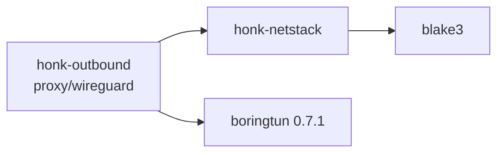

# Userspace network stack and WireGuard tunnel

`honk-netstack` is a sans-I/O IPv4/IPv6 TCP/UDP stack. `Mode::Endpoint` remains the default WireGuard client behavior. `Mode::Transparent` provides passive TCP, stateless UDP, bounded reassembly and ICMP generation. Core's explicit packet-endpoint embedding now consumes it; no daemon capture/backend configuration selects it, and no AF_XDP/TUN/native-continuation capability follows from this API. Unless stated otherwise, this page describes unchanged Endpoint behavior. Like the other userspace subsystems, this code is largely AI-authored and requires maintainer review.

The outbound-side behavior (registry, flows, failure provenance) is summarized from the stack's point of view below and specified in [Outbound design](./outbound.md#wireguard-tunnel). Node fields and share links are in the [node reference](../reference/nodes.md).

## Crate boundary

- `honk-netstack` depends only on `blake3` and `thiserror`, is `publish = false`, and forbids `unsafe`. Outbound, datapath and core depend on it; it knows nothing about nodes, Tokio or sockets. `smoltcp` is a pinned development-only baseline.
- It never reads a clock, an environment variable or a configuration file. The caller supplies `Instant`s, the interface addresses and MTU, a 32-byte private secret and the memory limits (`Config`). Defaults: MTU 1420, 4096 flows, 256 MiB memory, 8 MiB receive and 6 MiB send buffer per flow, `Mode::Endpoint`; the transparent-mode fields are listed under [Configuration and counters](#configuration-and-counters).
- `wire` is public (IPv4/IPv6/TCP/UDP/ICMP codecs and the checksum) because the integration tests build packets with it. Everything else is private.

## Programming model

The stack is driven by exactly one owner through `&mut Stack`. It has no locks or unbounded queues. TCP output obligations stay on the flow until pulled; bounded control replies and fragment queues have the limits described below. Packets are materialized only when the owner pulls them (the quinn-proto model).

| Call | Contract |
| --- | --- |
| `receive(now, packet) -> Rx` | Borrows one complete IP packet and verifies its checksums (`RxMeta::VERIFY`). Retained TCP bytes are copied into stack-owned rings. UDP returns `Rx::Datagram` (Endpoint) or `Rx::Transparent` (transparent mode): **the returned range is valid only until the caller reuses or recycles the input buffer**. `Rx::TransparentOwned` owns a reassembled packet. `Rx::Dropped(reason)` is counted. |
| `receive_with(now, packet, RxMeta) -> Rx` | Adds trusted TCP/UDP checksum provenance and/or GRO/USO metadata in transparent mode. Endpoint mode drops any metadata other than `RxMeta::VERIFY` as `Unsupported`; WireGuard cannot skip verification. See [Checksum trust](#checksum-trust) and [Segmentation offload](#segmentation-offload). |
| `poll_transmit(now, out) -> Option<usize>` | Writes one complete IP packet to `out[..n]`. A too-small `out` returns `None` without losing the packet. `None` also means nothing is currently allowed by cwnd, rwnd or pacing. |
| `poll_transmit_with(now, out, TxCaps) -> Option<Transmit>` | Same scheduler with optional TCP segmentation offload in transparent mode; returns `len`, `gso`, `csum` and the original known-TCP `flow` handle, or `None` for stateless/unknown-flow output. Endpoint mode ignores offload capabilities. `poll_transmit` is the plain-packet wrapper with `TxCaps::NONE` and discards metadata. |
| `poll_control_transmit(now, out)` | Shares the TCP emitter without TCP/UDP payload. Preserves ordinary readiness, DRR and payload TLP work while emitting eligible ACK/RST/SYN/FIN/probes, TIME_WAIT ACKs and ICMP. Reserve control frame/descriptor credit before calling. |
| `poll_timeout()` / `handle_timeout(now)` | Earliest flow or reassembly deadline; entries may be stale, so an early wakeup is legal. |
| `poll_event()` | Coalesced `Ready` bits (`CONNECTED`, `READABLE`, `WRITABLE`, `READ_CLOSED`, `ERROR`); a flow appears on the event list at most once. |
| `tcp_retained(id)` | True while the original TCP handle still owns application/protocol state, compact TIME_WAIT or a queued control response in this Stack. Does not include packets already returned to the driver. |
| `take_tx_wakeup()` | Set by `tcp_write`, `tcp_shutdown`, `tcp_close`, `tcp_abort`, `tcp_connect`, `tcp_accept`, `tcp_complete`, `tcp_refuse`, by a `tcp_read` that creates an ACK obligation and by a `udp_send_from` that leaves fragments queued. The caller must wake its owner when it returns true. |
| `tcp_*`, `udp_*` | `write(2)`-like semantics: `WouldBlock` instead of blocking, `Ok(0)` from `tcp_read` is EOF, terminal errors are sticky and returned after buffered data has been read. `FlowId` carries a generation, so a stale id returns `Stale` and never reaches a new occupant. |

Callers pass the same ingress timestamp to every `receive` of one receive batch (at most 64 packets) so RTT, RACK and autotuning do not measure processing delay.

### Output scheduling

`poll_transmit` serves five classes in rotation and remembers the rotation point across calls, so no class starves another:

1. **Control replies** to packets for unknown flows (RST). The queue holds 128 entries; when full the reply is dropped and counted (`control_dropped`), which is equivalent to link loss. In transparent mode the ICMP errors of refused SYNs share this queue.
2. **TIME_WAIT replies** (ACK of a retransmitted FIN or of old duplicate data), merged by bit per entry so none is lost.
3. **Ready TCP flows**, served by deficit round robin with a quantum of one MTU. Within a flow an ACK or retransmission goes before new data.
4. **Queued UDP fragments** of an oversized `udp_send_from` (transparent mode), in FIFO order.
5. **ICMP Time Exceeded** for timed-out reassemblies (transparent mode).

A flow's reply obligations are bits (`DATA`, `OOO`, `WINDOW_UPDATE`, `PROBE_RESPONSE`, `CHALLENGE`, `FIN_ACK`), not an inferred "`rcv_nxt` moved" test, because window updates, zero-window probe responses and challenge ACKs do not advance `rcv_nxt`. A caller that stops pulling therefore loses nothing; it is the back-pressure.

Control-only pulls use a separate, lazily allocated ready queue and class cursor; they cannot rotate ordinary readiness or consume its DRR credit. An adapter must also offer ordinary pulls for payload progress. The explicit core packet runtime alternates the first output class while reserving each class's frame and descriptor before pulling. Callers that never use control-only pulls, including WireGuard, allocate no control-only queue.

An unfunded RACK bookkeeping expansion defers only that flow: pending retransmission and its existing DRR credit survive, while other funded TCP flows and queued UDP fragments remain eligible. A too-small output buffer remains a distinct blocked-output result.

### Timers

Each flow exposes the minimum of its RTO/persist, delayed-ACK, tail-loss-probe, RACK reorder, pacing and close deadlines. A global min-heap holds at most one live entry per flow: a deadline is pushed only when it moves earlier. A later deadline reuses the old entry and is rechecked when popped. Calls that change a flow coalesce its heap refresh in a marked list (at most 64 distinct slots), flushed before processing timers or admitting another slot to a full list. `poll_timeout` also computes the marked flows' deadlines directly, so it cannot oversleep while refresh is deferred. When the heap exceeds twice the flow slab (at least 32 entries) it is rebuilt; the bound follows the slab because a rebuild walks every slot. TIME_WAIT expiry uses the same heap.

## Packet handling

- IPv4 headers with options are parsed; IPv6 extension headers (hop-by-hop, routing, destination options, at most eight) are skipped; a routing header with segments left is `Unsupported`. Jumbograms, ESP/AH and unknown protocols are `Unsupported`. IPv4 and IPv6 fragments are dropped (`Fragment`) after the header checksum in Endpoint mode: **there is no reassembly and no fragmentation**; transparent mode reassembles them and fragments large UDP replies (see [Reassembly](#reassembly)). Link padding past the IP length is ignored.
- Ordinary transmitted IPv4 packets have DF set, TTL/hop limit 64 and no options; transparent `udp_send_from`/`udp_send_gso_from` do not set DF, and IPv6 UDP fragmentation adds a Fragment header.
- In Endpoint mode a packet for an address that is not the configured local address of its family is `NotForUs`. A family without a local address cannot be used at all (`NoLocalAddress`). Transparent mode accepts any unicast destination instead (see [Scope and addressing](#scope-and-addressing)).
- Drop reasons are counted per reason in `StackStats`: `Malformed`, `Checksum`, `Fragment`, `NotForUs`, `NoFlow`, `Unsupported`, and in transparent mode `HalfOpen` and `Capacity`. (`Stale` is defined but never produced.)
- **Ordinary receive verifies checksums in both modes** (IPv4 header, TCP, UDP, ICMP) before changing flow state. IPv4 UDP checksum zero means none; IPv6 UDP zero is invalid on the verification path. Only transparent `receive_with` can trust the driver's TCP/UDP `Csum::Valid`/`Partial`; IPv4 headers, ICMP and reassembled datagrams are still verified. Endpoint mode rejects such metadata, so WireGuard always verifies its inner packets: it authenticates the tunnel peer, not the sender's inner checksum. Full transmit output copies the payload and then computes its checksum using native-endian accumulation lanes; offloaded output carries a partial checksum instead (see [Checksum trust](#checksum-trust)).
- **ICMP is consumed in both modes and emitted only in transparent mode.** A packet-too-big (RFC 1191/8201) or destination-unreachable message is honored only for a TCP flow of the message's own address family whose quoted sequence is inside the outstanding window; PTB lowers the flow's path MTU (never raises it) and makes every now-oversize segment sendable again, including one already retransmitted at the old size, unreachable on a `SYN_SENT` flow fails the connect with `Unreachable`. Legacy PTB without an MTU uses the RFC 1191 plateau table. ICMP echo and all other ICMP are ignored. In Endpoint mode the stack never generates ICMP; generation is described in [ICMP generation](#icmp-generation).
- **UDP in Endpoint mode** has no receive queue and no send queue. A datagram for an unbound port is `NoFlow` (no ICMP error). `udp_send` serializes directly into the caller's buffer as one IP packet; a datagram larger than the MTU is `TooLarge`. Transparent UDP is stateless and is described in [Transparent UDP](#transparent-udp).

## TCP

### Connection model

Endpoint mode is active open only: `tcp_connect` picks a source port with RFC 6056 algorithm 3 (a keyed hash of local/remote address and remote port plus a per-bucket counter, in 32768..65535), an ISN from a keyed hash (RFC 6528) plus a 4 µs clock, and a stable per-address-pair timestamp offset (RFC 6191). The secret is `Config::secret` (blake3 keyed hash). In Endpoint mode there is **no listen API**; a SYN for an unknown tuple gets an RST, simultaneous open is handled. Passive open exists only in transparent mode ([TCP admission](#tcp-admission)).

Every SYN offers MSS (MTU − 40/60), window scaling (the shift is chosen once from `tcp_rcv_buf_max`, up to 14), SACK-permitted and timestamps; each is used only if the peer echoes it. The peer MSS defaults to 536 (IPv4) or 1220 (IPv6) when absent and is raised to at least 48 (Linux `tcp_min_snd_mss`), so a hostile server cannot buy one packet per byte. Each wire data segment carries at most `min(peer MSS, PMTU − IP header − that segment's TCP header)`, computed per packet because timestamps plus SACK blocks can grow the header to 60 bytes; a TSO super-packet aggregates several such segments behind one header.

Validation: RFC 5961 (RST only at exactly `rcv_nxt`, otherwise a challenge ACK, SYN in a synchronized state answers a challenge ACK, challenge ACKs limited to one per flow per 100 ms), PAWS with a 24-day cutoff, acceptable-ACK window checks.

### Closing and lifecycle

- `tcp_shutdown` closes the write half only. `tcp_close` releases the application handle at once and lets the protocol finish (FIN after queued data); **closing with unread data, or while `SYN_RECEIVED`, sends RST** as Linux does. A flow that was closed from `FIN_WAIT_2` has a 60 s orphan timeout.
- TIME_WAIT is kept separate from the application handle. A flow stays on its slot (ring, ready bits) until the application has read everything and closed the handle and the last ACK has been sent; only then does it compact into a small table entry `{tuple, snd_nxt, rcv_nxt, ts_recent, expiry, ack_due}` that holds no chunks, for 60 s. A valid retransmitted FIN is answered with an ACK and restarts the timer; an old duplicate data segment is answered with an ACK only ([Close semantics](#close-semantics)). A new connection to the same tuple may reuse the entry only when RFC 6191 timestamp and sequence comparisons prove the peer can tell the incarnations apart; otherwise the port search continues (up to 32768 candidates, then `AddrInUse`). Which side keeps TIME_WAIT, and how a transparent SYN reopens a tuple, is in [Close semantics](#close-semantics).
- Terminal errors: `Reset`, `TimedOut` (six SYN retransmissions, fifteen consecutive RTO backoffs, fifteen zero-window probes in a row that no ACK answers, the orphan timeout, or, for accepted transparent flows with keepalive enabled, unanswered keepalive probes) and `Unreachable`. TCP keepalive is off unless `AcceptOpts::keepalive` sets it ([Keepalive](#keepalive)).

`tcp_state(id) == None` only describes application visibility, not retirement. The read-only `tcp_retained(id)` query uses the original handle across compaction and retains queued RST/ICMP refusals after their TCB disappears. A driver saves each returned `Transmit::flow` before checking retention, so a final packet cannot be reattributed to a reused tuple. A false query still requires the adapter to settle its device buffers, producers, tasks and scoped incarnation before releasing delivery state. Neither a `FlowId` from another Stack nor a CQ completion supplies that proof. An exhausted handle generation permanently removes its slot from reuse rather than wrapping.

### Receive side

- **SACK/DSACK.** Out-of-order data is written directly to its offset in the receive ring. A table of at most 32 ranges records what has arrived; a segment that would create a 33rd range is dropped and counted (`ooo_drops`). ACKs carry up to three SACK blocks with timestamps (four without), most recently changed block first and the rest rotated; the first block is a DSACK when duplicate data arrived. Without negotiated SACK, every out-of-order segment gets its own duplicate ACK.
- **ACK policy.** The first 16 segments after the start or an idle period of more than one RTO are acknowledged at once (quickack); afterwards an ACK is sent when two full-sized segments are unacknowledged, on out-of-order data or a gap fill, on window updates and FIN. Otherwise a 40 ms delayed-ACK timer runs. A window update is sent when a read reopens a zero window or advances the right edge by at least 2 MSS. A TCP GRO run advances this cadence by its represented frames but creates only a cumulative ACK obligation, not one replayed ACK per segment ([Segmentation offload](#segmentation-offload)).
- **Window autotuning (DRS).** Per measured receive RTT the target window becomes `2 × bytes read by the application + 16 × MSS`, never shrinking and capped at `tcp_rcv_buf_max`. Growth is committed from the memory pool before it is advertised (next section).

### Send side

- **Loss detection:** RACK-TLP (RFC 8985) for SACK peers: send-time ordered detection with a cursor over never-retransmitted descriptors and a lazy FIFO for retransmissions, adaptive reorder window from min RTT/4 that grows with reordering and decays, reorder timer, tail loss probe at about 2·SRTT (plus 200 ms for a lone segment). Peers without SACK use NewReno (RFC 6582). Loss of data sent during a recovery, still lost when the recovery ends, starts a new episode (Linux `tcp_time_to_recover`).
- **Reduction and undo:** PRR (RFC 6937, SSRB variant); spurious recoveries are undone by DSACK, timestamp echo (Eifel) or F-RTO.
- **RTO:** RFC 6298 estimator in microseconds with a 200 ms floor (a deliberate deviation shared with Linux), 120 s ceiling, 1 s initial value, exponential backoff that SYN retransmissions do not carry into the first data timeout. A timeout keeps SACKed data delivered and marks only the rest lost, unless the head itself is SACKed (reneging), which discards all SACK state; F-RTO therefore undoes only a timeout whose never-SACKed, never-retransmitted data was acknowledged, and falls back to ordinary recovery when no new data can go out. A zero window with data in flight still retransmits the head on timeout; persist probes run only when nothing is outstanding.
- **Congestion control:** CUBIC (RFC 9438) in fixed point — no floating point — with HyStart++ (RFC 9406). Initial window `min(10·MSS, max(2·MSS, 14600))`, restored (with HyStart++ state) when a flow resumes after a data-free RTO measured from its last data segment. The controller sits behind a `Cc` enum; a Reno variant exists only for reference tests.
- **Pacing:** token bucket at 2.0 × cwnd/SRTT in slow start and 1.2 × afterwards; ordinarily bursts of 10 segments, capped to 2 ms of traffic, always at least one segment. TSO can enlarge the segment count of the bucket, still subject to the 2 ms cap. The next release time is a flow deadline.
- **Scoreboard:** one descriptor per sent segment (end sequence, transmit time, SACKED/LOST/RETRANS flags, delivery-rate fields). `packets_out`, `sacked`, `lost` and `retrans` byte counters are maintained incrementally and checked against a from-scratch recount in debug builds. Delivery rate is sampled per ACK (draft-cheng-iccrg) with app-limited tracking and is reported in `TcpStats`.
- **Send buffer.** `tcp_write` copies into the send ring; accepted bytes belong to the stack until cumulatively ACKed (SACKed data is never freed, since the peer may renege). With `chunk = Config::chunk()`, the buffer limit follows the window: `min(max(2 × cwnd, 4 × chunk), clamped tcp_snd_buf_max)`, and `WRITABLE` is reported when at least `min(chunk, half the limit)` of room exists and the pool or tail has room. At Endpoint's default 16 KiB chunk these are the previous 64 KiB minimum and 16 KiB readiness threshold.

Zero-window handling (persist probes), window-update recovery and `snd_wl1/snd_wl2` window tracking follow RFC 9293. The probe interval doubles up to 120 s and resets only when the window opens; an ACK that keeps the window closed resets the retry count (unanswered probes still fail the flow after fifteen) but not the interval. Segments are accepted when they overlap the receive window, and nothing after a recorded FIN is accepted.

## Memory model

Payload storage is a pool of chunks organized in two rings per TCP flow (send, receive), plus the send descriptors. `Config::tcp_chunk` defaults to `None`: 16 KiB in Endpoint mode and 4 KiB in transparent mode. An explicit size is clamped to 4..=64 KiB; `Config::chunk()` reports the effective size.

- **Progress floor.** Every admitted TCP flow is entitled to one send chunk, one receive chunk and 16 descriptor slots whatever the global pressure. The floors are reserved up front: `floor_flows = min(max_flows, memory_limit / floor)` and the remaining `memory_limit − floors` is the shared pool. `tcp_connect` fails with `Memory` when no floor is left and with `FlowLimit` at `max_flows`; `max_flows` also counts UDP associations. The floor prevents the deadlock where a window that consumes the whole pool leaves `tcp_write` with no room while the peer waits for that very request.
- **Commitment.** Receive-window space beyond the floor is *committed* from the shared pool before it is advertised, while chunks are allocated lazily when data arrives. Therefore in-window data is not dropped for lack of memory. The highest advertised right edge is remembered and never withdrawn; window-scale rounding only rounds the wire value down and never above the commitment. The initial receive target is `min(65535, clamped tcp_rcv_buf_max)`, not one chunk: when shared space is available the advertised window commits more than the floor, even if the flow is idle and holds no resident payload chunks.
- **Honest accounting.** The budget is charged for chunk capacity (and descriptor storage), not for logical bytes. `StackStats.memory_committed` is floors in use plus shared TCP commitment; `memory_allocated` is the chunks and descriptor storage actually resident plus the pool's cached free chunks. The cache holds up to 64 chunks while any chunk is in use (a burst of writes and its ACK refills from it instead of the allocator) and a single spare once none is, so `memory_allocated` of an idle stack is one chunk at most. These gauges cover the TCP pool, not reassembly or queued UDP; `MemoryBudget::used()` also includes reassembly, queued timeout quotes and pending UDP datagram capacities when a shared budget is configured.
- **Idle flows.** The floors are accounting guarantees, not resident memory. A ring that becomes empty (receive ring fully read with nothing out of order, send ring fully acknowledged) gives every chunk back to the pool, and the descriptor storage (floor included) is released when nothing is in flight; the next write or segment allocates again from the pool's cache, so the floor can never fail to materialize. The out-of-order range table, the chunk-list stubs and the timer heap likewise shrink when empty or sparse. An idle established flow retains its `Tcb` (size-asserted at most 1 KiB), slab slot, flow-table bucket, timer entry and chunk-list stubs. `tests/idle_footprint.rs` counts allocator-rounded heap over 1000 established flows after repeated request/response exchanges and requires at most one shared cached chunk and 1.5 KiB per flow. A compact TIME_WAIT entry holds no chunk.
- **Process-shared budget.** `Config::shared_budget` (`Option<Arc<MemoryBudget>>`, `MemoryBudget::new(limit_bytes)`, `limit()`, `used()`) lets several stacks draw from one limit on top of their own `memory_limit`. Floors are charged at admission (`tcp_connect` returns `Memory` when the budget cannot fund one) and again for every shared chunk or descriptor commitment, on the same paths that charge the stack's pool; a retired flow refunds its floor, and dropping a `Stack` refunds all it still holds. A flow admitted under the budget keeps its floor, so it progresses even when the budget is exhausted. The budget is lock-free (one atomic update per chunk-sized charge) and does no I/O.
- Per-flow buffer maxima are clamped to between one chunk and 1 GiB so sequence arithmetic stays modular-safe.

### Accounted construction and retained packets

`Stack::new_accounted(cfg, now, max_slots)` requires `cfg.shared_budget` and reserves a conservative capacity bound before construction. Missing budget, overflow and insufficient capacity are distinct `ConstructionError`s. `max_slots` includes live, free, TIME_WAIT and exhausted slots; it does not permit failed admission to discard an old tombstone. `set_accepting(false)` closes only new passive admission, including SYNs emerging from reassembly, while existing flows and protocol output continue.

`overhead_reserved()` is reserved capacity, not measured resident bytes or RSS. It funds metadata, collection growth/rehash peaks and retained cache/scratch capacity; dynamic payload, ring-index and RACK commitments use the same budget. Accounted scopes need room for this reserve **and** admitted payload commitments; ordinary `Stack::new` and WireGuard defaults are unchanged.

`MemoryBudget::reserve` returns a non-cloneable `MemoryReservation`. Completed/atomic reassembly reserves destination storage while source storage is still charged; `OwnedPacket` keeps bytes and their charge together through consumer release, even after Stack drop. Capacity refusal drops that datagram, not an established flow's ownership evidence. Borrowed UDP ranges still require consumption/copy before input recycling.

## Core packet-endpoint embedding

`honk-datapath` supplies nonwrapping `ScopeId` and a fixed frame/descriptor ledger; it grants no capture or routing authority. `control::netstack::PacketScope` owns one accounted Stack, one mutex, bounded frames/waiters and an externally joined timer owner. Output leases retain original TCP `FlowId`, bytes and credit until actual consumer release. Local release is not a NIC CQ, and a CQ address has no fabricated generation. Control and bulk reserves are separate.

`control::packet_endpoint::PacketEndpoints` consumes an unstarted control plane and explicit scopes sharing one budget. Its supervisor joins scope, TCP, UDP and retirement work; cancelling a shutdown waiter does not cancel admitted cleanup. TCP uses the existing routing/dial/Score path with copy relay, not kernel adoption or splice. UDP reuses the one endpoint/source pool and captured packet reply sender, with no reply FD. Endpoint/source/foreign-reply/sniffer keys include scope; packet retirement cannot mutate coincident kernel state. DNS still follows traffic policy before controller admission, and must/Block remain final.

Startup opens scope admission before reporting readiness and native `Running`; a startup error waits for supervisor cleanup before returning. Shutdown keeps the first UDP drain result, so forced cancellation is not reported as graceful success. A five-second cleanup warning does not release ownership or impose a hard completion deadline. Entry metadata remains charged through exact retirement, and task allocation/buffer credit through join; completed UDP tasks are reaped before charging the next ingress copy. Health callbacks observe the UDP pool without extending its lifetime.

A connection-task panic terminates only that TCP flow, not other packet service. TCP task admission reaps completed work and explicitly resets a genuinely refused flow. Periodic UDP maintenance also returns joined task credit during idle periods. Closing ingress waits for already-reserved producer permits and disposes their late messages before joining scope owners; receiver closure alone is not proof that no `FlowIo` can still arrive.

Readiness commits atomically against cancellation; a close that wins before that commit cannot activate native `Running`, and scope gates cannot reopen after close. The task registry funds the elastic admission ceiling, not only its initial floor. An abnormal registry drop transfers its children and reservations to a pre-funded reaper on their owning runtime; even a blocking destructor or a panicking error payload cannot release another live task's credit early. The embedding must keep that runtime alive through cleanup.

Packet TCP write shutdown waits for handshake completion instead of turning temporary `WouldBlock` into reset. Flush remains a local no-op, not an ACK/delivery promise, but explicit scope abort makes it fail. Raw/non-DNS UDP/53 endpoint identity includes the initial outbound/mark and finality: a changed decision cannot reuse the old transport, while non-final fallback still permits configured sniffing. Valid non-must DNS continues through the controller; must remains raw and fixed.

The supplied budget accounts packet storage/reservations, not whole-process RSS or every pre-existing outbound runtime allocation. Kernel socket buffers remain separate. This embedding is an explicit Endpoint path, **not** native forwarding, capture metadata validation, a production backend publication gate or a performance result.

## Transparent termination

`Config::mode = Mode::Transparent { exclude }` makes the stack the TCP/UDP endpoint of the client's destination. Packet scripts, simulation, fuzzing and the core embedding exercise it; the daemon still has no transparent capture backend. WireGuard continues to use default `Mode::Endpoint`. The same memory, congestion, recovery and single-owner rules apply. No transparent-mode performance gate or throughput number is claimed.

### Scope and addressing

- A flow's local end is the packet's original destination, so every reply (SYN-ACK, data, RST, ICMP error, UDP) is sourced from it. Incoming packets are not matched against `local_v4`/`local_v6`, and the stack raises the MTU to at least 1280.
- `ExcludeSet` (`insert(addr, prefix_len)`) lists destination prefixes the stack refuses as `NotForUs`. It is a backstop only: the classifier/capture backend in front of the driver is the real gate, and a packet dropped here is a black hole for that client.
- Multicast, limited broadcast and unspecified destinations (the tun device's own router solicitation, MLD and DAD) are dropped silently as `Unsupported`.
- IPv4-mapped IPv6 source or destination addresses are not valid transparent wire endpoints. They are rejected as `Unsupported` before reassembly admission as well as on complete packets, so they cannot evict valid fragment state.
- A SYN whose source is not unicast, whose source and destination addresses are equal, or whose port is 0 opens no flow and is answered like any stray segment (RST).

### TCP admission

A plain SYN for an unknown tuple creates a pending flow in `SYN_RECEIVED` and sends nothing; while the flow is undecided or deferred it ignores all input, so retransmitted SYNs are absorbed without a second flow or a second report. The pending flow holds its memory floor but has committed no receive window yet; the window is committed by `tcp_accept`.

| Call | Contract |
| --- | --- |
| `poll_accept() -> Option<SynInfo>` | Reports each new flow once: `id`, `client`, `original_dst`, the client's `mss` (536 or 1220 when absent, at least 48), `wscale`, `sack`, `timestamps`. |
| `tcp_accept(id, AcceptOpts)` | `when: AcceptWhen::Now` queues the SYN-ACK; `AcceptWhen::Deferred { deadline }` holds it until `tcp_complete` (after an upstream dial); if `deadline` passes first the flow fails with `TimedOut` and sends nothing. `max_mss` clamps the MSS in both directions (floor 48); use the client's real egress MTU, the tun MTU says nothing about it. `keepalive` arms [Keepalive](#keepalive). Defaults (`AcceptOpts::default()`): `Now`, no clamp, no keepalive. Returns the flow's error if it already died (for example `TimedOut`), `Closed` if it was already decided, `Stale` for an old handle. |
| `tcp_complete(id)` | Releases the SYN-ACK of a deferred flow. `Closed` if the flow is not held. |
| `tcp_refuse(id, Refuse)` | Only before `poll_transmit` actually emits the passive SYN-ACK, including after `tcp_accept(Now)` or `tcp_complete` and after a blocked short-buffer pull (ignored after emission and for active opens; use `tcp_abort`). Forgets the flow and releases the handle. `Refuse::Rst` answers RST\|ACK, `Drop` answers nothing, `IcmpUnreachable` host unreachable, `IcmpAdminProhibited` administratively prohibited (see [ICMP generation](#icmp-generation)). RST and ICMP replies travel through the 128-entry control queue. |

`MAX_DEFERRED` is 25 s, chosen so that the stack gives up before the edge classifier's own 30 s handoff expires. A SYN that `poll_accept` never reported is forgotten silently 25 s after it arrived (the client retries); a reported or deferred flow that nobody has accepted or completed by its deadline (never later than 25 s after the SYN) fails with `TimedOut` without sending anything, surfaces `ERROR`, and the application must still close its handle.

Admission limits:

- **Half-open caps.** A flow is half-open from the SYN until the handshake completes or the flow dies. `Config::half_open_max` (default 1024) bounds them in total and `Config::half_open_per_source` (default 128) per client address. A SYN beyond a cap is dropped and counted (`DropReason::HalfOpen`): never answered with RST or ICMP, and there are no SYN cookies. Because every pending flow already holds a floor, the caps also bound the memory a SYN flood can pin.
- **Flow and memory limits.** A SYN that the flow table (`max_flows`), the floor cap or the memory floor and shared budget cannot admit is dropped and counted (`DropReason::Capacity`), not answered. The client retries.

### Close semantics

- The side that closes first (active close, simultaneous close included) goes through `FIN_WAIT_1`/`FIN_WAIT_2`/`CLOSING` into TIME_WAIT and keeps a compact tombstone for 60 s (RFC 9293). The side that closes second goes `LAST_ACK` to `CLOSED` and keeps nothing. Because the first closer always keeps TIME_WAIT, a server-side TIME_WAIT is never skipped.
- A tombstone answers a valid retransmitted FIN with an ACK and restarts its 60 s timer. A data segment lying wholly before the consumed FIN (ACK set, PSH allowed, no SYN/RST/FIN, ACK number and timestamp passing the same checks as the FIN) can be the peer retransmitting its unacknowledged tail after our final ACK was lost: it earns one coalesced ACK, which lets the peer leave `CLOSING`. Receiving that data does not reset the expiry or update `ts_recent`. The existing pending-output rule still applies: if an ACK has not been drained when expiry is processed, the timer re-arms for 60 s rather than discarding that output, so the driver must keep pulling. Everything else is ignored. A new SYN for the tuple replaces the tombstone only when the RFC 6191 check passes: its timestamp is newer than the last one seen, or, without usable timestamps, its sequence number lies beyond the old `rcv_nxt`; a SYN with an older timestamp is treated as a stray duplicate and ignored. The new flow's ISS is forced beyond the old `snd_nxt`.
- **Driver contract.** The entry lives inside the stack for at least 60 s after the last FIN exchange. For that long the driver must keep delivering packets of that tuple to `receive`: any delivery state in front of the stack (an eBPF redirect entry, a flow table) must outlive the flow, otherwise the client's retransmitted FIN reaches the real server instead of the tombstone and is answered with RST. `StackStats::timewait_entries` counts live tombstones.

### Transparent UDP

- `receive` returns `Rx::Transparent { src, dst, payload }` for a datagram: no flow, no bind, both addresses present. `payload` is a range of the input packet.
- `Rx::TransparentOwned { src, dst, packet, payload }` is the same for a datagram reassembled from fragments: the result owns `packet` and `payload` indexes it.
- `receive_with` returns `Rx::TransparentSplit { src, dst, payload, size }` for a UDP super-packet containing more than one datagram. Iterate `packet[payload].chunks(usize::from(size))`: each chunk is one datagram, the last may be shorter, and the boundaries must be preserved. At most 128 datagrams are accepted (`MAX_USO_RX`); exceeding that is `Malformed`. A run with at most one datagram returns `Rx::Transparent` instead.
- **Borrowed-payload lifetime.** The ranges of `Rx::Datagram`, `Rx::Transparent` and `Rx::TransparentSplit` are only valid until the caller recycles or reuses the input buffer. A driver whose input buffer is a TUN read buffer (or, later, an AF_XDP UMEM frame returned to the fill ring) must consume or copy every payload before it releases the buffer. `TransparentOwned` has no such limit.
- `udp_send_from(src, dst, payload, out)` is stateless and may use any source address (a reply comes from the datagram's original destination). A datagram that fits the MTU is written to `out` as one packet (no DF, identification set). A larger one, up to 65535 bytes of UDP length (IPv4 total length too; beyond that `TooLarge`), is fragmented: the first fragment is written to `out`, the rest is stack state (the checksummed datagram, copied once) and leaves through `poll_transmit`, one fragment per call in FIFO order; `take_tx_wakeup()` is set while fragments are pending. The pending datagram capacities are bounded at 512 KiB and charged to `Config::shared_budget`, including the first queued datagram. A send that would exceed either limit returns `Busy` before writing its first fragment. The capacity stays charged across short output buffers until the last fragment is emitted or the stack is dropped; a too-small initial `out` returns `BufferTooSmall` without a charge. Mixed address families are `FamilyMismatch`.
- `udp_send_gso_from((src, dst), payload, size, caps, out)` sends a run of datagrams with UDP segmentation offload, not IP fragmentation. It returns `Transmit`; its limits and the driver contract are in [Segmentation offload](#segmentation-offload).
- `udp_refuse(now, UdpRefuse, original, out)` answers a refused datagram with ICMP (`PortUnreachable`, `HostUnreachable`, `AdminProhibited`); `original` is the datagram's IP packet. `Ok(None)` means the error was suppressed or rate limited.

### Reassembly

Transparent mode reassembles IPv4 and IPv6 fragments of any protocol; Endpoint mode still drops them. Destination exclusions and special-address checks apply before any fragment acquires an entry or budget, so excluded fragments cannot produce timeout replies. The completed datagram re-enters the normal receive path, so the destination filter and checksums apply to it too. A completed IPv6 datagram that still contains a Fragment header, including behind other extension headers, is dropped as `Fragment`, never reassembled again.

- `FragmentLimits` (`Config::fragment_limits`) defaults: `max_entries` 64, `max_bytes` 4 MiB (retained capacities of payload storage, fragment 0's saved headers, the range table and queued timeout quotes, plus 256 B of fixed bookkeeping per datagram), `max_holes` 32, `timeout` 30 s counted from a datagram's first fragment.
- An overlapping fragment (an exact duplicate too) kills the datagram (RFC 5722, RFC 8200 section 4.5): the buffer is freed at once and a bufferless tombstone absorbs the remaining fragments (`Fragment`) until the timeout. More than `max_holes` gaps, or inconsistent lengths, kill it as well. Empty fragments, a non-final fragment whose length is not a multiple of 8 and a datagram beyond 64 KiB are `Malformed`. An atomic fragment is delivered as a whole datagram (RFC 6946).
- When the table or `max_bytes` is exhausted the oldest datagram is evicted silently, so a flood of first fragments cannot starve a burst that completes.
- A timeout answers with ICMP Time Exceeded (IPv4 type 11 code 1, IPv6 type 3 code 1) only if fragment 0 arrived; the quote is the saved headers plus up to 8 bytes, truncated before queueing to 548 bytes (IPv4) or 1232 bytes (IPv6). At most 16 such errors wait for `poll_transmit`; `poll_timeout` and `handle_timeout` cover the reassembly deadlines.
- **Shared budget.** Reassembly bytes are charged to `Config::shared_budget` (not to the stack's own `memory_limit`; without a budget only `FragmentLimits` bound them). A refused charge evicts the oldest datagram and retries; when nothing is left to evict the fragment is dropped, as `DropReason::Capacity` if it would start a datagram, or by killing the datagram (`Fragment`) if it is the only one left and cannot grow. Completion, eviction, kill and stack drop refund storage; expiry transfers the retained quote's actual capacity charge to the pending queue until it is sent, suppressed, rate limited or dropped. A short output buffer keeps that charge. A fragment flood can therefore occupy up to `FragmentLimits::max_bytes` of the shared budget, and new flows are admitted against the same budget: size it with that headroom, or SYNs are dropped as `Capacity` during the flood.

### ICMP generation

Errors are generated only by transparent-mode paths: `Refuse::IcmpUnreachable`/`IcmpAdminProhibited`, `udp_refuse`, `packet_too_big(now, mtu, original, out)` and reassembly timeout. The stack never generates ICMP on its own in Endpoint mode. (`udp_refuse` and `packet_too_big` do not check the mode; they exist for the transparent driver.) An error is sourced from the original destination and sent to the original source.

| Reject | IPv4 (type/code) | IPv6 (type/code) |
| --- | --- | --- |
| `UdpRefuse::PortUnreachable` | 3/3 | 1/4 |
| host unreachable (`Refuse::IcmpUnreachable`, `UdpRefuse::HostUnreachable`) | 3/1 | 1/3 |
| administratively prohibited (`Refuse::IcmpAdminProhibited`, `UdpRefuse::AdminProhibited`) | 3/13 | 1/1 (RFC 4443 section 3.1) |
| reassembly timeout | 11/1 | 3/1 |
| `packet_too_big` | 3/4 (MTU in the low 16 bits, capped at 65535) | 2/0 |

- **Suppression** (no error, no rate-limit charge): the original is a non-first fragment, its source or destination is unspecified, multicast or broadcast, it is itself an ICMP error (IPv4 types 3, 4, 5, 11, 12 and above 18; IPv6 types below 128) or an ICMP packet with no type byte, or the quote cannot be parsed. IPv6 inspection continues through extension headers after the first Fragment header; another Fragment header or truncation before the upper-layer protocol/type can be inspected suppresses the error too.
- **Size.** The whole error stays within 576 bytes (IPv4) or 1280 bytes (IPv6); the quote of the original is truncated to fit.
- **Rate limits** (`IcmpLimits`, Linux-style): a global bucket of `per_sec` 1000 messages per second with `burst` 50, and a per-target bucket keyed by the original source address of one message per `target_interval` (1 s) with `target_burst` 6 intervals of burst, remembering `max_targets` 128 targets (least recently used replaced). Both must agree before either is charged. Packet-too-big is exempt, as on Linux.
- A too-small output buffer leaves every limiter untouched so the call can be retried.

### Keepalive

`Keepalive { idle, interval, probes }` is set per flow through `AcceptOpts::keepalive` and is off by default; active-open flows have no API for it. It arms when the handshake completes. Every accepted segment from the peer restarts the idle period and the probe count. After `idle` of silence the stack sends an empty ACK at `snd_una - 1` every `interval`; when `probes` (at least 1) probes in a row go unanswered, one `interval` after the last, the flow fails with `TimedOut`. It is disarmed in `SYN_RECEIVED`, `TIME_WAIT` and `CLOSED` and by failure or abort.

### Checksum trust

`receive(now, packet)` is the verification-only entry point in every mode, equivalent to `receive_with(now, packet, RxMeta::VERIFY)`. `receive_with` accepts `RxMeta { csum, gso }` from a driver that owns a local device only in `Mode::Transparent`. In `Mode::Endpoint`, any metadata other than `RxMeta::VERIFY` is dropped as `Unsupported` before processing the packet: WireGuard cannot select a trusted checksum or a super-packet, because its inner packets come from the network.

- `Csum::Verify` verifies the TCP/UDP checksum normally. `Csum::Valid` trusts that the device already verified it. `Csum::Partial { start, offset }` accepts a local `CHECKSUM_PARTIAL` packet whose field contains only the pseudo-header sum, so there is no final checksum to verify; `start` must be the L4 header offset and `offset` must identify its checksum field (TCP 16, UDP 6), otherwise the packet is `Malformed`.
- The IPv4 header checksum and every ICMP checksum are always verified. Fragment metadata does not vouch for the reassembled datagram: completion re-enters receive with `RxMeta::VERIFY`. GSO metadata on a fragment or an ICMP packet is `Malformed`.
- `gso: Some(GsoRx { kind, size })` describes one header followed by `size`-byte payload segments (last possibly shorter). `size` must be nonzero and `GsoKind::Tcp`/`UdpL4` must match the packet's protocol, otherwise it is `Malformed`.

### Segmentation offload

- **TCP RX (GRO).** `receive_with` ingests a TCP super-packet as one contiguous segment. The delayed-ACK and quickack cadence counts `ceil(accepted_payload_len / size)` represented frames; it does not replay the header as separate TCP inputs. The run creates one cumulative ACK obligation, subject to normal ACK timing, not a train of duplicate ACKs that could trigger spurious loss recovery. UDP RX instead exposes the datagram boundaries through `Rx::TransparentSplit` ([Transparent UDP](#transparent-udp)).
- **TCP TX (TSO).** `poll_transmit_with(now, out, TxCaps { tso4, tso6, uso4, uso6 })` uses the family-specific `tso4`/`tso6` capability only in transparent mode. TCP data may leave as a `GsoKind::Tcp` super-packet of MSS/PMTU-sized segments, last possibly shorter. The current emitter caps the aggregate at 65535 bytes including headers and at `out.len()`; congestion and receive windows, descriptor space, pacing tokens and roughly 1 ms of pacing-rate autosizing bound it further. The pacing burst remains capped to 2 ms of traffic (at least one segment). Each represented segment keeps its own send descriptor; a run of lost segments can be retransmitted as one TSO packet. Small output buffers degrade to ordinary packets; SYNs, ACK-only packets, controls, TIME_WAIT replies, ICMP and queued UDP IP fragments remain ordinary packets. Endpoint mode ignores all `TxCaps`; `TxCaps::NONE` (also the default) gives the same output as `poll_transmit`.
- **UDP TX (USO).** `udp_send_gso_from((src, dst), payload, size, caps, out)` treats `payload` as concatenated datagrams, using the family's `uso4`/`uso6` capability in transparent mode. At most 64 datagrams (`MAX_USO_TX`) fit a super-packet; each `size`-byte datagram plus IP/UDP headers must fit the MTU, and the aggregate UDP length (IPv4 total length too) must fit 65535. A zero size or an exceeded size/count limit is `TooLarge`; mixed address families are `FamilyMismatch`; a multi-datagram run without transparent mode or the capability is `Offload`. A payload of at most `size` bytes uses ordinary `udp_send_from` even without the capability, including its fragmentation and wakeup behavior. The whole super-packet is written directly to `out`, not queued; a too-small buffer is `BufferTooSmall`, and errors consume nothing.
- **TX descriptor and driver contract.** `Transmit { len, gso, csum, flow }` describes `out[..len]`; `flow` has the Stack-local lifetime meaning above. Ordinary packets have `gso: None` and `TxCsum::Full`. An offloaded packet has `GsoTx { kind, size, hdr_len }` (IP plus L4 header length) and `TxCsum::Partial { start, offset }`: the checksum field holds the non-complemented pseudo-header sum over the whole super-packet's L4 length. The driver must hand this metadata to a capable kernel/device, which segments the packet and completes the per-segment headers/checksums; it must not transmit the aggregate as an ordinary wire packet. `TUN_F_TSO_ECN` is not supported. No TUN or AF_XDP driver implementing that contract exists yet.

### Memory and chunk size

`Config::tcp_chunk: Option<usize>` selects the TCP pool's chunk size. `None` means 16 KiB in `Mode::Endpoint` and 4 KiB in `Mode::Transparent`; explicit values are clamped to 4096..=65536 bytes by `Config::chunk()`. The floor is `2 × chunk + 16 × size_of::<Descriptor>()` (about 33 KiB at Endpoint's default, about 9 KiB at the transparent default). Chunk-sized commitment, the never-retreating advertised right edge and idle release otherwise follow [Memory model](#memory-model).

**The floor is not total idle commitment.** A SYN-only pending flow reserves just its floor; `tcp_accept`, including a deferred accept, then commits its initial receive window. The target starts at `min(65535, clamped tcp_rcv_buf_max)` and is funded, up to available shared space, in whole chunks beyond the floor's RX chunk. For example a 1 MiB receive-buffer maximum still starts with a 65535-byte target, not a 4 KiB target. An accepted idle flow can therefore retain substantially more budget commitment than its roughly 9 KiB admission floor while owning no resident payload chunks. Do not size a process budget or promise a flow count by dividing it by the floor alone: allow for receive-window commitments, TX/descriptors and reassembly, and inspect `StackStats` and `MemoryBudget::used()`.

### Configuration and counters

| `Config` field | Default | Meaning |
| --- | --- | --- |
| `mode` | `Mode::Endpoint` | Whom the stack answers for. |
| `half_open_max` | 1024 | Transparent: half-open flows in total. |
| `half_open_per_source` | 128 | Transparent: half-open flows per client address. |
| `icmp_limits` | `IcmpLimits::default()` | Transparent: ICMP generation limits. |
| `fragment_limits` | `FragmentLimits::default()` | Transparent: reassembly limits. |
| `shared_budget` | `None` | All modes; transparent reassembly is charged to it as well. |
| `tcp_chunk` | `None` | Both modes: 16 KiB Endpoint / 4 KiB transparent by default; explicit 4..=64 KiB; `Config::chunk()` reports the effective size. |

`StackStats` carries `drops` (per `DropReason`, now including `HalfOpen` and `Capacity`), `half_open` (flows between SYN and the end of the handshake), `timewait_entries`, `control_dropped`, `rx_packets`, `tx_packets`, `flows`, `memory_committed` and `memory_allocated`. RX/TX packet counters count supplied/emitted packets, including one for a super-packet, not its represented wire segments. The reassembly and ICMP counters are internal and not exported.

## Not implemented yet

Everything below is absent from `crates/honk-netstack/src` or from the repository today; the list is the boundary of this page's claims.

- The drivers: a TUN driver (`honk-tun`) and an AF_XDP driver (`honk-xsk`). No crate by those names exists.
- The eBPF/TC side: the classifier delivery bit, steering of flows to the stack, the delivery state that must outlive TIME_WAIT ([Close semantics](#close-semantics)), and proxying of non-first fragments at the TC layer.
- ICMP proxying: relaying echo or errors between the client and a real upstream. The stack only consumes ICMP for outstanding TCP sequences and generates the errors listed above.
- Any performance gate or measured number for transparent mode.

## Driver contract (WireGuard)

The driver lives in `honk-outbound/src/proxy/wireguard/`; [Outbound design](./outbound.md#wireguard-tunnel) is the specification and this is the part that constrains the stack.

- **Ownership.** One `Mutex<Inner { Stack, Tunn, .. }>` per tunnel. Application flows (`FlowIo` for TCP, `WgUdpTransport` for UDP) lock it directly for `tcp_read`/`tcp_write`/`udp_send`; the single owner task does everything else (outer receive, decryption, `receive`, `poll_transmit`, encryption, outer send, timers). After every application call `take_tx_wakeup()` decides whether the owner is notified through `Notify`, which stores a permit, so a notification sent before the owner waits is not lost. A reader that finds no data registers its waker under the same lock the owner holds when publishing readiness, so a wake-up cannot be lost in between.
- **Batching.** The owner holds the lock for at most 64 packets per pass in either direction, taking one `Instant` per lock hold (per ≤64-packet chunk of a received batch) for all `receive` calls in it; it pulls at most 64 packets per transmit pass and encrypts them into one buffer holding up to 256 datagrams. The outer socket uses `recvmmsg` with GRO and sends GSO runs of equal-size ciphertexts.
- **Copies.** A full-sized segment is copied three times on each path (application ↔ ring, ring ↔ plaintext buffer, boringtun's own `src → dst`). Steady-state operation allocates nothing per packet (`tests/alloc_free.rs` counts allocations over bulk send and receive); scratch, output and receive buffers are reused. A flow whose flight fully drains releases its descriptor storage, so the next burst regrows it with a few allocations per burst, not per packet.
- **Registry and idle teardown.** A tunnel registry keeps exactly one live tunnel per (our private key, peer public key, endpoint host, endpoint port) because two sessions with the same keys to the same peer invalidate each other's handshakes; key pairs shared across different endpoints get separate tunnels. The registry belongs to one control plane's runtime generations (reload successors, DNS forks and cold probes inherit it), so two planes in a process never share or close each other's tunnels; dials with no runtime use a separate process-wide registry nothing closes. A runtime with identical tunnel settings shares the live tunnel; different settings for the same key and endpoint replace it and close its flows with `RuntimeClosed` (not a node failure). The owner task belongs to the registry, not to a node's task owner, and ends on failure, replacement, the plane's `shutdown_wireguard_tunnels` (its terminal teardown joins it), immediately when the last runtime using it closes with nothing left that can carry data, or after 120 s with no flow and no warm owner. Warm retention holds the tunnel (counted, so re-installing the same tunnel keeps the pin); the last release drops the hold without cutting flows. The process memory share is divided into fixed per-tunnel slices with a cap on live tunnels (see Scale).
- **DNS-fork sharing (deviation).** DNS-fork runtimes normally own fresh protocol state. For WireGuard they share the business runtime's tunnel (the plane's registry) because a second session would knock it over. A runtime closing fails only the flows it opened (`RuntimeClosed`).
- **Reserved bytes.** WARP-style reserved bytes are written into bytes 1–3 of every outgoing datagram after encryption and zeroed on every incoming datagram before decryption; the Noise MACs never cover them.
- **Allowed IPs (single peer).** A dial or UDP association to a target outside `wg_allowed_ips` (or in a family without a tunnel address) is refused before any packet is sent; a later UDP send to another disallowed destination is a `Policy` rejection; an inbound inner packet whose source is outside them is dropped before the stack sees it. The list is aggregated into sorted disjoint networks and binary-searched. The target is always the numeric address; a target domain is never resolved remotely. Allowed IPs are not used to choose between peers, because there is exactly one.
- **Endpoint.** Every resolved address is a candidate (families alternate; a dual-stack IPv6 socket carries IPv4 peers mapped). Before a session exists the initiation is resent after 1 s and 2 s (a deliberate deviation from boringtun's first retry at 5 s, so a single lost datagram does not fail a 3 s dial), each time to the next candidate, then boringtun's 5 s cadence continues. A handshake attempt that timed out makes the next acquire re-resolve the name. An authenticated datagram from a new source address moves the outer endpoint (roaming); a cookie reply is not authentication.
- **UDP.** One stack socket per prepared source serves every destination (a `MultiTargetTransport`); received datagrams are copied into a bounded queue of 256 datagrams and overflow is dropped like a socket buffer. A confirmed send resolves only after the owner has handed the datagram to the socket.
- **Error provenance.** An inner RST or ICMP unreachable in answer to a SYN, and and a target outside the allowed IPs or in a family without a tunnel address (TCP dial or UDP association open, refused before any handshake), are target failures. A SYN that times out is a target failure only if the peer delivered other inner packets during the dial; otherwise it stays an untyped timeout that Score treats node-conservatively. A waiter whose handshake budget runs out gets a node failure shared by the waiters of the same attempt, without failing the tunnel; boringtun session expiry while flows exist and any unexpected end of the owner task fail the tunnel once for every waiter (one shared node-failure episode). Datagrams that fail authentication are dropped silently (no failure threshold: the source address is spoofable). Local exhaustion (`FlowLimit`, `Memory`, `AddrInUse`) is a `Capacity` rejection. A tunnel closed by its owner (runtime close, replaced settings, process shutdown) fails flows with `RuntimeClosed`, which is not a node failure. Handlers report no Score or health themselves.

## Validation

- Unit tests sit beside the code in `honk-netstack/src/`. `tests/tcp_receive.rs`, `tcp_send.rs` and `tcp_recovery.rs` are deterministic packet scripts that drive only the public API against a scripted peer and compare exact output segments.
- `tests/sim/` is a deterministic link simulator (seeded delay, iid and Gilbert-Elliott loss, reordering, duplication, rate limiting and drop-tail queues) connecting honk to honk or to a pinned smoltcp 0.14.0. `sim_honk.rs` checks exactly-once in-order delivery and completion through 1% loss, IPv6 and many flows, a one-packet pull budget delivering the same streams as an unlimited one, undo of reordering-induced spurious recoveries, and repair of a peer with neither SACK nor reassembly; `sim_baseline.rs` characterizes smoltcp and tests the simulator itself (including pull-budget resume). The scoreboard is recounted in debug builds after every mutation (counters, descriptor order, cursors and the remembered SACK runs), and `Tcb::check` ties it to `snd_una`/`snd_nxt` after every call. Two `#[ignore]` grids print comparison tables (`cargo test -p honk-netstack --test sim_honk -- --ignored --nocapture`).
- Transparent mode: `tests/transparent_tcp.rs` is the packet-script suite (admission, deferred accept and its 25 s expiry, retransmitted SYNs, refusals and their ICMP codes, half-open and capacity drops, MSS clamp, keepalive, active against passive close, a late FIN at the tombstone, RFC 6191 reopen, scope and exclusion, UDP and fragments). `tests/sim_transparent.rs` runs honk and smoltcp clients against a honk terminator (`tests/sim/honk_server.rs`) in virtual time through loss, IPv6, many flows and SYN retransmissions during a deferred accept. `tests/sim_termination.rs` adds the honk-to-honk end-to-end cases: the close-order matrix, a late FIN at the tombstone, and many flows and soak runs under a small shared budget; the transparent simulator tests assert that every flow, tombstone, half-open and memory charge returns to zero. `benches/stack.rs` transparent cases report per-packet cost beside the endpoint ones.
- Offload: `tests/offload_rx.rs` covers checksum provenance, Endpoint isolation, TCP GRO ACK cadence/OOO/SACK/PAWS and UDP splitting; `offload_tx.rs` checks TSO/USO segmentation and partial checksums against an independent kernel model, window/pacing/descriptor bounds, retransmission and plain-output equivalence; `offload_memory.rs` covers per-mode chunks, floors, commitment and idle release; `offload_e2e.rs` connects the TX and RX offload paths with and without loss. `benches/stack.rs` has an `OFFLOAD` switch (false by default) for transparent TCP GRO/TSO; its throughput units still count represented wire segments, not super-packets. These are in-process tests and microbenchmarks, not device or lab evidence.
- `honk-outbound/src/proxy/wireguard/tests/` runs the driver against an independent in-process peer (a boringtun `Tunn` on loopback UDP with a smoltcp interface behind it).
- `fuzz/` holds three libFuzzer targets, `netstack_packet` (arbitrary bytes, optionally with repaired lengths and checksums, into `receive` on a stack with flows in seven states), `netstack_schedule` (a byte-decoded sequence of crafted peer segments, application calls, time steps, pull budgets 0/1/N and ICMP) and `netstack_transparent` (SYNs and retransmitted SYNs, immediate and deferred accept, refusal, handshake ACKs, data, FIN/RST, keepalive, time and raw/UDP packets on a transparent stack). All come from the `fuzz-checks` feature of `honk-netstack` and also run as `tests/fuzz_replay.rs` on stable over the committed seeds and saved crash artifacts. They assert no panic, bounded and well-formed output, a whole-stack recount after every operation (`Stack::check`), that timers never leave an expired deadline behind, and that closing everything returns every pool charge and ends every flow. `cargo bench -p honk-netstack --bench stack` reports ns per packet for receive+ACK, bulk transmit, SACK processing and the transparent cases.
- Real-network lab tooling and results live only on the `bench` branch. As of this writing no honk-arm result is recorded on `main`, so no throughput, loss-recovery or CPU claim in this page is a measurement.

## Known limits and gaps

| Area | Limit |
| --- | --- |
| IP | Endpoint mode: no fragmentation or reassembly (fragments are dropped, oversize UDP is `TooLarge`) and no ICMP generation. Transparent mode reassembles within `FragmentLimits` and fragments UDP replies up to 64 KiB. No ECN; no IPv4 options on transmit. |
| TCP | Listen/accept only in transparent mode; no daemon capture backend. Accepted-flow keepalive is opt-in; no urgent-data API, TCP Fast Open or PLPMTUD; CUBIC only. Unknown TCP options are ignored; malformed option lengths stop parsing. |
| Receive | At most 32 out-of-order ranges per flow; ACK stretching limited by the 64-packet receive batch. |
| Scale | An idle established flow costs about 1.4 KiB of heap (no chunks); per tunnel 4096 flows, each admitted flow reserving a floor of about 33 KiB from the process budget (the share: 256 MiB by default, one eighth of RAM within 64 MiB..4 GiB in honk) that all tunnel stacks draw from together, so about 2,000 / 8,000 / 32,000 floor-only flows fit at 64 MiB / 256 MiB / 1 GiB; live tunnels are bounded by their fixed cost, `share / 4 MiB` within 1..128; `max_flows` counts UDP associations; one lock and one owner task per tunnel, so one tunnel is limited to one core. |
| WireGuard | Exactly one peer per tunnel; no inbound connections; IPv4 and IPv6 each need a configured tunnel address; the endpoint name is re-resolved only on the next acquire after a handshake attempt timed out, and the endpoint set is fixed while a session exists; one tunnel per (key pair, endpoint) per control plane (runtime-less dials share a separate process-wide registry), at most `share / 4 MiB` (1..128) tunnels live per registry (see Scale); nodes that share a key pair and endpoint must share every tunnel setting or they replace each other, and a hostname and an IP literal of one endpoint are separate tunnels; inner MTU at most 65472 so an outer datagram fits one UDP payload. |
| Transparent | Explicit core packet embedding only; no configured TUN/AF_XDP/eBPF capture path or native continuation. The roughly 9 KiB progress floor is not total accepted/idle commitment. GRO/TSO/USO device integration and lab performance remain unverified. |
| Verification | No interop run against non-Linux TCP implementations, no ARM run and no `test-routing`/`test-netns` VM gate. The design thresholds were measured on one x86-64 4-vCPU VM against kernel WireGuard + kernel TCP (not the design's same-engine TUN arm, with an extra loopback relay hop on the honk side): G1–G4 pass, G5 download fairness passes on the median, and G5 idle memory (about 4 KiB per flow including driver and relay state) misses its 1 KiB target; evidence lives on the `bench` branch under `bench/netstack/results/`. |

## Design validation (P1)

`tests/sim_termination.rs` has nine top-level cases: the honk-to-honk close-order matrix (client first, server first, simultaneous, each over IPv4/IPv6: six combinations), the same six combinations with smoltcp clients, three flows sending 2 MiB in each direction through 1% loss / 3% reordering / 0.5% duplication, two half-close directions, an audited late FIN reaching a compact TIME_WAIT tombstone after the final ACK was lost, 400 flows with a 1500 ms deferred accept, and the three admission/soak cases below. Drivers compare every byte for exactly-once ordered delivery and audit replies against the accepted original destination.

Reported observations with the **current 4 KiB transparent default**, for these deterministic simulator configurations only (elapsed times are virtual time, not real-network performance or admission guarantees):

| Admission/soak scenario | Shared budget | Reported observation |
| --- | --- | --- |
| 320 flows, 40 sources × 8 flows, sources arriving 60 ms apart | 1.5 MiB | Peak charged 1,572,864 B; 338 capacity-dropped SYNs; all completed in 8.465667209 s; maximum per-source duration 7.145667209 s. |
| 120-flow instantaneous herd, 15 sources × 8 flows | 3 MiB | Peak charged 3,145,728 B; 105 capacity-dropped SYNs; all completed in 3.224096304 s. |
| One greedy source with 120 flows, twenty polite sources with 4 each, all at once | 3 MiB | 350 capacity-dropped SYNs; all completed in 15.489163696 s; every polite source completed within 2.406434511 s of arrival. |

The drop counts are SYN packets, including retries, not lost application bytes or permanently rejected flows. The spaced-arrival case asserts every source completes in under 10 s; the greedy-source case asserts each polite source completes in under 10 s and before the greedy one. These workload-specific checks are not a Jain-index, performance-fairness or general admission gate. Microbenchmark measurements are reported separately; no lab performance gate or number is claimed here.

**Historical 16 KiB observation, before the 4 KiB import:** a separate instantaneous 320-flow herd at a 3 MiB shared budget admitted only 266 flows across the initial SYN and six retry waves (38 per wave); the remaining 54 clients timed out at about 127 s, although the budget was idle between waves. This is not a result for the current 4 KiB default. It exposes an admission caveat, not a failure of an admitted flow's progress floor: silent SYN drops alone do not guarantee bounded admission. Backend/driver admission, backpressure and per-source policy must account for bursts; a smaller floor is not a general admission guarantee ([Memory and chunk size](#memory-and-chunk-size)).

After handles close and TIME_WAIT drains, the tests assert zero flows, TIME_WAIT entries, half-open flows and committed TCP memory; the soak also asserts `MemoryBudget::used() == 0`. A stack may still cache one **uncommitted** spare payload chunk (4 KiB transparent / 16 KiB Endpoint by default) until the `Stack` is dropped; zero commitment does not mean zero resident cache. Reassembly accounting separately includes retained data/header/range capacities and fixed per-entry bookkeeping ([Reassembly](#reassembly)).

## Related docs

- [Outbound design: WireGuard tunnel](./outbound.md#wireguard-tunnel)
- [Node reference: WireGuard fields and share links](../reference/nodes.md)
- [Architecture overview](./overview.md)
