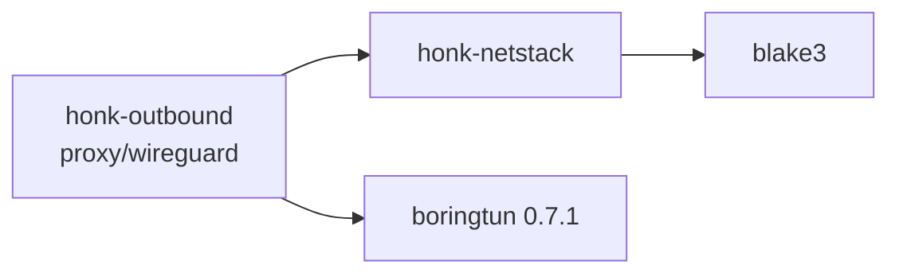

# Userspace network stack and WireGuard tunnel

`honk-netstack` is a sans-I/O IPv4/IPv6 TCP/UDP stack with two modes selected by `Config::mode`. In `Mode::Endpoint` (the default) it is the inner network of the WireGuard outbound's userspace tunnel: honk is the TCP/UDP client inside the tunnel, so the stack implements active open and datagram sockets and nothing else. In `Mode::Transparent` it terminates TCP and UDP for any destination address a client dialed (passive open, stateless UDP, IP reassembly, ICMP generation); that mode is implemented and tested but **no driver selects it yet** (see [Transparent termination](#transparent-termination) and [Not implemented yet](#not-implemented-yet)). Unless a sentence says otherwise, the rest of this page describes Endpoint mode, whose behavior is unchanged. This page describes what is implemented. Like the other userspace subsystems it is largely AI-authored and has had only partial maintainer review; see [Known limits](#known-limits-and-gaps).

The outbound-side behavior (registry, flows, failure provenance) is summarized from the stack's point of view below and specified in [Outbound design](./outbound.md#wireguard-tunnel). Node fields and share links are in the [node reference](../reference/nodes.md).

## Crate boundary

- `honk-netstack` depends only on `blake3` and `thiserror`, is `publish = false`, and forbids `unsafe`. Dependencies point from `honk-outbound` to it; it knows nothing about nodes, tunnels, tokio or sockets. `smoltcp` is a dev-dependency used by the test baseline.
- It never reads a clock, an environment variable or a configuration file. The caller supplies `Instant`s, the interface addresses and MTU, a 32-byte private secret and the memory limits (`Config`). Defaults: MTU 1420, 4096 flows, 256 MiB memory, 8 MiB receive and 6 MiB send buffer per flow, `Mode::Endpoint`; the transparent-mode fields are listed under [Configuration and counters](#configuration-and-counters).
- `wire` is public (IPv4/IPv6/TCP/UDP/ICMP codecs and the checksum) because the integration tests build packets with it. Everything else is private.

## Programming model

The stack is driven by exactly one owner through `&mut Stack`. It has no locks and no queues that can overflow; every pending output is state on a flow, and packets are materialized only when the owner pulls them (the quinn-proto model).

| Call | Contract |
| --- | --- |
| `receive(now, packet) -> Rx` | Borrows one complete IP packet. Retained bytes are copied into stack-owned rings, so the buffer is reusable at return. Never needs output capacity: replies become state. `Rx::Datagram` (Endpoint) and `Rx::Transparent` (transparent mode) hand back a range of the input for UDP: **that range is valid only until the caller reuses or recycles the input buffer** (`Rx::TransparentOwned` owns its bytes). `Rx::Dropped(reason)` is counted. |
| `poll_transmit(now, out) -> Option<usize>` | Writes one complete IP packet to `out[..n]`. A too-small `out` returns `None` without losing the packet. `None` also means nothing is currently allowed by cwnd, rwnd or pacing. |
| `poll_timeout()` / `handle_timeout(now)` | Earliest deadline of any flow; entries may be stale, so an early wakeup is legal. |
| `poll_event()` | Coalesced `Ready` bits (`CONNECTED`, `READABLE`, `WRITABLE`, `READ_CLOSED`, `ERROR`); a flow appears on the event list at most once. |
| `take_tx_wakeup()` | Set by `tcp_write`, `tcp_shutdown`, `tcp_close`, `tcp_abort`, `tcp_connect`, `tcp_accept`, `tcp_complete`, `tcp_refuse`, by a `tcp_read` that creates an ACK obligation and by a `udp_send_from` that leaves fragments queued. The caller must wake its owner when it returns true. |
| `tcp_*`, `udp_*` | `write(2)`-like semantics: `WouldBlock` instead of blocking, `Ok(0)` from `tcp_read` is EOF, terminal errors are sticky and returned after buffered data has been read. `FlowId` carries a generation, so a stale id returns `Stale` and never reaches a new occupant. |

Callers pass the same ingress timestamp to every `receive` of one receive batch (at most 64 packets) so RTT, RACK and autotuning do not measure processing delay.

### Output scheduling

`poll_transmit` serves five classes in rotation and remembers the rotation point across calls, so no class starves another:

1. **Control replies** to packets for unknown flows (RST). The queue holds 128 entries; when full the reply is dropped and counted (`control_dropped`), which is equivalent to link loss. In transparent mode the ICMP errors of refused SYNs share this queue.
2. **TIME_WAIT replies** (ACK of a retransmitted FIN), merged by bit per entry so none is lost.
3. **Ready TCP flows**, served by deficit round robin with a quantum of one MTU. Within a flow an ACK or retransmission goes before new data.
4. **Queued UDP fragments** of an oversized `udp_send_from` (transparent mode), in FIFO order.
5. **ICMP Time Exceeded** for timed-out reassemblies (transparent mode).

A flow's reply obligations are bits (`DATA`, `OOO`, `WINDOW_UPDATE`, `PROBE_RESPONSE`, `CHALLENGE`, `FIN_ACK`), not an inferred "`rcv_nxt` moved" test, because window updates, zero-window probe responses and challenge ACKs do not advance `rcv_nxt`. A caller that stops pulling therefore loses nothing; it is the back-pressure.

### Timers

Each flow exposes the minimum of its RTO/persist, delayed-ACK, tail-loss-probe, RACK reorder, pacing and close deadlines. A global min-heap holds at most one live entry per flow: a deadline is pushed only when it moves earlier. A later deadline reuses the old entry and is rechecked when popped. When the heap exceeds twice the flow slab (at least 32 entries) it is rebuilt; the bound follows the slab because a rebuild walks every slot. TIME_WAIT expiry uses the same heap.

## Packet handling

- IPv4 headers with options are parsed; IPv6 extension headers (hop-by-hop, routing, destination options, at most eight) are skipped; a routing header with segments left is `Unsupported`. Jumbograms, ESP/AH and unknown protocols are `Unsupported`. IPv4 and IPv6 fragments are dropped (`Fragment`) after the header checksum in Endpoint mode: **there is no reassembly and no fragmentation**; transparent mode reassembles them and fragments large UDP replies (see [Reassembly](#reassembly)). Link padding past the IP length is ignored.
- Transmitted IPv4 packets have DF set, TTL/hop limit 64, no options and no extension headers.
- In Endpoint mode a packet for an address that is not the configured local address of its family is `NotForUs`. A family without a local address cannot be used at all (`NoLocalAddress`). Transparent mode accepts any unicast destination instead (see [Scope and addressing](#scope-and-addressing)).
- Drop reasons are counted per reason in `StackStats`: `Malformed`, `Checksum`, `Fragment`, `NotForUs`, `NoFlow`, `Unsupported`, and in transparent mode `HalfOpen` and `Capacity`. (`Stale` is defined but never produced.)
- **Checksums are always verified in both modes** (IPv4 header, TCP, UDP, ICMP) before any flow state changes. IPv4 UDP checksum zero means none; IPv6 UDP zero is invalid. There is no "trusted" mode today and the `receive` signature has no way to ask for one; the rule for the future offload work is in [Checksum trust](#checksum-trust). WireGuard authenticates the peer's tunnel, not the sender's inner checksum. Verification is a separate read pass over the segment, then the payload is copied; the transmit checksum is computed during the payload copy.
- **ICMP is consumed in both modes and emitted only in transparent mode.** A packet-too-big (RFC 1191/8201) or destination-unreachable message is honored only for a TCP flow of the message's own address family whose quoted sequence is inside the outstanding window; PTB lowers the flow's path MTU (never raises it) and makes every now-oversize segment sendable again, including one already retransmitted at the old size, unreachable on a `SYN_SENT` flow fails the connect with `Unreachable`. Legacy PTB without an MTU uses the RFC 1191 plateau table. ICMP echo and all other ICMP are ignored. In Endpoint mode the stack never generates ICMP; generation is described in [ICMP generation](#icmp-generation).
- **UDP in Endpoint mode** has no receive queue and no send queue. A datagram for an unbound port is `NoFlow` (no ICMP error). `udp_send` serializes directly into the caller's buffer as one IP packet; a datagram larger than the MTU is `TooLarge`. Transparent UDP is stateless and is described in [Transparent UDP](#transparent-udp).

## TCP

### Connection model

Endpoint mode is active open only: `tcp_connect` picks a source port with RFC 6056 algorithm 3 (a keyed hash of local/remote address and remote port plus a per-bucket counter, in 32768..65535), an ISN from a keyed hash (RFC 6528) plus a 4 µs clock, and a stable per-address-pair timestamp offset (RFC 6191). The secret is `Config::secret` (blake3 keyed hash). In Endpoint mode there is **no listen API**; a SYN for an unknown tuple gets an RST, simultaneous open is handled. Passive open exists only in transparent mode ([TCP admission](#tcp-admission)).

Every SYN offers MSS (MTU − 40/60), window scaling (the shift is chosen once from `tcp_rcv_buf_max`, up to 14), SACK-permitted and timestamps; each is used only if the peer echoes it. The peer MSS defaults to 536 (IPv4) or 1220 (IPv6) when absent and is raised to at least 48 (Linux `tcp_min_snd_mss`), so a hostile server cannot buy one packet per byte. A data segment carries at most `min(peer MSS, PMTU − IP header − that segment's TCP header)`, computed per packet because timestamps plus SACK blocks can grow the header to 60 bytes.

Validation: RFC 5961 (RST only at exactly `rcv_nxt`, otherwise a challenge ACK, SYN in a synchronized state answers a challenge ACK, challenge ACKs limited to one per flow per 100 ms), PAWS with a 24-day cutoff, acceptable-ACK window checks.

### Closing and lifecycle

- `tcp_shutdown` closes the write half only. `tcp_close` releases the application handle at once and lets the protocol finish (FIN after queued data); **closing with unread data, or while `SYN_RECEIVED`, sends RST** as Linux does. A flow that was closed from `FIN_WAIT_2` has a 60 s orphan timeout.
- TIME_WAIT is kept separate from the application handle. A flow stays on its slot (ring, ready bits) until the application has read everything and closed the handle and the last ACK has been sent; only then does it compact into a small table entry `{tuple, snd_nxt, rcv_nxt, ts_recent, expiry, ack_due}` that holds no chunks, for 60 s. A valid retransmitted FIN is answered with an ACK and restarts the timer. A new connection to the same tuple may reuse the entry only when RFC 6191 timestamp and sequence comparisons prove the peer can tell the incarnations apart; otherwise the port search continues (up to 32768 candidates, then `AddrInUse`). Which side keeps TIME_WAIT, and how a transparent SYN reopens a tuple, is in [Close semantics](#close-semantics).
- Terminal errors: `Reset`, `TimedOut` (six SYN retransmissions, fifteen consecutive RTO backoffs, fifteen zero-window probes in a row that no ACK answers, the orphan timeout, or, for accepted transparent flows with keepalive enabled, unanswered keepalive probes) and `Unreachable`. TCP keepalive is off unless `AcceptOpts::keepalive` sets it ([Keepalive](#keepalive)).

### Receive side

- **SACK/DSACK.** Out-of-order data is written directly to its offset in the receive ring. A table of at most 32 ranges records what has arrived; a segment that would create a 33rd range is dropped and counted (`ooo_drops`). ACKs carry up to three SACK blocks with timestamps (four without), most recently changed block first and the rest rotated; the first block is a DSACK when duplicate data arrived. Without negotiated SACK, every out-of-order segment gets its own duplicate ACK.
- **ACK policy.** The first 16 segments after the start or an idle period of more than one RTO are acknowledged at once (quickack); afterwards an ACK is sent when two full-sized segments are unacknowledged, on out-of-order data or a gap fill, on window updates and FIN. Otherwise a 40 ms delayed-ACK timer runs. A window update is sent when a read reopens a zero window or advances the right edge by at least 2 MSS.
- **Window autotuning (DRS).** Per measured receive RTT the target window becomes `2 × bytes read by the application + 16 × MSS`, never shrinking and capped at `tcp_rcv_buf_max`. Growth is committed from the memory pool before it is advertised (next section).

### Send side

- **Loss detection:** RACK-TLP (RFC 8985) for SACK peers: send-time ordered detection with a cursor over never-retransmitted descriptors and a lazy FIFO for retransmissions, adaptive reorder window from min RTT/4 that grows with reordering and decays, reorder timer, tail loss probe at about 2·SRTT (plus 200 ms for a lone segment). Peers without SACK use NewReno (RFC 6582). Loss of data sent during a recovery, still lost when the recovery ends, starts a new episode (Linux `tcp_time_to_recover`).
- **Reduction and undo:** PRR (RFC 6937, SSRB variant); spurious recoveries are undone by DSACK, timestamp echo (Eifel) or F-RTO.
- **RTO:** RFC 6298 estimator in microseconds with a 200 ms floor (a deliberate deviation shared with Linux), 120 s ceiling, 1 s initial value, exponential backoff that SYN retransmissions do not carry into the first data timeout. A timeout keeps SACKed data delivered and marks only the rest lost, unless the head itself is SACKed (reneging), which discards all SACK state; F-RTO therefore undoes only a timeout whose never-SACKed, never-retransmitted data was acknowledged, and falls back to ordinary recovery when no new data can go out. A zero window with data in flight still retransmits the head on timeout; persist probes run only when nothing is outstanding.
- **Congestion control:** CUBIC (RFC 9438) in fixed point — no floating point — with HyStart++ (RFC 9406). Initial window `min(10·MSS, max(2·MSS, 14600))`, restored (with HyStart++ state) when a flow resumes after a data-free RTO measured from its last data segment. The controller sits behind a `Cc` enum; a Reno variant exists only for reference tests.
- **Pacing:** token bucket at 2.0 × cwnd/SRTT in slow start and 1.2 × afterwards; bursts of 10 segments, capped to 2 ms of traffic, always at least one segment. The next release time is a flow deadline.
- **Scoreboard:** one descriptor per sent segment (end sequence, transmit time, SACKED/LOST/RETRANS flags, delivery-rate fields). `packets_out`, `sacked`, `lost` and `retrans` byte counters are maintained incrementally and checked against a from-scratch recount in debug builds. Delivery rate is sampled per ACK (draft-cheng-iccrg) with app-limited tracking and is reported in `TcpStats`.
- **Send buffer.** `tcp_write` copies into the send ring; accepted bytes belong to the stack until cumulatively ACKed (SACKed data is never freed, since the peer may renege). The buffer limit follows the window: `clamp(2 × cwnd, 64 KiB, tcp_snd_buf_max)`, and `WRITABLE` is reported when at least `min(16 KiB, half the limit)` of room exists.

Zero-window handling (persist probes), window-update recovery and `snd_wl1/snd_wl2` window tracking follow RFC 9293. The probe interval doubles up to 120 s and resets only when the window opens; an ACK that keeps the window closed resets the retry count (unanswered probes still fail the flow after fifteen) but not the interval. Segments are accepted when they overlap the receive window, and nothing after a recorded FIN is accepted.

## Memory model

Payload storage is a pool of 16 KiB chunks organized in two rings per TCP flow (send, receive), plus the send descriptors.

- **Progress floor.** Every admitted TCP flow is entitled to one send chunk, one receive chunk and 16 descriptor slots whatever the global pressure. The floors are reserved up front: `floor_flows = min(max_flows, memory_limit / floor)` and the remaining `memory_limit − floors` is the shared pool. `tcp_connect` fails with `Memory` when no floor is left and with `FlowLimit` at `max_flows`; `max_flows` also counts UDP associations. The floor prevents the deadlock where a window that consumes the whole pool leaves `tcp_write` with no room while the peer waits for that very request.
- **Commitment.** Receive-window space beyond the floor is *committed* from the shared pool before it is advertised, while chunks are allocated lazily when data arrives. Therefore in-window data is not dropped for lack of memory. The highest advertised right edge is remembered and never withdrawn; window-scale rounding only rounds the wire value down and never above the commitment.
- **Honest accounting.** The budget is charged for chunk capacity (and descriptor storage), not for logical bytes. `StackStats.memory_committed` is floors in use plus shared commitment; `memory_allocated` is the chunks and descriptor storage actually resident plus the pool's cached free chunks. The cache holds up to 64 chunks while any chunk is in use (a burst of writes and its ACK refills from it instead of the allocator) and a single spare once none is, so `memory_allocated` of an idle stack is one chunk at most.
- **Idle flows.** The floors are accounting guarantees, not resident memory. A ring that becomes empty (receive ring fully read with nothing out of order, send ring fully acknowledged) gives every chunk back to the pool, and the descriptor storage (floor included) is released when nothing is in flight; the next write or segment allocates again from the pool's cache, so the floor can never fail to materialize. The out-of-order range table, the chunk-list stubs and the timer heap likewise shrink when empty or sparse. What an idle established flow keeps is its state: the `Tcb` (size-asserted at most 1 KiB), the slab slot (144 B), a flow-table bucket, a timer entry and two 48 B chunk-list stubs. `tests/idle_footprint.rs` counts the heap over 1000 established flows after a request/response exchange and asserts zero resident chunks and at most 1.5 KiB per flow (about 1.44 KiB measured, glibc chunk sizes); getting to the design's 1 KiB outside buffers would need a smaller `Tcb`. A TIME_WAIT entry holds no chunk.
- **Process-shared budget.** `Config::shared_budget` (`Option<Arc<MemoryBudget>>`, `MemoryBudget::new(limit_bytes)`, `limit()`, `used()`) lets several stacks draw from one limit on top of their own `memory_limit`. Floors are charged at admission (`tcp_connect` returns `Memory` when the budget cannot fund one) and again for every shared chunk or descriptor commitment, on the same paths that charge the stack's pool; a retired flow refunds its floor, and dropping a `Stack` refunds all it still holds. A flow admitted under the budget keeps its floor, so it progresses even when the budget is exhausted. The budget is lock-free (one atomic update per chunk-sized charge) and does no I/O.
- Per-flow buffer maxima are clamped to between one chunk and 1 GiB so sequence arithmetic stays modular-safe.

## Transparent termination

`Config::mode = Mode::Transparent { exclude }` makes the stack the TCP/UDP endpoint of whatever destination a client dialed. It is exercised by packet scripts, the simulator and fuzzing, but nothing in the tree selects it: the WireGuard driver builds a default `Config` and stays in `Mode::Endpoint`. Memory, congestion control, loss recovery, the programming model and the single-owner rule above apply to transparent flows unchanged. **No performance gate or number is claimed for this mode**; the simulator and benchmark figures are per-packet and virtual-time evidence, not lab evidence.

### Scope and addressing

- A flow's local end is the packet's original destination, so every reply (SYN-ACK, data, RST, ICMP error, UDP) is sourced from it. Incoming packets are not matched against `local_v4`/`local_v6`, and the stack raises the MTU to at least 1280.
- `ExcludeSet` (`insert(addr, prefix_len)`) lists destination prefixes the stack refuses as `NotForUs`. It is a backstop only: the TC classifier in front of the driver is the real gate, and a packet dropped here is a black hole for that client.
- Multicast, limited broadcast and unspecified destinations (the tun device's own router solicitation, MLD and DAD) are dropped silently as `Unsupported`.
- A SYN whose source is not unicast, whose source and destination addresses are equal, or whose port is 0 opens no flow and is answered like any stray segment (RST).

### TCP admission

A plain SYN for an unknown tuple creates a pending flow in `SYN_RECEIVED` and sends nothing; while the flow is undecided or deferred it ignores all input, so retransmitted SYNs are absorbed without a second flow or a second report. The pending flow holds its memory floor but has committed no receive window yet; the window is committed by `tcp_accept`.

| Call | Contract |
| --- | --- |
| `poll_accept() -> Option<SynInfo>` | Reports each new flow once: `id`, `client`, `original_dst`, the client's `mss` (536 or 1220 when absent, at least 48), `wscale`, `sack`, `timestamps`. |
| `tcp_accept(id, AcceptOpts)` | `when: AcceptWhen::Now` queues the SYN-ACK; `AcceptWhen::Deferred { deadline }` holds it until `tcp_complete` (after an upstream dial); if `deadline` passes first the flow fails with `TimedOut` and sends nothing. `max_mss` clamps the MSS in both directions (floor 48); use the client's real egress MTU, the tun MTU says nothing about it. `keepalive` arms [Keepalive](#keepalive). Defaults (`AcceptOpts::default()`): `Now`, no clamp, no keepalive. Returns the flow's error if it already died (for example `TimedOut`), `Closed` if it was already decided, `Stale` for an old handle. |
| `tcp_complete(id)` | Releases the SYN-ACK of a deferred flow. `Closed` if the flow is not held. |
| `tcp_refuse(id, Refuse)` | Only before the SYN-ACK has left (it is ignored afterwards; use `tcp_abort`). Forgets the flow and releases the handle. `Refuse::Rst` answers RST\|ACK, `Drop` answers nothing, `IcmpUnreachable` host unreachable, `IcmpAdminProhibited` administratively prohibited (see [ICMP generation](#icmp-generation)). RST and ICMP replies travel through the 128-entry control queue. |

`MAX_DEFERRED` is 25 s, chosen so that the stack gives up before the edge classifier's own 30 s handoff expires. A SYN that `poll_accept` never reported is forgotten silently 25 s after it arrived (the client retries); a reported or deferred flow that nobody has accepted or completed by its deadline (never later than 25 s after the SYN) fails with `TimedOut` without sending anything, surfaces `ERROR`, and the application must still close its handle.

Admission limits:

- **Half-open caps.** A flow is half-open from the SYN until the handshake completes or the flow dies. `Config::half_open_max` (default 1024) bounds them in total and `Config::half_open_per_source` (default 128) per client address. A SYN beyond a cap is dropped and counted (`DropReason::HalfOpen`): never answered with RST or ICMP, and there are no SYN cookies. Because every pending flow already holds a floor, the caps also bound the memory a SYN flood can pin.
- **Flow and memory limits.** A SYN that the flow table (`max_flows`), the floor cap or the memory floor and shared budget cannot admit is dropped and counted (`DropReason::Capacity`), not answered. The client retries.

### Close semantics

- The side that closes first (active close, simultaneous close included) goes through `FIN_WAIT_1`/`FIN_WAIT_2`/`CLOSING` into TIME_WAIT and keeps a compact tombstone for 60 s (RFC 9293). The side that closes second goes `LAST_ACK` to `CLOSED` and keeps nothing. Because the first closer always keeps TIME_WAIT, a server-side TIME_WAIT is never skipped.
- A tombstone answers a valid retransmitted FIN with an ACK and restarts its 60 s timer; other segments for it are ignored. A new SYN for the tuple replaces the tombstone only when the RFC 6191 check passes: its timestamp is newer than the last one seen, or, without usable timestamps, its sequence number lies beyond the old `rcv_nxt`; a SYN with an older timestamp is treated as a stray duplicate and ignored. The new flow's ISS is forced beyond the old `snd_nxt`.
- **Driver contract.** The entry lives inside the stack for at least 60 s after the last FIN exchange. For that long the driver must keep delivering packets of that tuple to `receive`: any delivery state in front of the stack (an eBPF redirect entry, a flow table) must outlive the flow, otherwise the client's retransmitted FIN reaches the real server instead of the tombstone and is answered with RST. `StackStats::timewait_entries` counts live tombstones.

### Transparent UDP

- `receive` returns `Rx::Transparent { src, dst, payload }` for a datagram: no flow, no bind, both addresses present. `payload` is a range of the input packet.
- `Rx::TransparentOwned { src, dst, packet, payload }` is the same for a datagram reassembled from fragments: the stack owns `packet` and `payload` indexes it.
- **Borrowed-payload lifetime.** The range of `Rx::Datagram` and `Rx::Transparent` is only valid until the caller recycles or reuses the input buffer. A driver whose input buffer is a TUN read buffer (or, later, an AF_XDP UMEM frame returned to the fill ring) must consume or copy the payload before it releases the buffer. `TransparentOwned` has no such limit.
- `udp_send_from(src, dst, payload, out)` is stateless and may use any source address (a reply comes from the datagram's original destination). A datagram that fits the MTU is written to `out` as one packet (no DF, identification set). A larger one, up to 65535 bytes of UDP length (IPv4 total length too; beyond that `TooLarge`), is fragmented: the first fragment is written to `out`, the rest is stack state (the checksummed datagram, copied once) and leaves through `poll_transmit`, one fragment per call in FIFO order; `take_tx_wakeup()` is set while fragments are pending. The pending bytes are bounded at 512 KiB (one datagram is always accepted); a send that would exceed it returns `Busy` before consuming anything, a too-small `out` returns `BufferTooSmall` and consumes nothing. Mixed address families are `FamilyMismatch`.
- `udp_refuse(now, UdpRefuse, original, out)` answers a refused datagram with ICMP (`PortUnreachable`, `HostUnreachable`, `AdminProhibited`); `original` is the datagram's IP packet. `Ok(None)` means the error was suppressed or rate limited.

### Reassembly

Transparent mode reassembles IPv4 and IPv6 fragments of any protocol; Endpoint mode still drops them. The completed datagram re-enters the normal receive path, so the destination filter and checksums apply to it.

- `FragmentLimits` (`Config::fragment_limits`) defaults: `max_entries` 64, `max_bytes` 4 MiB (payload, fragment 0's saved headers and 256 B of bookkeeping per datagram), `max_holes` 32, `timeout` 30 s counted from a datagram's first fragment.
- An overlapping fragment (an exact duplicate too) kills the datagram (RFC 5722, RFC 8200 section 4.5): the buffer is freed at once and a bufferless tombstone absorbs the remaining fragments (`Fragment`) until the timeout. More than `max_holes` gaps, or inconsistent lengths, kill it as well. Empty fragments, a non-final fragment whose length is not a multiple of 8 and a datagram beyond 64 KiB are `Malformed`. An atomic fragment is delivered as a whole datagram (RFC 6946).
- When the table or `max_bytes` is exhausted the oldest datagram is evicted silently, so a flood of first fragments cannot starve a burst that completes.
- A timeout answers with ICMP Time Exceeded (IPv4 type 11 code 1, IPv6 type 3 code 1) only if fragment 0 arrived; the quote is the saved headers plus up to 8 bytes. At most 16 such errors wait for `poll_transmit`; `poll_timeout` and `handle_timeout` cover the reassembly deadlines.
- **Shared budget.** Reassembly bytes are charged to `Config::shared_budget` (not to the stack's own `memory_limit`; without a budget only `FragmentLimits` bound them). A refused charge evicts the oldest datagram and retries; when nothing is left to evict the fragment is dropped, as `DropReason::Capacity` if it would start a datagram, or by killing the datagram (`Fragment`) if it is the only one left and cannot grow. The charge is refunded on completion, eviction, timeout, kill and when the stack is dropped. A fragment flood can therefore occupy up to `FragmentLimits::max_bytes` of the shared budget, and new flows are admitted against the same budget: size it with that headroom, or SYNs are dropped as `Capacity` during the flood.

### ICMP generation

Errors are generated only by transparent-mode paths: `Refuse::IcmpUnreachable`/`IcmpAdminProhibited`, `udp_refuse`, `packet_too_big(now, mtu, original, out)` and reassembly timeout. The stack never generates ICMP on its own in Endpoint mode. (`udp_refuse` and `packet_too_big` do not check the mode; they exist for the transparent driver.) An error is sourced from the original destination and sent to the original source.

| Reject | IPv4 (type/code) | IPv6 (type/code) |
| --- | --- | --- |
| `UdpRefuse::PortUnreachable` | 3/3 | 1/4 |
| host unreachable (`Refuse::IcmpUnreachable`, `UdpRefuse::HostUnreachable`) | 3/1 | 1/3 |
| administratively prohibited (`Refuse::IcmpAdminProhibited`, `UdpRefuse::AdminProhibited`) | 3/13 | 1/1 (RFC 4443 section 3.1) |
| reassembly timeout | 11/1 | 3/1 |
| `packet_too_big` | 3/4 (MTU in the low 16 bits, capped at 65535) | 2/0 |

- **Suppression** (no error, no rate-limit charge): the original is a non-first fragment, its source or destination is unspecified, multicast or broadcast, it is itself an ICMP error (IPv4 types 3, 4, 5, 11, 12 and above 18; IPv6 types below 128) or an ICMP packet with no type byte, or the quote cannot be parsed.
- **Size.** The whole error stays within 576 bytes (IPv4) or 1280 bytes (IPv6); the quote of the original is truncated to fit.
- **Rate limits** (`IcmpLimits`, Linux-style): a global bucket of `per_sec` 1000 messages per second with `burst` 50, and a per-target bucket keyed by the original source address of one message per `target_interval` (1 s) with `target_burst` 6 intervals of burst, remembering `max_targets` 128 targets (least recently used replaced). Both must agree before either is charged. Packet-too-big is exempt, as on Linux.
- A too-small output buffer leaves every limiter untouched so the call can be retried.

### Keepalive

`Keepalive { idle, interval, probes }` is set per flow through `AcceptOpts::keepalive` and is off by default; active-open flows have no API for it. It arms when the handshake completes. Every accepted segment from the peer restarts the idle period and the probe count. After `idle` of silence the stack sends an empty ACK at `snd_una - 1` every `interval`; when `probes` (at least 1) probes in a row go unanswered, one `interval` after the last, the flow fails with `TimedOut`. It is disarmed in `SYN_RECEIVED`, `TIME_WAIT` and `CLOSED` and by failure or abort.

### Checksum trust

Today the stack verifies every received checksum (IPv4 header, TCP, UDP, ICMP) in every mode, including on reassembled datagrams, and nothing in the public API can switch that off; the internal transparent UDP receive path has a `verify_csum` parameter that every caller sets to true. The design rule for the offload work (`Csum::Valid`/`Partial` metadata, not merged): a trusted checksum may only ever be accepted in `Mode::Transparent`, from a driver that owns the local device, and the WireGuard driver must never be able to select it, because its inner packets come from the network.

### Memory and chunk size

Payload chunks are 16 KiB in every mode (`CHUNK` in `tcp/ring.rs`); the floor of one TX chunk, one RX chunk and 16 descriptor slots, advertised-window commitment, the never-retreating right edge and idle release apply to transparent flows as described in [Memory model](#memory-model). A smaller chunk for transparent mode (the design proposes 4 KiB by default, with a floor of about 9 KiB) is **planned, not implemented**: `Config` has no chunk-size field.

### Configuration and counters

| `Config` field | Default | Meaning |
| --- | --- | --- |
| `mode` | `Mode::Endpoint` | Whom the stack answers for. |
| `half_open_max` | 1024 | Transparent: half-open flows in total. |
| `half_open_per_source` | 128 | Transparent: half-open flows per client address. |
| `icmp_limits` | `IcmpLimits::default()` | Transparent: ICMP generation limits. |
| `fragment_limits` | `FragmentLimits::default()` | Transparent: reassembly limits. |
| `shared_budget` | `None` | All modes; transparent reassembly is charged to it as well. |

`StackStats` carries `drops` (per `DropReason`, now including `HalfOpen` and `Capacity`), `half_open` (flows between SYN and the end of the handshake), `timewait_entries`, `control_dropped`, `rx_packets`, `tx_packets`, `flows`, `memory_committed` and `memory_allocated`. The reassembly and ICMP counters are internal and not exported.

## Not implemented yet

Everything below is absent from `crates/honk-netstack/src` or from the repository today; the list is the boundary of this page's claims.

- The drivers: a TUN driver (`honk-tun`) and an AF_XDP driver (`honk-xsk`). No crate by those names exists.
- The eBPF/TC side: the classifier delivery bit, steering of flows to the stack, the delivery state that must outlive TIME_WAIT ([Close semantics](#close-semantics)), and proxying of non-first fragments at the TC layer.
- Offload: GRO, GSO/TSO and USO, the `RxMeta`/`Csum` receive metadata, and therefore trusted checksums ([Checksum trust](#checksum-trust)).
- A configurable chunk size and the smaller transparent default ([Memory and chunk size](#memory-and-chunk-size)).
- ICMP proxying: relaying echo or errors between the client and a real upstream. The stack only consumes ICMP for outstanding TCP sequences and generates the errors listed above.
- Any performance gate or measured number for transparent mode.

## Driver contract (WireGuard)

The driver lives in `honk-outbound/src/proxy/wireguard/`; [Outbound design](./outbound.md#wireguard-tunnel) is the specification and this is the part that constrains the stack.

- **Ownership.** One `Mutex<Inner { Stack, Tunn, .. }>` per tunnel. Application flows (`FlowIo` for TCP, `WgUdpTransport` for UDP) lock it directly for `tcp_read`/`tcp_write`/`udp_send`; the single owner task does everything else (outer receive, decryption, `receive`, `poll_transmit`, encryption, outer send, timers). After every application call `take_tx_wakeup()` decides whether the owner is notified through `Notify`, which stores a permit, so a notification sent before the owner waits is not lost. A reader that finds no data registers its waker under the same lock the owner holds when publishing readiness, so a wake-up cannot be lost in between.
- **Batching.** The owner holds the lock for at most 64 packets per pass in either direction, taking one `Instant` per lock hold (per ≤64-packet chunk of a received batch) for all `receive` calls in it; it pulls at most 64 packets per transmit pass and encrypts them into one buffer holding up to 256 datagrams. The outer socket uses `recvmmsg` with GRO and sends GSO runs of equal-size ciphertexts.
- **Copies.** A full-sized segment is copied three times on each path (application ↔ ring, ring ↔ plaintext buffer, boringtun's own `src → dst`). Steady-state operation allocates nothing per packet (`tests/alloc_free.rs` counts allocations over bulk send and receive); scratch, output and receive buffers are reused. A flow whose flight fully drains releases its descriptor storage, so the next burst regrows it with a few allocations per burst, not per packet.
- **Registry and idle teardown.** A tunnel registry keeps exactly one live tunnel per (our private key, peer public key, endpoint host, endpoint port) because two sessions with the same keys to the same peer invalidate each other's handshakes; key pairs shared across different endpoints get separate tunnels. The registry belongs to one control plane's runtime generations (reload successors, DNS forks and cold probes inherit it), so two planes in a process never share or close each other's tunnels; dials with no runtime use a separate process-wide registry nothing closes. A runtime with identical tunnel settings shares the live tunnel; different settings for the same key and endpoint replace it and close its flows with `RuntimeClosed` (not a node failure). The owner task belongs to the registry, not to a node's task owner, and ends on failure, replacement, the plane's `shutdown_wireguard_tunnels` (its terminal teardown joins it), immediately when the last runtime using it closes with nothing left that can carry data, or after 120 s with no flow and no warm owner. Warm retention holds the tunnel (counted, so re-installing the same tunnel keeps the pin); the last release drops the hold without cutting flows. The process memory share is divided into fixed per-tunnel slices with a cap on live tunnels (see Scale).
- **DNS-fork sharing (deviation).** DNS-fork runtimes normally own fresh protocol state. For WireGuard they share the business runtime's tunnel (the plane's registry) because a second session would knock it over. A runtime closing fails only the flows it opened (`RuntimeClosed`).
- **Reserved bytes.** WARP-style reserved bytes are written into bytes 1–3 of every outgoing datagram after encryption and zeroed on every incoming datagram before decryption; the Noise MACs never cover them.
- **Allowed IPs (single peer).** A dial or UDP association to a target outside `wg_allowed_ips` (or in a family without a tunnel address) is refused before any packet is sent; a later UDP send to another disallowed destination is a `Policy` rejection; an inbound inner packet whose source is outside them is dropped before the stack sees it. The list is aggregated into sorted disjoint networks and binary-searched. The target is always the numeric address; a target domain is never resolved remotely. Allowed IPs are not used to choose between peers, because there is exactly one.
- **Endpoint.** Every resolved address is a candidate (families alternate; a dual-stack IPv6 socket carries IPv4 peers mapped). Before a session exists the initiation is resent after 1 s and 2 s (a deliberate deviation from boringtun's first retry at 5 s, so a single lost datagram does not fail a 3 s dial), each time to the next candidate, then boringtun's 5 s cadence continues. A handshake attempt that timed out makes the next acquire re-resolve the name. An authenticated datagram from a new source address moves the outer endpoint (roaming); a cookie reply is not authentication.
- **UDP.** One stack socket per prepared source serves every destination (a `MultiTargetTransport`); received datagrams are copied into a bounded queue of 256 datagrams and overflow is dropped like a socket buffer. A confirmed send resolves only after the owner has handed the datagram to the socket.
- **Error provenance.** An inner RST or ICMP unreachable in answer to a SYN, and and a target outside the allowed IPs or in a family without a tunnel address (TCP dial or UDP association open, refused before any handshake), are target failures. A SYN that times out is a target failure only if the peer delivered other inner packets during the dial; otherwise it stays an untyped timeout that Score treats node-conservatively. A waiter whose handshake budget runs out gets a node failure shared by the waiters of the same attempt, without failing the tunnel; boringtun session expiry while flows exist and any unexpected end of the owner task fail the tunnel once for every waiter (one shared node-failure episode). Datagrams that fail authentication are dropped silently (no failure threshold: the source address is spoofable). Local exhaustion (`FlowLimit`, `Memory`, `AddrInUse`) is a `Capacity` rejection. A tunnel closed by its owner (runtime close, replaced settings, process shutdown) fails flows with `RuntimeClosed`, which is not a node failure. Handlers report no Score or health themselves.

## Validation

- Unit tests sit beside the code in `honk-netstack/src/`. `tests/tcp_receive.rs`, `tcp_send.rs` and `tcp_recovery.rs` are deterministic packet scripts that drive only the public API against a scripted peer and compare exact output segments.
- `tests/sim/` is a deterministic link simulator (seeded delay, iid and Gilbert-Elliott loss, reordering, duplication, rate limiting and drop-tail queues) connecting honk to honk or to a pinned smoltcp 0.14.0. `sim_honk.rs` checks exactly-once in-order delivery and completion through 1% loss, IPv6 and many flows, a one-packet pull budget delivering the same streams as an unlimited one, undo of reordering-induced spurious recoveries, and repair of a peer with neither SACK nor reassembly; `sim_baseline.rs` characterizes smoltcp and tests the simulator itself (including pull-budget resume). The scoreboard is recounted in debug builds after every mutation (counters, descriptor order, cursors and the remembered SACK runs), and `Tcb::check` ties it to `snd_una`/`snd_nxt` after every call. Two `#[ignore]` grids print comparison tables (`cargo test -p honk-netstack --test sim_honk -- --ignored --nocapture`).
- Transparent mode: `tests/transparent_tcp.rs` is the packet-script suite (admission, deferred accept and its 25 s expiry, retransmitted SYNs, refusals and their ICMP codes, half-open and capacity drops, MSS clamp, keepalive, active against passive close, a late FIN at the tombstone, RFC 6191 reopen, scope and exclusion, UDP and fragments). `tests/sim_transparent.rs` runs honk and smoltcp clients against a honk terminator (`tests/sim/honk_server.rs`) in virtual time through loss, IPv6, many flows and SYN retransmissions during a deferred accept. `tests/sim_termination.rs` adds the honk-to-honk end-to-end cases: the close-order matrix, a late FIN at the tombstone, and many flows and soak runs under a small shared budget; the transparent simulator tests assert that every flow, tombstone, half-open and memory charge returns to zero. `benches/stack.rs` transparent cases report per-packet cost beside the endpoint ones.
- `honk-outbound/src/proxy/wireguard/tests/` runs the driver against an independent in-process peer (a boringtun `Tunn` on loopback UDP with a smoltcp interface behind it).
- `fuzz/` holds three libFuzzer targets, `netstack_packet` (arbitrary bytes, optionally with repaired lengths and checksums, into `receive` on a stack with flows in seven states), `netstack_schedule` (a byte-decoded sequence of crafted peer segments, application calls, time steps, pull budgets 0/1/N and ICMP) and `netstack_transparent` (SYNs and retransmitted SYNs, immediate and deferred accept, refusal, handshake ACKs, data, FIN/RST, keepalive, time and raw/UDP packets on a transparent stack). All come from the `fuzz-checks` feature of `honk-netstack` and also run as `tests/fuzz_replay.rs` on stable over the committed seeds and saved crash artifacts. They assert no panic, bounded and well-formed output, a whole-stack recount after every operation (`Stack::check`), that timers never leave an expired deadline behind, and that closing everything returns every pool charge and ends every flow. `cargo bench -p honk-netstack --bench stack` reports ns per packet for receive+ACK, bulk transmit, SACK processing and the transparent cases.
- Real-network lab tooling and results live only on the `bench` branch. As of this writing no honk-arm result is recorded on `main`, so no throughput, loss-recovery or CPU claim in this page is a measurement.

## Known limits and gaps

| Area | Limit |
| --- | --- |
| IP | Endpoint mode: no fragmentation or reassembly (fragments are dropped, oversize UDP is `TooLarge`) and no ICMP generation. Transparent mode reassembles within `FragmentLimits` and fragments UDP replies up to 64 KiB. No ECN; no IPv4 options on transmit. |
| TCP | Listen/accept only in transparent mode (no driver yet); keepalive only as an opt-in for accepted transparent flows; no urgent-data API; no TCP Fast Open; no PLPMTUD (PTB from the path only); CUBIC only (BBRv3 deferred); IW10 with no per-route tuning. Unknown TCP options are ignored and malformed option lengths stop option parsing. |
| Receive | At most 32 out-of-order ranges per flow; ACK stretching limited by the 64-packet receive batch. |
| Scale | An idle established flow costs about 1.4 KiB of heap (no chunks); per tunnel 4096 flows, each admitted flow reserving a floor of about 33 KiB from the process budget (the share: 256 MiB by default, one eighth of RAM within 64 MiB..4 GiB in honk) that all tunnel stacks draw from together, so about 2,000 / 8,000 / 32,000 floor-only flows fit at 64 MiB / 256 MiB / 1 GiB; live tunnels are bounded by their fixed cost, `share / 4 MiB` within 1..128; `max_flows` counts UDP associations; one lock and one owner task per tunnel, so one tunnel is limited to one core. |
| WireGuard | Exactly one peer per tunnel; no inbound connections; IPv4 and IPv6 each need a configured tunnel address; the endpoint name is re-resolved only on the next acquire after a handshake attempt timed out, and the endpoint set is fixed while a session exists; one tunnel per (key pair, endpoint) per control plane (runtime-less dials share a separate process-wide registry), at most `share / 4 MiB` (1..128) tunnels live per registry (see Scale); nodes that share a key pair and endpoint must share every tunnel setting or they replace each other, and a hostname and an IP literal of one endpoint are separate tunnels; inner MTU at most 65472 so an outer datagram fits one UDP payload. |
| Transparent | Not wired to any driver; the items under [Not implemented yet](#not-implemented-yet) are absent. Chunks stay 16 KiB. A fragment flood can use up to `FragmentLimits::max_bytes` of the shared budget. Coverage is packet scripts, the simulator and fuzzing only: no real-network, TUN, AF_XDP or eBPF run and no performance number. |
| Verification | No interop run against non-Linux TCP implementations, no ARM run and no `test-routing`/`test-netns` VM gate. The design thresholds were measured on one x86-64 4-vCPU VM against kernel WireGuard + kernel TCP (not the design's same-engine TUN arm, with an extra loopback relay hop on the honk side): G1–G4 pass, G5 download fairness passes on the median, and G5 idle memory (about 4 KiB per flow including driver and relay state) misses its 1 KiB target; evidence lives on the `bench` branch under `bench/netstack/results/`. |

## Related docs

- [Outbound design: WireGuard tunnel](./outbound.md#wireguard-tunnel)
- [Node reference: WireGuard fields and share links](../reference/nodes.md)
- [Architecture overview](./overview.md)
