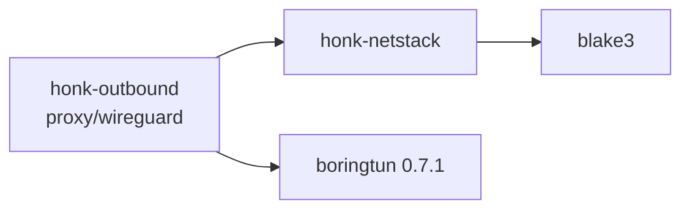

# Userspace network stack and WireGuard tunnel

`honk-netstack` is a sans-I/O IPv4/IPv6 TCP/UDP stack. Its one consumer is the WireGuard outbound, which uses it as the inner network of a userspace tunnel: honk is the TCP/UDP client inside the tunnel, so the stack implements active open and datagram sockets and nothing else. This page describes what is implemented. Like the other userspace subsystems it is largely AI-authored and has had only partial maintainer review; see [Known limits](#known-limits-and-gaps).

The outbound-side behavior (registry, flows, failure provenance) is summarized from the stack's point of view below and specified in [Outbound design](./outbound.md#wireguard-tunnel). Node fields and share links are in the [node reference](../reference/nodes.md).

## Crate boundary

- `honk-netstack` depends only on `blake3` and `thiserror`, is `publish = false`, and forbids `unsafe`. Dependencies point from `honk-outbound` to it; it knows nothing about nodes, tunnels, tokio or sockets. `smoltcp` is a dev-dependency used by the test baseline.
- It never reads a clock, an environment variable or a configuration file. The caller supplies `Instant`s, the interface addresses and MTU, a 32-byte private secret and the memory limits (`Config`). Defaults: MTU 1420, 4096 flows, 256 MiB memory, 8 MiB receive and 6 MiB send buffer per flow.
- `wire` is public (IPv4/IPv6/TCP/UDP/ICMP codecs and the checksum) because the integration tests build packets with it. Everything else is private.

## Programming model

The stack is driven by exactly one owner through `&mut Stack`. It has no locks and no queues that can overflow; every pending output is state on a flow, and packets are materialized only when the owner pulls them (the quinn-proto model).

| Call | Contract |
| --- | --- |
| `receive(now, packet) -> Rx` | Borrows one complete IP packet. Retained bytes are copied into stack-owned rings, so the buffer is reusable at return. Never needs output capacity: replies become state. `Rx::Datagram` hands back a range of the input for UDP; `Rx::Dropped(reason)` is counted. |
| `poll_transmit(now, out) -> Option<usize>` | Writes one complete IP packet to `out[..n]`. A too-small `out` returns `None` without losing the packet. `None` also means nothing is currently allowed by cwnd, rwnd or pacing. |
| `poll_timeout()` / `handle_timeout(now)` | Earliest deadline of any flow; entries may be stale, so an early wakeup is legal. |
| `poll_event()` | Coalesced `Ready` bits (`CONNECTED`, `READABLE`, `WRITABLE`, `READ_CLOSED`, `ERROR`); a flow appears on the event list at most once. |
| `take_tx_wakeup()` | Set by `tcp_write`, `tcp_shutdown`, `tcp_close`, `tcp_abort`, `tcp_connect` and by a `tcp_read` that creates an ACK obligation. The caller must wake its owner when it returns true. |
| `tcp_*`, `udp_*` | `write(2)`-like semantics: `WouldBlock` instead of blocking, `Ok(0)` from `tcp_read` is EOF, terminal errors are sticky and returned after buffered data has been read. `FlowId` carries a generation, so a stale id returns `Stale` and never reaches a new occupant. |

Callers pass the same ingress timestamp to every `receive` of one receive batch (at most 64 packets) so RTT, RACK and autotuning do not measure processing delay.

### Output scheduling

`poll_transmit` serves three classes in rotation and remembers the rotation point across calls, so no class starves another:

1. **Control replies** to packets for unknown flows (RST). The queue holds 128 entries; when full the reply is dropped and counted (`control_dropped`), which is equivalent to link loss.
2. **TIME_WAIT replies** (ACK of a retransmitted FIN), merged by bit per entry so none is lost.
3. **Ready TCP flows**, served by deficit round robin with a quantum of one MTU. Within a flow an ACK or retransmission goes before new data.

A flow's reply obligations are bits (`DATA`, `OOO`, `WINDOW_UPDATE`, `PROBE_RESPONSE`, `CHALLENGE`, `FIN_ACK`), not an inferred "`rcv_nxt` moved" test, because window updates, zero-window probe responses and challenge ACKs do not advance `rcv_nxt`. A caller that stops pulling therefore loses nothing; it is the back-pressure.

### Timers

Each flow exposes the minimum of its RTO/persist, delayed-ACK, tail-loss-probe, RACK reorder, pacing and close deadlines. A global min-heap holds at most one live entry per flow: a deadline is pushed only when it moves earlier. A later deadline reuses the old entry and is rechecked when popped. When the heap exceeds twice the flow slab (at least 32 entries) it is rebuilt; the bound follows the slab because a rebuild walks every slot. TIME_WAIT expiry uses the same heap.

## Packet handling

- IPv4 headers with options are parsed; IPv6 extension headers (hop-by-hop, routing, destination options, at most eight) are skipped; a routing header with segments left is `Unsupported`. Jumbograms, ESP/AH and unknown protocols are `Unsupported`. IPv4 and IPv6 fragments are dropped (`Fragment`) after the header checksum: **there is no reassembly and no fragmentation**. Link padding past the IP length is ignored.
- Transmitted IPv4 packets have DF set, TTL/hop limit 64, no options and no extension headers.
- A packet for an address that is not the configured local address of its family is `NotForUs`. A family without a local address cannot be used at all (`NoLocalAddress`).
- Drop reasons are counted per reason in `StackStats`: `Malformed`, `Checksum`, `Fragment`, `NotForUs`, `NoFlow`, `Unsupported`. (`Stale` is defined but never produced.)
- **Checksums are always verified** (IPv4 header, TCP, UDP, ICMP) before any flow state changes. IPv4 UDP checksum zero means none; IPv6 UDP zero is invalid. There is no "trusted" mode: WireGuard authenticates the peer's tunnel, not the sender's inner checksum. Verification is a separate read pass over the segment, then the payload is copied; the transmit checksum is computed during the payload copy.
- **ICMP is consumed, never emitted.** A packet-too-big (RFC 1191/8201) or destination-unreachable message is honored only for a TCP flow of the message's own address family whose quoted sequence is inside the outstanding window; PTB lowers the flow's path MTU (never raises it) and makes every now-oversize segment sendable again, including one already retransmitted at the old size, unreachable on a `SYN_SENT` flow fails the connect with `Unreachable`. Legacy PTB without an MTU uses the RFC 1191 plateau table. ICMP echo and all other ICMP are ignored.
- **UDP** has no receive queue and no send queue. A datagram for an unbound port is `NoFlow` (no ICMP error). `udp_send` serializes directly into the caller's buffer as one IP packet; a datagram larger than the MTU is `TooLarge`.

## TCP

### Connection model

Active open only: `tcp_connect` picks a source port with RFC 6056 algorithm 3 (a keyed hash of local/remote address and remote port plus a per-bucket counter, in 32768..65535), an ISN from a keyed hash (RFC 6528) plus a 4 µs clock, and a stable per-address-pair timestamp offset (RFC 6191). The secret is `Config::secret` (blake3 keyed hash). There is **no listen API**; a SYN for an unknown tuple gets an RST, simultaneous open is handled.

Every SYN offers MSS (MTU − 40/60), window scaling (the shift is chosen once from `tcp_rcv_buf_max`, up to 14), SACK-permitted and timestamps; each is used only if the peer echoes it. The peer MSS defaults to 536 (IPv4) or 1220 (IPv6) when absent and is raised to at least 48 (Linux `tcp_min_snd_mss`), so a hostile server cannot buy one packet per byte. A data segment carries at most `min(peer MSS, PMTU − IP header − that segment's TCP header)`, computed per packet because timestamps plus SACK blocks can grow the header to 60 bytes.

Validation: RFC 5961 (RST only at exactly `rcv_nxt`, otherwise a challenge ACK, SYN in a synchronized state answers a challenge ACK, challenge ACKs limited to one per flow per 100 ms), PAWS with a 24-day cutoff, acceptable-ACK window checks.

### Closing and lifecycle

- `tcp_shutdown` closes the write half only. `tcp_close` releases the application handle at once and lets the protocol finish (FIN after queued data); **closing with unread data, or while `SYN_RECEIVED`, sends RST** as Linux does. A flow that was closed from `FIN_WAIT_2` has a 60 s orphan timeout.
- TIME_WAIT is kept separate from the application handle. A flow stays on its slot (ring, ready bits) until the application has read everything and closed the handle and the last ACK has been sent; only then does it compact into a small table entry `{tuple, snd_nxt, rcv_nxt, ts_recent, expiry, ack_due}` that holds no chunks, for 60 s. A valid retransmitted FIN is answered with an ACK and restarts the timer. A new connection to the same tuple may reuse the entry only when RFC 6191 timestamp and sequence comparisons prove the peer can tell the incarnations apart; otherwise the port search continues (up to 32768 candidates, then `AddrInUse`).
- Terminal errors: `Reset`, `TimedOut` (six SYN retransmissions, fifteen consecutive RTO backoffs, fifteen zero-window probes in a row that no ACK answers, or the orphan timeout) and `Unreachable`. There is no TCP keepalive.

### Receive side

- **SACK/DSACK.** Out-of-order data is written directly to its offset in the receive ring. A table of at most 32 ranges records what has arrived; a segment that would create a 33rd range is dropped and counted (`ooo_drops`). ACKs carry up to three SACK blocks with timestamps (four without), most recently changed block first and the rest rotated; the first block is a DSACK when duplicate data arrived. Without negotiated SACK, every out-of-order segment gets its own duplicate ACK.
- **ACK policy.** The first 16 segments after the start or an idle period of more than one RTO are acknowledged at once (quickack); afterwards an ACK is sent when two full-sized segments are unacknowledged, on out-of-order data or a gap fill, on window updates and FIN. Otherwise a 40 ms delayed-ACK timer runs. A window update is sent when a read reopens a zero window or advances the right edge by at least 2 MSS.
- **Window autotuning (DRS).** Per measured receive RTT the target window becomes `2 × bytes read by the application + 16 × MSS`, never shrinking and capped at `tcp_rcv_buf_max`. Growth is committed from the memory pool before it is advertised (next section).

### Send side

- **Loss detection:** RACK-TLP (RFC 8985) for SACK peers: send-time ordered detection with a cursor over never-retransmitted descriptors and a lazy FIFO for retransmissions, adaptive reorder window from min RTT/4 that grows with reordering and decays, reorder timer, tail loss probe at about 2·SRTT (plus 200 ms for a lone segment). Peers without SACK use NewReno (RFC 6582). Loss of data sent during a recovery, still lost when the recovery ends, starts a new episode (Linux `tcp_time_to_recover`).
- **Reduction and undo:** PRR (RFC 6937, SSRB variant); spurious recoveries are undone by DSACK, timestamp echo (Eifel) or F-RTO.
- **RTO:** RFC 6298 estimator in microseconds with a 200 ms floor (a deliberate deviation shared with Linux), 120 s ceiling, 1 s initial value, exponential backoff that SYN retransmissions do not carry into the first data timeout. A timeout keeps SACKed data delivered and marks only the rest lost, unless the head itself is SACKed (reneging), which discards all SACK state; F-RTO therefore undoes only a timeout whose never-SACKed, never-retransmitted data was acknowledged, and falls back to ordinary recovery when no new data can go out. A zero window with data in flight still retransmits the head on timeout; persist probes run only when nothing is outstanding.
- **Congestion control:** CUBIC (RFC 9438) in fixed point — no floating point — with HyStart++ (RFC 9406). Initial window `min(10·MSS, max(2·MSS, 14600))`, restored (with HyStart++ state) when a flow resumes after a data-free RTO measured from its last data segment. The controller sits behind a `Cc` enum; a Reno variant exists only for reference tests.
- **Pacing:** token bucket at 2.0 × cwnd/SRTT in slow start and 1.2 × afterwards; bursts of 10 segments, capped to 2 ms of traffic, always at least one segment. The next release time is a flow deadline.
- **Scoreboard:** one descriptor per sent segment (end sequence, transmit time, SACKED/LOST/RETRANS flags, delivery-rate fields). `packets_out`, `sacked`, `lost` and `retrans` byte counters are maintained incrementally and checked against a from-scratch recount in debug builds. Delivery rate is sampled per ACK (draft-cheng-iccrg) with app-limited tracking and is reported in `TcpStats`.
- **Send buffer.** `tcp_write` copies into the send ring; accepted bytes belong to the stack until cumulatively ACKed (SACKed data is never freed, since the peer may renege). The buffer limit follows the window: `clamp(2 × cwnd, 64 KiB, tcp_snd_buf_max)`, and `WRITABLE` is reported when at least `min(16 KiB, half the limit)` of room exists.

Zero-window handling (persist probes), window-update recovery and `snd_wl1/snd_wl2` window tracking follow RFC 9293. The probe interval doubles up to 120 s and resets only when the window opens; an ACK that keeps the window closed resets the retry count (unanswered probes still fail the flow after fifteen) but not the interval. Segments are accepted when they overlap the receive window, and nothing after a recorded FIN is accepted.

## Memory model

Payload storage is a pool of 16 KiB chunks organized in two rings per TCP flow (send, receive), plus the send descriptors.

- **Progress floor.** Every admitted TCP flow is entitled to one send chunk, one receive chunk and 16 descriptor slots whatever the global pressure. The floors are reserved up front: `floor_flows = min(max_flows, memory_limit / floor)` and the remaining `memory_limit − floors` is the shared pool. `tcp_connect` fails with `Memory` when no floor is left and with `FlowLimit` at `max_flows`; `max_flows` also counts UDP associations. The floor prevents the deadlock where a window that consumes the whole pool leaves `tcp_write` with no room while the peer waits for that very request.
- **Commitment.** Receive-window space beyond the floor is *committed* from the shared pool before it is advertised, while chunks are allocated lazily when data arrives. Therefore in-window data is not dropped for lack of memory. The highest advertised right edge is remembered and never withdrawn; window-scale rounding only rounds the wire value down and never above the commitment.
- **Honest accounting.** The budget is charged for chunk capacity (and descriptor storage), not for logical bytes. `StackStats.memory_committed` is floors in use plus shared commitment; `memory_allocated` is the chunks and descriptor storage actually resident plus the pool's cached free chunks. The cache holds up to 64 chunks while any chunk is in use (a burst of writes and its ACK refills from it instead of the allocator) and a single spare once none is, so `memory_allocated` of an idle stack is one chunk at most.
- **Idle flows.** The floors are accounting guarantees, not resident memory. A ring that becomes empty (receive ring fully read with nothing out of order, send ring fully acknowledged) gives every chunk back to the pool, and the descriptor storage (floor included) is released when nothing is in flight; the next write or segment allocates again from the pool's cache, so the floor can never fail to materialize. The out-of-order range table, the chunk-list stubs and the timer heap likewise shrink when empty or sparse. What an idle established flow keeps is its state: the `Tcb` (size-asserted at most 1 KiB), the slab slot (144 B), a flow-table bucket, a timer entry and two 48 B chunk-list stubs. `tests/idle_footprint.rs` counts the heap over 1000 established flows after a request/response exchange and asserts zero resident chunks and at most 1.5 KiB per flow (about 1.44 KiB measured, glibc chunk sizes); getting to the design's 1 KiB outside buffers would need a smaller `Tcb`. A TIME_WAIT entry holds no chunk.
- **Process-shared budget.** `Config::shared_budget` (`Option<Arc<MemoryBudget>>`, `MemoryBudget::new(limit_bytes)`, `limit()`, `used()`) lets several stacks draw from one limit on top of their own `memory_limit`. Floors are charged at admission (`tcp_connect` returns `Memory` when the budget cannot fund one) and again for every shared chunk or descriptor commitment, on the same paths that charge the stack's pool; a retired flow refunds its floor, and dropping a `Stack` refunds all it still holds. A flow admitted under the budget keeps its floor, so it progresses even when the budget is exhausted. The budget is lock-free (one atomic update per chunk-sized charge) and does no I/O.
- Per-flow buffer maxima are clamped to between one chunk and 1 GiB so sequence arithmetic stays modular-safe.

## Driver contract (WireGuard)

The driver lives in `honk-outbound/src/proxy/wireguard/`; [Outbound design](./outbound.md#wireguard-tunnel) is the specification and this is the part that constrains the stack.

- **Ownership.** One `Mutex<Inner { Stack, Tunn, .. }>` per tunnel. Application flows (`FlowIo` for TCP, `WgUdpTransport` for UDP) lock it directly for `tcp_read`/`tcp_write`/`udp_send`; the single owner task does everything else (outer receive, decryption, `receive`, `poll_transmit`, encryption, outer send, timers). After every application call `take_tx_wakeup()` decides whether the owner is notified through `Notify`, which stores a permit, so a notification sent before the owner waits is not lost. A reader that finds no data registers its waker under the same lock the owner holds when publishing readiness, so a wake-up cannot be lost in between.
- **Batching.** The owner holds the lock for at most 64 packets per pass in either direction, taking one `Instant` per lock hold (per ≤64-packet chunk of a received batch) for all `receive` calls in it; it pulls at most 64 packets per transmit pass and encrypts them into one buffer holding up to 256 datagrams. The outer socket uses `recvmmsg` with GRO and sends GSO runs of equal-size ciphertexts.
- **Copies.** A full-sized segment is copied three times on each path (application ↔ ring, ring ↔ plaintext buffer, boringtun's own `src → dst`). Steady-state operation allocates nothing per packet (`tests/alloc_free.rs` counts allocations over bulk send and receive); scratch, output and receive buffers are reused. A flow whose flight fully drains releases its descriptor storage, so the next burst regrows it with a few allocations per burst, not per packet.
- **Registry and idle teardown.** A tunnel registry keeps exactly one live tunnel per (our private key, peer public key, endpoint host, endpoint port) because two sessions with the same keys to the same peer invalidate each other's handshakes; key pairs shared across different endpoints get separate tunnels. The registry belongs to one control plane's runtime generations (reload successors, DNS forks and cold probes inherit it), so two planes in a process never share or close each other's tunnels; dials with no runtime use a separate process-wide registry nothing closes. A runtime with identical tunnel settings shares the live tunnel; different settings for the same key and endpoint replace it and close its flows with `RuntimeClosed` (not a node failure). The owner task belongs to the registry, not to a node's task owner, and ends on failure, replacement, the plane's `shutdown_wireguard_tunnels` (its terminal teardown joins it), immediately when the last runtime using it closes with nothing left that can carry data, or after 120 s with no flow and no warm owner. Warm retention holds the tunnel (counted, so re-installing the same tunnel keeps the pin); the last release drops the hold without cutting flows. The process memory share is divided into fixed per-tunnel slices with a cap on live tunnels (see Scale).
- **DNS-fork sharing (deviation).** DNS-fork runtimes normally own fresh protocol state. For WireGuard they share the business runtime's tunnel (the plane's registry) because a second session would knock it over. A runtime closing fails only the flows it opened (`RuntimeClosed`).
- **Reserved bytes.** WARP-style reserved bytes are written into bytes 1–3 of every outgoing datagram after encryption and zeroed on every incoming datagram before decryption; the Noise MACs never cover them.
- **Allowed IPs (single peer).** A dial or UDP association to a target outside `wg_allowed_ips` (or in a family without a tunnel address) is refused before any packet is sent; a later UDP send to another disallowed destination is a `Policy` rejection; an inbound inner packet whose source is outside them is dropped before the stack sees it. The list is aggregated into sorted disjoint networks and binary-searched. The target is always the numeric address; a target domain is never resolved remotely. Allowed IPs are not used to choose between peers, because there is exactly one.
- **Endpoint.** Every resolved address is a candidate (families alternate; a dual-stack IPv6 socket carries IPv4 peers mapped). Before a session exists the initiation is resent after 1 s and 2 s (a deliberate deviation from boringtun's first retry at 5 s, so a single lost datagram does not fail a 3 s dial), each time to the next candidate, then boringtun's 5 s cadence continues. A handshake attempt that timed out makes the next acquire re-resolve the name. An authenticated datagram from a new source address moves the outer endpoint (roaming); a cookie reply is not authentication.
- **UDP.** One stack socket per prepared source serves every destination (a `MultiTargetTransport`); received datagrams are copied into a bounded queue of 256 datagrams and overflow is dropped like a socket buffer. A confirmed send resolves only after the owner has handed the datagram to the socket.
- **Error provenance.** An inner RST or ICMP unreachable in answer to a SYN, and and a target outside the allowed IPs or in a family without a tunnel address (TCP dial or UDP association open, refused before any handshake), are target failures. A SYN that times out is a target failure only if the peer delivered other inner packets during the dial; otherwise it stays an untyped timeout that Score treats node-conservatively. A waiter whose handshake budget runs out gets a node failure shared by the waiters of the same attempt, without failing the tunnel; boringtun session expiry while flows exist and any unexpected end of the owner task fail the tunnel once for every waiter (one shared node-failure episode). Datagrams that fail authentication are dropped silently (no failure threshold: the source address is spoofable). Local exhaustion (`FlowLimit`, `Memory`, `AddrInUse`) is a `Capacity` rejection. A tunnel closed by its owner (runtime close, replaced settings, process shutdown) fails flows with `RuntimeClosed`, which is not a node failure. Handlers report no Score or health themselves.

## Validation

- Unit tests sit beside the code in `honk-netstack/src/`. `tests/tcp_receive.rs`, `tcp_send.rs` and `tcp_recovery.rs` are deterministic packet scripts that drive only the public API against a scripted peer and compare exact output segments.
- `tests/sim/` is a deterministic link simulator (seeded delay, iid and Gilbert-Elliott loss, reordering, duplication, rate limiting and drop-tail queues) connecting honk to honk or to a pinned smoltcp 0.14.0. `sim_honk.rs` checks exactly-once in-order delivery and completion through 1% loss, IPv6 and many flows, a one-packet pull budget delivering the same streams as an unlimited one, undo of reordering-induced spurious recoveries, and repair of a peer with neither SACK nor reassembly; `sim_baseline.rs` characterizes smoltcp and tests the simulator itself (including pull-budget resume). The scoreboard is recounted in debug builds after every mutation (counters, descriptor order, cursors and the remembered SACK runs), and `Tcb::check` ties it to `snd_una`/`snd_nxt` after every call. Two `#[ignore]` grids print comparison tables (`cargo test -p honk-netstack --test sim_honk -- --ignored --nocapture`).
- `honk-outbound/src/proxy/wireguard/tests/` runs the driver against an independent in-process peer (a boringtun `Tunn` on loopback UDP with a smoltcp interface behind it).
- `fuzz/` holds two libFuzzer targets, `netstack_packet` (arbitrary bytes, optionally with repaired lengths and checksums, into `receive` on a stack with flows in seven states) and `netstack_schedule` (a byte-decoded sequence of crafted peer segments, application calls, time steps, pull budgets 0/1/N and ICMP). Both come from the `fuzz-checks` feature of `honk-netstack` and also run as `tests/fuzz_replay.rs` on stable over the committed seeds and saved crash artifacts. They assert no panic, bounded and well-formed output, a whole-stack recount after every operation (`Stack::check`), that timers never leave an expired deadline behind, and that closing everything returns every pool charge and ends every flow. `cargo bench -p honk-netstack --bench stack` reports ns per packet for receive+ACK, bulk transmit and SACK processing.
- Real-network lab tooling and results live only on the `bench` branch. As of this writing no honk-arm result is recorded on `main`, so no throughput, loss-recovery or CPU claim in this page is a measurement.

## Known limits and gaps

| Area | Limit |
| --- | --- |
| IP | No fragmentation or reassembly (fragments are dropped, oversize UDP is `TooLarge`); no ICMP generation; no ECN; no IPv4 options on transmit. |
| TCP | No listen/accept; no keepalive; no urgent-data API; no TCP Fast Open; no PLPMTUD (PTB from the path only); CUBIC only (BBRv3 deferred); IW10 with no per-route tuning. Unknown TCP options are ignored and malformed option lengths stop option parsing. |
| Receive | At most 32 out-of-order ranges per flow; ACK stretching limited by the 64-packet receive batch. |
| Scale | An idle established flow costs about 1.4 KiB of heap (no chunks); per tunnel 4096 flows, each admitted flow reserving a floor of about 33 KiB from the process budget (the share: 256 MiB by default, one eighth of RAM within 64 MiB..4 GiB in honk) that all tunnel stacks draw from together, so about 2,000 / 8,000 / 32,000 floor-only flows fit at 64 MiB / 256 MiB / 1 GiB; live tunnels are bounded by their fixed cost, `share / 4 MiB` within 1..128; `max_flows` counts UDP associations; one lock and one owner task per tunnel, so one tunnel is limited to one core. |
| WireGuard | Exactly one peer per tunnel; no inbound connections; IPv4 and IPv6 each need a configured tunnel address; the endpoint name is re-resolved only on the next acquire after a handshake attempt timed out, and the endpoint set is fixed while a session exists; one tunnel per (key pair, endpoint) per control plane (runtime-less dials share a separate process-wide registry), at most `share / 4 MiB` (1..128) tunnels live per registry (see Scale); nodes that share a key pair and endpoint must share every tunnel setting or they replace each other, and a hostname and an IP literal of one endpoint are separate tunnels; inner MTU at most 65472 so an outer datagram fits one UDP payload. |
| Verification | No interop run against non-Linux TCP implementations, no ARM run and no `test-routing`/`test-netns` VM gate. The design thresholds were measured on one x86-64 4-vCPU VM against kernel WireGuard + kernel TCP (not the design's same-engine TUN arm, with an extra loopback relay hop on the honk side): G1–G4 pass, G5 download fairness passes on the median, and G5 idle memory (about 4 KiB per flow including driver and relay state) misses its 1 KiB target; evidence lives on the `bench` branch under `bench/netstack/results/`. |

## Related docs

- [Outbound design: WireGuard tunnel](./outbound.md#wireguard-tunnel)
- [Node reference: WireGuard fields and share links](../reference/nodes.md)
- [Architecture overview](./overview.md)
