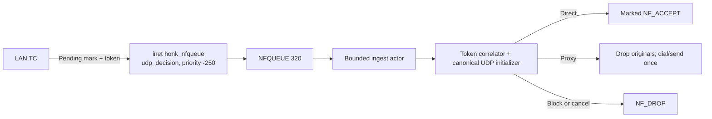

# NFQUEUE held-first-packet UDP

The NFQUEUE path holds ambiguous LAN-forwarded UDP originals until userspace returns a terminal direct, proxy, or block decision. The path fails closed.

## Activation and scope

The path is enabled by default through `global.nfqueue_enable`. Set it to `false` to disable it:

```dae
global {
    nfqueue_enable: false
}
```

Changing the setting normally requires a process restart. Reload rejects a toggle unless an actual pre-admission startup downgrade was recorded; the [global reference](../reference/global.md) explains that exception. Reload never retries activation after that downgrade.

Startup treats NFQUEUE as best-effort. Mock mode, a build without `ebpf`, a failed fixed-queue preflight, or a queue/rules/health failure before datapath admission logs a warning and disables staging for that process. It does not rewrite the config file. Persistent token-generation recovery failures stay fatal, because allocator state is ambiguous.

In real mode, the singleton instance lock is acquired before that preflight. A normal handoff therefore waits for the old queue owner instead of degrading spuriously. The reserved nftables table is reclaimed during installation, after queue binding. Once the service is admitted, listener, queue, watchdog, verdict, cleanup, and retirement failures stay fatal.

The hook is deliberately narrow:

| Traffic or state | Behavior |
| --- | --- |
| New, ambiguous LAN-forwarded UDP after LAN TC | Stage a unique token and hold the original skb in NFQUEUE when enabled and ready |
| Host-originated WAN UDP | Keep the canonical TPROXY path; host egress does not cross this `inet prerouting` hook |
| UDP port `53` | Follow [traffic-rule ownership](../reference/routing.md#outbound-targets-and-must). Fragmented LAN queries that need controller or raw handling use the complete-datagram path below, never ordinary conn-state or decision tokens |
| Internal/special or reverse-direction traffic | Never stage |
| A non-DNS `must` or `block` routing result | Treat as final; never stage |
| A direct result already safe at route time | Pass through the kernel direct path; never stage |
| Staging candidate while enabled but not ready | Drop the new flow; unrelated, non-staged UDP keeps its normal path |

An ambiguous flow is one whose preliminary route can still change after userspace routing, mode/group selection, or domain/QUIC inspection. The path avoids sending such a packet through a userspace relay when the preliminary result was incomplete.

## Packet-hold mechanism



| Mechanism | Current contract |
| --- | --- |
| Queue transport | `honk-nfqueue` uses raw `NETLINK_NETFILTER`; it does not shell out to firewall tools or use a netfilter helper library |
| Queue parameters | Fixed queue `320`, kernel maxlen `4096`, packet-copy range `65535`, and requested socket receive buffer `8 MiB` |
| Verdict ownership | A non-`Clone`, exactly-once `VerdictGuard`; dropping an uncommitted guard sends `NF_DROP` |
| Ingest ownership | One actor bounded to `256` entries and `8 MiB` of queued payload; a UDP slow-path permit is attempted only when the actor dequeues an entry |
| nftables ownership | One atomic transaction owns exact `inet honk_nfqueue` / `udp_decision`, an `inet prerouting` filter chain at priority `-250`; only UDP carrying the pending signature reaches the queue |
| Failure policy | No queue bypass, fanout, or fail-open flag exists. Identifiable bad or truncated UDP payloads and invalid checksums receive `NF_DROP`. Malformed queue metadata, unidentifiable headers, `ENOBUFS`, listener exit, and verdict-socket failure stay fatal |

The service binds queue `320` before publishing the nftables transaction. Installing the transaction reclaims the stale reserved table under the singleton process lock. On an orderly final shutdown, the service drains every dispatched guard, closes the queue, and deletes the owned table last. Same-network-namespace firewall managers must not mutate either reserved nftables object while honk runs.

`honk-core` uses this Linux mechanism only with the `ebpf` feature. Parsing uses
one exact-sized datagram allocation.

The core sampler and `StatsManager` report the current instance's queue depth
separately from process-wide drops accumulated across hard rebinds. They report
the latest kernel-read availability and errors, and refresh the held-guard and
effective-buffer gauges on every sample. Each sample opens procfs in the calling
thread's queue namespace before reading asynchronously through that
namespace-bound descriptor. Neither the process leader nor a blocking worker
selects the queue being sampled.

## Fragmented LAN DNS

TC evaluates the offset-zero UDP/53 fragment with the ordinary traffic policy. Native `direct(must)` and `block(must)` results and trusted exact control-plane marks keep their actions. A query that needs the DNS controller or a raw must group keeps its route/generation carrier in the host skb mark instead of crossing into `daens`; later fragments stay in the host too. Kernel IPv4/IPv6 defragmentation runs at priority `-400`, before the queue at `-250` and conntrack at `-200`. DNS has no fragment cache; [non-DNS fragment retention](./datapath.md#fragments-of-redirected-datagrams) belongs to the datapath.

The actor distinguishes these complete DNS datagrams from ordinary token-owned flows before it handles success, overflow, or rejection. It validates the carrier, current generation, and admission epoch, confirms `NF_DROP` on the original, and then publishes into the bounded DNS/raw pipeline used by transparent socket ingress. Existing redirect metadata restores replies from the original destination. UDP checksums are verified before dispatch, which allows IPv4's zero checksum and honors kernel checksum-partial metadata. An IPv6 zero checksum without that metadata is rejected.

A controller or raw fragment drops when the queue is disabled or unready; it never bypasses DNS policy. Unfragmented DNS keeps its TC fast path. This path does not add TCP-fragment support. It traverses host raw hooks, unlike a TC redirect, so an earlier firewall drop or mark rewrite can prevent admission. Copy truncation drops the identified packet instead of forwarding an incomplete DNS query.

An Ethernet first fragment that needs this path must be addressed to the host (`PACKET_HOST`). Pure L2-transit candidates fail closed instead of assuming bridge-to-inet hooks are enabled. LAN and WAN egress also drop an unconsumed DNS queue carrier, including while admission is closed. No bridge firewall sysctl is changed. A bridge/slave MAC mismatch may conservatively reject fragmented queries. Unfragmented DNS and native direct-must keep their existing behavior.

`ROUTING_GENERATION_SEQUENCE` is a core-owned, pinned one-entry counter. Reserve a nonwrapping 20-bit value before each routing publication or NFQUEUE fence. A fence replaces only the immutable descriptor and keeps the compiled policy and maps. Ordinary cleanup or restart preserves the counter, so an old first fragment cannot authorize a new process's group index. Exhaustion or a failed fence keeps NFQUEUE readiness closed; restarting does not reset it. Preserve this pin, like `UDP_DECISION_SEQUENCE`, while the host namespace can retain packets. Reboot clears both host reassembly and bpffs state.

## Decision-token protocol

`UDP_DECISION_SEQUENCE` is a pinned, persistent one-slot spin-locked allocator. Its legacy value is exactly 12 bytes: lock, full raw token in `next`, and `exhausted`. Startup validates this ABI and value but never rewrites it. Ordinary restart and cleanup preserve the pin so an older binary can resume at the same raw-token boundary after rollback.

| Bits or field | Meaning |
| --- | --- |
| skb mark bits `31..30` | `CLASSIFIED_MARK | NFQUEUE_PENDING_MARK` = `0xc0000000`, the staging signature selected by the nftables rule |
| Token mask | `NFQUEUE_TOKEN_MASK` = `0x3fffffff`; the token occupies the remaining mark bits |
| Token bits `29..28` | Two-bit generation `0..=3` |
| Token bits `27..0` | 28-bit monotonic sequence within the generation |

A token is ownership, not only correlation metadata. It must agree across the skb mark, `CONN_STATE_MAP`, `ROUTING_HANDOFF_MAP`, `REDIRECT_TRACK`, the userspace verdict cell, `UdpInitLease`, the endpoint or retirement tombstone, and the backend terminal transition. No terminal operation may act on tuple identity alone.

## Terminal transitions

| Decision | Ordered transition |
| --- | --- |
| Direct | Token-check `ArmDirect` → issue marked `NF_ACCEPT` for every held original skb in FIFO order → token-check `ActivateDirect` |
| Proxy | Commit token-bound final outbound and mark → transfer the one retained payload into the canonical UDP initializer → issue `NF_DROP` for the originals → dial and send once |
| Block | Commit token-bound `Block` → drop every original skb → retire the initializer as a kernel handoff |
| Cancel or expiry | Abort only the matching pending incarnation → drop every original skb and retire its lease identity |

Direct creates no userspace UDP socket, payload copy, replay, `Ready` endpoint, or `/connections` entry. Its final verdict mark keeps classification and removes the pending/token carrier. If another packet for the flow arrives after Arm, the correlator appends only its verdict guard, discards its payload and slow permit, and returns to the FIFO accept loop before activation.

Proxy does not create a second routing path. It reuses the `UdpInitLease` and `UdpEndpointPool` initializer used by ordinary transparent UDP. Publishing final kernel state before dial/send prevents a reply race. Only the retained payload is transferred, the originals are dropped, and the flow gets one send with no replay fallback.

## Deadline and fatality

Every packet has one absolute three-second receipt-to-verdict deadline, measured from raw-netlink listener receipt. Actor delay, commit-queue wait, and every backend-lock wait consume that same budget, including the second lock acquisition between Direct Arm and Activate. If the queue, correlator, or slow path saturates, or the deadline expires, packets drop and the path fails closed. It never extends ownership or grows memory.

`PendingUdpVerdicts` owns a joined pump. It batches up to 1,024 terminal requests, locks backend write → correlator cell, and releases the backend lock before endpoint kernel handoff. Synchronous backend work uses `block_in_place` on multi-thread runtimes and runs inline on current-thread runtimes. The pump keeps direct/block leases across caller cancellation. It rechecks original deadlines at dequeue, after backend locking, after grace, and before each item, and expires late requests without mutating the conn. Cancellation waits for armed Direct completion under that same deadline.

A watchdog checks held cells independently and enforces the hard hold bound. A stale token, endpoint-generation, or backend-state mismatch drops without mutating a newer incarnation. A verdict failure, or any failure after Direct has armed, is process-fatal, because userspace can no longer safely infer which originals the kernel accepted.

## Fences and lifecycle

### Reload and shutdown

Reload and shutdown share the same producer fence:

1. Publish `DATAPATH_FLAG_NFQ_READY=false`. New flows that require staging now fail closed.
2. Complete the synchronous `RETIRE_GRACE_ROOT` barrier. Then remove residual `Preparing`, `Pending`, and `Aborted` state in bounded, incarnation-checked tuple-fence batches. A delayed queue delivery then fails token lookup; descriptor-generation publication still fences queued DNS fragments.
3. Close correlator admission and drain or cancel verdict guards, initializer leases, scheduled token cleanups, endpoint tombstones, retirement work, and admitted commits before changing runtime ownership. Final shutdown stops and joins the pump; reload keeps it. Armed Direct commits can delay reload until their original three-second [receipt-to-verdict deadline](#deadline-and-fatality). Cancellation neither aborts them early nor starts a fresh timeout.
4. A successful reload publishes the replacement runtime generation and reopens correlator admission and readiness last. Shutdown detaches producers, closes queue ownership, and deletes `inet honk_nfqueue` last.

Failure or ambiguity in listener, queue, watchdog, cleanup, verdict, or retirement lifecycle is fatal. The runtime never reopens staging on uncertain ownership.

### Exact tuple retirement

Retirement publishes `RETIRE_ACTIVE` and inserts `RETIRE_FENCE[tuple]` with `BPF_NOEXIST`. It retains separate operation-owner and decision-token identities. A successful same-inner replacement of `RETIRE_GRACE_ROOT` drains pre-fence non-sleepable readers. The backend then revalidates incarnation, token, state, and auxiliary authority before deletion. Batches deduplicate fences but keep every request's outcome, partial deletion counts, and operation or release errors. Release checks the exact owner, and unresolved ownership inhibits admission. Initial `ArmDirect`/`ActivateProxy`/`Block` commits share this protocol, with one grace per batch. `ActivateDirect` alone updates immutable `DirectArmed` in place under native lock (`BPF_EXIST | BPF_F_LOCK`), without fence or grace. The backend write lock excludes other writers, and the kernel never renews `Pending`/`DirectArmed` timestamps.

WAN and LAN userspace UDP share this fence even with token zero. The endpoint retains its admission incarnation, and the WAN ownership bit distinguishes marked direct/must from native direct state. Reclaim matching auxiliaries before conn state, including on expiry. Preserve foreign metadata and refuse missing or superseded ownership. Userspace [endpoint retirement](./control-plane.md#tcp-relay-and-conn-state-ownership) requires actual conn-deletion evidence.

Before successful publication, a failed kernel producer records terminal `Aborted` with its captured incarnation and the actual allocated token, or zero if none was allocated. It does not delete tuple entries or convert a completed Pending/native/proxy/block decision. Preparing and Aborted followers cannot renew timestamps. Aborted cannot activate or forward, and it is immediately eligible for exact fenced hint or janitor cleanup. All physical tuple reclamation stays in the shared backend protocol.

## Sequence exhaustion and rotation

Exhaustion uses the lifecycle fence rather than resetting a live allocator:

1. Fence readiness, quiesce kernel stagers, cancel and drain userspace cells, and hard-rebind the fixed queue so old held skbs and guards cannot survive rotation.
2. Inspect all four live token-bearing maps: `CONN_STATE_MAP`, `RETIRE_FENCE` (its `decision_token`, never its operation owner), `ROUTING_HANDOFF_MAP`, and `REDIRECT_TRACK`.
3. Reset only when the candidate generation is absent from all four maps. Every numerically higher generation through `3` must be absent too. A rolled-back legacy allocator starting at the candidate can advance through exactly that suffix, so checking only the candidate would permit token reuse.
4. Reopen admission and readiness only after the locked allocator reset succeeds.

When batch lookup is available, a short successful map batch is not proof of completion. An absence scan continues until terminal `ENOENT`. If no rollback-safe suffix is clear, staging stays fenced and retries after `1`, `2`, `5`, then `30` seconds. It stays at `30` seconds for later failures. Non-staged UDP continues; only new flows that require staging fail closed.

## Capacity bounds

| Owner | Bound |
| --- | --- |
| Kernel NFQUEUE | `4096` queued packets |
| Userspace ingest actor | `256` entries and `8 MiB` retained queued payload |
| Verdict correlator | `4096` live flow cells |
| Commit pump queue | `4096` queued requests, one per live flow cell; reservation waits consume the [original deadline](#deadline-and-fatality) |
| One flow cell | `64` held verdict guards, including the first packet |
| UDP slow path | Effective startup budget capped at `256`; a permit is acquired only at actor dequeue |

The effective slow-path, endpoint, dial, and file-descriptor budgets derive from the process startup `RLIMIT_NOFILE` plan. `256` is therefore a ceiling, not a guaranteed permit count. See [Control plane](./control-plane.md) for budget derivation and ownership.

## Observability

With the API enabled, `GET /stats` exposes `udp.nfqueue`, documented as the dotted path `/stats.udp.nfqueue`. It reports listener and correlator counts, actor depth, bytes and oldest age, kernel queue/drop/read state, held and peak guards, the effective receive buffer, terminal verdict and token counters, verdict errors, and receipt-to-successful-verdict latency. See the [API reference](../reference/api.md) for the field inventory.

`EVENT_RINGBUF` emits a rate-limited `udp_decision_token_exhausted` warning as the immediate exhaustion signal. Recovery does not depend on that lossy channel. The supervisor periodically performs a locked read of `UDP_DECISION_SEQUENCE`, which detects exhaustion even if the event was dropped. Failure of this backstop is fatal.

## Related docs

- [eBPF datapath](./datapath.md)
- [Control plane](./control-plane.md)
- [Global configuration reference](../reference/global.md)
