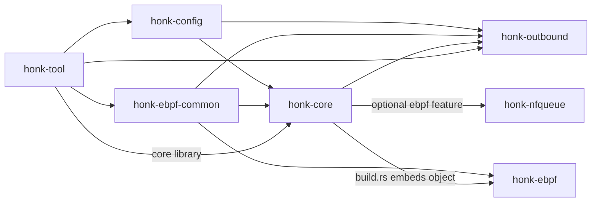
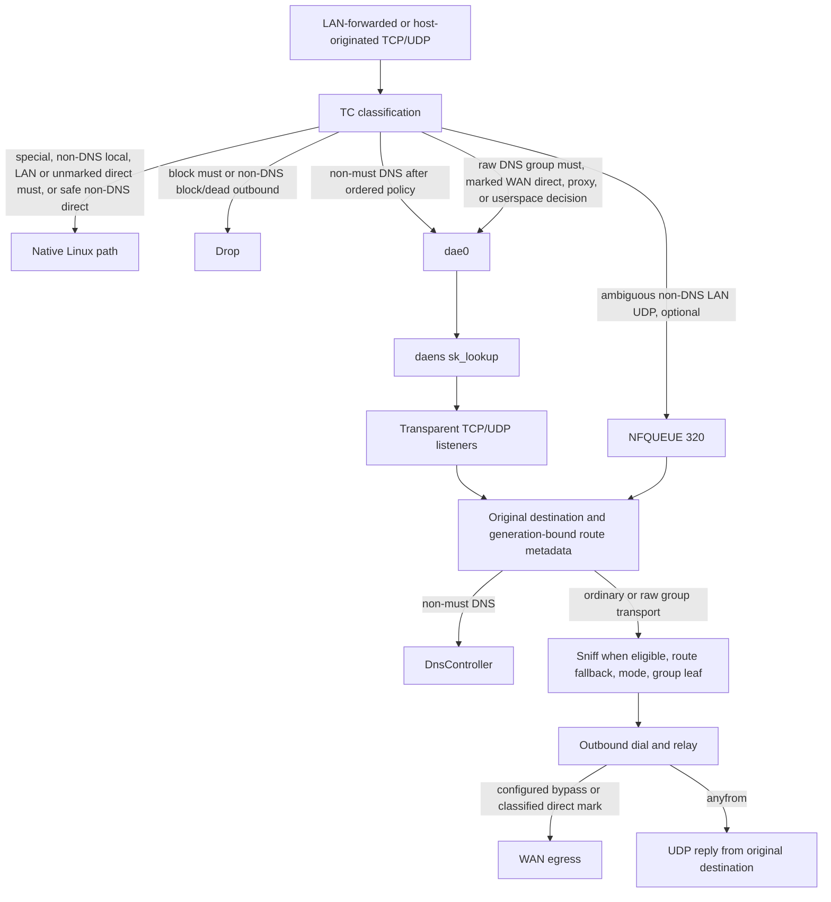

# Architecture overview

`honk` is a Linux eBPF transparent-proxy engine for gateway and host traffic. It is experimental alpha, licensed `GPL-3.0-only`, and developed in `daeuniverse/honk`. This page describes its architecture and runtime invariants.

The configuration syntax and TC datapath derive from dae and stay dae-compatible where documented. Outbound handlers, groups, and the Clash API follow sing-box designs. `honk` is an independent implementation and has diverged substantially from both.

## Goals and non-goals

### Goals

- Intercept Linux LAN-forwarded and host-originated traffic with an eBPF transparent-proxy datapath.
- Keep the native `.dae` configuration syntax as the primary and only documented configuration format.
- Provide multi-protocol outbounds, Selector/URLTest/LoadBalance/Fallback/Score groups, health checks, and a Clash-compatible control API.
- Ship one `honk-core` engine rather than a separate GraphQL service; optionally embed the pinned doona client with `native-ui`.

### Non-goals

- Full Clash Meta/mihomo parity. In particular, honk has no FakeIP engine or remote rule-provider/rule-set parity.
- Transparent proxying on Windows or macOS; the datapath is Linux-only.

## Crate map

The root workspace contains six crates. `honk-ebpf` is a separate Cargo project because it targets `bpfel-unknown-none`; it is excluded from the workspace and keeps its own `Cargo.lock`.

| Crate | Workspace | Responsibility |
| --- | --- | --- |
| `honk-config` | member | Shared configuration model, dae-syntax parser, include handling, share-link parsing, and subscription decoding. |
| `honk-ebpf-common` | member | `no_std`, `#[repr(C)]` constants and ABI types shared by kernel programs and userspace map writers. |
| `honk-nfqueue` | member | Raw `NETLINK_NETFILTER` queue `320`, verdict ownership, and the owned nftables transaction. |
| `honk-outbound` | member | Protocol handlers, per-node runtimes, outbound groups, health state, URLTest probing, and the always-compiled Score scorer. |
| `honk-core` | member | Engine library and binary: eBPF/NFQUEUE runtime, control plane, DNS, routing, relay, and Clash API. |
| `honk-tool` | member | CLI toolbox for subscription/node probing, datapath diagnostics, pinned-map inspection, and geo-asset queries. |
| `honk-ebpf` | excluded | TC, `sk_lookup`, and cgroup eBPF programs; built separately and embedded into `honk-core` when real eBPF is enabled. |

Changes to shared map keys, values, constants, or layouts must move together across `honk-ebpf-common`, `honk-ebpf`, and the `honk-core` map writers.

`honk-config` holds the shared configuration schema and parsers. Its pure-Rust dependencies are serde, regex, url, base64, chrono, and uuid. It enumerates interface addresses through `libc` `getifaddrs`, not an `ip` subprocess.

- `from_file` selects the loader by file extension. For a recognized `.json`, `.yaml`, or `.toml` extension, it tries that format, then falls back only among TOML, YAML, and JSON, never dae. For an unknown or missing extension, it tries file-aware dae (including `include`), then TOML, YAML, and JSON. The serde loaders are undocumented compatibility; dae is the primary format.
- Standalone `Node` serde reports each ignored protocol-incompatible field once. It reports them even when a later conversion fails. Diagnostics name schema fields only, never node names or values. `node::NodeSeed` returns the same warnings through a caller-owned sink and does not log; `FlatNode` remains the only flat wire adapter.
- `ConfigSeed` uses the Node seed for every original array element. Structured failures report the original node, group, and subscription indices, preserving map order or the declaration order of a sequence. They also report safe schema paths and the decoder's line and column, and never include the decoder's error text. A detailed file or JSON loader keeps the caller's diagnostic prefix when it fails; a successful format fallback removes only the abandoned attempts. When every format fails, the attempted diagnostics stay in order and one terminal cause follows. A dae semantic failure is final, unless the complete document decodes as a YAML, TOML, or JSON mapping with at least one known Config root key. In that case the structured loaders report their own outcome. Include and unsupported-policy errors stay final.
- Parser and share-link entry points return safe diagnostics and never log. They withhold scalar values, names, links, and raw error payloads. Static failure causes and migration guidance stay available, including the replacement of `dns.hosts_file` with `dns.use_host`. Group, filter, subscription, and entry positions use the original ordinals. Detailed dae diagnostics share a metadata-only source table, which records include-parent links and available physical line numbers. Only the outer attempt appends a terminal cause.
- `src/node/validation.rs` owns collection admission and shared checks. `src/node/vless.rs` exclusively owns canonical `VlessConfig` normalization, path selection, and combination validation. `src/node/protocol.rs` owns the other protocol configs and the shared TLS/stream/QUIC options. Detailed loaders keep typed causes and original one-based node coordinates.
- `src/parser/` holds `mod.rs`, which owns file-aware `include` and ordered root
  dispatch. `lexer.rs` and `cursor.rs` keep source-backed tokens, comment spans,
  and bounded segments; `read.rs` shares scalar and expression access. Section
  readers live in `scalars.rs`, `experimental.rs`, `entries.rs`, `groups.rs`,
  `dns.rs`, and `routing.rs`. Includes resolve entry-relative globs inside the
  canonical entry directory and reject duplicates and cycles. Permissive readers
  skip unknown nested blocks without applying their descendants. Node and
  subscription compatibility wrappers still traverse them, while outer
  experimental and NFQUEUE errors stay fatal. Readers return typed errors; only
  the outer attempt publishes a terminal diagnostic. Notice ordering is
  finalized per attempt with source-local prefix-maxima indexes. This keeps the
  legacy append order and the caller's prefix without repeated vector insertion.
  A segment records whether a statement was accepted or ignored and whether a
  block is compact or braced. Readers do not infer structure from a trailing
  token. Statement admission runs before compact splitting and continuation
  updates. A dynamic group header stays separate from entry values: once an
  entry value is populated, declaration splitting stops early. Structural
  comment-brace notices use the live cursor scope and are emitted once, before
  the EOF checks. Filter diagnostics keep the error provenance of the original
  token. Traversing sibling nodes, subscriptions, and groups resets semantic
  notice ownership. Body syntax separates line-local entries from multiline
  expressions. Parenthesis shielding follows returned expression statements
  across same-source roots and resets at source boundaries. An indexed opener
  keeps its existing header and subtree ownership. Subscription raw fields keep
  the complete opening-token bytes, independently of the structural header view.
- `src/share_link.rs` is the sole `Node::from_share_link` parser. `src/share_link/options.rs` maps URI packet encoding and independent mux controls into the canonical protocol model. Normalization and validation precede identity derivation. It does not retain a second VLESS mode model.
- `src/node/wire.rs` is the sole flat serde adapter. It rejects the removed VLESS legacy field by raw presence, including `null`. The same field on non-VLESS input remains only a compatibility artifact. `VlessConfig.network`, `udp_encoding`, and `multiplex` determine identity, so a canonical cutover can change a VLESS `Node.id` without changing VMess behavior or identity.
- Canonical VLESS behavior is summarized in [Outbound design](./outbound.md#vless-wire-contracts); field-level syntax and URI values belong in the [node reference](../reference/nodes.md).
- `src/experimental.rs` defines `ExperimentalConfig` for `clash_api`, `native_api`, and `cache_file`. Native settings are strict, independent, and require a restart. `native-api` is opt-in: build with `--features native-api` or `native-ui`; the full and `-native-api` release artifacts include it. It provides userspace observations, bounded histories, source-owned Group PATCH and main-entry administration, and verified-geodata activation. Its listener is disabled by default. `.dae` remains authoritative. Per-network automatic-policy pin and clear are enabled. A pin belongs to the current GroupManager and disappears on activation. Credential-bearing sources are read-only. Returned content masks listener-secret values instead of omitting bodies. Native mode and full kernel transparency stay gated. Default-off `native-ui` embeds licensed pinned doona assets obtained at packaging time through `ci/fetch-doona.sh` and `.github/ci/pins.env`. `build.rs` reads the absolute `HONK_DOONA_DIR`; there is no runtime fetching or frontend build. The dae parser explicitly whitelists the nested sections. It accepts the deprecated `udp_nfqueue` section only as a migration input and warns; `enabled` is copied to `GlobalConfig::nfqueue_enable` only when `global.nfqueue_enable` is absent.
- `src/subscription.rs`, `src/types.rs` (`NodeProtocol` with 11 variants, Direct/Block reserved for the built-ins; `DialMode` ip/domain/domain+/domain++; `SubscriptionType`; `DnsProtocol`; plus the shared `default_true`/`parse_duration_secs` helpers), `src/error.rs` (`ConfigError`).

## High-level data path

### Packet walk

1. The [datapath](./datapath.md) classifies LAN-forwarded traffic at LAN TC and host-originated TCP/UDP at WAN TC. Ingress and control-plane exclusions run first. Ordinary LAN port-53 traffic cannot bypass policy through a local socket. Non-DNS local-socket handling is unchanged. LAN `direct(must)` and route-time-safe non-DNS direct decisions stay native. A nonzero marked WAN direct decision needs a userspace socket for a new marked route lookup.
2. [Traffic-rule ownership](../reference/routing.md#outbound-targets-and-must) decides which port-53 queries enter the [DNS pipeline](./dns.md). Admitted transparent queries, the optional host-netns `dns.bind`, and flow-associated reality/target lookups all share the generation-pinned DNS policy, cache and singleflight, upstream pools, and routing projection.
3. The [datapath](./datapath.md) redirects ordinary proxy and userspace decisions through `dae0`. Inside `daens`, `sk_lookup` assigns them to the [control plane's](./control-plane.md) transparent TCP or UDP listener.
4. [NFQUEUE staging](./nfqueue.md) is enabled by default through `global.nfqueue_enable` when the startup prerequisites pass ([Configuration](../configuration.md)). It holds only ambiguous LAN-forwarded UDP, after LAN TC and before conntrack/NAT. Each staged flow allocates a persistent, unique decision token and publishes token-bound Pending before fixed queue `320`. Host-originated WAN traffic stays on canonical TPROXY. Direct, proxy, and block completion follows `honk-core`'s `control/nfqueue/`. A direct result creates no userspace socket, copy, retransmission, `Ready` endpoint, or connection entry.
5. The [control plane](./control-plane.md) recovers the original destination. For TCP it uses `SO_ORIGINAL_DST` / `IP6T_SO_ORIGINAL_DST`, with a transparent-`local_addr` fallback. For UDP it reads the IPv4 `IP_ORIGDSTADDR` or IPv6 `IPV6_ORIGDSTADDR` cmsg. TCP validates accepted-FD SYN ownership before using its immutable handoff. UDP reads identity-checked tuple metadata without consuming it. Owned unresolved decisions may use `Router::route_action`. Port-53 flows keep their distinct [TCP handoff and UDP per-packet admission rules](./control-plane.md#transparent-ingress).
6. The [routing path](./routing.md) may sniff TCP TLS SNI or HTTP Host, or decrypt UDP QUIC Initial SNI. It then runs the userspace `Router` when the kernel result is not final. Sniffing skips must-rules, `dial_mode: ip`, and negative-cache hits. `dial_mode: domain` runs a DNS reality check.
7. The [group layer](./groups.md) applies the Clash mode override but leaves final `must` and `block` results unchanged. `SharedGroupManager` then resolves the authoritative policy pick to a leaf. Score ranks only health-eligible members, using per-target TCP/UDP evidence. TCP and UDP normally use one authoritative leaf. Only a cold top-level URLTest initially staggers contenders, and only its winner commits an endpoint or source transport.
8. The [outbound layer](./outbound.md) dials that leaf through `TcpOutbound` or a fallible prepared UDP commit. An ordinary packet path binds one `PacketTransport` to the endpoint. A source-shared protocol (XUDP/Mux.Cool, Hysteria2, TUIC, and every `MultiTargetTransport`) may instead commit a core-owned source association shared by several canonical five-tuple endpoint views. Sniffed TCP bytes are forwarded first. Plain TCP then uses splice, and wrapped streams use copy. An unencrypted Vision TLS/REALITY carrier may lend its socket to splice once both directions are Direct.
9. Control-plane egress uses `global.so_mark_from_dae`; zero selects the default `0x100`. A marked direct flow uses its rule mark plus `CLASSIFIED_MARK`. WAN TC recognizes both forms without adding the default bypass bit. Proxied UDP and transparent port-53 replies use [anyfrom sockets](./control-plane.md) bound to the original destination. This lets the [return datapath](./datapath.md) preserve the source address.

## Runtime invariants

- Bypass-mark discipline: dials, probes, DNS upstreams, HTTP downloads, QUIC endpoints, and transparent listeners carry the process-configured bypass mark. A nonzero direct rule mark replaces the mark's low 30 bits and adds `CLASSIFIED_MARK`; policy rules must mask with `0x3fffffff`. Accepted TCP sockets have the listener mark cleared. Ordinary host-netns `dns.bind` ingress sockets are deliberately unmarked.
- Anyfrom UDP replies: proxied UDP and transparent port-53 DNS replies use transparent sockets created inside `daens` and bound to the flow's original destination. A reply from the TPROXY listener exposes the `dae0` source and fails on the return path. A reply from an alternate full-cone source returns through the client-only `CLIENT_REPLY_TRACK` framing instead of host forwarding. It never teaches the datapath a native reverse direction for the client's next packet to that source.
- DNS source boundary: the transparent and `dns.bind` adapters derive the logical client source from the socket peer. Flow-associated lookups use the admitted flow's source. Cache reuse starts only after routing materializes the selected source-neutral scope. Each policy generation's domain-predicate projection stays global and source-independent.
- UDP source boundary: source-shared protocol reuse is indexed by reused runtime, normalized client, protocol/UDP path, and actual-peer/original-destination reply projection. The full five-tuple endpoint map still owns routing, token/generation, and per-flow Score. The source association owns its one receiver and transport health. Source ownership of every non-VLESS protocol remains available without `rprx`.
- Network-namespace discipline: the process remains in the host netns. It enters `daens` only through scoped, fully synchronous `with_daens_netns` calls. No `.await` may occur across `setns`. Failure to restore the original namespace aborts the process.
- Datapath admission: `DATAPATH_STATE_MAP[0]` stays closed until every listener FD is published and every receive loop is running. It closes before listener teardown. TC passes traffic unchanged while the gate is closed.
- NFQUEUE readiness and ownership: enabled-but-not-ready staging drops only new flows that require staging. honk exclusively owns queue `320` and nftables `inet honk_nfqueue` / `udp_decision`. Readiness changes are fenced and lifecycle ambiguity is fatal. Same-netns firewall managers must not mutate those objects.
- Token-checked terminal state: a staged UDP token must agree across the skb mark, kernel state, handoff, redirect track, userspace verdict state, lease/endpoint, and backend transition. Direct follows Arm → all marked verdicts → Activate. Proxy publishes final state before its one canonical dial/send path.
- `must`/`block` finality: Clash mode overrides never replace a `block` result or a dae `(must)` result.
- Fail-closed dead outbounds: `lan_ingress` drops new flows routed to a dead outbound. A TCP group with one unique leaf and no `final` keeps that same proxy as a userspace last resort. UDP and all-dead multi-leaf groups stay fail-closed. A group containing a `direct`/`block` builtin never goes dead, because the builtins are never marked dead and the group-OR slot stays alive. TCP and UDP port `53` are exempt from health drops on LAN ingress and WAN egress, but not from terminal user `must` ownership. Gateway management follows [explicit local rules](../reference/routing.md#explicit-local-rules), not synthesized interface rules.
- Group-OR connectivity: the eBPF alive slot for a group is the OR of all leaf-member states, plus the sole-TCP-leaf last-resort exception above. A single dead member in a multi-leaf group must not make the whole group fail closed.
- Score isolation and reasons: health filtering and business-target family stay independent. First-choice utility stays heuristic. Healthy promotion compares every eligible challenger with a fixed incumbent, using shared target/time evidence rather than unrelated aggregate/setup averages. The evaluation set is bounded and sized by demand. Optional trials share a retained group/network/family budget funded by original business starts, never by elapsed time. Trials do not become committed incumbents. Real-flow streaks retain backoff and three-failure exclusion. Exact and aggregate evidence use separate 4,096-entry LRUs. Comparison storage is capped at 512 cells and 1 MiB of logical allocation, not process RSS. Overlapping counts are not added. Reload preserves admitted business outcomes while revoking recent usability and probe baselines. Public summaries and counters stay scope-limited and never expose raw scorer target keys; see [group design](./groups.md#score-scoring-and-lifecycle).
- Demand-driven Score feedback: setup/response and bounded directional progress publish before terminal settlement, without extra Beta completions. Traffic, configured health, and warm-up sources have separate roles. An arbitrary manual delay measurement never becomes business reliability or a configured baseline. Score TCP setup can recover once through a different permitted leaf under the original deadline, without new final edges, Selector escape, or payload replay.
- Conditional verification surface: Score proxy objects publish aggregate provisional/usable state, fresh pairwise challenger response relations, and evidence questions and wait reasons with the same readonly selected member. There is no group-wide comparison claim. `/stats` adds fixed group/network verification and budget/cost fields, plus a nested-deduplicated root business count. Observed trial failures are not causal extra failures. Neither surface exports raw target keys or a probability of optimality. See [API verification](../reference/api.md#score-verification).
- Internal and special traffic: honk's link-internal ranges `169.254.0.0/16` and `fd00:686f:6e6b::/64` are never proxied. L2 broadcast/multicast, IPv4 broadcast/multicast/unspecified destinations, and IPv6 multicast pass through before routing or conntrack.
- Explicit local routing: users [configure gateway management access](../reference/routing.md#explicit-local-rules) explicitly; no generated interface rules provide it. WAN egress still bypasses destinations matching `PARAM.local_ip`. This is not a general management-access guarantee. `PARAM.local_ip` is a startup snapshot. It selects the first resolved, existing LAN entry with a bindable canonical root, skipping refused roots. If there is none, it falls back to WAN. It then takes that root's first IPv4 address. Canonicalization follows the interface planner: bond/bridge members use their canonical master, while `vrf`/`openvswitch` members stay themselves. If no root is selectable, or the selected root has no IPv4 address, the value is 0 and that bypass stays off. Later interface or address changes do not update the snapshot. A WAN address chosen while the LAN is absent also stays for the process lifetime. Interface observation still serves topology/ECS/health, and the existing non-DNS TCP pure-SYN local-probe skip remains.

## Build features and mock mode

`honk-core` defaults to `clash-api`, `jemalloc`, and `rprx`; real eBPF is opt-in.

| Feature | Default | Effect |
| --- | --- | --- |
| `ebpf` | no | Pulls in `aya`, `aya-obj`, `aya-log`, and optional `honk-nfqueue`. `build.rs` embeds the static `honk-ebpf` object, and userspace compiles policy extensions at runtime. Requires Linux kernel 6.12+ at runtime. |
| `clash-api` | yes | Pulls in optional `axum` and `tower-http` for the Clash-compatible REST/WebSocket service. |
| `native-api` | no | Independent HTTP/1.1 native observations, opt-in accepted-source administration, and a local-directory UI. It owns bounded connections, checks bearer/Host/Origin strictly, and does not depend on Clash. |
| `native-ui` | no | Includes `native-api` and embeds assets from the pinned doona distribution for `ui: embedded`. `ui: embedded-lite` selects the lighter doona lite edition (preview) with the same feature requirement. No runtime extraction, download, or frontend build. |
| `jemalloc` | yes | Pulls in `tikv-jemallocator` and installs jemalloc as the `honk-core` binary allocator; the crate builds jemalloc from C source. On Linux, startup disables transparent huge pages for the process before starting Tokio. Runtime options use `_RJEM_MALLOC_CONF`, not `MALLOC_CONF`, because the crate prefixes jemalloc symbols with `_rjem_`. |
| `rprx` | yes | Enables `honk-outbound/rprx`, which registers the VLESS and VMess handlers, including the supported VLESS Encryption and `xtls-rprx-vision` paths. |

`mock-ebpf` is not a Cargo feature. A build without `ebpf` uses `MockEbpfBackend`, and `--mock-ebpf` selects the unprivileged development path explicitly. If `global.nfqueue_enable = true` is requested, startup logs a warning and disables NFQUEUE staging for that process. The config file is unchanged.

When embedding eBPF, `build.rs` rebuilds with the kernel crate's pinned compiler and standalone release policy. It does not inherit host `RUSTFLAGS`, `CARGO_ENCODED_RUSTFLAGS`, or `CARGO_PROFILE_*` profiling overrides. The compiler sidecar must be no older than the embedding build script, so an embedding-policy change invalidates previously built objects. Explicit `--bpf-object` artifacts and manual kernel builds remain the caller's responsibility.

## Authorship disclosure

- The eBPF datapath (`honk-ebpf`, `honk-ebpf-common`, and the attach/map path in `honk-core`) is the project maintainer's primary human design, implementation-review, and verification focus.
- Most remaining userspace subsystems (configuration parsers, outbound handlers, groups and health checks, userspace DNS, Clash API, and much of the control-plane glue) were largely authored with AI assistance. The maintainer performed partial code review rather than line-by-line ownership.

## Related docs

- [Configuration guide](../configuration.md)
- [Datapath design](./datapath.md)
- [Global configuration reference](../reference/global.md)
