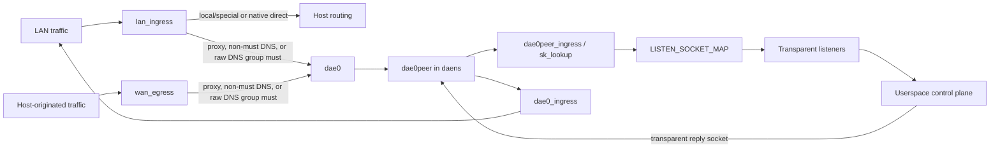

# eBPF 核心資料路徑

核心資料路徑負責攔截流量；使用者態路徑見[控制面](./control-plane.md)，暫存首包的 UDP 路徑見 [NFQUEUE](./nfqueue.md)。

## 網路名稱空間與 hook 架構

需要代理的封包由 honk 重新導向到隔離的網路名稱空間，主機端不需要 TPROXY 規則：

### 網路名稱空間生命週期

honk 用一個生命週期很短的輔助執行緒建立 `daens`：該執行緒呼叫 `unshare(CLONE_NEWNET)`，開啟 `/proc/thread-self/ns/net`，再把取得的 `OwnedFd` 交回行程。這個 FD 在整個行程生命週期內固定住 `daens`。`/var/run/netns/daens` 只是盡力建立的相容 bind 掛載，引擎不靠它持有網路名稱空間。

核心支援時，honk 用 rtnetlink 建立 L2 netkit pair `dae0`/`dae0peer`；不支援時退回 veth pair。隨後 honk 透過網路名稱空間 FD 把 `dae0peer` 移入 `daens`，再設定連結、位址、鄰居、策略規則與路由。兩端的位址如下：

| 一側 | IPv4 | IPv6 |
| --- | --- | --- |
| 主機 `dae0` | `169.254.0.1/32` | `fd00:686f:6e6b::1/64` |
| `daens` 的 `dae0peer` | `169.254.0.11/32` | `fd00:686f:6e6b::2/64` |

兩個 IPv4 endpoint 各自是獨立的 `/32` 位址，不共用一個 `/30`。honk 用連結作用域路由和靜態鄰居讓對端可達。在 `daens` 裡，fwmark `TPROXY_MARK` 選中表 `100`；該表的 IPv4 與 IPv6 local 預設路由把封包交給本機透明 socket。

其餘時間行程都留在主機網路名稱空間。每次切換都由 `with_daens_netns` 依序處理：它用行程級 mutex 排隊，儲存 `/proc/thread-self/ns/net`，進入 `daens`，執行一個純同步閉包，然後在正常返回或 panic 時還原原網路名稱空間。閉包不能跨越 `.await`，因為 `setns(2)` 只作用於執行緒。還原失敗時行程直接 abort，否則某個 worker 會留在 `daens` 裡，並從那裡發起後續撥號。

### 介面 hook 集合

honk 依每個介面的[訊框格式分類](../reference/global.md#網卡語義)選用 `_l2` 或 `_l3` 變體。啟動只驗證初始計畫要用的變體，需要時再加一個路由目標。之後新需要的變體在共享後端鎖之外驗證，通過後才能繫結。

設定裡的每個名稱先解析為規範根介面。bond 或 bridge 的成員解析到它的 master；本身是 bridge 埠的 bond 解析到該 bridge；其他 master 的成員也解析到 master，但 `vrf` 和 `openvswitch` 的成員保持自身。honk 支援一層 bond/bridge 巢狀，外加作為 bridge 埠的 bond。其他 bond/bridge 巢狀，或自身就是 master 的介面，honk 只拒絕該設定項並給出原因 `unsupported_type`，其餘項照常在啟動時繫結並 reconcile。各根介面獨立規劃：只出現在 `lan_interface` 的根算 LAN，只出現在 `wan_interface` 的算 WAN，兩邊都出現的算 LAN/WAN 共用：

| 根介面角色 | hook |
| --- | --- |
| LAN | `lan_ingress` + `lan_egress` |
| WAN | `wan_ingress` + `wan_egress` |
| LAN/WAN 共用 | `lan_ingress` + `wan_egress`；跳過 `lan_egress` 和 `wan_ingress` |

角色按介面各自判斷，所以多 LAN 設定裡出現一個共用介面，不會改變其他 LAN 介面的 hook。流量可能繞過 bridge master 上的 hook，因此 LAN bridge 根介面還會給每個埠繫結 hook，角色固定為 LAN，WAN 名稱不會把它提升為共用。bond 根介面只把邏輯 master 按表中角色繫結，不繫結成員。作為 LAN bridge 埠的 bond 仍是一個邏輯 LAN 埠，保留 `lan_ingress` + `lan_egress`，不展開成員。假設 LAN 是 `br0`、WAN 是 `bond0`，而 `bond0` 屬於 `br0`，那麼 bridge 為 LAN/WAN 共用，`bond0` 與其他埠仍為 LAN。沒有設定 `lan_interface` 的純 WAN 部署不裝任何 LAN hook。

bond 上只攔截經過邏輯 master TC hook 的正常軟體 skb。bonding 先決定哪些接收訊框進入 master，honk 隨後才分類，所以不會搶在 bonding 的接收決策前接管 inactive 成員上的訊框。直接注入成員的原始 `AF_PACKET` 訊框，以及繞過這些 TC hook 的路徑，包括這類硬體卸載，都不在覆蓋範圍內。

LAN TCP 與非 DNS UDP 在 bond 上被攔截時，`REDIRECT_TRACK` 記下 master ifindex；符合條件的 LAN UDP `CLIENT_REPLY_TRACK` 條目也保留這個 index。回覆從 master 的 TX 發出，即 `dev_queue_xmit`，由 bonding 選擇當前出埠。WAN 本機流量被攔截時儲存 master ifindex 和 `from_wan=1`，回覆經 master RX 回來，即 `BPF_F_INGRESS`，不依賴 `CLIENT_REPLY_TRACK`。active 成員切換和成員熱插拔都不需要 honk 在成員上掛 hook。WAN 本機回覆的目的 MAC 用的是擷取時讀到的 bond MAC，所以 honk 不支援 `fail_over_mac=active`，核心在成員無法設定 MAC 時會強制使用該模式，honk 也未驗證過：故障切換一旦改變 bond MAC，已有流上的後續回覆就不再作為本機封包交給主機 socket。

`lan_ingress` 分類轉送的用戶端流量，`wan_egress` 另外分類主機自己建立的流量。拓撲提供獨立方向時，反向 ingress/egress hook 只更新既有連線狀態。TCP 狀態只由正向 SYN 發布：反向的純 SYN 既不建立也不更新它。

在 Linux 6.12+ 上，honk 把介面 hook 建成 FD 持有的 TCX BPF link，排在既有 TCX 程式之後。啟動、重新繫結和關閉只釋放自己的 link。honk 不會建立或刪除實體介面上的 `clsact` qdisc 和舊式 filter；用不到的遺留項請手動刪除。啟動時 honk 重建遺留的 `dae0`/`dae0peer` 對。核心選項見[開始使用](../how-to-start.md#核心設定)。

不寫 mark、也不受所有權 guard 保護的直通出口返回 `TC_ACT_UNSPEC`（`-1`，在 TCX 等同 `NEXT`），讓後續的 TCX 程式繼續執行；反向重新整理和跳過 DNS 都屬於這類出口。在最低支援的核心上，`TC_ACT_PIPE` 不能當作繼續動作。會寫 mark 的路徑返回 `TC_ACT_OK`（`0`，在 TCX 等同 `PASS`），鏈到此為止；這類路徑包括明確寫零的 WAN 路徑，以及 LAN classified/pending 和 WAN 精確 socket-mark/classified 的所有權 guard。

屬於其他裝置的訊框同樣以 `NEXT` 繼續，因此同一裝置上排在後面的 TCX 程式以及 legacy `clsact`/`cls_bpf` 過濾器都能看到它們：

- **帶 VLAN 標籤的訊框。** 在乙太網路父裝置上，也就是 `_l2` 變體，`lan_ingress` 和 `wan_egress` 不處理仍帶標籤、VID 非零的訊框，把它們留給 VLAN 裝置。VLAN 裝置自己的 hook 會分類去標籤後的訊框。如果父裝置把它們重新導向進 `daens`，會在那裡按 `PACKET_OTHERHOST` 丟掉。跳過的只有這兩個 hook，反向的 `lan_egress` 和 `wan_ingress` 仍會更新連線狀態。VID 0 的優先順序標籤由父裝置直接上交，照常分類。`_l3` 程式只在按乙太網路 header 解析的訊框上遇到標籤，見[訊框格式](../reference/global.md#網卡語義)。
- **不支援的 LAN 入站訊框。** 非 IP 的 EtherType 和不支援的 L4 以 `NEXT` 返回，並且不寫 `CLASSIFIED_MARK`，好讓 `macsec0` 這類上層裝置能分類自己解密後的訊框。非 IP EtherType 有 ARP 和 MACsec，不支援的 L4 有 GRE、IPIP、ESP、ICMPv4，以及 Redirect 之外的 ICMPv6。NDP Redirect、非首分片和畸形封包則保持終結性的 classified `PASS`。不帶標籤、但已帶 `CLASSIFIED_MARK` 或 pending 標記的訊框也一樣，因為所有權 guard 先於解析執行。

### 介面協調

`InterfaceBindings` 是介面繫結的唯一 owner。它儲存已載入的 TC 程式 FD，並為每個自有 `(ifindex, direction)` 儲存一個 FD 持有的 TCX link。啟動時它先開啟 rtnetlink 訂閱，再讀一次拓撲快照，中斷的 link dump 最多重試三次。然後它推導計畫、解析 `local_ip`、載入 BPF 物件並繫結。設定項的行為契約見[網路卡語義](../reference/global.md#網卡語義)。

啟動只在以下情況失敗：

- 無法讀取拓撲。中斷的 dump 除外，其他錯誤立即失敗。
- 有 `auto` 項時無法讀取預設路由。
- 啟動集合裡的 TC 變體載入不了。啟動集合指啟動計畫繫結的變體；若其中沒有路由目標，再加上 `lan_ingress_l2`，沒設定 LAN 時換成 `wan_egress_l2`。
- 內部 link 失敗，包括 `dae0`/`dae0peer`、cgroup 和 `sk_lookup`。

`dae0`/`dae0peer` 的 ifindex 為零，或 `dae0peer` 的 MAC 全零，同樣算失敗。

啟動序列只有一份實作，真實 eBPF VM 測試用的也是它。序列在資料路徑 admission 或 READY 之前結束。之後某個計畫第一次需要的變體在阻塞執行緒上驗證，不持有共享後端鎖；`auto` 切換到 PPP 或 WireGuard 裝置就是例子。提交時先掛上當時有效的路由 generation，再把變體釋出為可繫結。一個變體載入或擴充失敗，不影響其他獨立變體的嘗試。載入器始終持有未載入程式中嵌入的原始 map FD，日誌和事件消費者拿的是副本，因此它們失敗或取消不會讓後續載入失效。

只有某項為 `auto` 時才讀 `/proc/thread-self/net/route`。讀取錯誤不等於「沒有預設路由」：啟動階段它是致命錯誤，之後算 reconcile 失敗，保留現有繫結。

[API 參考](../reference/api.md#原生-api)定義 `interface_binding` 降級與原因優先順序。reconcile 失敗時，繫結和降級保持最近一輪已完成 apply/commit 的結果。

`IfaceWatcher` 接管啟動時在拓撲 dump 之前開啟的 rtnetlink 訂閱。每 60 秒一次的 tick 是事件交付的後備，首次 reconcile 無條件執行，覆蓋啟動期間的變化。訂閱或它的 poll 註冊失敗時，reconcile 只由 tick 驅動，並報告 `iface_watch` 降級。拓撲發現、程式驗證和 TCX link I/O 都在 backend 鎖之外執行。watcher 只在讀鎖下準備驗證任務或複製 link 快照；寫鎖下只做三件事，掛接當前路由擴充、釋出已驗證變體、轉移 link commit。路由釋出和接收追蹤準備都不會持這把鎖等 TC verifier。計畫不變且 link 健康時不提交任何內容。角色變化時就地更新既有 link，不會再疊一個。

關閉時先發 stop，再 join watcher。watcher 會等進行中的批次完成；超過階段逾時只記 warning，仍繼續等，之後才釋放 BPF hook。

連結、位址、路由或介面角色變化時，介面位址仍用於拓撲偵測和 ECS 重新整理。honk 不再生成 `direct(must)` 規則，也沒有隱藏的核心位址白名單。系統清除健康檢查 cooldown 並觸發新探測。新探測成功之前，失效的 UDP 和多葉節點出站仍保持 fail-closed；未設定 `final` 的單葉節點 TCP 代理群組仍可在使用者態作為最後嘗試。

## 程式清單

| 程式 | hook | 核心職責 |
| --- | --- | --- |
| `lan_ingress_l2`, `lan_ingress_l3` | LAN TC ingress | 檢查 admission，繞過特殊/控制面及非 DNS 本機流量，執行單源新流限制與含埠 53 的有序路由策略、DNS 接管判斷、連線狀態、direct 卸載、代理重新導向、TX 計數、分片 verdict 記錄，以及可選的歧義 UDP 暫存。 |
| `wan_ingress_l2`, `wan_ingress_l3` | WAN TC ingress | 更新反向連線狀態；LAN/WAN 共用介面上不掛接。 |
| `lan_egress_l2`, `lan_egress_l3` | LAN TC egress | 更新反向連線狀態，不從 `dae0` 的 UDP 封包建立新條目；抑制本機產生的 ICMPv6 Redirect。LAN/WAN 共用介面上跳過。 |
| `wan_egress_l2`, `wan_egress_l3` | WAN TC egress | 路由主機發起的 TCP/UDP，使用行程名與控制面旁路資料，檢查出站連通性，快取決策並重新導向代理流量；抑制本機產生的 ICMPv6 Redirect（LAN/WAN 共用介面的 LAN-egress hook 被跳過）。 |
| `dae0_ingress` | 主機 `dae0` 的 TC ingress | 從 `REDIRECT_TRACK` 還原回覆訊框資訊與 RX 歸屬，或使用不計數的用戶端回退；[續期符合條件的 UDP owner](#udp-生存期續期)。 |
| `dae0peer_ingress` | `daens` `dae0peer` 的 TC ingress | 在連結 scrub 後還原 UDP53 provenance 與 SYN incarnation；分配 UDP listener。TCP 保留原生 established/TIME_WAIT 查詢。 |
| `tproxy_sk_lookup` | `daens` 中的 `sk_lookup` | 用 `LISTEN_SOCKET_MAP` 中的透明 listener 覆蓋一般 socket 查詢。 |
| `tproxy_wan_cg_sock_create` | cgroup `sock_create` | 保留 socket 首次擷取的行程身分；擷取失敗只計數，建立不受影響。 |
| `tproxy_wan_cg_connect4`, `tproxy_wan_cg_connect6` | cgroup `connect4`, `connect6` | 保留既有身分，缺失時在 connect 前擷取；擷取失敗只計數，連線不受影響。 |
| `tproxy_wan_cg_sendmsg4`, `tproxy_wan_cg_sendmsg6` | cgroup `sendmsg4`, `sendmsg6` | 保留既有身分，缺失時在傳送前擷取；擷取失敗只計數，傳送不受影響。 |
| `honk_tcp_passive` | cgroup2 根上的必需 `sock_ops` | 在自有 `daens` 內 child 的 `PASSIVE_ESTABLISHED_CB` 上，驗證 child 的 tuple、ISN 與 conn/handoff/redirect incarnation，再把已證明的 handoff 寫入 child 的 socket storage。 |

`LISTEN_SOCKET_MAP` 的 key 固定為 `0` TCP4、`1` TCP6、`2..=5` UDP4、`6..=9` UDP6。所有 UDP 路徑共用 `udp_listener_index`；輸入是源和目的位址的低位位址字以及埠，都取主機位元組序。`tproxy_sk_lookup` 在 `src/sk_lookup.rs`，它的 IPv4/IPv6 context 讀取必須保留為獨立的 `#[inline(never)]` 子程式。在最佳化等級 2 下，行內展開可能產生計算偏移讀取，verifier 會以解引用已修改的 context 指標為由拒絕。

TC 入口點是原始函式，接受 `*mut __sk_buff`，帶 `#[unsafe(no_mangle)]` 和 `#[unsafe(link_section = "classifier")]`。它們不用 Aya 的 `#[tc]` 巨集，因為該巨集的結構化引數形狀在 7.0 及更高版本核心上會被 verifier 拒絕。程式主體返回 `Verdict = Result<c_long, c_long>`，即 `action::Verdict`：`Ok` 表示正常路徑，`Err` 表示提前退出，兩者都攜帶真實的 `TC_ACT_*` 值；`flatten` 把任一個變體歸約為核心的 `i32` verdict。`action::flatten` 定義 `flatten`，實作在 `src/action.rs`，`TC_ACT_*` 常數也在那裡。解析器和輔助函式的哨兵值另外表示，不與 verdict 混用，例如 `transport::ERR_FALLBACK`、`ERR_FRAGMENT`、`PASS_UNSUPPORTED`。`bpf_loop` 回呼用來控制是否繼續執行的返回值同樣獨立。

`src/sk.rs` 裡，`sk_assign_by_index` 是 TC 側對應 aya `SockMap::redirect_sk_lookup` 的 helper，後者只接受 `SkLookupContext`；`probe_udp_socket` 查詢非 DNS 的本機 UDP socket。全部輔助函式都會釋放隱式查詢參考。各程式的分工如下：

- `lan_ingress_l2/l3`：分類、路由和重新導向 LAN 流量，在有序策略下判斷 DNS 所有權，並用 `CLASSIFIED_MARK` 去重。NFQUEUE 已啟用且 ready 時，它只把有歧義的非 DNS UDP 決策以唯一 token 暫存為 Pending；已啟用但未 ready 時 fail-closed，實作在 `src/ingress.rs`。
- `wan_ingress_l2/l3`：更新反向 conntrack，LAN/WAN 共用介面上跳過。
- `lan_egress_l2/l3`、`wan_egress_l2/l3`：更新反向 conn state，並路由本機流量。本機流量用實際 skb socket 的 `SOCKET_IDENTITY` 匹配 pname，查控制面旁路和 `OUTBOUND_CONNECTIVITY_MAP` 裡的存活狀態，再重新導向到控制面。存活的非 DNS WAN UDP 條目只查詢快取路由；未命中時才求值一次路由，並釋出完整 conntrack 後設資料。實作在 `src/egress.rs`。
- `dae0_ingress`：重寫回覆 MAC，並把回覆重新導向到原 LAN 介面。未知對端的 UDP 回覆使用用戶端訊框資訊，不歸屬任何出站；honk 自己的連結源位址從不使用這個回退。
- LAN 與 WAN egress 只抑制本機發起的 ICMPv6 Redirect，判斷依據是遍歷擴充 header 之後的 ICMPv6 header；轉送的 Redirect 和其他 ICMPv6 仍放行。LAN/WAN 共用介面不掛 `lan_egress`，這條不變量改由該介面上的 WAN hook 承擔。`honk-core/tests/ebpf_datapath_test.rs` 用 `BPF_PROG_TEST_RUN` 檢查 L2，用隔離 TUN 介面檢查 L3，並覆蓋精確 tuple RX 計數和 cached-route 策略。
- `dae0peer_ingress`：還原 UDP53 provenance 和 TCP SYN incarnation。它按重新導向點寫進 `cb[4]` 的標記 `0x100 | index`，用 `bpf_sk_assign` 分配 UDP，不解析封包位元組。缺標記時 UDP 留給 `sk_lookup`；TCP SYN 保留自己的 `cb[3]`/`cb[4]` incarnation carrier，繼續走原生 established/TIME_WAIT 處理。
- cgroup sock_create/connect4/6/sendmsg4/6：原生 socket storage 保留首次擷取的 `SocketIdentity{pid, pname}`，供行程名規則和控制面旁路使用。`pname` 透過執行時 kernel-BTF offset 讀取 `argv[0]` 執行檔的 basename，最長 15 位元組；不可用或讀取失敗時退回執行緒 `comm`。核心在 socket 物件銷毀時回收 storage，所以不再需要 release hook 或 cookie janitor。缺少必需的 cgroup/storage 支援會拒絕啟動。這些 hook 掛在根 cgroup 上，所以身分擷取失敗，例如 storage 分配或 optmem 計費失敗，不會拒絕主機操作：只計數，該 socket 的流量沒有身分，行程名規則也不會匹配它。honk 自己的 socket 仍透過 `dae_socket_mark` 識別。實作在 `src/cgroup.rs`。

## Map 清單

`crates/honk-ebpf/src/maps.rs` 宣告以下 map：

| Map | 形狀與職責 |
| --- | --- |
| `CONN_STATE_MAP` | 不預分配的一般 hash，最多 524,288 項。原生 value lock 保護每流 TCP/UDP 狀態和已釋出的路由後設資料，實體回收由使用者態負責。 |
| `REDIRECT_TRACK` | 不預分配的 65,536 項 token-bound hash。帶鎖的有方向五元組 payload 儲存原始 MAC 和介面、出站、時間戳、決策身分，用來還原回覆路徑。 |
| `CLIENT_REPLY_TRACK` | 16,384 項 LRU hash，把用戶端位址和埠對映到 `REDIRECT_TRACK` 的訊框資訊 payload，讓未聯絡過對端的回覆不必經主機轉送就能到達用戶端。只用於目的埠非 53 的 UDP，用戶端源埠為 53 時也算。寫入時目的欄位清零，payload 不含 lock header，token 也清零。核心淘汰是近似行為：CPU 較多時，近期沒發過封包的用戶端可能在表滿前就被淘汰，這類回覆隨後退回主機轉送。該快取不持有流歸屬，也不由使用者態清掃。 |
| `ROUTING_HANDOFF_MAP` | 不預分配的 65,536 項 hash。TCP SYN handoff 裡存已提交策略 generation，暫存 UDP 攜帶 decision token。原始 must UDP/53 不釋出 tuple handoff，所有權改用逐封包 mark。非 must UDP/53 保留事實，供畸形 payload 回退時使用。 |
| `ROUTING_POLICY_ROOT` | 單項 map-in-map，在不可變 policy descriptor 和兩個同步生成函式槽之間二選一。替換 root 成功返回時，舊的 non-sleepable 讀者已經走完 grace。 |
| 按 generation 持有的 IP/MAC 索引 | 分離的目的和源 IPv4、IPv6 LPM maps，以及 MAC LPM。value 是本 generation 完整的謂詞 bitmap，更具體的字首繼承祖先的位元。 |
| 按 generation 持有的 domain map | 不預分配的 hash，把 IP 對映到網域謂詞 bitmap。DNS 和 sniff 得到的事實都寫入，正向和否定條件都覆蓋；已存在的零 bitmap 表示 known-false。descriptor 記錄它的 map ID，供診斷讀取。 |
| `OUTBOUND_CONNECTIVITY_MAP` | 1,536 項陣列。每個出站有六個存活槽，覆蓋 TCP/UDP 類別與 IPv4/IPv6；缺失槽按存活處理。 |
| `OUTBOUND_STATS` | 直接以 `u8` 出站編號為索引的 256 項（`MAX_OUTBOUNDS`）per-CPU 陣列。每個 32-byte `OutboundStatsCounters` 值緊湊儲存 `tx_packets`、`tx_bytes`、`rx_packets`、`rx_bytes`；當前 ABI 不使用 `outbound * 4 + counter` 索引。 |
| `LISTEN_SOCKET_MAP` | 16 槽 `SockMap`；key `0..=9` 儲存兩個 TCP 和八個 UDP 透明 listener。 |
| `DATAPATH_STATE_MAP` | 單槽 admission 陣列。零值不改動地放行流量；非零值啟用分類與重新導向。 |
| `DATAPATH_FLAGS_MAP` | 單槽執行時策略字，存 Rule/Direct 卸載屬性、`global.nfqueue_enable` 和 NFQUEUE ready fence。新流分類時讀它；已建立流的 direct 卸載只用快取後設資料。 |
| `SOCKET_IDENTITY` | 不複製的 `SK_STORAGE`，儲存 socket 第一次被擷取時的 PID 和執行檔 basename。儲存跟著實際 socket 的生命週期走，不受固定 hash 項數和使用者態過期清理約束。WAN TC 只查詢；cgroup 的 create/connect/sendmsg 會同步補擷缺失的身分。 |
| `CONN_STATE_OCCUPANCY` | 兩槽 per-CPU 插入和核心刪除計數，再結合使用者態的實際刪除數估算佔用。這條路徑不再由核心刪除 tuple，所以核心刪除計數一直是零。 |
| `AUX_OCCUPANCY` | 兩槽 per-CPU 計數器，統計 redirect 和 handoff 的插入；使用者態減去實際刪除數。 |
| `ADMISSION_PRESSURE` | janitor 寫入的 conn-state 壓力鎖存。輔助 map 有壓力不會置位它。 |
| `NEW_FLOW_RATE` | 16,384 項 per-CPU LRU hash，key 是 LAN 源位址。每個 CPU 為單源新流限制儲存一個一秒的 `(second, count)` 視窗。 |
| `FRAG_VERDICT` | 4,096 項 LRU，key 是源、目的和 IP identification，IPv4 還要加協定；見[分片處置記錄](#重新導向封包的分片)。 |
| `BPF_STATS_MAP` | 由 [`honk-tool bpf stats`](../reference/cli.md#bpf) 公開的計數器。標籤與佈局不匹配的說明見該參考頁。 |
| `EVENT_RINGBUF` | 262,144 位元組的 ring，每條記錄 80 位元組，其中有實際使用的 tuple/incarnation 過期提示。producer 直接在 ring 儲存裡預留並初始化事件，不再經過有界 TC 堆疊複製。 |
| `FLOW_EXPIRY_HINT` | 私有的 4,096 項 per-CPU LRU hash，key 是 tuple，儲存最近一次提示的 incarnation 和時間戳。它只盡力抑制重複的 `FlowExpired` 提示，從不持有流，也沒有回收 authority。 |
| `UDP_DECISION_SEQUENCE` | NFQUEUE 決策身分的單槽 pinned allocator 狀態。協定細節見 [NFQUEUE](./nfqueue.md)。 |
| `FLOW_INCARNATION_SEQUENCE` | 按 generation 持有、spin-lock 保護、不可迴繞的 56 位元身分域，用 `u64` 表示，獨立於持久化的 UDP decision token。 |
| `RETIRE_FENCE`、`RETIRE_ACTIVE` | 不預分配的 65,536 項規範 tuple fence，加一個單槽 active 標誌。每個 fence 儲存獨立的操作 owner 和 decision token。 |
| `RETIRE_GRACE_ROOT` | 私有單項 map-in-map。重新裝入同一個 inner map 成功之後，fence 之前的 non-sleepable 核心讀者會被同步排空。 |
| `TCP_PUBLISHING` | 不預分配的 65,536 項 hash，對同一個 key 的 SYN 釋出做互斥。owner 只活一個 TC invocation，競爭的 SYN 在修改前就被拒絕。沒有使用者態清掃；已建立連線上的封包不會取得這個 claim。 |
| `TCP_SOCKET_BINDING` | 不複製的 socket storage，存已接受 child 的原始 tuple 和 handoff，由 `honk_tcp_passive` 寫入。使用者態在接管前用 accepted FD 讀取。 |
| `TCP_LIVE_PINS` | 不預分配的 65,536 項 hash，把 incarnation 對映到 presence。已驗證的 accepted owner 取得精確 pin，只有老化 TCP 的查詢會讀它。每個 guard 各自釋放自己的 incarnation，不依賴 tuple-local 參考計數是否歸零。 |

核心/使用者態共用的 map key 和 value 是 `#[repr(C)]` ABI。共享流結構中的 IPv4 位址都以網路位元組序的 IPv4-mapped IPv6 值儲存。

`ConnState`、`RedirectEntry`、`RoutingHandoffEntry` 的 payload 分別是 72、40、72 位元組，各含獨立的 `incarnation: u64`。對應的 tuple map 用 `FlowMapValue<T>`：原生 lock 在 offset 0，payload 在 offset 8，實際 value 大小依序為 80、48、80 位元組。payload 內的 decision token 偏移不變。`ConnState` 還記錄原始 SYN ISN 和已提交攔截標誌；offset 68 的 `reserved` 字恆為零。`TuplesKey` 仍是 40 位元組，尾部 padding 明確清零。不可變的 `TcpSocketBinding` payload 為 120 位元組，offset 116 是 `syn_isn`。持久化的 `UDP_DECISION_SEQUENCE` 嚴格保留 12 位元組。Core 在掛接前驗證實際 map 的 BTF/value 佈局，工具在解碼前驗證儲存佈局。必須使用匹配版本，不提供相容 shim。

既有 tuple element 只原地更新，從不替換。Linux 的一般 hash 替換會在 RCU 讀者仍持有舊指標時重複使用儲存，所以不能替換。核心在原生鎖內取得一致快照或窄投影；修改時在同一把鎖內比較之前擷取的身分。持鎖期間除 unlock 外不呼叫 helper。實體刪除仍要經過 tuple fence、成功的核心 grace，以及事後再驗證所有權。外部工具使用 bucket 保護的 batch 和加鎖的 value copy，不退回不安全的單項讀取。

無狀態 UDP tuple 後設資料的 token 和 incarnation 都是 `0/0`。每個新求值的封包只在一個專用的 `0/0` 項上原地更新完整的 handoff/redirect payload，不會覆蓋一般或 staged owner。原始 must 目的埠 53 仍用逐封包 carrier，不用 tuple handoff。無狀態 redirect 更新在既有重新整理間隔到期前保留原時間戳。

`auxiliary.rs` 負責用戶端訊框資訊的首次釋出和按間隔續期。目的埠非 53 的精確 LAN UDP 流量，包括源埠 53 的流量，在任一方向都可以沿用既有的一秒時間戳重新整理節奏，補回被淘汰的用戶端記錄。它先在原生鎖內複製當前儲存的 MAC 和介面 payload，解鎖後再投影。未知對端的回退不續期該快取，也不取得出站歸屬。這個操作仍是 best effort，不增加 timer，也不逐封包寫 LRU。

`RoutingMeta` 的 bit 58 仍表示 WAN UDP 歸使用者態所有，bit 57 即 `OFFLOAD`，用來區分原生直連。未釋出 UDP claim 失敗時，honk 在原地給精確 owner 記下 `Aborted` 和實際已分配的 token，輔助項保留到 fenced 的使用者態清理。Preparing/Aborted 封包不能續期 claim。Aborted 立即滿足過期清理條件，但不能轉送，也不能啟用。advisory hint 遺失時，仍由既有 janitor 接手。

新物件驗證成功後，啟動只刪除六個已廢棄的 honk pin：`COOKIE_PID_MAP`、`UDP_DECISION_EPOCH`、`UDP_DECISION_INFLIGHT`、`UDP_DECISION_RETIRE_FENCE`、`TCP_REQUEST_BINDINGS`、`REQUEST_FENCE`。它不清掃無關 pin，也不刪除持久化的 UDP allocator。

`crates/honk-ebpf-common/src/lib.rs` — 共享 mark、NFQUEUE token 編碼、`OutboundIndex`、`RoutingMeta`、`DaeParam`、`OutboundStatsCounters` 與 map 常數。
`crates/honk-ebpf-common/src/routing_policy.rs` — 固定 `RoutingInput`/`RoutingDecision`/`RoutingPolicyDescriptor` ABI（128/24/24 位元組）、feature bit 與行程名歸一化限制。`RoutingDecision` 含直連 mark 索引（未指定時為 `u32::MAX`）；loader 檢查 slot 的 BTF 輸出佈局並拒絕舊外部物件。
`crates/honk-ebpf-common/src/redirect_need.rs` — `TuplesKey`、`Tuples`、攜帶 token 的 `RoutingResult`/`RoutingHandoffEntry`、256 位元 `DomainRouting` 與 `SocketIdentity`。
`crates/honk-ebpf-common/src/conn.rs` — `ConnState`（含 `UdpDecisionState` 與 `decision_token`）、`ParseTransportCtx`、`BpfStatsKey`、`TcpState`，以及與使用者態共享的輔助項過期時限。
`crates/honk-ebpf/src/maps.rs` — 靜態 TC map 宣告與核心側容量。
`crates/honk-ebpf/src/contrack.rs` 持有 incarnation 分配、核心私有的 `ConntrackArgs` scratch 與共享的生命週期檢查；`contrack/tcp.rs` 持有 SYN 分類與 TCP 釋出，`contrack/udp.rs` 持有 UDP claim/釋出/中止協定。`flow.rs` 持有加鎖快照/投影；`auxiliary.rs` 持有輔助項過期、LAN 與 WAN 共用的 `AuxPrep` 釋出策略、身分匹配的重新整理與穩定釋出。

`crates/honk-ebpf/src/route.rs` — 靜態 root/slot facade 與固定 ABI dispatch；生成的 policy code 由使用者態載入。
`crates/honk-ebpf/src/tcp_binding.rs` 與 `honk-core/src/ebpf/real/tcp_binding.rs` 持有必需的 SYN 釋出橋與 `honk_tcp_passive` child 證明；二者都不讀取核心記憶體，因此 TCP 不需要任何核心結構偏移。Peer ingress 還原後，SYN 以 mark 的低 24 位元與 priority 的 32 位元共 56 位元攜帶身分；request 證明移除後，TCP 不再有該 carrier 的讀取方，寫入方的移除推遲處理。身分耗盡後拒絕釋出，不迴繞。

被攔截的 SYN 在 TC 中分類，不讀核心記憶體。`bpf_skc_lookup_tcp` 查詢 FD 持有的 `daens`；查詢為空、`LISTEN` 和 `NEW_SYN_RECV` 都視為不存在，所以 request 本身從不被檢查。`TIME_WAIT` 會釋出新 incarnation。已有 child 時，結論看它的 socket storage：缺少 child storage 就拒絕，ISN 不同就釋出新 incarnation，證明有效則沿用儲存的 incarnation。

查詢不存在時，honk 取第一條匹配的規則作用在 conn-state 條目上：

- ISN 與該 SYN 不同：釋出新 incarnation。
- 狀態不是 Active：釋出新 incarnation。
- incarnation 被存活 relay pin 住：釋出新 incarnation。
- handoff 或 redirect 輔助項缺失：拒絕。
- 輔助項存在但已老化：釋出新 incarnation。
- 其餘情況：沿用快取的 incarnation 和原始路由快照，即使期間策略已經改變。

已提交攔截缺少證據時，honk 拒絕重傳，不重建歸屬，也不轉為原生放行。TC 無從得知 request 的 ISN，所以重傳可能沿用快取，而核心仍持有由更早、ISN 不同的 SYN 建立的 request。該 request 的 ACK 過不了回呼的 ISN 檢查，保持未證明並被關閉。原生直連流不取得攔截證明。

`honk_tcp_passive` 以 BPF link 掛接到 cgroup2 根，而且是必需的：沒有它啟動就失敗，TCP admission 也無法開放。它忽略 `PASSIVE_ESTABLISHED_CB` 以外的所有回呼，也忽略自有 `daens` 之外的 socket。判斷 socket 是否在 `daens` 內，靠 netns cookie 等於使用者態在載入前從 `daens` 內 socket 讀到的 `SO_NETNS_COOKIE`；cookie 為零時該程式被停用。已接受 child 的 tuple 取自回呼 context，ISN 是 `rcv_nxt - 1`。

在既有 value lock 下，回呼要求以下幾項都成立：

- tuple 沒有在退役。
- conn-state 的 incarnation 非零，帶 `ORIGINAL_INTERCEPT`，且 ISN 相同。
- handoff 和 redirect 的 incarnation 與它相等。
- handoff 仍在 established 時限內。

conn-state 可能已經是 Closing：TC 在任何 FIN 或 RST 上標記 Closing，而 FIN/RST 可能先於完成握手的封包到達，也可能就在該封包上。條件滿足後，回呼以一次 `bpf_sk_storage_get(F_CREATE)` 寫入完整的 `TcpSocketBinding`。回呼始終返回成功，所以拒絕和儲存失敗都不會阻斷連線：child 只是不帶證明，接管時被關閉；儲存失敗還會累加 child 證明計數。child 存在到 storage 寫入之間有一小段視窗，視窗內被拒絕的 SYN 重傳由用戶端重試。ctx 讀取仍是按位址族拆分的 `#[inline(never)]` 常數偏移讀取，形態和 `tproxy_sk_lookup` 相同，回呼只用堆疊上 scratch。

自有 `daens` 關閉時會驗證 SYN cookies、request migration 和 Fast Open。只有缺少 `tcp_syncookies` key 這一種情況，可以當作核心不提供該 feature 處理；檢查、寫入或驗證出錯仍然是致命錯誤。無法掛接 `sock_ops` 時拒絕啟動，包括根 cgroup 槽位已被舊式 flags=0 程式佔用的情況。證明缺失、未證明、分配失敗，或被新 owner 替代時，honk 關閉 accepted socket，不授權刪除 tuple。已取得證明的 child storage 跟隨實際 socket 生命週期，沒有單獨的過期。Backlog 溢位依賴用戶端重試，honk 不猜 cookie 歸屬。因此 LAN 主機大量傳送不完成握手的 SYN 時，可以佔滿透明 listener 的 backlog，在這些 request 過期前拖慢新的被攔截 TCP 連線。先以 IPv4-only 啟動、後來再啟用 IPv6，仍需要重啟：IPv6 socket 族探測在載入時固定，TCP6 listener 在啟動時繫結。

有兩個視窗用重試或重新釋出代替拒絕。核心先把 child 放進 accept 佇列，再執行 `PASSIVE_ESTABLISHED_CB` 回呼，所以已經在執行的 acceptor 可能在證明寫入前看到這個 child。x86 loopback 上實測中位數約 1 µs，最壞約 17 µs；ARM64 只有原始碼分析給出的上界。`adopt_tcp_flow` 對缺失的證明每隔 1 ms 重試三次，之後才關閉 socket。仍存活的 request 如果收到 30 秒 handoff 時限之後才到達的重傳 SYN，會發現釋出已老化，於是在舊 request 仍存活時釋出新的 incarnation 和路由快照。ISN 匹配的 child 繫結到當時有效的 incarnation，因此沿用替代者的路由。

歷史歸屬證明建置中，最大的分類程式在 Linux 6.12.94 aarch64 上驗證了 464,596 條指令（`verified_insns`），而引入歸屬證明前的 beta.82 發行版為 74,469。增加狀態檢查的改動應在同一 fixture 上報告改動前後的 `verified_insns`。

`crates/honk-ebpf-common/src/event.rs` — 固定佈局的 ring event，包括 conntrack overflow 與 UDP decision-token exhaustion。
`crates/honk-ebpf-common/src/dae_ip.rs` — `In6Addr` union 與 v4-mapped helper。
`crates/honk-core/src/routing/ir.rs` — 規範 `CompiledPredicate` 與使用者態 `PortRange`；`crates/honk-core/src/control/routing_matcher.rs` 將其轉換為生成函式 ABI。

## Mark 及其所有權

| 常數 | 值 | 含義 |
| --- | --- | --- |
| `TPROXY_MARK` | `0x08000000` | 選擇 `daens` 表 100 的 local-delivery 路由，並標記要交給 listener 的重新導向封包。`global.tproxy_mark` 必須等於這個編譯期值。 |
| `DAE_BYPASS_MARK` | `0x00000100` | `global.so_mark_from_dae` 為零時的預設值；非零時 honk socket 和 listener 識別使用設定值精確匹配。 |
| `CLASSIFIED_MARK` | `0x40000000` | 防止同時掛在 bridge master 和 slave 上的封包被重複分類；也標記最終 direct verdict。 |
| `NFQUEUE_PENDING_MARK` | `0x80000000` | 用來識別必須在 conntrack/NAT 前持有的流量；有效的暫存 mark 還攜帶 `CLASSIFIED_MARK` 和非零 token。 |
| `NFQUEUE_TOKEN_MASK` | `0x3fffffff` | 選取 NFQUEUE 暫存封包中承載 decision token 的 skb mark 低 30 位元。 |

`SKB_MARK_RESERVED_MASK` 是 `0xc0000000`，也就是 `CLASSIFIED_MARK` 和 `NFQUEUE_PENDING_MARK` 合起來佔用的位。設定驗證會拒絕與這些 bit 重疊的 `global.so_mark_from_dae` 和路由規則 mark。NFQUEUE direct 完成路徑在接受規則 mark 之前會重複同樣的檢查。

最終直連封包會帶 mark，值為 `rule_mark | CLASSIFIED_MARK`。LAN 原生轉送、NFQUEUE 接受和使用者態 TCP/UDP socket 都這樣。Linux 策略路由只匹配使用者位，也就是 `fwmark 0x200/0x3fffffff`。WAN egress 的旁路有兩種：精確匹配非零的全域 socket mark，或封包帶分類位且不含 `NFQUEUE_PENDING_MARK`。只含 `0x100` 位不再算旁路。主機發起、帶非零直連 mark 的流量會交給使用者態，因為到 WAN TC 才改 skb mark 已經晚於原始 Linux 路由查詢。

真實透明 UDP/53 從 `SO_RCVMARK` 啟用的 `SOL_SOCKET`/`SO_MARK` 輔助資料裡取逐封包的出站和策略 generation。同一個 skb 的 `cb[2]` 跨連結儲存路由編碼和一個不迴繞的 20 位元已提交策略 generation，由必需的 `dae0peer` TC 還原。簽名遮罩是 `0xc8000000`，可變攜帶位是 `0x37ffffff`。位 `0x100` 表示這個 8 位元欄位是不可變直連 mark 索引，不是出站編號；索引透過當前 Router 的排序 mark 表解析。`daens` 內部的 fwmark 規則忽略這些可變位。使用者 mark 的保留位和 `UDP_DECISION_SEQUENCE` 保持不變。原始直連和群組的歸屬絕不依賴可變 tuple handoff。

探測非 DNS 本機 socket 時，honk 比較完整 socket mark 和 `PARAM.dae_socket_mark`，據此區分自己的透明 listener 和一般本機服務。主機網路名稱空間裡的 `dns.bind` socket 仍是一般未標記 listener，但它的存在不能繞過 LAN 埠 53 策略。

## 封包行為與不變量

### DNS 與本機 listener 優先順序

LAN/WAN 的 TCP/UDP 目的埠 `53` 先經過既有入口和控制面排除，然後只執行一次正常有序策略，不另外掃 must 規則。走原生、丟棄、原始轉送還是控制器，由[流量規則所有權](../reference/routing.md#出站目標與-must)決定。具體位址或通配位址上的本機 `:53` listener 都不能覆蓋這個策略。埠 `53` 仍豁免 LAN ingress 和 WAN egress 上的出站健康檢查丟包，但已選的使用者 `must` 結果不豁免。

只有非 DNS 流量會在流量策略之前探測本機 socket。探測用的是封包所在的當前網路名稱空間，即負 netns ID，不是相對名稱空間 ID `0`。匹配到的非 honk socket 可以接收；通配匹配還要求完整 FIB 返回 `NOT_FWDED`。TCP 純 SYN 跳過探測的行為保留。解析出的目的埠 `53` 請求，在標記非零且完全匹配控制面 bypass mark 時保留原生交付；一般請求繼續執行路由，不探測本機 listener。後端回包仍受非 53 策略約束。bind 留空不代表關閉透明 DNS。

實際本機 socket 的優先接收不等於所有閘道器位址強制直連。非 DNS TCP 純 SYN 的現有探測策略不變，所以不能承諾不做設定就能一直存取閘道器管理面；需要時使用[明確的使用者規則](../reference/routing.md#顯式本地路由)。

原生直連仍受外部防火牆/NAT 影響；它與 `asis` 及用戶端側 anyfrom 回覆的區別見[DNS 來源邊界](./dns.md#入口路徑)。
UDP53 不建立一般 UDP conn-state 或 decision token。LAN 查詢分片需要控制器或原始群組處理時，使用[核心重組與 NFQUEUE](./nfqueue.md#lan-dns-分片)；未分片查詢仍走 TC redirect。持久化路由 generation 計數器隔離重啟前的排隊後設資料。其他封包遵循[分片處置記錄](#重新導向封包的分片)。

### 單源新流限制

每個 LAN 源位址都有始終開啟、不可設定的預算：每 CPU 每秒 1024 次新流嘗試，按固定的一秒視窗計。計數範圍包括純 TCP SYN，含重傳；未快取流的第一個一般 UDP 封包；以及任一埠為 53 的每個被路由 UDP 封包。direct 流和代理流共用這份預算；同一個 NAT 路由器或存取點後面的所有用戶端也共用；每個 IPv6 位址各算一個源。超額的嘗試在分配狀態前丟棄，並計入 `honk-tool bpf stats` 的 `new_flow_rate_limited`；計數成長時 janitor 記 WARN。本機服務回覆學習也用這份預算，但請求不會被丟棄，見[反向學習](#反向-udp-學習與-conn-壓力)。LRU 淘汰會忘掉近期計數。限制不覆蓋主機發起的 WAN 流量、已快取流的輔助項重建，以及大量偽造或輪換的源位址。

視窗按 CPU 計，所以有效上限是 CPU 數乘以 1024/s。這份預算只減緩、並不限制單個源佔用共享輔助 map：一個 CPU 的預算就夠一臺主機用 UDP 流佔滿 `REDIRECT_TRACK`，該 map 有 65,536 項、空閒 120 秒過期；流量分散到 3 個及以上 CPU 時，可以用任一協定的新流佔滿 `ROUTING_HANDOFF`，它有 65,536 項、30 秒過期。janitor 的壓力節奏和回收是最後防線；map 寫滿由 `redirect_track_insert_failure` 和 `routing_handoff_insert_failure` 計數。

### 重新導向封包的分片

在 `lan_ingress` 和 `wan_egress` 上，首片帶 more-fragments、偏移為 0，如果它的 verdict 是 `TC_ACT_SHOT` 或 `TC_ACT_REDIRECT`，honk 會把這個 verdict 記進 `FRAG_VERDICT` 並保留 30 秒；匹配的後續分片直接丟棄，不交給代理重組。其他首片 verdict 會清除舊記錄，direct、staged、pending 流量照舊。任一埠為 53 的 UDP 被排除，LAN DNS 保留[原生重組](./nfqueue.md#lan-dns-分片)。解析不了的微小首片放行。後續片先到，或記錄已過期、被淘汰、插不進去時，後續片可能放行。IPv6 只按源、目的和 identification 匹配，所以 UDP 之前的擴充 header 不會把同一封包的分片拆開。

### 反向 UDP 學習與 conn 壓力

本機非 honk 的 UDP 請求原生放行。建立它的反向回覆 tuple 會消耗[單源預算](#單源新流限制)；快取命中的請求和回覆繞過 socket/FIB 探測。預算耗盡時 honk 跳過學習，不丟請求，也不增加 `new_flow_rate_limited`，於是回覆可能作為新流被路由。`wan_ingress`/`lan_egress` 也學習反向 tuple，不受這份預算約束；反向觀察不會覆蓋正向所有權。即使本機服務已經關閉，持續請求仍會續期學習條目，讓它繼續原生繞過，直到 [UDP 空閒逾時](#udp-生存期續期)。

`ADMISSION_PRESSURE` 置位時，反向學習只做查詢：未命中就增加 `udp_reverse_learning_suspended`，新觀察到的服務回覆可能作為新流被路由，既有條目仍然有效。沒有進入壓力狀態時，未經請求的反向流量可以搶先佔據後續正向流的同一 tuple，讓後續正向流原生放行。

### UDP 生存期續期

UDP conn state 的空閒逾時是 120 秒。三種流量會續期它，至多每秒一次：正向流量、拓撲具備的 `wan_ingress`/`lan_egress` 反向 hook，以及經 `dae0_ingress` 精確匹配非 DNS `REDIRECT_TRACK` 的回覆。精確回覆先在加鎖狀態下檢查身分、狀態和 fence，通過後只續期匹配的存活 owner，包括繫結 token 的代理流；它不建立狀態。以下都不續期：無狀態埠 53 UDP、`Preparing`、`Aborted`、已過期、`Pending`、`DirectArmed`，以及 `CLIENT_REPLY_TRACK` 退回。代理回覆在單網卡和雙網卡閘道器上都有用；單網卡原生 direct 流量不會增加反向 hook。使用者態計時器見[長連線](../operations/long-connections.md)。

### 特殊與內部流量

在 LAN ingress/egress 和 WAN egress 上，`dst_is_special` 遇到以下目的位址時，會在路由和 conntrack 前放行流量：

- L2 目的 MAC 的 individual/group bit 已設定，覆蓋 broadcast 和 multicast；
- IPv4 `255.255.255.255`、`224.0.0.0/4` 或 `0.0.0.0`；
- IPv6 `ff00::/8`。

這樣 DHCP、mDNS、SSDP、LLMNR 這類連結流量就不會進入代理。內部連結位址空間是 `169.254.0.0/16` 和 `fd00:686f:6e6b::/64`。任一端點落在這些範圍時，控制面 UDP admission 會拒絕初始化代理；引擎自己的交付路徑由 `dae0`/`dae0peer` hook 處理。

### 出站存活狀態

使用者態把 group-OR 健康狀態釋出到 `OUTBOUND_CONNECTIVITY_MAP`。新 LAN 流一旦被路由到明確標為失效的槽，核心就用 `TC_ACT_SHOT` 丟棄它，這是有意的 fail-closed 行為。只有一個窄例外：未設定 `final`、且只有一個唯一葉節點的 TCP 群組會讓槽保持開放，好讓真實流量經同一代理嘗試並驗證恢復，同時不會隱式退回到 `direct`。UDP 流，以及所有葉節點都失效的多葉節點群組，仍保持 fail-closed。群組裡只要有 `direct`/`block` 內建成員，就永遠不會失效，因為內建節點不會被判定失效，group-OR 槽也因此保持開放。LAN ingress 和 WAN egress 上的 TCP/UDP 目的埠 `53` 都豁免這項健康檢查丟包，但仍遵循上面的 DNS 所有權規則；豁免從不繞過已選策略。閘道器管理存取不再由自動位址規則保障。

TCP 健康檢查只作用於新 SYN 的釋出；已建立的連線和快取命中的重傳不受後續健康變化影響。UDP 在一般 LAN redirect 以及 WAN 路由/快取路徑上逐封包檢查健康，原生 direct 卸載和已提交、繫結 token 的 LAN `Proxy` redirect 除外。設定的 UDP block 保持 final。

### 路由時 direct 卸載

非 `must`、非 DNS 流是否留在核心走 direct 路由，只在路由時決定一次，結果快取到 `RoutingMeta` 的 bit 57。已建立的流檢查這個快取 bit，不再讀 `DATAPATH_FLAGS_MAP`。下表裡的模式卸載不適用於非 `must` DNS，也不能剝奪 DNS 控制器的接管權限。

| 有效模式 | 路由時策略 |
| --- | --- |
| `Rule`（也包括沒有 Clash 模式覆蓋） | 只有 SNI 不可能改變結果時才卸載非 `must` 的 `direct` 結果。滿足任一條即可：不存在網域類重新求值；DNS 學習已經提供該流的網域 bitmap；或者從首條 live 規則到當前 direct 規則，包含當前這條，字首裡沒有網域謂詞。後置的網域規則不再阻止卸載；前置或當前規則裡尚未確定的網域謂詞仍按保守處理。 |
| `Direct` | LAN ingress、WAN TCP 和 WAN UDP 都把每個非 `must`、非 `block` 流當成 `direct` 卸載，不經過代理健康把關。只有規則本身路由到 `direct` 時才保留規則 mark。這裡不參考 SNI，和使用者態的模式覆蓋不同，所以只靠 sniff 網域命中的 `block` 或 `must` 規則不會生效。 |
| `Global` | 全域選擇正好是 `direct` 時，用同一套全 direct 策略。其他全域選擇讓非 final 流留在使用者態，以便套用選出的出站。 |

`direct(must)` 始終保持 direct，不需要 bit 57 標誌。一般非 DNS 的 `block` 與 `block(must)` 保持 final；一般非 `must` DNS `block` 仍交給 DNS 控制器。完整規則求值與模式語意見[路由設計](./routing.md)。

### 主機發起的 WAN UDP

`wan_egress` 只分類本機產生的流量。轉送封包帶著真實的 ingress ifindex，因此原樣放行。帶 honk 自有 mark 的 socket，以及匹配控制面 socket 身分的流量，也會 bypass。存活且已釋出連線狀態的非 DNS UDP 流走只查詢的快取路由路徑。miss 時只跑一次路由並釋出完整狀態，後續封包再用快取。DNS 是短生命週期，不建立這項 UDP 快取。準備 redirect 失敗時，例如 handoff/redirect map 已滿或歸屬不匹配，WAN TCP 和 UDP 封包會被丟棄，不會原生放行；map 已滿由現有插入失敗計數記錄。

## admission 順序

`DATAPATH_STATE_MAP[0]` 一直保持為零，流量原樣放行，直到四件事都完成：內部 hook 全部就緒；listener 繫結並釋出完整的 TCP/UDP FD 集合；接收迴圈啟動；已啟用的 NFQUEUE 已經 ready。已設定的介面是 lazy 繫結，不是 admission 的前提，見[介面協調](#介面協調)。純 WAN 部署也必須掛 `dae0_ingress`；掛接失敗會在 admission 前中止啟動。

關閉時，系統先在適用的情況下阻止新的 NFQUEUE 暫存；接著在拆除 listener 之前關閉 `DATAPATH_STATE_MAP[0]`；然後 drain 並 detach producer。admission map 操作失敗是 fatal，不會在所有權不明確時靜默繼續。

## 使用者態維護與計數

`BpfJanitor` 每兩秒醒一次。已接受的 TCP relay 在自己的生命週期內 pin 住 conn 和 redirect 項；沒有 pin 的 closing TCP 在 10 秒後過期，沒有 pin 的 active TCP 有 120 秒 backstop，UDP 按[空閒續期](#udp-生存期續期)處理。沒有 pin 的 TCP，以及 token/incarnation 為 `0/0` 的無狀態 UDP53 redirect，30 秒後回收但不刪 conn state；其他 redirect 保留核心的 120 秒過期。

conn、redirect、handoff 的最高佔用率決定每張 map 的清理節奏和候選預算：通常 60 秒掃 1,024 項，佔用 70% 時 15 秒掃 2,048 項，85% 時每兩秒 tick 掃 4,096 項。以下情況同樣切到壓力節奏：overflow 計數成長，輔助掃描沒做完，或覆蓋率 ≥85%。各 map 的游標繼續有界掃描，只有完整遍歷時才用新鮮的插入/刪除計數加上使用者態刪除記錄來校準佔用。獨立的 `ADMISSION_PRESSURE` 鎖存只看 conn-state 佔用率，70% 置位，低於 60% 清除。socket 身分不做清掃。

overflow、conn/輔助佔用或健康統計讀失敗時，系統保留上次的樣本，初值為零，至多每 10 秒記一次 WARN 並指出是哪個訊號失敗，清掃不會停。漏讀 overflow 不算退出壓力所需的安靜輪次，校準也要求計數是新鮮的。日誌會區分 conn/redirect/handoff 佔用；overflow 的 WARN 只在計數確實成長時才出現。退役或 admission 壓力釋出失敗仍是 fatal，並記錄完整的原因鏈。

核心過期會拒絕封包並發出一條 advisory hint，但不刪狀態。UDP handoff 如果仍匹配存活 conn 的 token/incarnation，即使超過名義上的 30 秒，也會在加鎖檢查身分後原地續期，每秒至多一次；不匹配仍然拒絕。`FLOW_EXPIRY_HINT` 把快取裡的 tuple/incarnation 合併成每 CPU 每秒一條提示，只有 ring 接受後才記下來。新 incarnation 會重置抑制；淘汰或插入失敗可能漏記。因此 ring 滿不會讓某個 tuple 靜默一秒，代價是 ring 一直滿時，每個符合條件的封包都多一次失敗的預留。hint 不受診斷日誌限速影響，也不授予回收 authority。ring/queue 漏提示由 janitor 清掃接手，過載下不保證及時恢復。

Removal worker 每批最多處理 1,024 項 TCP/UDP/過期請求，使用 [NFQUEUE fence/grace 協定](./nfqueue.md#精確-tuple-退役)。它會按規範 tuple 去重，並保留第一個 token 以及取得/釋放順序。TCP pin 在後端寫鎖內複驗；已經通過 admission 的清理在關閉 warning 之後仍會 join。真正的 UDP conn 刪除會觸發[精確 endpoint 退役](./control-plane.md#tcp-中繼與-conn-state-所有權)。

每個出站的流量計數器都是 per-CPU。路由結果一產生，`lan_ingress` 就對重新導向和 direct 卸載結果統計 TX 封包與位元組。`dae0_ingress` 在 `REDIRECT_TRACK` 認出返回流量屬於哪個出站後，統計 RX 封包與位元組；經 `CLIENT_REPLY_TRACK` 交付的回覆沒有對應出站，不計數。未分類的直通流量和丟包沒有出站計數。

Backend API 使用 `TuplesKey`/`ConnState`、有界 map 掃描和條件退役。舊 `ConnTuple` CRUD、字串 IP/網域路由、參數快取 setter 與 backend 統計配接器已刪除；載入時設定的 `DaeParam` global、帶 generation fence 的 IP/規則位投影、`StatsManager` 和 pinned `OUTBOUND_STATS` 仍是正式路徑。

`just test-netns` 包含生產 TC 封包回歸：完整反向 tuple 的 RX 計數、快取路由的健康/就緒政策，以及 LAN 與 WAN egress 的本機 ICMPv6 Redirect 抑制。L2 使用 `BPF_PROG_TEST_RUN`；L3 使用隔離網路名稱空間內的真實 TUN 介面，並驗證轉送封包與卸載 hook 後的對照行為。

## 相關文件

- [路由設計](./routing.md)
- [NFQUEUE 持包路徑](./nfqueue.md)
- [控制面](./control-plane.md)
