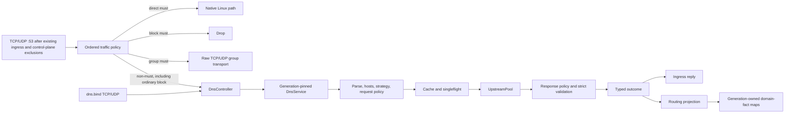

# DNS 子系統

對 53 埠的透明攔截與選用的 `dns.bind` listener，共用同一套使用者態 DNS 架構。

欄位級設定、可接受的 URI 形式及預設值見 [DNS 設定參考](../reference/dns.md)。快取完全位於使用者態；由 generation 持有的路由投影與域名事實 map 儲存學習到的謂詞事實，不儲存 DNS 應答。

## 架構



非 `must` 的透明入口與獨立的 `dns.bind` 這兩個 adapter，共用同一個 `DnsController`、
目前的 `DnsServiceProvider`、forwarder、快取、singleflight 集合、上游池和路由投影。adapter
從 admission 開始持有所有權，一直到應答 I/O 完成；它不會直接寫 domain route。終態的
`group(must)` 走原始 TCP relay 或 UDP `PacketTransport`，不進入這條 DNS 管線，也就跳過
hosts、快取、請求和回應策略，以及投影。

獨立 UDP listener 在同一個 socket 上執行 `min(runtime worker 數, 4)` 個接收 supervisor。
每個 supervisor 每批最多收八個封包，各自保留目的地位址中繼資料與獨立 admission，並重用
自己的 512 KiB payload 緩衝，每個 listener 最多 2 MiB。socket 請求 4 MiB 的核心
接收緩衝區，Linux 會靜默截斷到 `net.core.rmem_max`。每個查詢先在 supervisor 上 poll 一次，
再決定要不要 spawn，所以已經就緒的快取應答不需要任務。未完成的查詢在停止和排空期間仍
被持有並 join，查詢 panic 會讓 teardown 失敗。批次處理不會繞過容量或 generation 檢查。
接收錯誤的 warning 以 supervisor 為單位計，同一個 socket 故障最多記四次 warning。

- [`src/dns.rs`](../../../crates/honk-config/src/dns.rs) — `DnsConfig`，欄位包括
  `bind`、`upstream`、`routing`、`strategy`、`cache` 和 `fixed_domain_ttl`。
  `DnsBindEndpoint`、`DnsBindTransport`、`DnsBindError` 負責解析目前的 dae
  listener 設定，並支援語意相等判斷；`DnsConfig::bind_endpoint` 把空值對映為關閉。
  listener 繫結語法見[設定指南](../configuration.md)。`DnsUpstream` 包含 `name`、
  `address`、`protocol: DnsProtocol`、`tls_server_name`，以及撥號路徑的代理 tag
  `outbound: Option<String>`。Dae 路由採首次匹配執行
  `DnsRequestRule`/`DnsResponseRule`；`DnsCond` 之間是 AND，支援否定。
  請求規則支援 `Qname`、`Qtype`、`Sip`；回應規則支援 `Qname`、`Qtype`、`Upstream`、
  `Ip`。`Sip` 接受混合的主機位址和 CIDR 引數，不能用在回應規則裡。動作有 `Reject`、
  `AsIs`、`Accept`、`Upstream(name)`，舊的 `rules`/`fallback` 會被轉換。
  `types.rs::DnsProtocol` 有六個變體：`Udp`、`Tcp`、`Tls`（DoT）、`Https`（DoH）、
  `H3`（DoH3）、`Quic`（DoQ）。只有 dae 解析器會填入請求和回應規則，規則型別
  不經過 serde；路由包裝型別只序列化預設值，只反序列化 null 值。

[`honk-config/src/dns/validation.rs`](../../../crates/honk-config/src/dns/validation.rs) 負責命名上游的引用驗證，由啟動、SIGHUP 和公開的執行時 reload 入口裡的 `Config::validate` 呼叫。`DnsRouting` 的私有請求來源選擇邏輯同時供驗證和 `effective_request` 使用，既保留舊版欄位的診斷路徑，也避免在驗證時配發轉換後的規則。只解析設定的介面不執行完整設定驗證。

- DNS hosts 使用不可變、固定 generation 的快照。有序 `use_host` 來源在請求路由、快取查詢及上游交換前合併。來源語法、優先順序與交易式 SIGHUP 行為見[設定指南](../configuration.md)。
- [`src/dns/`](../../../crates/honk-core/src/dns/) 的模組分工：
    - `runtime.rs` / `runtime/provider.rs` — `DnsRuntime` 與 `DnsServiceProvider`；[generation 與退役](#generation-與-reload)。
    - `forwarder/`、`engine/`、`planner.rs`、`policy.rs` — [解析管線](#解析管線)與請求/回應策略。
    - `cache/` — [應答快取與持久化](#快取與持久化)。
    - `upstream_pool/`、`transport/` — [上游 session 與 driver](#上游-transport)；`transport/retry.rs` 負責重試判定，`transport/lifecycle.rs` 負責 session 退役，`transport/udp_pool/error_queue.rs` 負責 Linux 錯誤引用封包接收。
    - `projection/` — 由 generation 持有的路由投影與域名事實協調（[路由投影](#路由投影)）。
    - `service.rs`、`resolver.rs` — 供透明 DNS、`dns.bind`、Clash API 與應用查詢存取目前的 provider。

## 入口路徑

| 路徑 | Socket 與目的地位址模型 | 應答模型 |
| --- | --- | --- |
| 透明攔截的 53 埠，無終態使用者 `must` 結果 | 按[流量規則所有權](../reference/routing.md#出站目標與-must)admission 的有效查詢進入 `DnsController`。 | 控制器接管的透明 UDP 使用繫結到原始目的位址的 anyfrom socket；TCP 在被攔截的 stream 上應答。請求動作 `asis` 撥該原始目的位址並保留 TCP/UDP，包括 UDP `TC` 後回退 TCP。 |
| 獨立 `dns.bind` | 所選 TCP/UDP socket 是 host network namespace 中一般且未標上 mark 的 socket。它們沒有攔截所得的目的位址。 | TCP 在 accept 得到的 socket 上應答。UDP 使用 packet info，使通配 bind 從查詢實際命中的本機位址與網路卡應答。 |

`DnsRequestMeta { source_ip, original_dst }` 用一個不可變值同時承載邏輯用戶端來源與攔截所得目的位址。透明 adapter 和獨立 adapter 都從 socket peer 設定 `source_ip`；只有透明攔截設定 `original_dst`。IPv4-mapped IPv6 peer 會規範化為 IPv4。代表已通過 admission 的 TCP/UDP 流執行的查詢使用該流的用戶端位址，且沒有攔截所得的 DNS 目的位址。內部、bootstrap、prefetch 與 Clash API 查詢兩者都為空。

`asis` 仍然透過 honk 新建的 socket 查詢原始目的解析器，不保留用戶端的網路來源位址。只有原生 `direct(must)` 繞過使用者態重送；是否仍發生 SNAT/MASQUERADE 取決於其他防火牆和網路設定。原生直連或原始群組轉送繞過的 DNS 應答不會補充 honk 的域名路由事實；anyfrom 負責用戶端側回覆來源位址，不是上游來源位址偽裝。私有 DNS 繞過遷移見[路由參考](../reference/routing.md#顯式本地路由)。

[TCP handoff 與 UDP 逐封包 admission](./control-plane.md#透明代理入口)由控制面負責，包括兩者不同的路由 generation 要求。

過期快取重新整理與偏好位址族的附加查詢保留發起者的 `DnsRequestMeta`。為流執行的 DNS 解析依用戶端來源處理，但沒有被攔截的目的位址；策略選擇 `asis` 時會 fail-closed。

獨立 listener 具有以下生命週期與 admission 不變量：

- 啟動 supervisor 前，同步繫結全部所選 transport。任一繫結失敗都會關閉已繫結的部分，並令啟動失敗。
- 只轉送完整、結構有效的單問題請求。無效 UDP 請求收到 `FORMERR`；畸形或不完整 TCP frame 會關閉連線。
- UDP 入口 profile 將宣告的應答大小限制在 `512..=1232`。Packet-info provenance 保留通配應答來源位址選擇。
- TCP 使用持久的 RFC 7766 雙位元組 framing。每次長度讀取、正文讀取和應答寫入都有 30 秒上限。
- 獨立 TCP 最多佔用行程級全域連線預算的四分之一。持久連線上的每個 frame 都分別計入 DNS 查詢預算。
- `DnsListener` 為行程級物件，由 `ControlPlane::run` 持有。關閉時先停止 admission，再排空或中止子任務，並在 DNS runtime 退役前 join 每個 supervisor。
- SIGHUP 中 `dns.bind` 的語意變化要求重啟。未變化的 listener 繼續使用新發布的 DNS generation。
- 獨立請求傳入 `original_dst=None`；選擇 `asis` 因而產生 DNS 失敗（`SERVFAIL`），不會遞迴撥回 listener。

將 `dns.bind` 留空不會關閉透明 TCP 與 UDP 攔截。本機 53 埠的 listener 不能讓一般 LAN DNS 跳過流量策略。

## DNS 所有權狀態機

下表區分 LAN 入站查詢和一般主機、loopback 投遞。honk 的透明代理依賴真實 eBPF 資料路徑和已經掛接的 LAN hook，mock 模式攔截不到封包。`must` 保留已選出的出站，不再用嗅探重新判斷，但也不繞過所有處理。

| 查詢路徑 | 流量策略結果 | 接收者 | 應答路徑 |
| --- | --- | --- | --- |
| LAN 查詢閘道器或外部 `:53`，無論本機是否有 dnsmasq / `dns.bind` listener | 非 `must` | Honk DNS 控制器 | Honk hosts、快取、請求/回應策略與選定上游；透明 anyfrom/stream 回包 |
| LAN 查詢由 dnsmasq 監聽的閘道器 `:53` | `direct(must)` | Linux 原生投遞到 dnsmasq | dnsmasq 本機資料、快取或上游 |
| LAN 查詢閘道器或外部 `:53`，即使有本機 listener | `block(must)` | 無 | 丟棄 |
| LAN 查詢閘道器或外部 `:53`，即使有本機 listener | `group(must)` | Honk 原始 TCP/UDP 代理群組傳輸 | 原始 DNS 流量經已選群組轉送，不經過 `DnsController` |
| 不經過透明 admission 的一般主機/loopback 查詢 `127.0.0.1:53` | 不適用 | dnsmasq | dnsmasq 本機資料、快取或上游 |
| 投遞到非 53 埠的 `dns.bind`，例如 `127.0.0.1:54` | 不是透明埠 53 admission | Honk bind | 同一套 Honk DNS 策略與上游堆疊 |
| 資料路徑未啟用或流量不經過已掛接 hook | 不執行 Honk 策略 | 一般目的 socket | 對應本機服務；沒有監聽則拒絕或逾時 |

有效的非 `must` DNS 查詢按[流量規則所有權](../reference/routing.md#出站目標與-must)處理；畸形 UDP payload 保留既有回退。具體位址或通配位址上的本機 `:53` socket，都不能提前終結 LAN admission。非 DNS 的本機 socket 探測保留原有的 transport、FIB 和 TCP 純 SYN 規則。

解析後的 DNS 請求只有帶著非零、且與設定的控制面 bypass mark 完全相等的標記時，才保留原生投遞。這是請求側的豁免，跟使用者規則裡的 `must` 無關；回包仍按非 53 路由規則走。不經過 LAN hook 的一般 loopback 後端存取不變。Honk 和 dnsmasq 繫結同一個已佔用埠時，仍會產生一般的 socket bind 衝突；透明攔截本身不佔主機埠 `53`。

需要控制器或原始群組處理的 LAN UDP 分片查詢要求 NFQUEUE ready，並使用[核心重組](./nfqueue.md#lan-dns-分片)，這不是原生策略旁路；這條路徑不處理 TCP 分片。

以 dnsmasq 為後端時，LAN 查詢可以先進入 Honk，而 dnsmasq 保留埠 53 的 listener：

```text
LAN client -> gateway :53 -> transparent Honk DNS policy
                              | local upstream -> 127.0.0.1:53 -> dnsmasq -> external resolver
                              | remote upstream -> selected direct/proxy transport
```

Honk 的獨立 bind 可以是 `:53530`、其他空閒埠，或者關閉；它不是 LAN 埠 53 的接管開關。主機 loopback 到 dnsmasq 的請求，不會因為啟動了 Honk 就變成 LAN 請求。如果改成 dnsmasq 把未命中的請求轉給 Honk，Honk 的選定上游就不能再指回這個 dnsmasq，否則會形成遞迴迴圈。只有 Honk DNS 策略選中 dnsmasq 後端時，才會取得它的本機名稱、DHCP 名稱以及快取應答。

## 解析管線

生產路徑中的 `DnsService` 呼叫方在發布快取之前，要求嚴格驗證查詢和回應的封包格式。原始 `DnsForwarder::resolve*` 相容介面仍供舊的內部呼叫方使用。

生產路徑順序如下：

| 階段 | 不變量 |
| --- | --- |
| 1. admission 與 generation | `DnsController` 固定一個 runtime，取得該 generation 的 owned query permit；UDP 入口同時取得 controller 持有的行程級 UDP permit。兩種 permit 都保留到應答完成；飽和時降級為 `REFUSED`。 |
| 2. 解析與驗證 | adapter 要求一條完整請求。`DnsEngine` 解析 wire，拒絕沒有可用問題或有多個問題的請求，產生小寫的路由域名而不改變 qname 的大小寫，並記錄入口 profile。 |
| 3. 位址族 gate 與 hosts | `ipv4only`/`ipv6only` 在 hosts 或上游工作前，以 NODATA 拒絕另一位址族。除此之外，不可變 hosts 快照先於請求路由、快取與上游交換執行。 |
| 4. 請求規劃 | 依原始碼順序的請求規則使用路由域名、QTYPE 與邏輯用戶端來源選擇 reject、`asis` 或命名上游。首條命中。 |
| 5. 重用 | 符合資格的請求先查詢精確身份的正/負快取；未命中時共用一次 singleflight 交換。不符合資格的請求繞過兩者。 |
| 6. 交換 | 請求 scope 選擇攔截所得目的位址或某個 `UpstreamPool` transport。 |
| 7. 回應規劃 | 策略使用每個上游回應前，都會嚴格核對其與查詢是否匹配。回應規則執行 accept、reject 或經命名上游重新查詢；遍歷無迴圈且最多包含三個上游。 |
| 8. 發布與渲染 | 只有嚴格驗證後的最終 wire 回應才能進入快取或發布給 singleflight waiter。偏好位址族壓制在儲存已驗證、可重用的應答後，才套用於呼叫方渲染。 |
| 9. 結果與投影 | forwarder 傳回型別化結果。`DnsController` 使用固定 generation 的投影快照提交該結果，隨後入口 adapter 寫應答。 |

每個 generation 有兩個互相獨立的 2,048 上限：controller 查詢的生命週期，以及活躍的 singleflight key。UDP 用戶端 admission 和一般 UDP 初始化是分開的，啟動時以 `min(1536, MemTotal / 4 / 256 KiB)` 為上限。`DnsController` 持有這份行程級 UDP 預算，活躍和退役的 generation 共用；reload 不補發額度，permit 保留到應答完成。每查詢 256 KiB 是容量估算，不是強制的 RSS 上限；共享的 2,048 查詢上限也不是給 TCP 專用預留的。每個 flight 最多接受 256 個 follower。flight 飽和時直接拒絕，不會開啟無限上游交換；controller 把這個過載渲染成 `REFUSED`。發布結果時，刪除 flight 和向已加入的 follower 廣播結果是原子完成的，之後的快取未命中請求可以開新 flight。已完成的失敗保留原始原因，但不進入快取，所以已加入的 follower 不會各自重複那次失敗的交換。leader 丟棄未發布的結果時會刪除 flight 並喚醒 follower 重新競爭所有權；取消屬於這種情況，缺少已驗證的 response template、只被 compatibility mode 接受的成功結果也一樣。

DNS 自己的 socket 用一份獨立扣減的行程級描述符分割區，活躍和退役的 generation 共用。額度跟著實際 socket、空閒 stream、endpoint poller 或 packet-adapter worker 走，保留到 teardown。Endpoint 的網路 bootstrap 會為併發的 A/AAAA 一次預留兩個額度。Literal IP 和 pinned 位址繞過這個 admission；`/etc/hosts` 只有在沒有先查詢設定的 resolver 時才不需要網路額度。設定 resolver 的 admission 放在 hosts 回退之前，被拒就立即傳回。

代理 TCP stream 和非原始 UDP 的 packet 準備，共用一份保守的邏輯 lease 上限，大小不超過 DNS socket 分割區，並在代理節點 bootstrap 之前取得 lease。Direct、Shadowsocks、SOCKS5 的原始 UDP 使用物理額度；SOCKS5 的控制 TCP 和其他代理 carrier 保留原有的 outbound 所有權。兩額度預留只涵蓋 DNS 上游的 endpoint 名稱。解析原始 Shadowsocks/SOCKS5 代理節點或 SOCKS5 relay 名稱時，準備過程只持有一個額度，卻可能為併發的 A/AAAA 短暫開啟兩個沒有計入的 resolver socket。Shadowsocks 會在開啟 UDP socket 之前把它們關掉；SOCKS5 解析 relay 時可能和控制 TCP 重疊。這不等於所有代理 carrier 或代理準備階段 resolver socket 的總 FD 上限。

必要的 admission 阻塞時，按 generation 註冊的弱 owner 透過保留的 close/join 路徑，回收沒有被借用的快取 UDP socket 以及空閒的 TCP/TLS/H2/QUIC 資源。完成和取消在釋放借用後會重新檢查壓力，其他等待中的上游不必依賴維護定時器；已經開始交換的不會被淘汰。Socket admission 失敗時，重試和 resolver hook 裡保留型別化的 `Capacity`，可能渲染成 `SERVFAIL`，這不同於 singleflight 的 `REFUSED`。入口飽和時，獨立 listener 仍傳回拒絕，透明 UDP 仍丟棄，行為和原來一樣。

Clash [`/stats.dns`](../reference/api.md#dns-欄位) 暴露行程生命週期內物理 admission 的拒絕和逾時計數、邏輯代理 admission 的逾時計數，以及因為壓力而選中退役的資源數。這些計數不表示已經釋放的描述符，也不按 singleflight follower 重複統計失敗；原生 DNS 診斷和歷史仍只提供原有的結果檢視。

初始化與 flight fan-out 使用 `SharedError`。這個 Arc-backed error 給 builder 和
waiter 複製的是原始 causal chain，不是從 display 文字重建的。已完成的 failure 不
進入 cache；所有已加入的 waiter 看到同一個 typed source，包括
`PacketRejection::Capacity`。

### Hosts 快照

建構 generation 時，按宣告順序讀取並合併每個可重複的 `use_host` 來源。`true` 表示 `/etc/hosts`，它的解析器索引精確名稱和別名；寫成路徑時，讀取 OxiDNS 相容的規則檔案，支援精確、domain 字尾、regexp 和 keyword。後定義的同名規則覆蓋先定義的規則。精確匹配和最長字尾匹配優先於有序的 regexp、keyword 匹配。規則檔案的目標也可以是一個域名，這時匹配到的名稱是別名。載入時先合併全部來源，再拒絕迴圈和超過 8 級的別名鏈。查詢時，CNAME 鏈會和目標在完整管線裡巢狀解析得到的應答合成；經節點域名 hook 解析的域名同樣跟隨別名，見[參考](../reference/dns.md#hosts-快照use_host)。查詢處理不執行檔案 I/O。

只有 IN class 的 A 和 AAAA 查詢會用到這個快照。位址條目缺少請求的位址族時傳回 `NOERROR`/NODATA，絕不洩漏給上游。本機位址記錄和生成的別名 CNAME 用 60 秒 TTL；複製的目標記錄保留目標自己的 TTL 策略。Hosts 應答繞過正快取和負快取的重用；巢狀的別名目標查詢保留呼叫者的快取策略。合成結果仍經過正常的路由投影。別名合成會保留目標最終應答的 `TC` 和完整 RCODE；非 EDNS 用戶端無法表示的擴充錯誤，變成不帶記錄的 `SERVFAIL`。派生查詢只接受一個問題、空的 answer 和 authority section，以及至多一個 additional OPT；它保留 ID、全部 flags、type、class，以及精確的 OPT class/TTL/選項，並單獨編碼那個根名稱 owner。不支援的 section 在目標 I/O 之前就失敗，不會丟記錄，也不會回退到原始名稱。快照在自己的 generation 內不可變；改了來源就送 SIGHUP 來發布替換項。載入或解析失敗會讓啟動失敗，或者在發布前中止 reload。

Bootstrap hook 透過別名或選中的 `subtag()` 規則接管原始域名。直接位址條目本身不會接管這個域名，但別名鏈終止於位址條目時，會使用這些位址。被接管的本機位址、bootstrap 目標和 subtag 查詢，共用 DNS 執行時的 admission 和取消機制。一旦選定解析路徑，它的失敗就是最終結果。hook 的使用方和排除範圍見[節點域名參考](../reference/dns.md#節點伺服器域名)。

### 位址族策略

| 策略 | 轉送與結果語意 |
| --- | --- |
| `both` | 內部/應用 A+AAAA 名稱解析同時啟動兩個符合資格的位址族查詢，並保留兩者的可用記錄。呼叫方的單條 DNS 查詢不會被壓制。 |
| `preferipv4` | A+AAAA 名稱解析同時啟動兩者，但以 IPv4 作為偏好結果集。對一般 AAAA 請求，forwarder 透過正常管線發起 A sibling；僅當 sibling 含可用 IPv4 記錄時才傳回 NODATA。 |
| `preferipv6` | 與 `preferipv4` 對稱：僅當 AAAA sibling 含可用 IPv6 記錄時才壓制 A 回應。 |
| `ipv4only` | 只有 A 符合資格。AAAA 不執行上游 I/O，直接應答 NODATA。 |
| `ipv6only` | 只有 AAAA 符合資格。A 不執行上游 I/O，直接應答 NODATA。 |

偏好位址族的 sibling 查詢只改第一個問題的 QTYPE。交易 ID、flags、QCLASS、EDNS 資料、入口 profile、邏輯用戶端來源、原始目的位址，以及其餘 wire profile 都不變。Sibling 一般失敗或傳回 NODATA，不會壓制可用的非偏好回應；typed local packet refusal 則用原始原因結束呼叫方的解析。內部和應用主機名解析時，bootstrap fallback 只在所有符合資格的位址族都不可用時執行一次，之後用同一套位址族資格過濾 fallback 位址。

這個策略也決定 bootstrap 解析出的上游撥號目標順序。`both` 用 IPv4 優先的相容順序；偏好模式把對應位址族放前面，同時保留另一個位址族。stream 和 QUIC transport 會依次嘗試候選位址。直連 UDP 保持現有的兩次嘗試上限：首個候選失敗後，唯一的一次重試先換另一個位址族，再考慮同族其他位址，並快取成功的 socket。

包括 capacity 在內的型別化 local packet refusal 不算 availability failure。
DoH3/DoQ 和代理 reusable-session 初始化，給 builder 和每個 waiter 保留同一個
`SharedError` cause。外層 route loop 和位址族 aggregation 不會把它變成另一條
route、bootstrap 或 system-DNS 嘗試。health 和 URLTest 的 resolver hook 會把這個
錯誤保留到最終消費者，所以被拒絕的 lookup 不會降低節點 health，也不會替換預設的
UDP check target。獨立允許的 probe 和設定裡的 literal fallback IP 仍然可用。
Typed refusal 不會變成 stale-cache 應答，也不會變成成功的非偏好位址族應答；一般
失敗、空 response 和已接受的 SERVFAIL 仍按文件規定的 fallback 行為處理。這條規則
同樣涵蓋經代理 TCP session 承載的 `udp://` 冷啟動和快取路徑：收到拒絕後不再繼續
解析重試位址，最後一次嘗試被拒時也保留型別化原因，而不是只剩一段顯示文字。QUIC
健康目標在 generation 內延遲解析。型別化拒絕不會初始化快取，後續符合條件的 probe
仍可重試；目標解析和那次 QUIC 嘗試共用一個 timeout 預算。不支援 UDP 的節點，以及
被顯式策略拒絕的目標，完全跳過解析。

### DNS 路由

同一規則內的條件按 AND 組合，一個條件內的引數按 OR 組合，每個條件都可以取反。編譯後的條件模型涵蓋 qname、qtype、只對請求可用的來源 IP、只對請求可用的訂閱 tag、上游名和回應 IP。規則按原始碼順序求值，命中第一條就停。來源未知時，`sip(...)` 和 `!sip(...)` 都為 false；response 規則裡的 `sip` 會在設定階段被拒絕。同樣，除[節點伺服器域名](../reference/dns.md#節點伺服器域名)查詢外，`subtag(...)` 和 `!subtag(...)` 對所有查詢都為 false；節點域名查詢只評估 `subtag()` 規則。

| 階段 | 策略使用的輸入 | 動作 |
| --- | --- | --- |
| 請求 | 規範 qname、QTYPE 與邏輯用戶端來源；`asis` 還要求存在攔截所得的原始目的位址。 | `reject`、`asis` 或 `upstream(name)` |
| 回應 | 規範 qname、QTYPE、目前上游與提取出的應答 IP。 | `accept`、`reject` 或用於重新查詢的 `upstream(name)` |

回應重新查詢始終向所選上游傳送原始請求 wire。迴圈會被拒絕，遍歷深度最多為三個上游。

### 快取與 singleflight 身份

快取與持久化使用以下不可變 `CacheKey`：

```text
canonical query wire (TXID zeroed)
+ ingress profile
+ logical request scope
+ DNS policy identity
+ operation (resolve or refresh)
```

wire 身份保留 flags、精確的 question 編碼、QCLASS 和 EDNS 內容。UDP 宣告的大小仍屬於入口 profile。邏輯 request scope 在請求路由之後確定，它區分命名上游和 `asis` 目的位址；policy identity 防止跨語意 reload 重用。

用戶端 IP 不進快取身份，也不進持久化身份。不同來源選中同一個命名上游時，共享這份與來源無關的應答；選中不同上游時，scope 會自然隔離，`asis` 仍按原始目的位址隔離。前景的 `FlightKey::Resolve` 包含 resolve 的 `CacheKey`，始終額外區分 strict 和 compatibility mode；只有 preference-sensitive 的 sibling 查詢可能改變發布應答時，才加入 `DnsRequestMeta`。其他前景 flight 仍可跨用戶端合併。背景的 `FlightKey::Refresh` 只包含 refresh 的 `CacheKey`，發起方 metadata 和 mode 由 leader 捕獲。正快取、負快取和 stale 命中，都會用目前呼叫方的 metadata 重新做偏好位址族渲染。

只被 compatibility mode 接受的回應鏈，不會進入共享記憶體快取，也不會持久化。例如終止於回應路由迴圈或深度上限的鏈，或者沒通過 strict response-template 驗證的鏈。所以後續的 strict 查詢不會繼承 compatibility-only 的接受結果。HDNS v2 不存執行模式來源，因此還原的條目在目前行程完成一次上游交換並替換它們之前，只有 compatibility mode 能用；持久化 codec 仍是 v2。

重用只適用於標準的單問題 QUERY：沒有 answer 或 authority record，至多一個無 option 的 EDNS-v0 OPT。ECS、COOKIE、任何其他 EDNS option、EDNS-v1、多個 OPT record 或異常 flags，會同時繞過快取和 singleflight。請求仍走正常的嚴格交換路徑。

設定生成的 ECS 屬於 generation 固定的命名上游 transport policy，不屬於入口身份。有效的 IPv4 prefix 會寫進 `PolicyId`，原始查詢仍是 cache/singleflight key。上游池只在 admission 之後加入 ECS，保留用戶端自帶的 ECS，驗證生成 option 的回顯，並在回應分析和快取發布之前移除生成的 EDNS 狀態。`asis` 繞過這套轉換。自動推斷在啟動、reload 和網路事件時以交易方式重新整理，所以替換 generation 的探測和建構期間，活動查詢仍用舊 generation。

## 快取與持久化

| 機制 | 不變量 |
| --- | --- |
| 容量 | 最多 16 個 LRU 分片精確劃分 `max_cache_size`（限制在 1–100,000）。每個分片的應答位元組預算為 `max(條目容量 × 1 KiB, 65,535 位元組)`；單條超過 65,535 位元組的應答不快取。 |
| 正快取 TTL | `fixed_domain_ttl` 優先順序最高；零表示該域名不快取。否則，非零 `optimistic_cache_ttl` 覆蓋應答最小 TTL。兩者均未覆蓋時，NOERROR 正應答取所有已遍歷非 OPT 記錄的最小 TTL，包括零；最小值為零時移除精確快取槽，不保留新應答。選定的非零 TTL 也會寫入快取中的記錄。失敗回應碼仍使用原有的 TTL 提取規則。 |
| 負快取 TTL | NXDOMAIN 使用 `min(SOA TTL, SOA MINIMUM, 300)` 秒；缺少 SOA 或生命週期為零時移除精確快取槽，不保留應答。SERVFAIL 仍預設為 60 秒，並將 SOA 得出的生命週期限制在 `1..=300` 秒。`fixed_domain_ttl: 0` 禁止快取所有回應碼的應答，但不移除已有條目。 |
| NODATA TTL | `ANCOUNT=0` 的 NOERROR 應答以完整封包保留在正快取槽中。非零 `fixed_domain_ttl` 優先於 SOA 和上限；否則生命週期為 `min(SOA TTL, SOA MINIMUM, 300)`，缺少 SOA 或生命週期為零時移除精確快取槽，不保留新應答。`optimistic_cache_ttl` 不適用。NODATA 仍可作為過期應答傳回；過期改寫只改變 SOA TTL，不改變 MINIMUM。 |
| Stale 處理 | 過期正應答在一小時內仍可用於 serve-stale。一般上游交換失敗或已接受的 SERVFAIL 可傳回該應答；typed local packet refusal 不可。`optimistic_stale_reply_ttl` 預設為 30 秒；非零值替換每個非 OPT RR 的 TTL，並設定 outcome TTL。`0` 保留快取中已按策略改寫的 TTL，而不是權威 TTL；此時 outcome TTL 由該 wire 的 `extract_min_ttl` 得出，不存在正 TTL 時回退為 60 秒。接近過期的命中會啟動去重的 stale-while-revalidate refresh。 |
| Flush fence | publication epoch 防止 flush 前開始的前景或背景工作在 flush barrier 後重新填充記憶體或持久化。 |

正、負快取命中的 outcome，在等待偏好位址族時保留條目原來的過期時刻，不用取整後的 TTL 中繼資料重算生命週期。

背景重新整理命中正快取時，會一併讀出 `Resolve` 快取槽的發布版本號，即 `revision`。每次已接受的精確 key 發布都會推進版本號，包括負快取合併和持久化還原。發布時在分片鎖內檢查：版本號必須一致，正快取也必須還在。版本號不符、快取槽只剩負快取，或槽已被淘汰時，重新整理結果直接丟棄；已淘汰的槽不會因為重新整理完成而被重新寫入。

匹配且可快取的 NXDOMAIN，先移除被重新整理的正快取，再寫入負快取；可快取的正應答或 NODATA 則替換整個快取槽。NXDOMAIN、NODATA 或零 TTL 的正應答沒有可用生命週期時，移除整個槽，包括槽裡的負快取。SERVFAIL 如果沒有可用的過期應答回退，就保留正快取並合併負快取。

前景仍以最後完成的發布為準。不可快取的 NXDOMAIN、NODATA 或零 TTL 正應答會移除整個精確快取槽；可快取的 NXDOMAIN 仍合併在正快取之上。舉例來說，嚴格模式的前景 SERVFAIL 可以讓相容模式對已還原正快取發起的重新整理失去發布資格；等負快取過期，那個正快取又會可見。替換受發布 epoch 約束，透過分片的計數維護介面移除條目；轉發器停用快取時不執行替換。快取命中時不會遞減封包 TTL。

這個保證只適用於記憶體；快取槽版本號只在行程內有效，不改變持久化格式，也不改變嚴格模式的應答 admission。移除正快取不會讓已經儲存的 SQLite 行失效。如果在這一行過期前重啟，該正快取可能還原成只有相容模式可用：嚴格模式不會重用它，相容模式則可能在持久化過期時間之後的一小時內繼續提供過期應答。重新整理觸發條件會把剩餘秒數向下取整，所以重新整理開始時原應答可能還有至多 `max(min_ttl / 10, 1) + 1` 秒的實際有效期。

啟用 `store_dns` 後，一個有界 actor 會把仍保留的正快取插入動作同步到 SQLite。actor 把命令佇列和 pending set 都限制在 1,024 項，批次寫入並按 epoch 隔離；flush 在接納目前狀態之前會丟棄更舊的排隊 epoch。

`HDNS` version 2 的條目儲存在狀態資料庫的 `dns_answer` 表裡，編碼 canonical wire、入口 profile、scope、policy、operation、expiry 和已驗證的 response wire。還原時跳過已過期、損壞、version 不匹配、collision 不匹配和 policy 不匹配的行。編碼後超過 4 KiB 的條目在進入批次寫入前就被丟棄，並計入 `oversize`，因為表的長度 `CHECK` 會讓整個批次交易失敗。

## 上游 transport

| 協定 | 重用模型 | 撥號路徑代理 |
| --- | --- | --- |
| UDP | 每個直連上游位址由 generation 持有一個主 connected socket 及最多三個壓力觸發的 socket 分片，每個 socket 各有一個 receive task；`TC` fallback 由 TCP 池處理。 | 設定代理時，查詢由池化 TCP-DNS 承載。 |
| TCP | RFC 7766 空閒 stream 池。 | 支援經所選節點或群組葉節點。 |
| DoT | 空閒 TLS stream 池。 | 支援經代理 TCP 基礎 stream。 |
| DoH | 一個長生命週期、可重用併發請求的 HTTP/2-only TLS session。 | HTTP/2 session 可經由代理 TCP 連線建立。 |
| DoQ | 一個長生命週期 QUIC connection；每個查詢一條雙向 stream。 | 支援經所選葉節點的 `PacketTransport`。 |
| DoH3 | 一個長生命週期 QUIC 與 HTTP/3 session。 | QUIC session 可使用所選葉節點的 `PacketTransport`。 |

代理 DoQ 和 DoH3 把固定 generation 的葉節點 `PacketTransport` 適配成 quinn 的 `AsyncUdpSocket`。每個池化的 QUIC connection 或 HTTP/3 session 持有一個有界 adapter 和 client endpoint，直到 retry 或 shutdown 關閉它們。datagram 邊界和 peer 中繼資料保持不變，內層 QUIC payload 上限為 1252 bytes。adapter 的接收 worker 每讀 32 次 transport 就讓出一次排程，讓 endpoint driver 能在從不掛起的 transport 兩批讀取之間得到排程。佇列還是滿的時候，丟棄該 datagram 並計入 `transportRxDrops`，不會對 transport 施加背壓。缺少代理 registry 或 packet capability 時 fail-closed，不會繞成直連。直連 QUIC 每次撥號都重新繫結帶 bypass mark 的原生 endpoint，重撥不會繼承失效路徑的本機埠。

DNS client task owner 和捕獲的 runtime owner 保留同一份 packet-adapter worker join，涵蓋 session 發布前握手失敗或被取消的路徑。關閉和暫停都會等這些 join；worker panic 在回收後仍保留，並讓暫停失敗。零 timeout 的 endpoint close 只請求關閉，不確認 joined cleanup；健康探測共用同一套 endpoint 關閉協定。

`-> node-or-group` 強制選一個由 generation 固定的撥號葉節點。沒有顯式目標時，上游 endpoint 走固定的流量 Router 和群組快照。UDP 加代理是有意使用 TCP-DNS；這個策略和一般代理 UDP 流量用的 SOCKS5 RFC 1928 UDP transport 互不相干。

直連 UDP 查詢的 future 只為直連交換保留狀態。經路由的 transport 交換，包括 `TC` fallback 和代理 UDP，以及 endpoint 位址解析，只在實際走到時才把狀態裝箱；否則每次快取未命中都要為用不到的路徑配發並複製幾十 KB 狀態。

直連上游 socket 帶 bypass mark，流量不會重新進入透明攔截。主機名 endpoint 透過 generation 捕獲的 bootstrap resolver 解析；撥號從不依賴 honk 被攔截的 resolver 路徑。

撥號、TLS、QUIC、HTTP session 建立用 dial/handshake 逾時，請求和回應交換用獨立的 query 逾時。一次查詢嘗試只有一個絕對的交換 deadline。每個 transport 失敗後最多重試一次，需要時重置無效的可重用 session，所以總查詢工作有界。Transport slot 對併發初始化做 singleflight，每個正在關閉的資源保留唯一的 teardown future。池關閉先停止 admission，等已通過 admission 的交換結束，再關閉空閒資源，並顯式 join 每個 receive 或協定 driver task。

DoH 和 DoH3 在配發或讀取回應體之前先判斷 HTTP 狀態。以下情況不會重置或重試
session：2xx/5xx 之外的狀態、長度不足 DNS 頭的回應體，以及超過 DNS 大小上限的
回應。5xx 和傳輸錯誤保留一次查詢級 reset/retry；typed packet refusal 仍是終態拒絕。
已關閉的 sender 在使用前會重新整理。`send_request` 發現的 HTTP/3 GOAWAY 由外層重試
owner 處理，不會在單次查詢可取消的逾時內關掉 session，也不增加巢狀的查詢嘗試。
重試決策由 `transport/retry.rs` 管理。

DoH、DoH3 和 DoQ 的失敗只透過弱引用關聯到 session，錯誤物件本身不會延長 driver
的生命週期。退役在 slot 鎖內比對身份，所以遲到的失敗關不掉替代 session。closer
取消後，teardown 仍留在 slot 裡；後續的 acquire 或 close 會繼續同一份清理，完成
後才重建。Shutdown 仍會關閉目前資源，不取決於最後使用它的是哪個查詢。銷毀最後
一個 owner 仍會中止它的 driver；任務計數也涵蓋首次 poll 之前的取消。

直連 UDP 從 CSPRNG 隨機起點搜尋佔用 bitmap，配發一個新的 16-bit ID。接收時同時驗證 ID 和 question，再還原呼叫方的 ID。已經收到應答的 ID 隔離 500 ms；取消、逾時、傳送失敗和已歸屬的 ICMP 錯誤走獨立佇列，隔離三秒。交換期間，pending ID 始終佔用。因此延遲封包無法在 ID 重用後滿足另一個問題；不過這個有限的隔離視窗並不保證同一問題的重複封包都是真實的。

每個上游和位址族為目前位址保留最多四個可重用 socket，每個 socket 最多 1,024 個 pending 交換。pending 超過 768，或者傳送前 ID/容量耗盡時，可以增加分片。整個行程包括退役的 generation 在內，最多持有 16 個額外 socket，每個分片還必須持有物理 socket 額度。切換分片不會重放已經接受的傳送。失敗的分片只做局部替換，空閒的額外分片由既有維護過程回收；壓力下也可以回收沒被借用的主 socket。已通過 admission 的工作還在完成時，舊 socket 可以和替換項重疊，它的額度和接收任務一直保留到 join teardown。

UDP 冷路徑和 cached-current 捷徑走同一個取池入口，在交換前替換已關閉或已停止
的 socket，不把位址嘗試浪費在舊池上。Linux 下由
`transport/udp_pool/error_queue.rs` 讀取 `IP_RECVERR`/`IPV6_RECVERR` 提供的原始
封包；ERROR 就緒位和一般封包的 READABLE 就緒位由不同的消費者處理。只有完整匹配
DNS ID 和 question 的錯誤引用才能結束對應請求，並保留原始的 I/O 錯誤原因。過短、
已退役或不相關的引用不影響其他請求；已歸屬的 ICMP 錯誤按 abandoned ID 隔離三秒。
沒有可用引用的接收錯誤讓請求繼續受自己的 deadline 限制，不支援 error queue 的
平台也按這種保守方式處理。send 系統呼叫失敗仍按既有行為把原始錯誤傳回目前交換，
也不聲稱對 send 錯誤做了引用歸屬，並且不在該交換內重新傳送；傳送和等待回應共用
一個絕對 deadline。只有 socket-fatal 的接收錯誤會停掉池並結束其餘等待者；重複的
目的地錯誤本身不能證明 socket 已經死亡。

透明 DNS 的回覆 socket 遇到目的地相關的傳送錯誤時也保持重用；其他傳送錯誤保留
原有的一次替換和重試路徑。獨立 `dns.bind` 的回覆仍用原 listener socket。

## 路由投影

`DnsController` 將解析結果轉換為 desired state，而不是直接內嵌寫 active policy 的 domain map：

| 結果 | 投影 observation |
| --- | --- |
| 已接受的 A 或 AAAA positive | 可快取時，用 outcome 的有效 TTL 替換該名稱在所查詢位址族下的 IP 集合與 expiry；不可快取的正應答改用既有 wire TTL 規則：非 OPT 記錄中的最小正 TTL，不存在正 TTL 時回退為 60 秒。拒絕快取不應抹去已接受位址的路由壽命。同一 IP 的多個域名 owner 會貢獻按 OR 合併的路由 bitmap。 |
| 已接受的 A 或 AAAA NODATA | 只清除該名稱在所查詢位址族下的 owner。 |
| 已接受的 NXDOMAIN | 清除該名稱兩個位址族的 owner。 |
| 其他 QTYPE（如 HTTPS）、已接受的 SERVFAIL 或被策略拒絕 | 保留目前狀態。 |

同一名稱的 A 與 AAAA owner 相互獨立，各用自己的 TTL。所以一個已經學到 IPv4 位址的名稱，收到空的 AAAA 或 HTTPS 應答時，IPv4 事實仍然保留。

每個 policy generation 內的域名 association 仍是全域的，與來源無關。帶來源的請求路由只隔離 DNS 交換的 scope 和應答，不劃分 eBPF 的 domain observation，也不影響一般流量路由。投影會獨立於其他條件，逐一計算全部域名謂詞，包括用於否定的謂詞；已知域名沒有匹配項時，可以投影成一個存在的零 bitmap。

投影最多保留 10,000 個 owner，同一名稱的 A 和 AAAA owner 分別計數。它向容量 65,536 的 domain map admission 最多提交 49,152 個唯一 IP key。選入 desired 或 reload 集合的零 bitmap 另有 32,768 個 key 的上限，給後續命中規則的 DNS 事實留出空間；等待成功刪除的過時零值 key 可以暫時超過這個子上限，但仍受 applied 總上限約束。剩下的 16,384 個 map 槽位不供 DNS 投影使用，留給 sniff 寫入。IPv4 和 mapped-IPv6 owner 共用一個 key，事實按 OR 合併。增量協調和 reload 用同一套 admission 策略：先淘汰零 bitmap，同一優先順序內淘汰位址最大的 IP。被省略的 owner 仍可以在後續的 policy generation 重新參與投影；一般重新整理也能在空間可用時，讓被省略的 IP 重新通過 admission。容量壓力會產生 warning。

在同一個 generation 內，每個 owner 快取自己的謂詞 bitmap，每個 IP 按名稱和位址族成員記錄各 bitmap 的貢獻次數。改一個 owner 時只合併不同的 bitmap，不再重新匹配共享這個 IP 的所有名稱。reload 投影在候選快照下，對每個保留名稱只計算一次；發布時重建快取的貢獻，不改變 admission 策略。

延長 TTL 和更新 LRU 時，重用已經在堆積裡的條目。過期喚醒和淘汰候選先重新驗證目前 owner，再重排或刪除；縮短 TTL 則立即安排更早的 deadline。獨立的入隊 sequence 標記用來隔離清除後的重建和位址族變化，並保留原有的有界堆積壓縮。

由 DNS 快取傳回的正應答使用該快取項的精確剩餘壽命。位址集合沒變時，重新提交只重新整理 TTL 和 LRU 新近度，不重建集合。快取命中還可以跳過投影的 publication fence 和 state lock，前提是：距上次加鎖提交不到一秒，policy generation、owner 結構和規範化位址集合都相同，報告的到期時間不晚於已套用值，且最多早一秒。被合併的命中會跳過最多一秒的壽命縮短，也不會安排後續更新，所以路由到期時間最多比快取報告的到期時間晚一秒；LRU 新近度也可能落後同樣的視窗。新增、刪除、重建 key，因容量被省略的 owner，更新的 generation，以及新鮮、過期或上游應答，始終走加鎖路徑。

每個正應答 observation 都在首次提交前固定好絕對到期時間。等待發布和重試都會消耗原有壽命，不會重新計時；reload 被拒絕後也是這樣。如果實際套用時已經到期，只清除所查詢位址族的 owner，不插入一個能被後續 reload 預填的過期 owner。

被省略的 key 按一般的缺失域名事實處理，不偽造零 bitmap。現有的 dial-mode 和終態 `must`/`block` 語意仍然有效：符合條件的未確定 direct 結果會進入 control-plane routing，但這個容量策略不會把所有未知事實都推進慢路徑，也不改變 `ip` 模式。sniff 寫入共享同一張物理 map，仍可能耗盡自己預留的空間；backend 寫入失敗繼續可觀測，並在適用的路徑上重試。

worker 每批最多處理 256 個 set/remove，協調帶 generation 的 desired state，然後自己排程剩餘已就緒的工作，不必等下一次 DNS observation。過時的 key 優先於新增項進入批次；已經寫入的投影達到 IP 上限後，新增的 DNS key 必須等刪除確認，刪除失敗期間也不釋放額度。失敗的寫入保持 dirty，並按有界退避重試。修改 backend 之前，worker 先取得 backend lock，並在持有 publication fence 時重新檢查 generation。reload 在同一個 backend lock 下安裝替換的投影快照。所以舊批次在替換 generation 發布之後，既進不來，也改不動 map。

同一 generation 的 DNS observation 和 worker 批次共享 publication fence；desired-state mutex 仍序列化 observation 和寫入確認。只有攜帶更新快照的 observation 才獨佔 fence。查詢和 reload 爭用時，查詢在應答前非同步等待，並受自己捕獲的 runtime 取消約束。取消和發布釋放同時就緒時優先取消，於是這個等待者不發布 observation，而是經既有應答路徑傳回終態 SERVFAIL。只有爭用時的等待會被裝箱，未爭用應答的 future 大小不變。這不會把快取 flush 的取消範圍擴充到解析之後，也不改變獨立 listener 的 reload admission。

重試喚醒和批次 admission 共用同一個帶容量判斷的逐 IP deadline；投影已滿時，一個已經過期但過不了 admission 的新增項不會在刪除退避期間空轉。成功 reload 會先把實際寫入新 map 的完整 IP 集合記為 applied，再協調目前 owner，包括載入期間已經到期的 owner。worker 的 map 寫入和確認保持在同一個 generation fence 內，舊的完成事件覆蓋不了新發布的記帳。保留物理 map 的 reload 也保留原有的 applied 狀態。

增量確認把成功寫入和目前期望 bitmap 或缺失狀態比較，不保留歷史 IP revision 帳本。owner 的 TTL sequence 和策略 generation 仍各自保護自己的邊界。

## Generation 與 reload

一個 `DnsRuntime` 包含 forwarder 和 policy、不可變的 hosts 表、routing/group snapshot、transport manager、路由投影、捕獲的 bootstrap resolver，以及 generation 內的 query admission。每個新 forwarder 獨佔 singleflight 和 refresh/prefetch worker；clone 仍屬於這個 generation。每個 DNS pool 持有新的 outbound runtime fork，不重用 traffic session，也不重用舊 DNS generation 的 session。fork 和來源設定 generation 共享 dial semaphore、行程 physical-dial ceiling 和行程 VLESS-carrier gate，但不共享 retirement state 或 protocol pool。

現有維護任務也會回收目前 DNS registry 裡已經結束的任務和空閒 VLESS carrier。registry 終止關閉時會釋放它快取的 connector，即使已退役的 runtime 仍被保留。

發布後，新 generation 立刻擁有獨立的 query 和 singleflight 資源。舊 generation 即使飽和，也佔不到新 generation 的 generation 內 query 配額，也不能讓新查詢加入舊 flight。UDP admission 仍跨 generation 共享，舊 UDP caller 在釋放 permit 前可能佔滿這份行程級配額。已完成答案的快取、publication/flush fence 和持久化繼續共享；它們不持有在途工作。舊查詢 lease 自然排空到應答 I/O 完成，然後退役流程等背景 worker 結束並關閉 DNS transport；只有這些 transport 排空後，才關閉它們私有的 outbound runtime fork，再退役捕獲的一般流量 registry 裡未轉移的可重用狀態。

30 秒期限只限制等待查詢 lease 排空，不限制 transport 和 outbound pool 整體拆除的時間。它是一條安全限制，不是新 generation 服務的前置條件；到期時會取消 runtime 所有的 forwarding 和已通過 admission 的應答 future。應用解析的 bootstrap fallback 仍在原查詢 lease 內執行，drain 會等它，強制 shutdown 也會取消它。最多保留四個已退役 generation；超過上限和 provider 關閉會觸發同樣的強制取消。某個 generation 退役完成、lease 也排空後，就釋放它的 runtime，只保留 outbound registry 給上面的強制關閉使用。已經就緒的終態 `SERVFAIL` 應答仍會嘗試傳送，但停滯的、已通過 admission 的應答 I/O 會被取消；TCP 寫入被取消時關閉連線。

查詢完成時，已經發布的 runtime 取消優先，即使查詢結果在同一次執行器輪詢裡已經就緒。應答 I/O 是有意保留完成優先的；尚未完成的應答仍可被取消。

`DnsServiceProvider` 持有並回收全部退役與強制關閉的 supervisor，關閉時等它們結束。listener socket 和行程級物理資源限制仍然共享，所以 generation 隔離並不承諾描述符耗盡後還能服務。

SIGHUP 在 commit point 之前建構 policy、`/etc/hosts`、群組、路由、上游 transport、投影資料和 outbound runtime。發布時持有控制面的 routing/config lock；準備失敗會完整保留目前 generation。`dns.bind` 的語意變化是例外：listener 屬於行程級資源，reload 會被拒絕並要求重啟。

路由發布在 admission 前拒絕舊 generation 排隊中繼資料；已通過 admission 的查詢保留原 generation lease。20 位 carrier 使用持久化、啟動週期內不迴繞的分配器，也計入只替換 descriptor 的 NFQUEUE fence。失敗預留值不重用，一般重啟不重置耗盡；見[路由發布](./routing.md)。

## 可觀測性

DNS 診斷用一組互相獨立、單調遞增的 atomic counter。涵蓋的類別包括：快取的 hit、miss、stale；singleflight 的飽和、cancel、retry、amplification avoided；持久化的 drop 和 flush failure；runtime 的退役和 forced close；transport 的初始化和 reset；投影的 stale-generation、write failure、retry；以及 positive、NODATA、NXDOMAIN、SERVFAIL、rejected、error 這些結果。

記錄不取得共享的 metrics gate。內部 scrape 用 relaxed ordering 獨立載入每個 counter；它是 best-effort，不代表同一時刻的一致快照，所以不能拿它建立跨 counter 的等式。

結構化的 DNS 失敗事件把錯誤歸到有界的 `error_kind` 類別。forwarder 有 `engine`、`exchange`、`response`、`internal`、`rejected_plan`、`overloaded`；持久化有 `worker_closed`、`ack_dropped`、`worker_failed`、`database`；投影有 `map_full` 和 `backend_write`；transport 有 `exchange_failed`，另帶有界的 transport label。這些事件欄位裡沒有 query name、upstream 位址，也沒有自由格式的 error payload。

上面的 atomic counter 快照只在內部使用，不對外提供 DNS metrics endpoint。原生 API 另外從真正的 DNS owner 取有界的 query、cache、log 資源；這些觀測介面不構成同一個原子快照。

### 原生診斷、精確失效與用戶端歷史

`/api/v1/dns/query` 把 cache access 和選用的強制設定 upstream 作為同一個請求的區域選項，貫穿 planning、preferred-family sibling 和 exchange；一次請求固定同一個 DNS generation。強制 upstream 會替換一般請求路由，但保留 hosts/strategy 和回應側 requery，hosts 命中時也不會虛構一次 upstream exchange。`bypass` 不讀正、負、stale 答案，不寫快取，不加入一般 singleflight/refresh，也不啟動背景 refresher；一般生產請求不帶 override 時語意不變。最多 8 個不同 type，共享 10 秒請求期限、262144 位元組的完整 JSON 預算，以及每分鐘 30 次的 principal/global 限額。

Cache list 的 opaque ID 對應 exact-key 的一個 incarnation，檢查它不會觸發 LRU promotion，也不計入 hit 統計；`persistent:false` 明確表示只涵蓋執行時記錄。分頁固定 filters 和 instance，最多 8 個 snapshot、30 秒、合計 8 MiB；底層淘汰不會釋放仍由 snapshot 持有的預算。按 ID 刪除只影響那個 incarnation；按完整 name/type 刪除可以涵蓋不同的 exact 變體。原生和 Clash 的失效共用 DNS/cache owner 的 publication→shard 順序，並等待持久化刪除以及此前 queued put 的確認；舊的 foreground/refresh 復活不了已經確認失效的記錄。Flush 只清答案快取，不清域名路由投影；持久化失敗不能假報成功。

`record_dns_log` 預設為 `true`。當獨立的 DNS 日誌需求有效，或執行時顯式設定 `record_dns_log: "on"` 時，才會記錄；實際記錄停止時會釋放歷史並讓游標失效。行程級環形緩衝區在用戶端請求真正完成時捕獲一般 DNS 查詢結果，以及來源已知的用戶端解析結果；原生和 Clash 的診斷呼叫、背景重新整理產生的重複記錄都會排除。它保留實際的 `SocketAddr`、問題、最終狀態、快取/上游/路由和時間，最多 512 條、8 MiB，原始封包和中繼資料一起計入預算；不截斷 RRset，超限就淘汰整條舊記錄。列表最新優先，支援 `name`、`type`、`src` 過濾、每頁最多 500 條，以及和過濾器繫結的游標；淘汰會讓舊游標失效。查詢、快取和日誌的回應投影裝不進 262144 位元組時傳回 503 和 `Retry-After`，不會傳回截斷後仍標為完整的答案。快取和日誌分頁在會超限的記錄之前結束，並傳回 `next_cursor`；單條記錄本身超限時獨佔一頁完整傳回，因為原始封包最多 65535 位元組，展開後大小有界，分頁遍歷不會因此中斷。設定裡停用記錄器需要重啟；執行時的 `"off"` 可以強制關掉設定已允許的記錄器。執行時設定由同一個 owner 原子發布；臨時縮減在顯式設定啟用時重置，provider 重新整理或網路重新整理時保留。

## 相關文件

- [控制面設計](./control-plane.md)
- [路由設計](./routing.md)
- [DNS 設定參考](../reference/dns.md)
- [DNS 灰度操作](../operations/dns-rollout.md)
