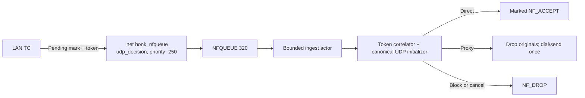

# NFQUEUE 保留首包的 UDP 路徑

NFQUEUE 以 fail-closed 方式保留語意尚未明確的 LAN 轉送 UDP 原始封包，直到使用者態做出 direct、proxy 或 block 的終態決策。

## 啟用與範圍

這條路徑由 `global.nfqueue_enable` 控制，預設開啟。設為 `false` 即關閉：

```dae
global {
    nfqueue_enable: false
}
```

改動這個開關通常要重啟行程。除了確實記錄過資料路徑 admission 之前的啟動降級以外，reload 會拒絕開關變更，例外見[全域設定參考](../reference/global.md)。降級之後，reload 也不會重試啟用。

啟動階段 NFQUEUE 是 best-effort。遇到以下情況時只記錄 warning，並在本行程內關閉暫存，不改寫設定檔：mock 模式；建置裡沒有 `ebpf`；固定佇列的前置檢查失敗；資料路徑 admission 之前的佇列、規則或健康檢查失敗。持久化 token generation 恢復失敗仍是 fatal，因為分配器狀態已經無法確定。真實模式先取得單一實例鎖，再做前置檢查，所以正常交接會等舊佇列 owner 退出，不會誤降級。繫結佇列之後，安裝階段會回收保留的 nftables table。服務 admission 之後，listener、queue、watchdog、verdict、cleanup 和 retirement 的失敗都是 fatal。

這個 hook 依流量型別和狀態決定要不要暫存：

| 流量或狀態 | 行為 |
| --- | --- |
| 經過 LAN TC 後語意尚未明確的新 LAN 轉送 UDP | 啟用且 ready 時，暫存唯一 token 並在 NFQUEUE 中保留原始 skb |
| 主機發起的 WAN UDP | 保持規範 TPROXY 路徑；主機 egress 不經過這個 `inet prerouting` hook |
| UDP 連接埠 `53` | 遵循[流量規則所有權](../reference/routing.md#出站目標與-must)；需要控制器或原始代理群組處理的 LAN 分片查詢走下述完整 datagram 路徑，不建立普通 conn-state 或 decision token |
| 內部、特殊或反向流量 | 絕不暫存 |
| 非 DNS 的 `must` 或 `block` 路由結果 | 視為終態；絕不暫存 |
| 路由時已經確定安全的 direct 結果 | 走核心 direct 路徑；絕不暫存 |
| 已啟用但尚未 ready 時的暫存候選 | 丟棄新流；無關的非暫存 UDP 保持正常路徑 |

語意還不明確，是指初步路由結果仍可能被使用者態路由、模式或群組選擇、網域名稱或 QUIC 檢查改變。這條路徑不會只因為初步結果不完整，就把封包重新導向到使用者態 relay。

## 持包機制



| 機制 | 目前契約 |
| --- | --- |
| 佇列傳輸 | `honk-nfqueue` 使用原始 `NETLINK_NETFILTER`；不呼叫防火牆命令，也不使用 netfilter helper 函式庫 |
| 佇列參數 | 固定佇列 `320`、核心 maxlen `4096`、packet-copy range `65535`，並請求 `8 MiB` socket 接收緩衝區 |
| Verdict 所有權 | 使用不可 `Clone`、只允許提交一次的 `VerdictGuard`；未提交的 guard 在 drop 時傳送 `NF_DROP` |
| Ingest 所有權 | 單 actor，佇列上限為 `256` 筆和 `8 MiB` payload；僅當 actor dequeue 時才嘗試取得 UDP slow-path permit |
| nftables 所有權 | 由單一原子交易獨佔 `inet honk_nfqueue` / `udp_decision`，即優先順序 `-250` 的 `inet prerouting` filter chain；只有攜帶 Pending 簽名的 UDP 才進入佇列 |
| 失敗策略 | 不設定 queue bypass、fanout 或 fail-open flag。可識別的壞包、UDP payload 截斷和檢查碼錯誤傳送 `NF_DROP`；畸形佇列後設資料、無法辨識的封包標頭、`ENOBUFS`、listener 退出和 verdict socket 失敗仍為 fatal |

服務先繫結佇列 `320`，再發布 nftables 交易。安裝階段在單一實例鎖保護下回收殘留的保留 table。最終有序關閉時，它先 drain 所有已分派的 guard，再關閉佇列，最後刪除自有 table。同一網路命名空間裡的防火牆管理器不得在 honk 執行期間修改這些保留的 nftables 物件。

這套 Linux 機制只在 `honk-core` 的 `ebpf` feature 下使用。解析時只分配一份和 datagram 同樣大小的緩衝區。core 取樣器和 `StatsManager` 會區分目前實例的佇列深度與跨 hard rebind 累積的行程級丟包數，回報最近一次核心讀取是否成功以及錯誤內容，並始終更新 held-guard/effective-buffer gauge。

每次取樣核心統計時，先開啟呼叫執行緒所在佇列網路命名空間的 procfs 檔案，再透過繫結到該命名空間的檔案描述符非同步讀取。取樣哪個命名空間，取決於佇列所在的 netns，而不是行程主執行緒或阻塞 worker 的 netns。

## LAN DNS 分片

TC 依普通流量策略判斷 offset-zero 的 UDP/53 首片。原生 `direct(must)`、`block(must)` 和可信的精確控制面 mark 保留原動作。需要 DNS 控制器或原始 must 群組處理的查詢，在 host skb mark 裡攜帶路由和 generation，不進入 `daens`；後續分片也留在 host。核心的 IPv4/IPv6 重組在優先順序 `-400` 執行，早於佇列的 `-250` 和 conntrack 的 `-200`。DNS 沒有分片快取；[非 DNS 分片記錄](./datapath.md#重新導向封包的分片)由資料路徑維護。

不管走成功、飽和還是拒絕路徑，actor 都先區分完整的 DNS datagram 與普通 token 流。它驗證 carrier、目前 generation 和 admission epoch，對原包確認 `NF_DROP` 之後，才把 datagram 交付到透明 socket 共用的有界 DNS/原始 UDP 管線。回覆沿用既有的 redirect 後設資料恢復原目的位址。分派前會驗證 UDP 檢查碼：IPv4 允許檢查碼為零，並識別核心的 checksum-partial 後設資料；IPv6 沒有該後設資料時，檢查碼為零會被拒絕。

佇列關閉或尚未 ready 時，需要控制器或原始群組處理的分片會被丟棄，不能退回原生路徑繞過 DNS 策略。未分片的 DNS 仍走 TC 快路徑；這條路徑也不增加 TCP 分片支援。它要經過 host raw hook，和 TC redirect 不同，前置防火牆丟包或改寫 mark 都能阻止 admission。封包複製被截斷時，丟棄已經識別的封包，不轉送不完整的查詢。

需要這條路徑的乙太網路首片必須發給本機，即 `PACKET_HOST`。純二層轉送的候選依 fail-closed 處理，不假設 bridge-to-inet hook 已經啟用。LAN 和 WAN egress 還會丟棄未被消費的 DNS queue carrier，admission 關閉時也一樣。honk 不改寫橋接防火牆 sysctl。橋和 slave 的 MAC 不同時，分片查詢可能被保守拒絕；未分片 DNS 和原生 direct-must 保持原有行為。

`ROUTING_GENERATION_SEQUENCE` 是 core 持有並 pin 的單值計數器。每次路由發布或 NFQUEUE fence 之前，先預留一個不迴繞的 20 位值。fence 只替換不可變的 descriptor，編譯策略和 maps 保持不動。普通清理和重啟會保留計數器，舊首片不能授權新行程的群組索引。耗盡或 fence 失敗時，NFQUEUE readiness 保持關閉，重啟也不會重置計數器。只要 host 命名空間還可能保留封包，就必須像 `UDP_DECISION_SEQUENCE` 一樣保留這個 pin；重啟系統會同時清除重組佇列和 bpffs 狀態。

## decision token 協定

`UDP_DECISION_SEQUENCE` 是 pinned、持久化的單槽 spin-lock allocator。它的 legacy 值固定為 12 位元組：lock、`next` 裡的完整 raw token，以及 `exhausted`。啟動時只驗證這個 ABI 和值，絕不重寫。普通重啟和清理會保留該 pin，所以回滾後的舊版程式可以從同一個 raw-token 邊界繼續。

| bit 或欄位 | 意義 |
| --- | --- |
| skb mark bit `31..30` | `CLASSIFIED_MARK | NFQUEUE_PENDING_MARK` = `0xc0000000`，即 nftables 規則選擇的暫存簽名 |
| Token mask | `NFQUEUE_TOKEN_MASK` = `0x3fffffff`；token 佔用 mark 的其餘 bit |
| Token bit `29..28` | 2 bit generation `0..=3` |
| Token bit `27..0` | generation 內單調遞增的 28 bit sequence |

Token 表示所有權，不只是用來關聯的後設資料。它必須在這些位置保持一致：skb mark、`CONN_STATE_MAP`、`ROUTING_HANDOFF_MAP`、`REDIRECT_TRACK`、使用者態 verdict cell、`UdpInitLease`、endpoint 或 retirement tombstone，以及後端終態轉換。任何終態操作都不能只憑 tuple 身分執行。

## 終態轉換

| 決策 | 有序轉換 |
| --- | --- |
| Direct | 檢查 token 的 `ArmDirect` → 依 FIFO 順序為每個被保留的原始 skb 發出帶 mark 的 `NF_ACCEPT` → 檢查 token 的 `ActivateDirect` |
| Proxy | 提交 token-bound 最終出站和 mark → 把唯一保留的 payload 轉移到規範 UDP initializer → 對原始包發出 `NF_DROP` → 撥號並傳送一次 |
| Block | 提交 token-bound `Block` → 丟棄所有原始 skb → 以 kernel handoff 方式退役 initializer |
| Cancel 或過期 | 只 abort 匹配的 Pending incarnation → 丟棄所有原始 skb，並退役其 lease identity |

Direct 不建立使用者態 UDP socket，也不複製或重放 payload，不建立 `Ready` endpoint 或 `/connections` 條目。最終的 verdict mark 保留 classified 狀態，去掉 Pending/token carrier。如果該流的另一個封包在 Arm 之後到達，correlator 只追加它的 verdict guard，丟棄 payload 和 slow permit，並在 activation 之前回到 FIFO accept 迴圈。

Proxy 不建立第二條路由路徑。它重用普通透明 UDP 的同一個 `UdpInitLease` 和 `UdpEndpointPool` initializer。撥號或傳送之前先發布最終核心狀態，可以避免 reply race。只轉移保留的 payload，丟掉原始包，就能保證只傳送一次，也沒有 replay fallback。

## 截止時間與 fatal 策略

每個封包只有一個 3 秒的絕對 deadline，從 raw-netlink listener 收到封包算起，到 verdict 為止。actor 延遲、commit 佇列等待和每一次後端鎖等待都消耗同一份預算，包括 Direct Arm 與 Activate 之間第二次取鎖。佇列、correlator 或 slow path 飽和，或者 deadline 到期時，一律依 fail-closed 丟包：不延長所有權，也不再增加記憶體佔用。

`PendingUdpVerdicts` 持有一個 joined pump，每批最多處理 1,024 筆終態請求。取鎖順序是先取後端寫鎖，再取 correlator cell；釋放後端鎖之後，才把 endpoint 交給核心。同步的後端工作在多執行緒 runtime 上用 `block_in_place`，在 current-thread runtime 上直接內嵌執行。呼叫方取消之後，pump 仍持有 direct/block lease，並在四個時點重新驗證原始 deadline：出隊時、取得後端鎖後、grace 結束後、每一項執行前。過期請求不會修改 conn。取消會等待已 Arm 的 Direct 在同一期限內完成。

watchdog 獨立檢查保留的 cell，強制執行硬保留上限。token、endpoint generation 或後端狀態不匹配時，它丟掉這個封包，也不改動更新的 incarnation。verdict 失敗，或 Direct 已經 Arm 之後的任何失敗，都會讓行程 fatal，因為使用者態已經無法安全判斷核心接受了哪些原始封包。

## fence 與生命週期

### reload 與關閉

reload 和 shutdown 共用同一套 producer fence：

1. 發布 `DATAPATH_FLAG_NFQ_READY=false`。此時需要暫存的新流會 fail-closed。
2. 完成同步的 `RETIRE_GRACE_ROOT` barrier，再用有界、檢查 incarnation 的 tuple-fence batch 移除殘留的 `Preparing`、`Pending`、`Aborted` 狀態。之後延遲到達的 queue delivery 會因 token lookup 失敗而終止。descriptor generation 發布仍會對排隊的 DNS fragment 套用 fence。
3. 關閉 correlator admission，並在改動 runtime 所有權之前 drain 或 cancel 這些工作：verdict guard、initializer lease、scheduled token cleanup、endpoint tombstone、retirement work，以及已通過 admission 的 commit。最終 shutdown 會停止並 join pump；reload 保留 pump。已 Arm 的 Direct 會讓 reload 延遲到它原來的三秒[收包至 verdict deadline](#截止時間與-fatal-策略)；取消既不會提前中止，也不會重新計時。
4. 成功 reload 會發布 replacement runtime generation，最後才重開 correlator admission 和 readiness。Shutdown 先 detach producer，釋放 queue 所有權，最後刪除 `inet honk_nfqueue`。

listener、queue、watchdog、cleanup、verdict 或 retirement 生命週期中的失敗或歧義都是 fatal。所有權不確定時，runtime 絕不會重新開放暫存。

### 精確 tuple 退役

retirement 先發布 `RETIRE_ACTIVE`，再用 `BPF_NOEXIST` 插入 `RETIRE_FENCE[tuple]`，分別保留操作 owner 和 decision token。成功重新載入 `RETIRE_GRACE_ROOT` 的同一 inner map，會排空 fence 之前的 non-sleepable 讀者。之後後端重新驗證 incarnation、token、state 和輔助項所有權，通過後才執行刪除。batch 會對 fence 去重，保留每個請求的結果、部分刪除計數以及操作和釋放錯誤。釋放時檢查精確的 owner；所有權沒有解決時禁止 admission。初始的 `ArmDirect`、`ActivateProxy`、`Block` commit 共用這套協定，每批一次 grace。只有 `ActivateDirect` 在原生鎖下原地更新不可變的 `DirectArmed`，標誌為 `BPF_EXIST | BPF_F_LOCK`，不取 fence 或 grace：後端寫鎖排除了其他寫者，核心也從不續期 `Pending`/`DirectArmed` 時間戳記。

WAN 和 LAN 的使用者態 UDP 即使 token 為零也共用同一套 fence。endpoint 保留 admission incarnation，WAN ownership bit 區分帶 mark 的 direct/must 與原生直連。回收順序是先處理匹配的輔助項，再處理 conn；過期清理也走同一順序。外來後設資料會保留；所有權缺失或已被替代時則拒絕。使用者態 [endpoint 退役](./control-plane.md#tcp-中繼與-conn-state-所有權)要求提供實際刪除 conn 的證據。

核心 producer 在成功發布之前失敗時，會記錄一個終態 `Aborted`，裡面包含捕獲的 incarnation 和實際分配的 token；還沒分配 token 時記為零。它不刪除 tuple 項，也不把已完成的 Pending/native/proxy/block 狀態改成 Aborted。Preparing 和 Aborted 的 follower 都不能續期時間戳記。Aborted 不能啟用，也不能轉送，會立即滿足精確 fenced hint/janitor 的清理條件。所有實體 tuple 的回收仍共用後端協定。

## Sequence 耗盡與 generation 輪轉

耗盡使用生命週期 fence，不會重置仍存活的 allocator：

1. 先 fence readiness，讓核心 stager 停下來，cancel 並 drain 使用者態 cell，再對固定佇列執行 hard rebind。這樣舊的已保留 skb 和 guard 就無法活過這次輪轉。
2. 檢查全部四個存活 token-bearing map：`CONN_STATE_MAP`、`RETIRE_FENCE`、`ROUTING_HANDOFF_MAP` 和 `REDIRECT_TRACK`。其中 `RETIRE_FENCE` 讀的是 `decision_token`，不是操作 owner。
3. 只有候選 generation 以及所有數值更高的 generation，直到 `3`，都不在這四張 map 中時，才執行重置。回滾後的 legacy allocator 會從候選值開始，恰好沿這個 suffix 前進；只檢查候選值會允許 token 被重用。
4. 只有鎖定 allocator 重置成功之後，才重新開放 admission 和 readiness。

使用 batch lookup 時，短的成功 map batch 不能證明掃描完成；absence scan 會一直做到終態 `ENOENT`。如果沒有 rollback-safe suffix 可用，暫存保持 fenced，並依 `1`、`2`、`5`、`30` 秒重試，後續失敗保持 `30` 秒。非暫存 UDP 繼續執行；只有需要暫存的新流 fail-closed。

## 容量上限

| Owner | 上限 |
| --- | --- |
| 核心 NFQUEUE | `4096` 個排隊封包 |
| 使用者態 ingest actor | `256` 筆和 `8 MiB` 保留的排隊 payload |
| Verdict correlator | `4096` 個存活 flow cell |
| Commit pump 佇列 | `4096` 筆排隊請求，每個存活 flow cell 一筆；槽位預留等待會消耗[原始 deadline](#截止時間與-fatal-策略) |
| 單一 flow cell | `64` 個保留的 verdict guard，包括首包 |
| UDP slow path | 啟動時有效預算上限為 `256`；僅在 actor dequeue 時取得 permit |

有效的 slow-path、endpoint、dial 和檔案描述符預算來自行程啟動時的 `RLIMIT_NOFILE` 規劃，因此 `256` 是上限，不是保證可用的 permit 數。預算推導與所有權見[控制面](./control-plane.md)。

## 可觀測性

啟用 API 後，`GET /stats` 會公開 `udp.nfqueue` 段，文件裡寫作 `/stats.udp.nfqueue`。內容包括 listener 和 correlator 的計數、actor 深度與位元組數、最舊項目的 age、核心佇列與 drop/read 狀態、held/peak guard 和實際接收緩衝區、終態 verdict 與 token 計數、verdict 錯誤，以及從收包到 verdict 成功的延遲。欄位清單見 [API 參考](../reference/api.md)。

`EVENT_RINGBUF` 會發出受速率限制的 `udp_decision_token_exhausted` warning，作為即時的耗盡提示。恢復不靠這個有損通道。supervisor 會定期加鎖讀取 `UDP_DECISION_SEQUENCE`，事件遺失也能發現耗盡；這個 backstop 失敗就是 fatal。

## 相關文件

- [eBPF 資料路徑](./datapath.md)
- [控制面](./control-plane.md)
- [全域設定參考](../reference/global.md)
