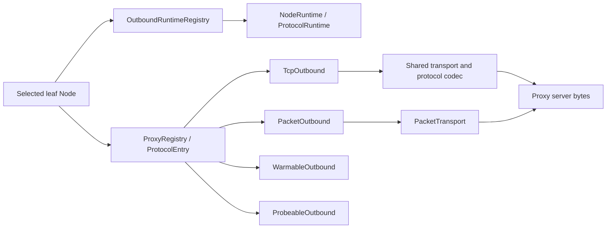

# 出站與代理棧

出站棧把選定的葉節點連線到代理伺服器或目標，並處理協定位元組。

## 範圍

路由和代理群組選擇確定葉節點 `Node` 後，出站棧接手後續工作：按 capability 分派 handler、
維護可複用的協定狀態、建立 transport、完成 TLS 與 REALITY 握手以及代理 framing。
建立好的 TCP 或 UDP 物件由它返回給控制面。

節點設定見[節點參考](../reference/nodes.md)，群組成員選擇與健康策略見[群組設計](./groups.md)。
這兩項不歸出站棧管。

普通呼叫方會收到兩種物件之一：

- `ProxyStream`：已經建立並繫結目標的 TCP 位元組流。
- `Arc<dyn PacketTransport>`：已經建立、面向一個 UDP 目標的分幀封包路徑。

推測式 UDP 撥號先返回 `PreparedUdpTransport<T>`。commit 可能失敗；成功時只返回被選中值的 `Arc<T>`，未選中的 preparation 在 drop 時復原。VLESS XUDP/Mux.Cool、Hysteria2、TUIC 和所有 `MultiTargetTransport` 都屬於來源共享協定，它們把 transport 提交給 core 所有的 source attachment，同一 source scope 下的多個五元組因此共用同一個 receiver。

`direct` 不使用代理協定，直接連線目標。`block` 終止請求。其他 handler 根據選定節
點，生成代理伺服器能理解的協定位元組。

`honk-outbound` 負責出站撥號、群組和健康檢查，`honk-core` 透過 `honk_core::{proxy, group, outbound}` 重新匯出這些模組。

## 實作模組歸屬

公開的 `proxy::*`、`quic::*` 與 `quic_boring::*` import 路徑仍受支援。實作按職責
拆成普通 Rust 模組：

| 範圍 | 實作模組 |
| --- | --- |
| Proxy 契約 | `proxy/{error,packet,outbound,registry}.rs` |
| 協定族 | `proxy/shadowsocks/{mod,aead2022,stream}.rs`；`proxy/vless/{mod,handler,mux,cool,encryption}.rs` |
| QUIC | `quic/{path_health,flow_control,metrics,endpoint,client,stream,boring}.rs` |
| AnyTLS | `proxy/anytls/{padding,writer,overflow}.rs` |
| Score 與健康 | `group/score/{evidence,ranking,feedback}.rs`；`alive/{health,urltest}.rs` |
| Session pool | `session/{maintenance,speculative}.rs` |
| Stream transport | `proxy/transport/{grpc,h2_io}.rs`；`proxy/transport/xhttp/{browser,preparation,request,response,runtime,session,stream,upload}.rs` |
| Pooled runtime 生命週期 | `runtime/pooled.rs` |

共享狀態仍留在共同的父模組裡，子模組不公開這些欄位。REALITY、TLS、stream
transport 和 UoT 仍由多個協定共用，不歸 VLESS 獨佔。既有的測試名稱保留在對應協定
族內。物理檔案、行號和定義模組的 metadata 會隨歸屬變化；公開 reexport 不會保留
`type_name` 或預設 tracing target。舊的 `quic_boring`、`vless_mux`、
`shadowsocks_2022` 日誌過濾目標，應改成 `honk_outbound::` 字首下的
`quic::boring`、`proxy::vless::mux`、`proxy::shadowsocks::aead2022`。

## Registry 與 capability 模型



`ProxyRegistry` 只做協定分派，不持有 session。每個 `ProtocolEntry` 包含一個
`ProtocolDescriptor`、一個必需的 TCP handler，以及可選的 packet、warm 和 probe
capability 槽。槽為 `None` 表示協定沒有實作該 capability，分派會直接拒絕，不會靜
默換成別的實作。

`src/proxy/mod.rs` 裡，`ProxyStream::into_tcp_stream` 保持 zero-copy splice 的
downcast 不變量。`proxy/vless/handler/stream.rs` 的
`ProxyStream::into_vision_splice` 對未包裝的 Vision TLS/REALITY carrier 型別遵循
同一套 vtable 分派規則。因此，只要給這個 carrier 加一層包裝，它就不能再交給
splice。`PreparedUdpTransport<T>` 用一次消費式 commit 隔離推測式發布，並返回精確
選中的 `Arc<T>`。`WarmAttempt` 在建立期間持有 retention lock；失敗或取消時，只回
滾自己插入的 bit。

### Capability trait

`WarmRequirement::Session|Udp` 選擇要建立哪種可複用狀態。VLESS 會分別從 TCP path
和 UDP path 解析這兩種 requirement，所以 Selector 預熱不會開啟僅 UDP 的 Xray
pool。

| Trait | 操作 | 契約 |
| --- | --- | --- |
| `TcpOutbound` | `dial`、`dial_with_tcp`、`dial_runtime`、`dial_runtime_marked` | 開啟繫結目標的 `ProxyStream`。`dial_with_tcp` 可以使用已經連線的裸伺服器 socket。`dial_runtime` 把擁有 session 的工作固定到捕獲的 generation。`dial_runtime_marked` 攜帶已路由直連流的 `DirectMark`；只有 Direct 應用它，其他 handler 拒絕該呼叫。`ProxyRegistry` 讓帶 mark 與不帶 mark 的撥號經過同一組 generation fence。 |
| `PacketOutbound` | `dial_udp_transport`、`dial_udp_transport_runtime`、`dial_udp_transport_runtime_marked`、`dial_udp_transport_speculative_runtime` | 開啟或準備普通 `PacketTransport` 契約。runtime 與 speculative 變體防止 reload 或冷 race 的工作查詢可變的目前狀態。帶 mark 變體遵循 `dial_runtime_marked`。 |
| `WarmableOutbound` | `warm(runtime, timeout, WarmRequirement)` | 只建立 requirement 指定的可複用狀態。Hysteria2 用 `Udp` 驗證伺服器 admission；VLESS 可以把 `Session` 與 `Udp` 對映到不同 pool。 |
| `ProbeableOutbound` | `test_connectivity` | 測試原始代理伺服器可達性。協定可以覆蓋預設的帶 mark TCP 連線。 |

`PacketTransport` 暴露 relay 目標、`send_packet`、`send_packet_confirmed` 和
`recv_packet`。對帶佇列的 tunnel，`send_packet_confirmed` 是更強的首包 admission
點。full-cone 協定還可以宣告：伺服器 metadata 能權威指定回包源位址。來源共享協定
由 core 序列化各 endpoint view 的傳送，並持有 transport 唯一的 receive loop。

正式環境的 UDP handler 不返回裸 socket 或 loopback bridge。Direct 和 SOCKS5 把
native socket 包在 `PacketTransport` 後面；tunnel 協定在自己的真實 transport 上
實作 framing。

### 協定 descriptor

`src/descriptor.rs` 裡的 `ProtocolDescriptor` 是唯一的逐協定事實表。predicate 接
收具體節點，因為 VLESS 的 `network` 和 TCP path，以及 Trojan 的 transport，會影
響 capability 或 pooling。Trojan 與 AnyTLS 共用 `network_allows_udp`；VLESS 使用
規範的 `VlessConfig::udp_enabled()`。

| 協定 | `supports_udp` | `pool_ready_streams` | `pool_bare_tcp` | Generation runtime | 分享連結 scheme |
| --- | --- | --- | --- | --- | --- |
| Shadowsocks（含 2022） | 是 | 否 | 是 | `None` | `ss` |
| Trojan | `network` 預設或包含 `udp` 時 | 僅 `tcp`/空 transport | XHTTP 之外 | `None` | `trojan` |
| VMess | 否 | 否 | XHTTP 之外 | `None` | `vmess` |
| VLESS | `network` 允許 UDP 時 | 否 | direct TCP path 且非 XHTTP | `Vless` | `vless` |
| SOCKS5 | 是 | 是 | 是 | `None` | `socks5`、`socks4`、`socks4a` |
| Hysteria2 | 是 | 否 | 否 | `Quic` | `hysteria2`、`hysteria` |
| TUIC | 是 | 否 | 否 | `Quic` | `tuic` |
| Juicity | 是 | 否 | 否 | `Quic` | `juicity` |
| AnyTLS | `network` 預設或包含 `udp` 時 | 否 | 否 | `AnyTls` | `anytls` |
| Direct | 是 | 否 | 否 | `None` | 無 |
| Block | 否 | 否 | 是 | `None` | 無 |

Ready-stream pooling 儲存已完成、已繫結目標的握手。Bare-TCP pooling 只儲存已經連
到代理伺服器的 socket，目標握手留給之後的 `dial_with_tcp` 完成。TCP multiplex 和
QUIC 協定不進入這兩種 pool，因為 generation runtime 已經持有複用狀態。Direct 也
不進入這兩種 pool，因為每條流的 socket 各自帶著規則 mark 或全域 mark。即使設定了
獨立的僅 UDP Xray pool，direct TCP 的 VLESS 仍可以進入 bare pool。XHTTP 不進入這
兩類 preconnect pool，物理 H2 複用由它自己的 transport runtime 持有。

Ready stream 按 runtime generation、節點身分和目標分別儲存。只有流所屬
generation 與被撥號時的 generation 一致，才能取出。reload 發布新 generation 後，
連線池會在同一把鎖內做幾件事：移除舊 generation 的 ready stream、目標計數、預熱
任務記錄和目標存取計數；拒絕舊 generation 之後發來的 ready 寫入、存取計數更新和
預熱請求。新 generation 的 ready 名稱空間從空開始；reload 被拒絕時，目前連線池狀
態保持不變。Bare-TCP 仍以代理伺服器位址為 key。節點失效時，清除該位址的 bare 連
接，但只清除目前 generation 中屬於該節點身分的 ready 連線。

Bare entry 只完成了到代理伺服器的 TCP connect。複用它之前，pool 會拒絕任何已經排
隊的入站位元組，包括 fatal TLS alert。此時協定和 TLS 建立都還沒開始，伺服器不可能
發出有效位元組。這個 socket 不做 SNI 或 alert 特判，也不重試握手。Ready entry 已經
完成繫結目標的協定握手，所以緩衝的目標資料仍然有效，不算 stale。

Registry 組裝時會檢查三件事是否一致：descriptor 宣告的 capability、已填充的槽、
runtime 的種類。依賴節點的 entry 即使預設節點沒有 UDP，也可以帶 packet 槽。
`block` 是顯式例外：descriptor 宣告它沒有 UDP capability，但分派允許它的 packet
槽通過，讓選定的 block 決策能夠終結並拒絕該流。關閉 UDP 的節點返回普通的
capability 拒絕，呼叫方可以繼續回退到設定中的冷候選。顯式目標策略的拒絕仍是終態，
不影響健康狀態，也不等於缺少 UDP 支援。

### 協定與 UDP 清單

| Handler | TCP 行為 | `dial_udp_transport` |
| --- | --- | --- |
| `direct` | Native 帶 mark 目標連線 | `PacketTransport` 後的 native 帶 mark UDP |
| `block` | 拒絕 | 顯式拒絕路徑例外；不承載 UDP |
| `socks5` | SOCKS CONNECT | RFC 1928 UDP association。每個用戶端來源有一條控制流和一個連線到中繼的 socket，供其所有目的地共用。每個 header 寫入自己的目的地，每個應答返回真實線上來源（IPv4-mapped IPv6 規範化為 IPv4）。網域來源僅在等於撥號網域且埠一致時才投影為捕獲的目標，其他名字不經 DNS 直接丟棄。傳送時只寫入撥號網域，其他名字以數值目標發出。被截斷、RSV 非零、分片（`FRAG != 0`）或網域不是 UTF-8 的中繼 datagram 只丟棄該包並記 DEBUG；未知 ATYP 或控制流 EOF 結束 association。協商和認證、ASSOCIATE 請求和應答（含中繼網域解析）各有五秒逾時。 |
| `ss` / Shadowsocks 2022 | Shadowsocks stream | Shadowsocks packet framing；每個用戶端來源一個已連線的伺服器 socket 與加密狀態，可發往任意目的地（見下文） |
| `trojan` | 共享 transport 上的 Trojan stream | `network` 允許 UDP 時使用 Trojan UDP framing；每個用戶端來源一條 associate 流，每個 frame 自帶對端位址 |
| `vmess` | VMess stream | 未實作 |
| `vless` | 由獨立 multiplex policy 選擇 direct、H2 或 Mux.Cool | `network` 允許 UDP 時可用；encoding 與可選 UDP multiplex 決定路徑 |
| `hysteria2` | QUIC stream | Hysteria2 QUIC datagram |
| `anytls` | AnyTLS 邏輯 stream | UoT v2 邏輯 stream |
| `tuic` | TUIC v5 QUIC stream | QUIC datagram 或 uni-stream fallback |
| `juicity` | Juicity QUIC stream | 每個用戶端來源一條長度分幀 QUIC bi stream，承載所有目的地 |

Shadowsocks 的傳統 AEAD 和 2022 版本用一個 `MultiTargetTransport` 承載同一用戶端
source 的所有目的地。它只有一個連到伺服器的帶 mark socket 和一份加密狀態。2022
還多了用戶端 session ID、單調遞增的包計數器，以及一對伺服器 session 重放視窗，這
些狀態都不會因目的地變化而重設。預設目標的位址標頭預先編碼，其他目的地編碼到棧緩衝。
`recv_packet` 返回經認證的內層位址作為對端，因此從未聯絡過的主機回包，也會以該主
機的身分到達核心；IPv4-mapped IPv6 會規範化為 IPv4。網域來源只有在等於撥號網域和
埠時才會被接受，比較按 ASCII 不區分大小寫，並對映到撥號目標；其他網域一律丟棄，
不做 DNS。傳送時每個 datagram 只寫入撥號網域，其他名字以數值目標發出。過短、key
錯誤、重放、位址錯誤或無法對映的封包只丟棄自身；2022 的重放狀態只在位址解碼成
功後提交。外層 socket 仍連線伺服器，所以未經請求的對端能否到達用戶端，取決於伺服器
端自己的 NAT 行為。

VMess 和 VLESS entry 只在 `rprx` feature 下編譯，`honk-core` 和 `honk-tool` 的預
設 feature 集啟用了它。不帶 `rprx` 時，這些節點形式仍能解析，但 registry 裡沒有
對應的 entry，撥號會以普通的 `No handler for protocol` 拒絕。feature-off 建置不
分配 VLESS runtime pool，也不分配 carrier semaphore。單元測試透過 `cfg(test)` 保
留 backend 覆蓋；feature 邊界整合測試連結正常的 library，用來驗證這兩種建置的區
別。

## Runtime 所有權與 reload

`src/runtime.rs` 定義 `OutboundRuntimeRegistry`。控制面在一個不可變設定
generation 中，可複用的出站狀態都由它持有。它把 `Node.id` 對映到 `NodeRuntime`，
每個 `NodeRuntime` 包含：

- 不可變的 `Arc<Node>` 設定；
- 節點相關的 `udp_capable` 結果；
- 由 descriptor 選擇的一個 `ProtocolRuntime`；
- 可選的 XHTTP transport 狀態，它與協定 runtime 並存，不替代協定 runtime。

`ProtocolRuntime` 可以是 `None`、AnyTLS 狀態、`VlessRuntime`，或型別擦除的 QUIC
client 槽。每個 VLESS 節點都持有 `VlessRuntime`，其中只建立設定選中的 H2、
shared-Cool 或 separate-Cool pool，並儲存 lazy private source-ID key。這些資源歸
generation 所有，handler 保持無狀態。

遇到未知 transport、無效的 pin 或 REALITY key、保留的內建名稱或協定時，一律 fail-closed。

- 結構化或匯入的 raw TCP TLS ALPN 存於 `TlsOptions.alpn`，對應的 flat serde 欄位是 `tls_alpn`，空列表時省略。`Node::validate_protocol` 要求 AnyTLS 或 TCP Trojan/VMess/VLESS 啟用普通 TLS，並拒絕 REALITY、WS、gRPC、QUIC 的 override。ALPN 名稱長度為 1–255 位元組，編碼後的列表最多 65,533 位元組。非空 ALPN 以基礎 ID 作為名稱空間，以 JSON 元組 `["tls-alpn", <ordered list>]` 作為名稱，派生 UUID v5 子 ID，與任意認證資訊文本分開。空列表保留基礎 ID，包括 VLESS 重新派生的身分。URI/v2rayN 的 ALPN 相容行為和 TUIC 獨立的 `tuic_alpn` 不變。

XHTTP 使用獨立的 H2-only profile。規範節點攜帶 `["h2"]`，普通 TLS 和 REALITY 都會設定這個 offer，但不會改變 raw TCP、WS 或 gRPC profile。普通 TLS 在傳送代理位元組之前，會拒絕沒有協商 H2 的對端。認證後的 REALITY 按 transport 契約選擇 H2；官方 Xray 會故意省略伺服器 ALPN。顯式的明文 XHTTP 要求對端支援 H2。規範請求形態以及 TLS/明文安全設定都參與節點身分和 reload 複用。

admission 範圍內的 TCP 回饋只會開始一次：在首個獲准的物理嘗試開始時，或者在複用
session 或 QUIC connection 上開啟邏輯流之前。冷 admission 還在等待時，回饋不會開
始。已經完成、但沒有經過上述任一邊界的路徑，仍使用完成時的回退機制。

### Generation 生命週期

啟動時先建置並校驗完整的 runtime registry，然後才發布。reload 基於前一份
registry 建置 replacement。只有完整節點設定相等時，runtime 才能遷移；比較時忽略
解析期的 `created_at` 和 `updated_at` metadata。

遷移發生在 reload commit 點。replacement 發布之後，舊 generation 才記錄已經移出
的 `Node.id`，並在後續的 drain 和 shutdown 中跳過這些 runtime。因此，未變化的節
點會保留：

- TUIC、Juicity 和 Hysteria2 的 QUIC client 和連線；
- AnyTLS 物理 session；
- 完整的 VLESS runtime，包括 H2/Mux.Cool carrier 和 source-ID key。

退役 generation 首先對新工作變成 terminal。未遷移的 AnyTLS 和 VLESS pool 進入
draining：不再接收新的邏輯 stream，但現有 stream 保留 carrier 直到結束。QUIC 流
持有連線 clone，所以 terminal generation 檢查會拒絕新工作，目前流則自然完成。行
程 shutdown 在可選的[業務連線寬限等待](../reference/global.md#關閉)之後，強制關
閉剩餘 pool 和 QUIC client。

standalone probe 這類沒有 generation 的呼叫方使用 `EphemeralRuntimeGuard`。
AnyTLS 或 VLESS stream 與 packet transport 在整個生命週期內都保留 guard。正常完
成時可以等待 `close`；drop 也會啟動確定性的 teardown，所以一次性 pool 不會在呼叫
方 abort 後殘留。Single XUDP 也用 VLESS runtime 生成逐 source key，但它的
private carrier 不進入可複用 session pool。

### 撥號 admission

direct TCP 與代理的 TCP/QUIC 嘗試都屬於物理出站連線，它們連同協定握手會取得兩個 permit：

1. 捕獲 generation 的設定撥號 gate；
2. 所有重疊 reload generation 共享、啟動時固定的行程級 ceiling。

先取得 generation gate，避免低限額 generation 在等待時佔住行程容量。replacement
可以立刻採用新的 generation 區域性限額，舊的在途工作繼續佔用共享行程 gate。已經預
熱的 session 上，邏輯 stream 不再執行物理撥號。

Session pool 自主發起的 replacement dial 只繫結已發布 owner 的 admission。reload
發布時，會原子地把遷移的 pool 重新繫結到新 generation；遲到的 speculative commit
不能恢復前任 generation 的 gate。退役會立即清除已儲存的 admission。未 commit 的
`PreparedUdpTransport` 不保留 generation 或行程級 dial-admission permit。

Pool waiter 在檢查容量之前，先註冊容量變化通知。pool 持有的每個 stream permit 釋
放時都會通知 waiter，包括 detached session 的首個 permit。carrier 發布會喚醒所有
符合條件的 waiter。這樣，不預留 stream 的 warm offer 不會消耗掉唯一一次通知，也
不會讓仍有可用容量的 stream checkout 一直等下去。

撥號發起者在啟動 task 之前訂閱結果，並直接消費這次嘗試的結果。即使已有 warm
session 可以承接普通 spread 撥號的失敗，已經完成的本地拒絕仍保持終態。Pool-owned
task 在 poll 撥號之前會重新檢查終態。在途的普通撥號會預留一個可複用 slot。如果普
通 offer 或進行中的撥號佔滿上限，detached winner commit 會把超出的 private
carrier 以 drain-only 方式發布，並保留已經 admission 的 stream；多 carrier 批次
也一樣。批次先校驗全部成員，再發布其中任何一個。丟棄 loser，或者向已退役 pool 提
交時，仍然只關閉它的 private carrier。

解除 warm retention 時，多餘的 live carrier 進入 Draining 後也會喚醒容量 waiter，
不需要等這些 carrier 上已有的 child 結束。maintenance 按 max-age 退役，或者清理
已關閉 session 而釋放容量時，也會發布通知，即使沒有關閉 idle carrier 或執行
prewarm。backend 關閉或從 Active 進入 Draining 時，會通知同一個所屬 pool，包括
child permit 仍被持有時 H2 driver 終止。session 在發布或 detached attach 之前綁
定 pool 通知；手動清理已關閉 carrier 時也會廣播容量變化。

VLESS 物理 carrier 還持有不可變行程級 VLESS-carrier gate 的一個 permit。啟動資源
預算先扣除 DNS socket 分割區，再在計算 UDP endpoint 之前分出
`min(after_dns / 8, 8192)`；零值保持為零。reload 流量和 DNS runtime fork 共用同
一個 gate。permit 隨實際 carrier I/O 經過 provisional、active、draining 和 idle
狀態，一直保留到 task teardown。因此，描述符的權威邊界來自這個 gate，而不是各節
點 pool cap 的總和。

## 共享 stream、socket 與 bootstrap 層

### Stream transport

Trojan、VMess 和 VLESS 共用 `src/proxy/transport.rs`。具體行為由 `node.transport()` 返回的 `StreamTransportOptions` 決定，用到其中 `transport`、`ws_path`、`ws_host`、`grpc_service`、`xhttp` 這幾個欄位。建立順序固定：

```text
TCP -> optional TLS or REALITY -> optional WebSocket, gRPC or XHTTP -> protocol header
```

`maybe_tls_wrap_concrete` 保留 Vision 需要的具體 TCP/TLS 型別。有 REALITY 引數時，
它走[有界認證建立過程](#伺服器認證與指紋約束)，不走普通 TLS。因此，同一條共享路
徑為 Trojan、VMess 和 VLESS 提供一致的 TLS、REALITY、WS、gRPC 和 XHTTP 建立過程。

Trojan 冷連線和 pool 中取出的裸連線使用同一套完整 transport。

Trojan UDP 讓一個用戶端來源的所有目的地共用一條 UDP-associate 流。header 指定首個
目的地，之後每個 frame 的格式是 `address | u16 length | CRLF | payload`，兩個方
向上各自攜帶對端位址。`recv_packet` 返回 frame 中的真實對端；IPv4-mapped IPv6 規
範化為 IPv4。因此核心可以接納來自從未聯絡過的對端的首個回覆。網域 frame 只有與捕
獲的撥號網域和埠一致時，才投影為捕獲的目標。其他網域 frame 會被整幀消費並丟棄，
包括 length、CRLF 和 payload，也不做 DNS。傳送時每個 frame 只寫入撥號網域，其他
名字以數值目標發出。未知 ATYP 無法推導長度，會終止該流。各 frame 共用該流的
writer：寫到一半就停滯的 frame 會終止整個 source，絕不按擁塞處理。各目的地因此共
享隊頭阻塞和失敗命運。網域目標 scope 仍按原始目的地區分。TLS 批次讀取先返回已經
讀到的位元組，再在下一次非空讀取中報告後續的 I/O 錯誤，不會把該錯誤轉換成 EOF。


`transport_quality` 按 runtime owner 管理 carrier 壓力提示。共享的
TCP/TLS/REALITY 和 AnyTLS 在物理 I/O 層觀測，Shadowsocks 借用已有的 socket half。
Linux `TCP_INFO` 每個活躍秒最多讀一次。各欄位按核心返回的 ABI 長度分別檢查；欄位
缺失或讀取失敗時保持未知，也不改變 I/O。Vision Direct 和 ready pool 的 FD 存活性
檢查仍走 socket 路徑。Hy2/TUIC/Juicity 複用已有的每秒物理 QUIC 取樣，隔離握手確
認或發布之前的歷史，peer 改變時重建基線；邏輯 mux child 不會重複報告同一事件。這
裡不額外持有 FD，也不建立逐 TCP 定期任務；靜止的 TCP 不會產生新的事件驅動觀測。
詳見 [Score 壓力語義](./groups.md#score-評分與生命週期)。

`proxy/transport/grpc.rs` 使用已有的 `h2` client 承載 gRPC gun framing。HTTP/2
幀、HPACK/Huffman、CONTINUATION 拼接和連線級動態表都交給 `h2` 管理。回應標頭限制為
64 KiB，動態表採用預設的 4 KiB 上限。返回的流直接擁有連線 driver 和 socket；丟棄
流就關閉 transport，不會留下脫離 owner 的任務。

opening request 不設定 `END_STREAM`。TLS 請求使用 `:scheme: https`，且始終協商
`h2`，與指紋 profile 無關。DATA 保留 gRPC 長度字首，也保留 gun 對端使用的
protobuf 單 bytes 欄位 envelope。最多允許一個 16 KiB 的應用訊息排隊等待傳送；取
消不會把已經取得所有權的位元組算進後一次呼叫的 buffer。`h2` 可以把訊息拆到正在傳送
的視窗裡，視窗小於 envelope 也可以。flush 會同時等待排隊 DATA 和底層 transport
重新整理完成，不能只看控制幀是否重新整理。請求 shutdown 傳送 `END_STREAM`，但保留回應方
向；拆分後的讀寫任務都能收到 driver 喚醒。

非 200 回應、trailers-only 拒絕、非零 gRPC status、流重設，以及攜帶錯誤或排除當
前流的 GOAWAY，都會返回流錯誤，而不是正常 EOF。已快取的 payload 先交付，終止讀取
錯誤隨後交付，後續讀取仍然保留該錯誤。接收方向已經成功完成時，不會因為稍後的寫入
失敗而失去 EOF。優雅 GOAWAY 允許已接受的流完成，不會自動重放應用位元組。

VMess 在關閉 duplex 半邊前記錄 relay 返回的錯誤，使回應標頭及訊息體解碼
失敗傳遞到流 owner，而不是變成 EOF。

#### XHTTP carrier 與邏輯流所有權

`proxy/transport/xhttp.rs` 把原始 H2 body 適配成已有的 stream 契約，並持有節點級 `SessionPool`。它不是新的代理協定，也不是 loopback relay。開啟下載後會多一個 peer：它有自己的 pool 和撥號節點，只承載 GET。呼叫方傳入的 socket 始終屬於上傳 peer。winner commit 在同一次 lifecycle 鎖內同時持有兩個 pool 鎖，先校驗兩側的 private carrier，再發布；任何一側的 carrier 已經斷開，兩側都不會發布。每個 pool 最多保留兩條可複用物理 carrier。draining carrier 可以在既有的行程 FD/VLESS-carrier gate 下與 replacement 短暫重疊。物理 driver 擁有 socket、觀測和 carrier permit；HTTP 請求和邏輯代理流使用獨立的 reservation。對端公布的並行 stream 上限保持權威，包括零、一和後續的縮小。

每條 carrier 最多保留 2048 個本地 reset 請求，相當於 16 個 admission 視窗。它使用 h2 預設的一秒在途 frame 寬限期，也保留 h2 預設的終身協定錯誤 reset 預算：最多 1024 次。持續的短流 churn 會在舊 reset 狀態過期前取消多個 admission 視窗，所以保留數量必須高於活躍請求上限。

Stream-one 使用一個 POST，stream-up 使用 GET 和流式 POST，packet-up 使用 GET 和有序的有限 POST。建鏈不必等回應標頭，就能返回可寫流。上傳回應裡的 padding 會被持續排空並丟棄，不計入應用 RX。Packet-up 在閒置後的第一批資料到達時立即傳送，不額外等湊批。連續的 POST 遵守 `scMinPostsIntervalMs`。POST 等待節奏間隔、或其 body 正在傳送時接納的位元組，會合併到下一次 POST。每流位元組緩衝和最多八個未完成回應的 POST 一起限制背壓；前一個 body 物理寫完之後，就可以繼續後續 POST，不必等它的回應。

legacy 上傳 padding 的 Referer 使用設定的基礎 path，query 換成生成的 `x_padding` 值；請求本身仍保留設定的 query。

Stream-one 和 stream-up 的 flush 在目前 H2 流控下，等待位元組所有權釋放和物理 I/O 重新整理。Packet-up 的協定建立 flush 和首次應用寫入 flush，都會等待完整的已接納位元組字首完成物理重新整理，跨多個 POST 也一樣。VLESS Encryption 額外預留一個建立屏障；在恢復的 0-RTT 連線裡，即使握手和協定標頭共用一次 flush，也保留這個屏障。沒有新位元組的 flush 不消耗這些屏障。之後的 packet-up flush 只檢查保留的錯誤，不等待 POST，所以逐 datagram 的 write/flush 迴圈可以跨節奏間隔合併批次。

如果沒調 shutdown 就丟掉 packet-up stream，已經接納但還沒上傳的位元組也會丟；shutdown 是唯一的上傳完成屏障。緩衝的下載位元組先於終止錯誤交付。上傳 shutdown 保留回應方向；stream-up 在請求 END_STREAM 完成物理重新整理後結束，並繼續排空 POST 回應，保留延遲到達的上傳拒絕。Packet-up 的 shutdown 等待每個已接納位元組所屬 POST 的回應完成並檢查狀態，不偽造 EOF 標記。

優雅 GOAWAY 停止向該 carrier 開新請求，保留已通過 admission 的 stream；只有未來的新 POST 轉到 replacement，不重放交付狀態不明的應用位元組。退役會關閉新邏輯流 admission，但已經 admission 的 packet 流保留完成所需的請求容量。

如果對端縮小 stream 上限，導致已保留的 packet-up 上傳 lane 不可用，就先把該 carrier 轉為 draining，再接納 replacement。已有 GET 保持存活，replacement 取得上傳容量；舊 reservation 不會佔住可複用 carrier 上限。

Stream-up 上傳回應錯誤已經可以報告時，會優先於同時完成的請求 END_STREAM 處理。因此 shutdown 返回該拒絕錯誤，而不是報告半關閉成功。

ephemeral 建立過程在取消期間也受 guard 管理。由 pool 自己管理的握手有 deadline。
speculative UDP carrier 只有在勝者完成 fallible commit 之後才發布；關閉或丟棄
preparation 會復原 reservation。清理由既有的 runtime shutdown、retirement 和
idle maintenance 負責，沒有新增協定 janitor，也不產生逐包 telemetry。

### 帶 mark socket 與名稱解析

`crates/honk-outbound/src/bootstrap.rs` 提供與 dae `bootstrap_resolver` 對應的行程級解析，`util::connect_marked` 和 QUIC 建立路徑都會呼叫它。ECH 的 raw-query 發現由 `tls::discover_ech_config` 呼叫 `query_ech_config`。

`util.rs` 集中建立出站 socket：

- `connect_marked` 先解析，再連線 TCP，並設定 timeout、nodelay、keepalive 和可選
  的 `SO_MARK`。
- `connect_outbound` 對代理伺服器 TCP 應用 bypass mark。
- `udp_marked_bind` 和 `marked_udp_socket` 建立帶 bypass mark 的 UDP socket。

控制面 socket 使用行程級 `global.so_mark_from_dae`，值為零時選 `DAE_BYPASS_MARK`，
即 `0x100`。非零直連規則 mark 改用 `rule_mark | CLASSIFIED_MARK`，不會把覆蓋值傳
給 bootstrap 或代理 carrier。WAN egress 識別這兩類標記。只有在沒有正式 datapath
的非特權 `EPERM` 環境裡，mark 應用才是 best-effort；其他錯誤都會向上傳播。

訂閱和直連 UI 下載也走同樣的帶 mark TCP 撥號，之後用 Hyper HTTP/1 處理幀，並沿用
既有的 rustls/platform-verifier TLS 策略。掛接 eBPF 之前的首次訂閱抓取也一樣。
TLS 初始化失敗會返回下載錯誤，不會 panic。訂閱 URL 裡的認證資訊會轉成標記為敏感的
Basic Authorization header；顯式設定的 Authorization 優先。同源重定向保留認證信
息；host、埠或 scheme 一旦變化，認證資訊就永久移除，即使之後又跳回原始源也不會
恢復。重定向 URL 的 userinfo 不會提供新認證資訊。回應內容上限和 HTTP(S) 環境代理連線仍
受各自下載邊界的約束。

`bootstrap.rs` 避免代理主機名稱解析依賴 honk 自己攔截的 DNS 路徑。節點撥號點經
`connect_marked` 或 QUIC 建立呼叫 `bootstrap::resolve`，絕不直接呼叫裸
`lookup_host`；否則代理主機名稱解析會和 honk 自己攔截的 DNS 路徑形成死鎖。
`resolve` 先交給 core 的行程級 `NodeHostResolver`。它只接管目前 DNS generation
中由 [`subtag()` 規則](../reference/dns.md#節點伺服器域名)路由的主機名稱。
`resolve_with*` 用於 DNS 上游 endpoint，會跳過它，因此上游自己的網域不會遞迴。其
餘情況下，設定的 bootstrap resolver 透過帶 bypass mark 的 UDP/TCP 發出查詢。查詢
失敗時回退到 `/etc/hosts` 及 `/etc/resolv.conf` 中第一個數字 nameserver；DNS
socket 同樣帶 mark，不呼叫 libc NSS，也不追加搜尋字尾。A 和 AAAA 同時查詢，各自
有獨立的 3 s 預算。只接受與隨機查詢 ID 及原問題完全匹配的回應；被截斷的 UDP 應答
會改用帶 mark 的 TCP 重試。`query_ech_config` 透過同一 raw 路徑查詢 DNS HTTPS 記
錄，`qtype 65`，並提取 SVCB `ech` 引數。

解析完成後，`src/address_race.rs` 為代理伺服器的 TCP `connect_marked` 和共享
QUIC `QuicClient` 安排連線嘗試。IPv4 和 IPv6 穩定交錯，最多同時 race 兩個位址。
首個位址立即開始，fallback 在 250 ms 後啟動。首個位址更早失敗時會提前 fallback，
但物理嘗試之間仍至少相隔 10 ms。每個在途的位址嘗試分別持有 generation 和行程級撥
號 permit；達到設定上限時，fallback 必須等先前的嘗試結束，所以
`max_concurrent_dials: 1` 會序列嘗試位址。race 始終發生在已經選定的同一節點內部，
socket mark 和安全設定保持一致。TCP TLS 建立與 QUIC 協定初始化，包括 QUIC 協定認
證，只在勝出的 transport 上執行；QUIC TLS 握手也參與位址 race。錯誤按原始位址順
序確定性地回報。

`crates/honk-outbound/src/util.rs` 提供 `connect_marked`、`connect_outbound` 和 `udp_marked_bind`。`connect_marked` 與 `connect_outbound` 負責 TCP `SO_MARK`、keepalive 和逾時。`marked_udp_socket` 請求 8 MiB 的 `SO_RCVBUF`/`SO_SNDBUF`；Linux 會分別按 `rmem_max`/`wmem_max` 限制，並報告兩倍的記賬值。honk-core 在非 mock 啟動時嘗試把 `net.core.rmem_max`/`wmem_max` 提高到 16 MiB，失敗時只記錄 warning。208 KiB 的預設視窗會讓 QUIC 在 1 ms RTT 下大約受限於 2 Gbps。必須遵守 runtime 的 Bypass mark 不變量，否則 `wan_egress` 會把 socket 迴圈匯入 `daens`。

## TLS、指紋、ECH 與 pin

出站和 DNS transport 棧裡，正式環境的 TLS 全部使用 BoringSSL。TCP 用 `boring` 和
`tokio-boring`；QUIC 用自訂的 `quinn-proto` crypto backend。信任庫由
`webpki-root-certs` 建置。顯式 no-verify connector 只用於設定的不安全模式和
REALITY；REALITY 用自己的握手後檢查替代 PKI。

`src/tls.rs` 提供 BoringSSL TLS client，行程級 `set_tls_mode` 選擇 TLS profile。`build_reality_connector(chrome)` 使用 `reality.rs` 的握手後 ed25519 認證替代 PKI，只允許 TLS 1.3，不提供 REALITY resumption。顯式結構化的 TCP ALPN 在 tls 和 utls 模式下都會傳給 `build_connector`。空列表保留 profile 預設值；Chrome ALPS 取決於列表是否精確包含 `h2`。Registry 發布和直接建構 connector 都會校驗非空 override，共享 stream dispatch 會在選擇 plaintext 或 REALITY 之前校驗。直接 QUIC 設定會拒絕 TCP ALPN，不會忽略它。

`build_connector` 和 `build_reality_connector` 返回共享的 BoringSSL context。每種組合各有一個 context：REALITY、是否驗證、pin、ALPN 覆蓋、Chrome 模式。它們儲存在行程級快取裡，達到 128 種組合時清空重建。每個 context 持有行程級 webpki 信任庫，不用 `SslConnector::builder` 預設解析的系統 CA 證書包。因此撥號不再解析證書，存活連線也不會各自佔用一份 CA 副本。

### 行程級 TLS profile

`tls_implementation = "utls"` 在行程範圍內啟用目前唯一實作的 Chrome-oriented 模
擬 profile。這個 profile 會設定：

- GREASE 與逐連線擴充套件亂序；
- 先 `X25519MLKEM768`、後 `X25519` 的 key share；
- Chrome-derived signature algorithm、curve、cipher 集與 ALPN；
- brotli 證書壓縮；
- h2 ALPS 使用歷史 `0x4469` codepoint；本次核對的[uTLS Chrome_133
  profile](https://github.com/refraction-networking/utls/blob/aa6edf4b11af/u_parrots.go)
  使用 `0x44cd`；
- 沒有真實 ECHConfigList 時的 ECH GREASE。

其他 `utls_imitate` 名稱會記錄 warning，並使用這個 profile。
`tls_implementation = "tls"` 保持普通的 BoringSSL ClientHello。兩者都不承諾完整
的瀏覽器身分；REALITY 還必須加上 ed25519 signature algorithm。

### ECH 與證書 pin

節點可以內聯提供靜態 ECHConfigList，也可以透過檔案提供。顯式設定無效時，registry
建置會失敗。伺服器返回 `ECH_REJECTED` 時 fail-closed；伺服器提供的 retry config
會記錄日誌，但不持久化。

只啟用 ECH discovery 時，connector 會在連線期間透過 bootstrap 路徑查詢 DNS HTTPS
記錄。正結果採用受限的記錄 TTL，負結果快取五分鐘。discovery 是 best-effort，採用
fail-open：查詢失敗時，這條連線不使用真實 ECH，Chrome 模式仍可傳送 ECH GREASE。

`pinSHA256`，對應 `tls_pin_sha256`，會比較葉證書的 SHA-256 digest，並替代 PKI
chain 校驗和主機名稱校驗。無效 pin 一律 fail-closed。TCP TLS 和 QUIC crypto
backend 使用同一規則。

## REALITY client

`src/reality.rs` 透過 `RealityConfig`、`parse_reality_config` 和 `reality_connect`，實作只允許 TLS 1.3 的專用 REALITY BoringSSL 握手。workspace 裡打過補丁的 `boring-sys` 提供兩個用戶端 hook，詳見 [Technology stack](../../../AGENTS.md#technology-stack)：

- `SSL_set1_client_x25519_private_key` 為獨立的 X25519 share 預置 honk 的臨時
  private key。
- `SSL_set_client_hello_fixup_cb` 在序列化的 ClientHello 進入握手 transcript 之
  前重寫它。

### ClientHello 認證

首次 ClientHello 先宣告 `X25519MLKEM768`，再宣告獨立的 `X25519`。即使 peer 協商
了 hybrid share，REALITY 認證仍刻意從預置的 classic X25519 private key/share 派
生。fixup callback 把 32 位元組的 legacy `session_id` 槽清零，然後計算：

- `authKey = HKDF-SHA256(X25519(eph, pbk), salt=clientRandom[:20], "REALITY")`；
- nonce `clientRandom[20:32]`；
- `AES-256-GCM(authKey).Seal([ver:3][0][ts:4][shortId:8])`，版本位元組保持 `1,3,3`，保留位元組為 `0`，時間戳為大端 u32，short ID 為八位元組。AAD 是 `session_id` 置零後的完整 ClientHello。

16 位元組的加密 plaintext 加 16 位元組 GCM tag，恰好填滿 session ID。空 short ID 是
八個零位元組。設定值必須是偶數長度的 hex，最多八位元組，並向右補零。解析或 fixup 失
敗時，會在傳送未認證 ClientHello 之前中止。callback 只 seal 一次；第二次呼叫會在
複用 GCM key/nonce 之前中止，HRR 的第二條 ClientHello 也一樣。因此用戶端不聲稱支
持 HRR。

### 伺服器認證與指紋約束

REALITY 用自己的認證替代普通證書校驗。對端葉證書必須是臨時 ed25519 證書，簽名必須精確等於 `HMAC-SHA512(authKey, raw ed25519 public key)`。

不匹配、普通的 mask-target 證書或其他認證失敗都會 fail-closed。用戶端不會據此推
斷唯一的遠端原因。它不會回退到 PKI，也不使用 session resumption。

如果共享的 VLESS/Trojan/VMess transport 在首次 TLS 握手完成後收到非 ed25519 葉證
書，就允許一次相容嘗試。做法是關閉該連線，向同一個 peer 位址新建帶 bypass mark
的 TCP socket，只通告 X25519。SNI、伺服器 public key 和 short ID 保持不變；SSL
狀態、client random 和臨時 key 全部重新生成。新連線仍要通過同一個 REALITY HMAC
認證，之後才能傳送代理標頭或應用資料。ed25519 HMAC 錯誤、證書缺失、TLS/IO 錯誤或
HRR 不會觸發相容嘗試。第二次嘗試只要失敗就是最終失敗。

這個證書結果本身沒有通過認證，不能據此證明伺服器是舊版本。錯誤認證資訊或主動攻擊者也
可能誘發 classical 嘗試，但無法繞過它的認證。profile 不快取，也不增加設定項。兩
次嘗試、配額等待以及連線本身共用一個 `3 × connect_timeout` 的 setup deadline；外
層呼叫方的 deadline 可以更早到期。冷連線替換期間，已關閉 socket 的配額會保留到認
證結束。替換傳入或池化的 socket 必須申請新配額，不能借用同級連線持有的 permit。
直接呼叫底層 `reality_connect` helper 仍只嘗試一次。

REALITY profile 在 Chrome-derived signature algorithm 列表前面加入 ed25519，讓
BoringSSL 能用該葉證書的 public key 驗證伺服器的 TLS CertificateVerify。這與本次
核對的 uTLS Chrome_133 profile 不同。honk 不承諾完整的 Chrome identity 或特定的
JA4 值。

target 緩衝限制取決於伺服器版本，不是 honk 用戶端統一的證書大小上限。文件中的
sing-box 1.12 / MetaCubeX-uTLS 1.8.0 peer 使用 [8192 位元組的 target TLS record 緩
衝區](https://github.com/MetaCubeX/utls/blob/v1.8.0/reality.go)，這個數字包含
record framing，不是隻限制 DER 證書長度。本次核對的 [XTLS/REALITY 實作](https://github.com/XTLS/REALITY/blob/8cdf7bf9c7f0/tls.go)
使用 17 KiB 緩衝區。應按實際部署的伺服器版本選擇相容的 target。

## VLESS wire 契約

規範設定是 `honk-config/src/node/vless.rs` 裡的 `VlessConfig`。UDP permission、
協定 packet encoding 和 multiplex 是三個互相獨立的維度：

| 軸 | 值 | 路徑作用 |
| --- | --- | --- |
| `network` | 僅 TCP 或允許 UDP | 唯一 UDP capability gate；關閉 UDP 不會選擇 encoding。 |
| `udp_encoding` | `auto`、`native`、`xudp`、`uot-v2` | 選擇非 multiplex packet 協定。無 Vision 時，`auto` 在 53/443 使用 native command-UDP，其他情況使用 Single XUDP。 |
| `multiplex` | `off`、H2、Xray | 獨立選擇 direct/H2/Mux.Cool TCP 與 protocol/H2/Mux.Cool UDP path。只有 H2 持有其 padding flag。 |

Xray TCP concurrency 為零時按 8 處理，負值關閉 TCP mux。XUDP concurrency 為零時
跟隨 TCP pool，負值讓 UDP 回到協定 encoding。正的 XUDP concurrency 會建立獨立的
UDP pool，並被規範化為 `1..=128`。UDP/443 policy 預設是 `allow`：使用設定的 UDP
pool，沒有 pool 時用協定 encoding。顯式 `reject` 即使在兩個 pool 都關閉時仍是終
態。`skip` 使用協定 encoding，不使用 pool。Vision 不會隱式限制 443 埠。

用戶端不會探測另一條伺服器 path，不會換成別的 framing 重試，也不會重放首個 UDP
packet。原生 VLESS 使用 u16 分幀的 connected command-UDP，不傳送 UoT magic
destination 或 setup preamble。傳送範圍是 1–8190 位元組。收到的零長度 frame 是
datagram，不是 EOF。writer 會確認 flush，不會重放取消後結果不明確的寫入。

顯式 `uot-v2` 使用 non-connect UoT v2。request 是模式位元組 `0` 加第一個目的地；此
後雙向每個 datagram 都是 `[ATYP 0/1/2][地址][連接埠][u16 長度][payload]`，採用 UoT
v1 編號，payload 最多 65535 位元組。因此一條 stream 服務一個用戶端來源的全部目的地，
也就是 core 的 `Shared` source。每個回覆都保留真實 peer：數字 peer 直接返回，
IPv4-mapped IPv6 規範化為 IPv4；捕獲的撥號網域和埠投影回邏輯目標；其他網域不經
DNS 直接丟棄，並整幀消費；未知 ATYP 終止該 stream。與 XUDP 不同，這裡沒有
empty-first 或 poisoned-child 規則。request 和第一個 datagram 在一次寫入中傳送；
寫入被中斷會使 stream 失效，且不重放。按網域撥號的流會在 request 和每個 datagram
中傳送該網域。其他任何名字，以及按數值撥號的流，都以數值目標發出。

真實 sing-box 1.12.4 的 direct outbound 由第一個目的地決定形態。網域 request 之
後，同名的逐包 FQDN 會被對映；數值 request 之後，逐包 FQDN 會報
`invalid AddrPort: missing address`，並終止整個 association。H2MUX PacketAddr、
AnyTLS、Trojan、SOCKS5 和 Shadowsocks 適用同一規則，即 `addr::dialed_name`。
Juicity 未改動，也無法驗證，因為沒有 juicity-server 可用。

型別化的 policy、size 和 carrier-capacity 拒絕都是終態的本地結果，與擁塞或
transport failure 分開。它們不會降低健康狀態或 Score。候選 admission 在提交協定
狀態之前檢查 policy。DNS、health 和 CLI 呼叫方會保留這個拒絕，不選擇 fallback，
也不把路徑報告為不適用。

### H2MUX

`src/proxy/uot.rs` 和 `src/proxy/vless/mux.rs` 實作共享的 UoT v2 framing 和
sing-box H2MUX。H2MUX 把物理 VLESS 請求發往 `sp.mux.sing-box.arpa:444`，選擇
backend `2`，然後在 carrier 上執行 HTTP/2。邏輯 stream 承載 TCP 或 UDP。UDP
stream 設定 sing-mux flags `UDP|Addr`，值為 `3`；在命名第一個目的地的 request 之
後，雙向都攜帶 `[SOCKS5 地址][連接埠][u16 長度][payload]`，使用 SOCKS5 ATYP，不同
於 UoT v1 編號。一條 stream 就是用戶端的共享 source，按與 UoT 相同的投影和丟棄規
則返回真實 peer；被丟棄的幀同樣歸還 HTTP/2 credit。不存在 loopback bridge。

可選的 H2 padding 會為每個方向最初的 16 條 record 增加 sing-mux v1 隨機 preface
和 record framing。每個節點最多有兩條可複用或正在撥號的 H2 carrier，每條最多並行
128 條 stream。draining carrier 可以與 replacement 重疊。這裡的 128 是並行限制，
不是 carrier 生命週期或 open-count 輪轉。

HTTP/2 流控驅動背壓。GOAWAY 讓 carrier 進入 draining，新工作轉到 replacement。
driver failure 會向 child 擴散；half-close、reset、receive-window 釋放和 lazy
response error 仍按 stream 隔離。每個 stream 的接收 credit 保持 2 MiB。
connection credit 仍能為每條已通過 admission 的 stream 容納一個最大的 response
frame：狀態位元組、最寬位址 259 位元組、長度和 65535 位元組 payload。credit 按每幀完整
消費的 wire 長度歸還，不管該幀被交付還是被丟棄。

### Mux.Cool 與 XUDP

`src/proxy/vless/cool.rs` 及其 `codec`、`child` 模組實作 Xray mux command、child
TCP 和 XUDP record。一個有序 writer 序列化所有 child frame。每條 carrier 的有效
並行數取設定正值與 128 中的較小值。Session ID 單調增長，且不復用。發出 ID 128 後，
carrier 進入 draining，由 replacement 接納新工作。這裡沒有逐節點兩 carrier 上限；
行程級 VLESS-carrier FD gate 才是權威邊界。

接收 payload 共用每 carrier 8 MiB 的預算。TCP delivery 在瞬時預算或佇列壓力下保
留 100 ms 寬限；逾時只 reset 停滯的 child。UDP 在仍然滿載時丟包。池化的 Mux.Cool
packet 保持 8 KiB 上限；Single XUDP 保持 7,526 位元組上限。

### Source/session ownership and capacity

來源共享協定包括 Single XUDP、shared/separate Mux.Cool、Hysteria2、TUIC 和各個
`MultiTargetTransport`。對於這些協定，`honk-core` 按四項內容索引 source owner：
複用的 `NodeRuntime` identity、規範化後的 client 位址、所選協定與 UDP path，以及
reply projection，即 `ActualPeer` 或 `RewriteTo(original destination)`。一個
owner 持有一條協定 association 和一條 receiver，多個規範五元組 endpoint entry 提
供序列的 send view。Single XUDP 每個 scope 使用一個私有且未池化的 SID 0。
Mux.Cool 給各 scope 分配不同的 child SID，這些 SID 可以共享物理 pool。

Hysteria2 在 scope 的不同目的地之間複用一個 Session ID，TUIC 複用一個
association ID。不同 scope 可以共用物理 QUIC connection，但不共用邏輯
association。關閉 `rprx` 時，這些 QUIC source 路徑以及它們的 shutdown join 仍可
用；只有 VLESS 分支依賴這個 feature。

Hysteria2 和 TUIC 的兩種接收模式都用既有的有界重組器保留實際回包來源。Hysteria2
各分片的來源必須一致。TUIC 的後續分片可以省略位址，等第零片提供來源，即使第零片
最後到達也一樣。來源後設資料隨所屬 packet entry 過期。已知的請求網域和埠可以使用
捕獲的目標投影，網域按 ASCII 大小寫不敏感比較。未知網域不會觸發 DNS，也不會偽造
foreign IP。TUIC 的零長度 payload 仍是 datagram；Hysteria2 保留既有的空入站
payload 拒絕。保留來源並不保證遠端 NAT 的對映或過濾行為。

`MultiTargetTransport` 是 Shadowsocks、Juicity、SOCKS5、Trojan、AnyTLS 和 VLESS
UoT v2/H2MUX 共用的通用 source transport。Hysteria2、TUIC 和 VLESS XUDP/Mux.Cool
保留具體分支，使傳送路徑不被裝箱。每個用戶端來源為其所有目的地持有一條邏輯
association：一個 Shadowsocks socket 與加密 session、一條 Juicity 雙向流、一條
SOCKS5 控制連線加一個中繼 socket、一條 Trojan associate 流、一條 non-connect UoT
v2 流，或一條 H2MUX PacketAddr 流。對 Shadowsocks 來說，SS2022 不會因為目的地變
化而重設 session ID、包計數器或重放視窗。

`recv_packet` 返回伺服器報告的真實 peer。IPv4-mapped peer 規範化為 IPv4。網域來
源只有在等於捕獲的網域和埠時才接受；其他網域，包括空名和非 UTF-8 名字，都不經
DNS 直接丟棄，流式協定會整幀消費被丟棄的幀，再讀下一幀。未知位址型別仍是終止性錯
誤。

`send_packet` 和 `send_to` 共用一個未裝箱 helper。`confirmed` 只在各 view 的首個
datagram 上傳給 transport 時設定；`admitted` 在 datagram 進入線路或 writer 佇列
時設定。對於可靠流 carrier，例如 Trojan、Juicity、AnyTLS、UoT 和 H2MUX，部分幀逾
時對整個 source 仍是終止性的，因此共用一條流的各目的地也共享隊頭阻塞和失敗命運。
H2MUX 只有在第一個分塊交給 h2 時才 admit 該 datagram，並開始標記中毒。因此，任何
位元組入隊前的流控等待逾時屬於包區域性擁塞，流仍可繼續使用。包區域性擁塞只在 source 仍
能 admit datagram 時成立。一串未 admit 的逾時如果沒有被任何 admit 的 datagram 打
斷，不管彼此間隔多遠，持續滿 30 秒後就會像其他傳輸失敗一樣讓 source 失敗。所以回
包無法讓卡死的上行一直存活，而什麼都不發的閒置 source 也不會被誤判。

寫到一半被取消的幀會讓該流帶著型別化的 `FrameInterrupted` 中毒：下一次傳送失敗，
並退役該 source 的所有目的地，不會接在殘幀後面。若這次寫入是被其 view 自身的退役
取消的，這次退役屬於中性取消，不向節點記入健康或 Score；因逾時造成的撕裂仍是傳輸
失敗。原生 UDP 的大小拒絕，即 `EMSGSIZE`，是型別化的本地 `InvalidSize` 拒絕，不
觸發終止處理。最後一個 view 的 endpoint permit 會保留到 source receiver 退出或另
一個 view 繫結，讓退役中的 source 不超出描述符分割區；這也意味著飽和的 pool 短時間
內可能拒絕新 endpoint。core 的 send gate 是唯一的外層鎖：後端只在它下面持有自己
的葉子鎖，也不回呼 core。

完整的 `(client, destination)` endpoint map 仍然是 route、decision token 和逐
flow Score 的權威持有者。Ready entry 的 reply 只在 endpoint 屬於該 source owner
時投遞。wrong owner、`Initializing` 或 `Retiring` entry 必須丟棄，絕不能重新分類
為 foreign。只有 `ActualPeer` scope 中不存在 key 時，才可以使用 foreign
full-cone reply；它會更新 source transport accounting，但沒有 flow Score owner。
domain route 使用 `RewriteTo(original)`，永遠不會變成 foreign reply。

VLESS runtime 會從該 scope lazy 生成 private keyed source-ID hash。複用 runtime
時替換 carrier 會保持 ID；替換 runtime 或重啟行程會生成新 key。這樣有意保留了
honk 的 per-source 行為，不等同於 Xray 的 source-only global identity，也不保證
NAT 無碰撞。遲到的 callback 會在動作之前重新檢查 source owner 和 endpoint
token/generation；語義不明確的 send 不會自動重放。

作為對照，本次核對的 [Xray 實作](https://github.com/XTLS/Xray-core/blob/c412e77a9b712082ac9ebf27fa793951cb5a7d85/common/xudp/xudp.go)
預設在行程內生成隨機 base key。跨用戶端重啟保留 `XRAY_XUDP_BASEKEY` 是顯式選項，
不是 Xray 的預設保證。honk 沒有持久化 base-key 選項，並額外區分 runtime、path 和
reply projection。ID 位元組穩定或 carrier 複用，都不保證遠端 NAT 狀態能跨過期或伺
服器端重啟保留。

source owner 負責報告共享 DataUdp transport 的 health。每個繫結的 endpoint 保留
自己的 Score reporter；匹配的 reply 和共享的 terminal outcome 會分別結算這些流。
foreign reply 沒有逐 flow Score。source 容量耗盡時返回
`PacketRejection::Capacity`：該候選到此終結，但不影響 health 或 Score。

source 關閉 admission 時，會同時發布中性或失敗的結算結果。即使 driver cleanup 搶
先取得 reporter，統一的 endpoint Score 結算入口也會使用這個結果。未繫結的 view，
以及在 source 關閉前已經退役的 view，保留自己的區域性結果；shutdown 仍保持中性。最
後一個已繫結 view 只在 pending attachment 也全部釋放之後才退役 source；sibling
view 退役時，已有 attachment 仍可以完成 commit。

對於 VLESS，endpoint 在 packet 入隊後有意退役時，會終結結果不明確的 source，但不
重放 packet，也不產生負向 transport health。後續 sender 和 receiver 保留相同的取
消原因，避免兄弟流的傳送把它重新解釋為 carrier 故障。傳送開始、完成和退役意圖共
用 source-state 臨界區。先記錄匹配 sender 的意圖，再在同一臨界區發布 endpoint 和
source-view 退役標誌，之後傳送端或接收端才能分類取消原因。

QUIC source 只有在通過 source gate 並開始 I/O 之後才建立 send token，但 token 由
endpoint driver 保留到 success/timeout/failure 分類完成。等待 gate 會消耗既有的
傳送 deadline，不建立 QUIC attempt。Datagram 擁塞和 TUIC stream failure 保留各自
的語義；取消或部分接受都不會授權重放 packet。

Selector 與 UDP warm retention 分別決定：TCP 選中的 pool 回應
`WarmRequirement::Session`，UDP 選中的 pool 回應 `WarmRequirement::Udp`。因此僅
UDP 的 Xray pool 可以參加 UDP 預熱，direct TCP 仍可使用 bare pool。現有的
outbound maintenance pass 回收未被 retention 持有的 idle VLESS session，沒有
VLESS 專用 timer。active、provisional、draining 和 idle carrier 都會持有行程
carrier permit，直到實際 I/O task teardown。同步未變化的 retention 不會 drain 任
何 pool；只有實際解除保留，才會 drain 該 pool 的多餘 carrier，已有 child 仍可繼
續完成。只有 Active carrier 計入可複用的 warm/standby 下限。攜帶活動 child 的
Draining carrier 獨立保留，不能擠掉閒置 replacement；idle 回收和解除保留的刪除過
程都線性遍歷 pool。

檔案描述符分割區在行程啟動時固定，並在 reload 和 DNS fork 之間共享。啟用 `rprx` 時，
先扣除 DNS socket 分割區，再在劃分 UDP endpoint 配額之前預留
`min(after_dns / 8, 8192)` 個 carrier slot，即使初始設定沒有 VLESS 節點。原生
VLESS UDP、UoT 和 Single XUDP 也使用這個 gate。關閉 `rprx` 時不預留 carrier，相
關餘量留給 UDP endpoint。容量耗盡後立即返回型別化的 Capacity 拒絕，不排隊等待。

| 生效 `nofile` | 不預留 carrier 時的 UDP endpoint 上限 | 預留後的上限 | 減少 |
| ---: | ---: | ---: | ---: |
| 1,024 | 45 | 39 | 13.33% |
| 4,096 | 192 | 168 | 12.50% |
| 65,536 | 4,563 | 3,992 | 12.51% |
| 1,048,576 | 32,768 | 32,768 | 0%（已達 endpoint 封頂） |

這些上限是從描述符推匯出來的，不是預先分配 endpoint 記憶體。啟動時還會按[記憶體](./control-plane.md#queue-與描述符預算)
進一步限制 endpoint。reload 不會重新劃分，也不會擴大啟動時的分割區。

### Vision 與 VLESS Encryption

VLESS addon 攜帶 `xtls-rprx-vision`。response header 在第一次 read 時才 lazy
strip，因為它可能和目標位元組同時到達。Vision 會移除 response padding。沒有 VLESS
Encryption 時，Vision 要求 raw TCP 搭配 TLS 1.3 或 REALITY。即使啟用 Encryption，
TCP multiplex 也始終非法；只有僅 UDP 的 Xray multiplex 合法。Vision 拒絕 native、
UoT 和 H2 UDP path。基礎的 `xtls-rprx-vision` 預設允許經 Single XUDP 存取
UDP/443，`mux=off` 時也一樣；使用者可以用路由規則阻斷 QUIC。輸入中的
`xtls-rprx-vision-udp443` 會在派生身分和判斷 runtime 複用之前，規範化為基礎
Vision。顯式 Xray `reject` 仍是終態，`skip` 使用協定回退。wire addon 始終是基礎
Vision flow。

Vision 的上行從撥號開始。撥號時，VLESS 請求和 Vision 首幀一起發出：UUID 加一個內
容為空、帶長 padding 的 Continue 幀，與 Xray 用戶端在還沒有 payload 時的做法一致。
因此請求仍在撥號的失敗處理和 deadline 範圍內。之後的上傳按 Xray 預設的 padding
逐幀填充。已識別的 application-data 終止位置遵循內層 TLS record 邊界，不按讀寫調
用邊界。非 TLS payload 在完成分類後使用 End。出現 ClientHello 時，padding 會持續
到第一個完整 application-data record 結束。若下行 ServerHello 選擇了 TLS 1.3，
cipher 屬於 Xray 接受的範圍 0x1301–0x1304，且 codec 具備 direct writer，該幀就攜
帶 Direct，否則攜帶 End。每個方向的檢查預算是 64 KiB，在每幀或每次 read 後檢查。
如果在觀察到符合條件的 ServerHello 之前就出現 early application data，或者檢查預
算在做出 application-record 決定前耗盡，就改用 End 結束 padding，並在後續上行中
保留所選 outer transport。

上行 Direct 幀離開 outer codec 並 flush 之後，上傳繞過該 codec。在 TLS/REALITY
上，SSL 寫半部被標記為關閉，但不傳送任何資料，因此之後的 fatal alert 或
KeyUpdate 確認不會寫入 raw 上行；shutdown 關閉 TCP 寫方向，不傳送 close_notify。
下行 Direct 命令仍只切換讀取，SSL session 已解碼的明文先於 raw 位元組交付。兩個方
向各自獨立切換。padding 會給每條 Vision 連線增加位元組。與引入上行之前的 relay 做
loopback A/B 時，短 Vision 連線在上行 1 KiB、下行 4 KiB 的情況下，relay CPU 約增
加 2.6%，幾乎全部來自 padding；交接記賬的開銷在噪聲範圍內。足夠長、能進入 Direct
和 splice 的連線開銷更低；非 Vision relay 不變。

`src/proxy/vless/encryption.rs` 在 VLESS 請求之前包裝選定的 transport。實作的協
定是 `mlkem768x25519plus`，wire mode 有 `native`、`xorpub` 和 `random`。它接受
X25519 或 ML-KEM-768 伺服器 key，包括 chained relay key。新的 1-RTT 連線會組合
ML-KEM-768 和 X25519，認證 record 使用選定的 AEAD。可選的 0-RTT cache 按規範化節
點 identity 建立 key，並讓被拒絕的 ticket path 失效。

Encryption 可以包裝 direct 和 Xray/Mux.Cool path，包括受支援的 Vision 組合，但不
能使用 H2 或 UoT framing。任一方向的 Vision Direct 都只移除 AEAD framing。outer
transport 和 random 模式逐 record 的 header XOR 保持不變，並遵循 Xray `XorConn`，
包括它對 TLS 形態 header 的跳過規則。這不表示 encrypted Vision 會 cut over 到
raw socket。random-mode Direct 每次 write 最多確認並複製 8 KiB。Header XOR 狀態
跨這些短寫保留；native Direct 不增加 wire-copy buffer。

資料持續流動時，codec 複用一塊寫緩衝，與 random-mode Direct 共用，並在兩塊讀緩衝
之間輪換，因此穩定傳輸的 frame 不再分配。超過一個最大 frame 的寫緩衝，例如較大的
0-RTT prewrite，用完即丟棄。flush 完成後釋放寫緩衝；讀取在 frame 邊界等待時釋放
明文緩衝。所以閒置 stream 只保留 5 位元組 header 緩衝。

## QUIC 棧

TUIC、Juicity 和 Hysteria2 使用 quinn 0.11。`src/quic.rs` 負責 transport 調優、
帶 mark endpoint、連線 single-flight、rotation、stream wrapper 和共享分片支援。
協定 handler 把節點設定轉換成 `QuicClientOptions`，共享層不讀取協定特有欄位。

非同步的 `client_config(node, alpn, QuicClientOptions)` 可以發現 ECH，並用 BoringSSL crypto backend 建置 quinn ClientConfig。選項包括 `congestion_factory`、keep-alive、stream 和 conn 接收視窗，以及 MTU discovery；`congestion_factory` 可取 cubic/new_reno/bbr，hy2 定速時用 `BrutalConfig`。client `Endpoint` 使用帶 `SO_MARK` 的 UDP socket。本模組還提供 `QuicBiStream`，以及 `#[cfg(test)] testutil` 中基於 rustls 的行程內互通伺服器。

### BoringSSL crypto backend

`src/quic/boring.rs` 透過 BoringSSL QUIC API 實作 client 側的
`quinn_proto::crypto::Session`，用到 `SSL_set_quic_method`、
`SSL_provide_quic_data` 和 `SSL_export_keying_material`。它提供：

- TLS 1.3 握手位元組與 traffic-secret 交付；
- RFC 9001 initial、handshake 與 1-RTT packet key；
- 透過 `boring::aead` 實作 AES-GCM 與 ChaCha20-Poly1305 packet protection；
- 透過 `aes` 與 `chacha20` 實作 AES 或 ChaCha20 header protection；
- key update 與 Retry integrity；
- QUIC transport-parameter 交換。

Header protection 會感知 packet-number 長度。接收時先 unmask 第一位元組，再推導一
到四位元組的 packet-number 長度，只 mask 或 unmask 相應數量的位元組。如果把所有
packet number 都當成四位元組，就會破壞短 packet number 後面的 payload；和存在同樣
錯誤的對端互測時，錯誤會相互抵消。

行程級的有界 `SESSION_TICKETS` cache 按 ticket key 儲存 BoringSSL TLS 1.3
session。代理 key 包含 host、port、SNI 和有序 ALPN，且所有 key 都按
`skip_cert_verify` 分割區，開啟與跳過證書驗證的連線絕不共享 ticket。BoringSSL 沒有
隱式用戶端快取，session 恢復要求顯式呼叫 `SSL_set_session`。`pinSHA256` 節點既不
resume，也不儲存 ticket，因為 PSK 握手會繞過證書 pin。被拒絕的快取 session 會被
淘汰，但不會刪除並行連線寫入的更新 ticket。

這個 backend 可以為 hy2、juicity、tuic、DoQ 和 DoH3 承載真實 ECH 和 Chrome QUIC
ClientHello。代理出站不向 quinn 暴露 early packet key，因此不會傳送 0-RTT early
payload。互通檢查中，受支援的官方 TUIC、Juicity 或 Hysteria2 伺服器也都沒有接受
這類 early data。

`rtt_probe` 做伺服器探測時發現，quic-go 支援 session 恢復，官方 tuic-server 不發 ticket。rustls 缺少 client ECH；quiche 缺少逐連線 ECH hook。

### 共享 client 所有權

每個由 generation 持有的 `QuicRuntime` 都有一個型別擦除的協定 client 槽，即
`QuicRuntimeClient`。`QuicClient<C>` 對連線做 single-flight，所以同時進行的首次撥號
會共享一次握手。它最多保留一條可複用的 active 連線。

rotation 天然重疊：每個流各自持有一個 `(Connection, protocol state)` pair，型別
是 `(Connection, Arc<C>)`。holder 替換已關閉或失效的連線時，新工作使用
replacement，現有流可以在舊 clone 上完成。移除最後一份 warm 所有權只會去掉未來的
複用，不會切斷 active 流。IPv4 和 IPv6 各自的有界流控 profile 屬於 runtime，不屬
於可選的 client 槽；profile 包含自適應接收/傳送下限和冷卻期。因此 warm 釋放、重
建和 speculative client 會複用同一份已經學到的路徑畫像。

每條池化的 QUIC connection 每秒取樣一次 Quinn 路徑和 UDP I/O 計數器，彙總到 `/stats` 的 `quic` 欄位。臨時的 URL 和健康探測連線明確排除。取樣使用 honk 的 Quinn fork 中應用已交付/對端已確認的 stream 計數器、connection-credit gauge 和 stream-blocked frame，驅動按位址族儲存的流控 profile。

收發方向使用 10 秒 goodput EWMA。SRTT 大於等於 80 ms，且連續三個樣本確認高 BDP 時，會把 connection 的接收或傳送下限朝 `2 x BDP` 提高。對端發來 `DATA_BLOCKED` 時，connection 接收樣本不必再滿足 RTT 條件即可合格，接收下限的目標改為 `max(adaptive_window(BDP), 2 × current_window)`，因為按受限速率算出的 `2 x BDP` 不會讓視窗增長。這仍需連續三個樣本，並遵守每個下限五分鐘的升檔冷卻。stream 接收下限由 `STREAM_DATA_BLOCKED` 單獨觸發加倍，不要求連續三個樣本，因為 connection 的聚合 goodput 判斷不了單條 stream 的需求。每個下限最大 32 MiB，各自執行五分鐘升檔冷卻，不會自動縮小。不需要重連，就能更新目前 connection 以及目前和後續 stream。只有對應的 connection credit 仍受壓時，零進度樣本才會保留未完成的升檔 streak。

原生 TUIC 和 Hysteria2 UDP endpoint 的單次傳送 deadline 是 `clamp(4 × SRTT, 1 s, 5 s)`。僅傳送逾時不會關閉 connection，因為 Quinn 會在擁塞控制佔用容量時掛起傳送。只有當最近一次確認之後發出的 ack-eliciting 封包至少還有三個未確認，且超過 `max(8 × SRTT, 10 s)` 沒有新的 QUIC 封包被確認時，路徑 watchdog 才會關閉該 connection，退役 endpoint，讓下一條流重新撥號。確認有進展就會重設這個時鐘；已嘗試的 UDP 封包絕不重放。TUIC 還啟用 Quinn PING keepalive，包括無法傳送協定心跳封包的 UDP-over-stream 回退路徑。

### 協定契約

| 協定 | 認證與 TCP | UDP | Transport 策略 |
| --- | --- | --- | --- |
| TUIC v5（`src/proxy/tuic.rs`） | uni stream 上的 TLS-exporter 認證；每個流一條 TCP bi stream | QUIC datagram、分片，以及沒有 datagram 時的 uni-stream fallback | 10 秒 heartbeat；預設 8 MiB stream 與 8 MiB connection 接收視窗，後者自動調整至最多 32 MiB，可由節點覆蓋 |
| Juicity（`src/proxy/juicity.rs`，已驗證與 juicity-rs 伺服器互通） | ALPN `h3`；TLS-exporter 認證；bi-stream header `[network][trojanc metadata]` | 每個用戶端來源一條 bi stream；開啟時寫一次 `[network=3][metadata]`，之後雙向均為 `[metadata][u16 length][payload]` record，每條各自標明目的地或來源 | 上游 juicity/juicity-rs 預設 BBR；8 MiB stream 與 8 MiB connection 接收視窗，後者自動調整至最多 32 MiB |
| Hysteria2（`src/proxy/hysteria2/`、`mod.rs`） | ALPN `h3`；最小 `h3.rs` HTTP/3/QPACK `POST https://hysteria/auth`，成功狀態 `233` | Native Hysteria2 QUIC datagram 與分片 | 正值 `hy2_up_mbps` 選擇 `quic::BrutalConfig`（視窗 = max(速率×RTT, 10×MTU)，忽略丟包），否則 BBR；`hy2_down_mbps` 按 bytes/s 寫入 `Hysteria-CC-RX`；同樣預設 8/8 MiB 接收視窗，connection 視窗同樣自動調整 |

Go 版 `juicity-server` v0.4.3 有一個實作層面的 UDP relay 限制。它申請 1,500 位元組
buffer，池會把它擴成 2,048 位元組，於是伺服器會截斷更大的分幀封包。互通實測中，
8,192 位元組 payload 只返回 2,048 位元組，而 2,048 位元組回顯正常。這不是 Juicity 線協
定的限制，所以 honk 不會對別的伺服器強行施加 2,048 位元組上限。

Juicity UDP 使用已部署的 trojanc ATYP 編號：IPv4 為 1、網域為 3、IPv6 為 4。它不
用 Juicity 規範示意的另一套編號，也不增加 session 位元組。同一用戶端來源的所有目的地
共用一條 UDP stream，合作的伺服器因此可以用同一個 socket 轉發。`recv_packet` 返
回每個回覆幀標明的對端，IPv4-mapped IPv6 規範化為 IPv4。網域來源只有在與 stream
開啟時使用的名稱相等、且埠相同時才被接受，比較按 ASCII 不區分大小寫，並投影為
該 stream 的目標。其餘網域幀整幀消費後丟棄，不做 DNS。未知 ATYP 是終止性錯誤。以
改寫網域撥出的目的地，仍按原始目的地分別建立 scope。所有目的地共享該 stream 的隊
頭阻塞和失敗命運。寫入逾時可能留下半個幀，因此會退役整個源，不按擁塞處理。QUIC
send-attempt hook 保留在該源路徑上。

Hysteria2 的 HTTP/3 層刻意做得小，而且只在本模組內實作：control/QPACK uni stream、
靜態表 QPACK，以及認證需要的 HEADERS 處理。它不能宣告 `SETTINGS_H3_DATAGRAM`，否
則會啟動一個競爭的 quic-go datagram reader，可能把 Hysteria2 的 UDP packet 讀走。

Hysteria2 沿用 sing-quic 的 lazy TCP 建立方式：開啟雙向流後，撥號就返回；首次寫入合併請求和酬載，首次讀取校驗並移除回應，從而省下一次 RTT。

`salamander.rs` 實作自帶的 Salamander 混淆。它在每個 wire datagram 前面加 8 位元組
隨機 salt，並用重複的 `BLAKE2b-256(password || salt)` 和 payload 做 XOR。client
埠跳躍由 `hy2_port_hopping` 和 `hy2_hop_interval` 控制，從第一次傳送起就選擇配
置的目標埠。伺服器必須把這個埠範圍 DNAT 到 listener。接收 metadata 會把回包
源埠重寫成 nominal remote 埠，讓 QUIC 只看到一個穩定的 peer。

quinn 的 1.25 MiB 視窗會讓 stream 在 100 ms RTT 下大約受限於 12.5 MB/s。connection window 也限制記憶體；處理緩慢的接收方會緩衝約三倍 connection window 的資料。視窗從 8 MiB 起步，honk 的 quinn fork 透過 `TransportConfig::receive_window_autotune` 按 quic-go 的方式增長：一個 epoch 內，應用讀走超過半個視窗，且讀走這部分耗時少於 `4 × 比例 × RTT` 時，視窗翻倍。上限取 32 MiB 和設定視窗中較大的那個。增長只由應用實際讀走的位元組驅動，處理緩慢的接收方不會放大視窗，視窗也不會縮小。可以用 `tuic_init_stream_recv_window`/`tuic_init_conn_recv_window` 以及 hy2 的 `hy2_init_*` 覆蓋預設值。

## AnyTLS session 引擎

`src/proxy/anytls/mod.rs` 實作 sing-anytls 多路複用，handler 保持無狀態。每個
generation 的 `NodeRuntime::AnyTls` 擁有一個 `SessionPool<AnyTlsSession>`，以及
首次撥號時建置的 BoringSSL connector。TLS context 按 shape 共享，所以 connector
不做閒置回收。沒有 generation 的呼叫使用由 guard 持有的 ephemeral 等價物件。

### Pool 與 session 生命週期

`src/session.rs` 定義由節點持有的通用 `SessionPool`，供 AnyTLS、VLESS H2MUX、
VLESS Mux.Cool 和 XHTTP 使用；QUIC 使用 `quic::QuicClient`。它維護 `Active`、
`Draining` 和 `Closed` 三種狀態，管理 atomic stream permit、事件驅動的容量等待、
least-loaded 選擇，以及由 pool 自己負責的物理撥號 single-flight。Draining
session 不計入可複用的 cap，可以在存活 stream 完成期間與 replacement 重疊。pool
還負責有界重試分類、退避、退役和冪等的強制關閉。

dial 完成時已經關閉的 session 算作撥號失敗，不會發布。已經自己執行過 dial 的呼叫
方不會再次撥號，而是按順序嘗試：取得有空位且 least-loaded 的 active session、等
待其他呼叫方正在進行的 dial、在退避視窗內快速失敗、在已滿的 active session 上等
待容量。沒有 active session 時失敗，並記一次撥號失敗。初始化 waiter 收到同一個
`SharedError`。它透過 `Arc` clone 原始 `anyhow::Error`，保留 source chain。pool
廣播 builder failure 之前，絕不會把它壓平成 display 文本。

runtime owner 已經終止、撥號任務被拒絕時，pool 會清除該任務自己的 in-flight 註冊，
喚醒 waiter，並按一次建立失敗計入既有的重撥 backoff。janitor 被拒絕時不保留執行
標誌。drain worker 被拒絕時，強制關閉保留的 session。Mux.Cool 的 owner 拒絕傳送
END 時，讓 carrier 失敗。

AnyTLS 設定八條可複用的物理 session，每條承載 128 個 stream。它會把負載 spread
開：所有 session 都忙，且不足八條時，pool 先建立一條新 session，再增加複用負載，
然後按 least-loaded 排程，讓並行的 stream 不共享同一條 TCP carrier 的隊頭阻塞。連
續撥號失敗使用有界 backoff，不會讓每條代理流各做一次物理連線。

v2 server settings 協商完成後，會收到 `CMD_SERVER_SETTINGS`、`v=2`。此後每個複用
的邏輯 stream，也就是 SID 2 及以後，在 SYN 寫出後就加入按 SID 追蹤的 pending 集
合。SYNACK 只結清自己的 SID，因此無關 stream 的應答不會清除其他 stream 的
deadline。本地拆流也會取消對應的計時器。如果某個 open 在 SYN 寫出三秒後仍處於
pending，而視窗內 session 仍有入站幀，說明伺服器還活著、只是沒有應答這個 open，
那就只重設該 stream。視窗內完全靜默並不表示 carrier 已失效：突發丟包會讓所有
stream 同時靜默，之後 TCP 仍會送達。此時只重設這個 open，並讓 session 退出輪轉。
再靜默十秒之後，session 才會連同它的 stream 一起退役，隨後 pool 重新撥號，不再復
用已經失效的 carrier。同一靜默視窗內逾時的所有 open，以及它們的最終退役，共用一
個 Score 節點故障 episode，不會按受影響的 stream 數量重複累加故障次數。

Session 到 30 分鐘時，會按每個 session 的 jitter 進入 age-based drain。設定的
`min_idle` 下限和 `anytls_idle_session_timeout` 會輸入同一個節點區域性的 janitor；
`min_idle` 對應 `anytls_min_idle_session`。Selector 或 UDP warm 所有權分別提高有
效保留值。最後一個 owner 釋放時，只排空未來的複用，不終止存活 stream。

### 有序 write 路徑

所有 frame 都透過一個 `WriterQueue` 和一個物理 writer task。Data 使用兩種單位的
有界 permit：每個 session 896 個 frame，以及 1 MiB 已排隊或在途的 payload；先到
上限的那個生效。預算用盡時，寫入的 stream 會被背壓。位元組上限也限制新 stream 的
SYN 在飽和上傳之後要等多久。control frame 保留 queue headroom，整個 queue 最多
1,024 條命令。1,024 條命令的 queue 耗盡或關閉之後，再 push 會讓 session 轉為
terminal，不會繼續增長記憶體。

真正限制排隊 payload 的是位元組預算。一個 frame 最多 65,535 位元組；只按 frame 計數
時，一個 session 可以排隊 56 MiB，線速上傳就能把它填滿。預算不計取得 permit 之前
的 UoT 包，也不計編碼後的 batch 緩衝。relay 每次最多讀 65,535 位元組，一次非空讀最
多對應一個 AnyTLS frame。原先讀 64 KiB 會變成一個 65,535 位元組的 frame 加一個 1
位元組的 frame。stream 的 SYN 和第一個 PSH 作為一個 atomic batch 插入，其他 stream
不能插在兩者之間。開啟流的註冊被中途放棄時，會傳送 FIN，不會終止 session。

一次 blocking pop 完成後，writer 只收集已經排隊的 frame，最多 63 frame 或 256 KiB，
兩者都不含首幀，然後執行一次 `flush`，不等待湊滿 batch。data frame 在接納
payload 的那次複製中連同 header 一起序列化。不加 padding 時，writer 直接從這個緩
衝區寫出完整的 TLS record，只複製 control frame 和不足一個 record 的 data 位元組，
所以 batch 的 record 邊界與一次連續寫入相同。只有物理 batch 成功，或者 session
變成 terminal，才釋放 data permit 和 confirmed-write completion。

只含控制幀的 batch 有 5 秒 deadline，與 sing-anytls 的 `writeControlFrame` 一致；到期會讓 session 失敗。含資料幀的 batch 沒有 deadline：擁塞只對容量上限施加背壓，不會終止同一 session 中的其他流。

`AnyTlsStream::poll_write` 在取得 writer queue permit 之前不復制任何位元組，因此是
cancellation-safe 的。只有恰好這 `n` 位元組進入有序 queue 後，才返回 `Ok(n)`；重試
的寫入只入隊一次。返回 `Pending` 的寫入沒有接受任何位元組：flush 和 shutdown 會丟
棄它的 permit 等待，被放棄的位元組不會發出，也不等待 writer 容量就返回。

### 非阻塞 demultiplex

每個 TCP child 都有一個按 `sid` 分發的有界交付佇列。佇列滿時，demultiplexer 按
SID 順序把 frame 暫存到 overflow，不等待佇列，保證 sibling 能繼續，並保留精確的
frame 和 byte 計數。

沒有獨立計時器會 reset parked stream：reader 可以暫停任意長時間，只有 queued
byte 並不構成 stall 的證據。emergency hard limit 是每 session 768 個 parked data
frame，每個 SID 最多兩個 terminal event。達到上限時，只有整整 3 秒沒有成功
overflow flush 的 stream 才會被 reset。retained payload 的位元組數由 pool-wide
budget 單獨約束。如果某個 stream 已經超過 3 秒 grace，達到 hard limit 時
admission 會立即 reap 它。否則 demultiplexer 以有界 100 ms 的
`OVERFLOW_EMERGENCY_WAIT` 輪次等待，並縮短到最近的 grace 到期時間；reader 有進展
後重新判斷。這覆蓋已測得的、9.4 Gbps 下 12–16 ms 的 reader 啟動延遲。正常讀取端
的首次 flush 透過 `overflow_notify` 喚醒等待。每次移除都把對應的 overflow
counter 歸零。

同一節點 pool 中所有 current 和 draining session，對 TCP 和 UoT 的 retained
payload 各使用 12 MiB 的 pool-wide byte budget，合計上限 24 MiB。把 drop-on-full
的 UoT class 分開，可以防止 stalled datagram consumer 阻塞 TCP recovery。TCP
budget 覆蓋主 delivery queue 和 overflow；達到上限後同樣按 100 ms 輪次等待。最舊
的 TCP retained payload 如果整整 3 秒沒有 application-read progress，就只 reset
該 stream，丟掉它的 retained payload。reader 持續有進展會重新開始 grace。

一個被放棄的主佇列不會耗盡 pool 中所有 sibling session 的容量。

FIN 和 error event 會繞過 data-frame quota，讓 termination 不被滿佇列掩蓋，但每
個 SID 最多停放兩個 terminal event。普通 overflow reap 在 reset 之前會排空已經
admitted 的 data。pool-budget recovery 是 fail-safe 例外，只丟棄 stalled stream
自己 retained 的 payload。session failure 變成 `ConnectionAborted`；逐 stream 拒
絕或 slow-consumer reap 變成 `ConnectionReset`。

伺服器發來非空 ALERT 會讓 session 失敗；空 ALERT 仍被忽略。ALERT 和 SYNACK 的診
斷文本在有損 UTF-8 解碼之前最多保留 1 KiB 源位元組，並標記截斷，以限制每個
deferred error 的大小。TCP stream 在交付終止讀取結果時釋放容量 permit，包括先交
付緩衝資料、再交付 deferred error 的路徑；drop stream 也會釋放 permit。

UoT delivery 使用非阻塞的 `try_send`。UoT sink 滿時，會移除該 sink 並退役對應的
SID，不會阻塞 session demux，也不會丟掉任意 chunk 後繼續使用已經損壞的長度分隔字
節流。

### Lazy UoT 建立

透過 `open_uot_stream` 開啟 AnyTLS UDP transport 時，會先預留 stream，但延後它的
UoT request。AnyTLS 使用 non-connect UoT v2：request 是 `0x00` 加第一個目的地的
SOCKS5 位址，只用於伺服器路由和位址族選擇。request 和第一條編碼後的 datagram 作
為一個有序 PSH 一起傳送。此後雙向每個 datagram 都按 UoT v1 佈局
`[ATYP][address][port][u16 length][payload]` 攜帶自己的位址。packet ATYP 為 IPv4
`0`、IPv6 `1`、網域 `2`，不同於 request 位址的 SOCKS5 編號。payload 上限是 16 KiB，
與 anytls-go 0.0.13 和 sing v0.5.1 的 relay buffer 一致。更大的輸入會在消耗 lazy
setup 或破壞邏輯 stream 之前失敗。這樣既避免了一次原本為空的 setup round trip，
也不允許重放首包。

因此一條 stream 服務一個用戶端來源的全部目的地，也就是 `Shared` source transport；
伺服器可以用同一個未 connect 的 socket 承載它們。`recv_packet` 在消耗 frame 之前
先解碼位址。數值源位址直接返回，IPv4-mapped IPv6 規範化為 IPv4；開啟時捕獲的網域
加埠投影回捕獲的 target；其他任何網域 frame 都整體丟棄，釋放標頭和 payload 的
全部 credit，也不做網域解析；未知 ATYP 是終止錯誤。傳送時，逐包目的位址只有與撥
號網域相同才寫為網域，其他目的位址使用數值形式。每條流的首次傳送等待物理 flush，
即 `confirmed`；穩態傳送只入隊，`admitted` 在 frame 進入 session writer 佇列時設
置。佇列和 credit 上限仍是單個 transport 的上限，因此佇列飽和或 EOF 會退役共享該
SID 的所有目的地。網域目標流，即 `RewriteTo`，仍按原始目的地各自成 scope。

## 冷 URLTest speculative preparation

冷 URLTest 是唯一會準備多個葉節點的選擇路徑。選擇策略和 stagger 規則見[群組設計](./groups.md)；
出站層只保證 preparation 的副作用安全。

Session pool 會原子地返回兩種結果之一：已有共享 session 上的 permit，或者一個計
入 pool cap、由呼叫方所有的 provisional 物理撥號槽。detached 的 AnyTLS 或 VLESS
mux session 會留在可複用 pool 之外，直到 winner commit 發布並啟動 janitor。丟棄
未勝出的準備結果時，會取消物理撥號、移除受 generation 保護的槽和 SID，並同步關閉
附著的 session。

QUIC candidate 會建置 detached client。loser 會被 force-close。winner commit 只
在 generation 槽仍為空時發布它的 client。如果普通流量已經填充該槽，就保留
incumbent；winning 流繼續使用它已經擁有的 detached connection 和 protocol-state
clone。

非同步的 `PreparedUdpTransport::commit` 會在暴露 `PacketTransport` 之前完成該協定
的 promotion。commit 失敗時 fail-closed，並 drop transport。QUIC 槽仲裁在修改槽
之後不再 await，所以 cancellation 不會留下已經發布但未 commit 的 winner。

## 相關文件

- [群組設計](./groups.md)
- [控制面設計](./control-plane.md)
- [節點參考](../reference/nodes.md)
