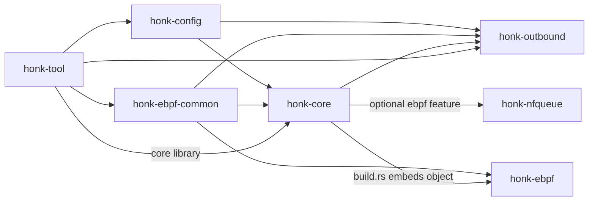
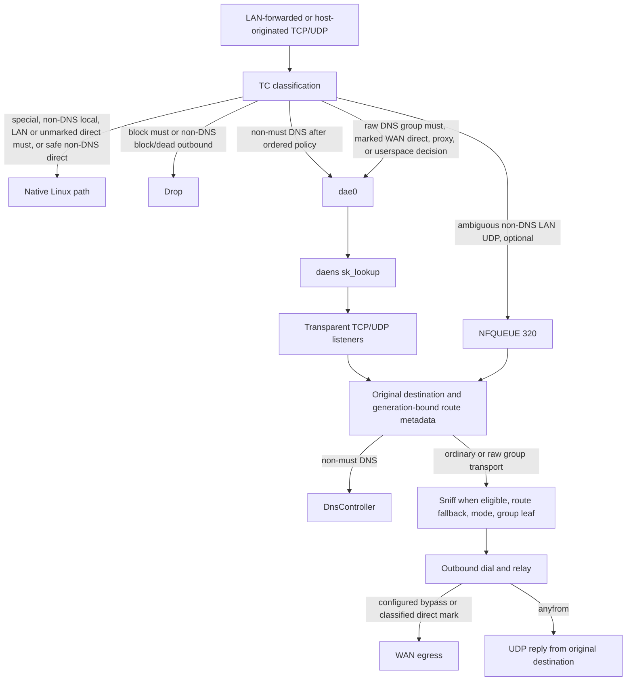

# 架構概覽

`honk` 是 Linux eBPF 透明代理引擎，代理閘道器轉送的流量和本機發起的流量。專案處於實驗性 alpha 階段，以 `GPL-3.0-only` 授權，儲存庫為 `daeuniverse/honk`。

`honk` 的設定語法和 TC 資料路徑來自 dae，在文件宣告的範圍內與 dae 相容。出站 handler、代理群組和 Clash API 採用 sing-box 風格的設計。它是獨立實作，與兩者都有明顯差異。

## 目標與非目標

### 目標

- 在 Linux 上透過 eBPF 透明代理資料路徑，代理 LAN 轉送流量和本機發起的流量。
- 以原生 `.dae` 語法作為主要設定格式，也是唯一寫入文件的格式。
- 提供多協議出站、Selector/URLTest/LoadBalance/Fallback/Score 群組、健康檢查，以及 Clash 相容控制 API。
- 只發行一個 `honk-core` 引擎，不另設 GraphQL 服務。`native-ui` 可選內嵌固定版本的 doona 用戶端。

### 非目標

- 不追求與 Clash Meta/mihomo 完全對齊。honk 沒有 FakeIP 引擎，也不追求遠端 rule provider/rule-set 對齊。
- 不支援在 Windows 或 macOS 上透明代理。資料路徑只支援 Linux。

## Crate 分工

根 workspace 包含六個 crate。`honk-ebpf` 的目標是 `bpfel-unknown-none`，因此不在 workspace 內，單獨作為一個 Cargo 專案並維護自己的 `Cargo.lock`。

| Crate | Workspace | 職責 |
| --- | --- | --- |
| `honk-config` | 成員 | 共享設定模型、dae 語法解析器、include 處理、分享連結解析和訂閱解碼。 |
| `honk-ebpf-common` | 成員 | 核心程式與使用者態 map 寫入端共享的 `no_std`、`#[repr(C)]` 常數和 ABI 型別。 |
| `honk-nfqueue` | 成員 | raw `NETLINK_NETFILTER` 佇列 `320`、verdict 所有權和自有 nftables 事務。 |
| `honk-outbound` | 成員 | 協議 handler、逐節點 runtime、出站群組、健康狀態、URLTest 探測和始終編譯的 Score 評分器。 |
| `honk-core` | 成員 | 引擎庫與二進位檔：eBPF/NFQUEUE runtime、控制面、DNS、路由、中繼和 Clash API。 |
| `honk-tool` | 成員 | 用於訂閱/節點探測、資料路徑診斷、已固定 map 檢查和 geo 資源查詢的 CLI 工具箱。 |
| `honk-ebpf` | 排除 | TC、`sk_lookup` 和 cgroup eBPF 程式；單獨建置，並在啟用真實 eBPF 時嵌入 `honk-core`。 |

共享 map 的 key、值、常數或佈局有改動時，必須同時修改 `honk-ebpf-common`、`honk-ebpf` 和 `honk-core` 的 map 寫入邏輯。

`honk-config` 提供共享設定模型與解析器。它依賴的純 Rust crate 有 serde、regex、url、base64、chrono、uuid。介面位址透過 `libc` 的 `getifaddrs` 列舉，不呼叫 `ip` 子行程。

- `from_file` 按副檔名選擇格式。副檔名是已知的 `.json`、`.yaml` 或 `.toml` 時，先嘗試對應格式，失敗後只在 TOML、YAML、JSON 之間退回，不會嘗試 dae。副檔名未知或缺失時，依序嘗試支援 `include` 的檔案級 dae、TOML、YAML、JSON。serde loader 是未寫入文件的相容介面，dae 才是主格式。
- Node 單獨反序列化時，會報告因協議不相容而被忽略的欄位。這些 warning 每條只記錄一次，即使後續轉換失敗也不會遺失。診斷裡只有設定欄位名，沒有節點名稱或欄位值。`node::NodeSeed` 把 warning 寫進呼叫端提供的列表，不自己記錄日誌。`FlatNode` 仍是唯一的扁平格式配接器。
- `ConfigSeed` 用 Node 配接器處理節點陣列裡的每個原始條目。結構化輸入失敗時，診斷保留節點、群組和訂閱的原始序號、安全的設定欄位路徑，以及解碼器給出的行列號。解碼器的原始錯誤文字不保留。對映和按欄位宣告順序排列的序列都保留序號。詳細檔案與 JSON 載入介面失敗時，保留呼叫端已有的診斷；格式退回成功時，只刪掉已放棄嘗試的診斷。所有格式都失敗時，診斷按嘗試順序保留，最後附一個終止錯誤。dae 語意錯誤會終止載入，但有一種例外：完整文件能按 YAML、TOML 或 JSON 解碼成對映，且至少含一個已知 Config 頂層 key 時，交給結構化格式載入器處理並報告結果。包含檔案的錯誤和不支援的策略錯誤仍會終止載入。
- 解析器和分享連結的資料介面只返回安全的診斷，不自己記錄日誌。純量值、名稱、連結和原始錯誤內容都不會出現在診斷裡，但固定錯誤原因和 `dns.hosts_file` → `dns.use_host` 這類遷移說明會保留。群組、過濾器、訂閱和條目按原始序號定位。詳細 dae 診斷共用一張只含後設資料的來源表，表中保留 include 父來源的關聯和能取得的實體行號。只有最外層載入嘗試會追加終止錯誤。
- `src/node/validation.rs` 做集合 admission 和共享檢查。`src/node/vless.rs` 獨佔規範 `VlessConfig` 的正規化、路徑選擇和組合驗證。`src/node/protocol.rs` 儲存其他協議設定以及共享的 TLS/stream/QUIC 選項。詳細載入介面保留型別化錯誤原因和從 1 開始計數的原始節點座標。
- `src/parser/mod.rs` 處理檔案級 `include` 和有序的頂層分派。`lexer.rs` 和 `cursor.rs` 保留帶來源文字的詞法單元、註解範圍和有界片段。`read.rs` 提供共享的純量與表示式讀取介面。各設定節分別由 `scalars.rs`、`experimental.rs`、`entries.rs`、`groups.rs`、`dns.rs` 和 `routing.rs` 讀取。包含檔案的 glob 以入口檔案所在目錄為基準解析，匹配檔案的正規化路徑不能超出該目錄。重複包含和循環包含都會被拒絕。允許忽略未知內容的讀取器會整塊跳過未知巢狀塊，不套用其中的子項。節點與訂閱的相容包裝塊仍會繼續遍歷。`experimental` 外層和 NFQUEUE 錯誤仍會終止解析。

  各讀取器直接返回型別化錯誤，只有最外層嘗試釋出終止診斷。診斷提示在嘗試結束時統一排序：每個來源維護一個字首最大值索引，保留原來的追加順序和呼叫端已有的診斷，不再反覆插入向量。

  片段會區分已接納和已忽略的語句，也會區分緊湊塊和一般花括號塊，讀取器不再根據末尾詞法單元猜結構。語句 admission 在緊湊塊切分和續接狀態更新之前完成。群組的動態塊頭和條目值分開處理：條目值開始後，不再提前切分宣告。涉及結構註解和花括號的診斷按游標當前作用域判定，並在 EOF 檢查前統一發出。過濾器診斷保留原始詞法單元的錯誤來源。遍歷節點、訂閱和群組的同級宣告時，語意診斷的歸屬會重置。

  遍歷語法區分單行條目和多行表示式。括號保護狀態只隨實際返回的表示式語句跨越同源分段，並在來源邊界重置。已建立索引的起始花括號保留原來的塊頭和子樹歸屬。訂閱原始欄位獨立於結構塊頭檢視，保留完整起始詞法單元的位元組。
- `src/share_link.rs` 是唯一的 `Node::from_share_link` 解析器。`src/share_link/options.rs` 把 URI 封包編碼和獨立的多工控制項歸入規範協議模型，先正規化和驗證，再衍生身分，不保留第二套 VLESS 模式模型。
- `src/node/wire.rs` 是唯一的扁平 serde 配接器。VLESS 輸入只要含有已移除的舊欄位，即使值為 `null`，也會被拒絕。同一欄位在非 VLESS 輸入上僅為相容而保留。`VlessConfig.network`、`udp_encoding` 與 `multiplex` 參與身分衍生，因此切換規範模型會改變 VLESS `Node.id`，但不會改變 VMess 的行為或身分。
- 行為概要見[出站設計](./outbound.md#vless-wire-契約)，欄位語法見[節點參考](../reference/nodes.md)。
- `src/experimental.rs`：`ExperimentalConfig` 持有 `clash_api: ClashApiConfig`、`cache_file: CacheFileConfig` 和 `native_api`。原生設定嚴格驗證、獨立啟用，而且都需要重啟。`native-api` 要明確編譯，可用 `--features native-api` 或 `native-ui` 建置，full 與 `-native-api` 發行產物都包含它。它提供使用者態觀測、有界歷史、由原始檔管理的群組 PATCH 和主檔案條目管理，以及已驗證 geodata 的啟用。listener 仍預設關閉。`.dae` 仍是唯一的設定權威。原文揭露與寫入權限彼此獨立。帶憑證的來源只讀。介面返回正文時會遮蔽 listener secret 的值，而不是省略整段正文。按網路的自動策略 pin/clear 已啟用；pin 歸屬於當前 `GroupManager`，啟用後失效。原生 mode 與完整核心透明仍未開放。`native-ui` 預設關閉，打包時透過 `ci/fetch-doona.sh` 和 `.github/ci/pins.env` 取得帶授權及版本記錄的 doona 發行資產。`build.rs` 讀取絕對路徑 `HONK_DOONA_DIR`，執行時不會取得資產或建置前端。dae 解析器目前明確允許 `clash_api` 和 `cache_file` 這兩個巢狀節。舊的 `udp_nfqueue` 只作為遷移輸入：解析時發出 warning，且只在沒有設定 `global.nfqueue_enable` 時，把 `enabled` 複製到 `GlobalConfig::nfqueue_enable`。
- `src/subscription.rs`、`src/types.rs`、`src/error.rs`。`src/types.rs` 裡 `NodeProtocol` 有 11 個變體，Direct/Block 留給內建節點；`DialMode` 為 ip/domain/domain+/domain++；還有 `SubscriptionType`、`DnsProtocol` 以及共享的 `default_true`/`parse_duration_secs` helper。`src/error.rs` 定義 `ConfigError`。

## 高層資料路徑

### 封包路徑

1. [資料路徑](./datapath.md)在 LAN TC 分類轉送的 LAN 流量，在 WAN TC 分類本機發起的 TCP/UDP。既有的入口規則和控制面排除規則先執行。一般 LAN 埠 53 的流量不能借本機 socket 跳過策略；非 DNS 的本機探測行為不變。LAN `direct(must)` 和路由時已判定安全的非 DNS direct 決策走 Linux 原生路徑。非零 mark 的 WAN 直連改用使用者態 socket，並重新執行帶 mark 的路由查詢。
2. [流量規則所有權](../reference/routing.md#出站目標與-must)決定哪些埠 53 查詢進入[DNS 管線](./dns.md)。已通過 admission 的透明查詢、可選的 host-netns `dns.bind`，以及流關聯的 reality/目標查詢，共用按 generation 固定的 DNS 策略、快取與 singleflight、上游池和路由投影。
3. [資料路徑](./datapath.md)把一般 proxy 和使用者態決策經 `dae0` 重定向。進入 `daens` 後，`sk_lookup` 把它們交給[控制面](./control-plane.md)的透明 TCP 或 UDP listener。
4. [NFQUEUE 暫存](./nfqueue.md)由 `global.nfqueue_enable` 控制，預設開啟，但只有啟動前置條件通過時才真正啟用。它只在 LAN TC 之後、conntrack/NAT 之前攔住仍有歧義的 LAN 轉送 UDP。每個暫存流分配一個持久化的唯一 decision token，並在進入固定佇列 `320` 之前釋出繫結該 token 的 Pending 狀態。本機發起的 WAN 流量繼續走規範 TPROXY 路徑。Direct/proxy/block 的終態由 `honk-core` 的 `control/nfqueue/` 執行。direct 不建立使用者態 socket，不複製或重傳封包，也不建立 `Ready` endpoint 或連線條目。
5. [控制面](./control-plane.md)還原原始目的位址。TCP 用 `SO_ORIGINAL_DST` 或 `IP6T_SO_ORIGINAL_DST`，兩者都失敗時退回透明 socket 的 `local_addr`；UDP 用 IPv4 `IP_ORIGDSTADDR` 或 IPv6 `IPV6_ORIGDSTADDR` cmsg。TCP 先確認 accepted FD 的 SYN 所有權，再用不可變的 handoff；UDP 以非破壞性方式讀取經過身分驗證的 tuple 後設資料。所有權已確認但尚未終結的決策可以進入 `Router::route_action`。埠 53 另有一套 [TCP handoff 與 UDP 逐封包 admission 規則](./control-plane.md#透明代理入口)。
6. [路由路徑](./routing.md)會嗅探 TLS SNI、HTTP Host 或 QUIC Initial SNI，在核心結果尚未終結時執行使用者態 `Router`。命中 must 規則、設定了 `dial_mode: ip` 或命中負快取時跳過嗅探。`dial_mode: domain` 會執行 DNS reality check。
7. [群組層](./groups.md)套用 Clash 模式覆蓋，但不改寫最終的 `must`/`block` 結果。然後 `SharedGroupManager` 把策略選擇解析成一個葉節點。Score 只用逐目標的 TCP/UDP 證據，在健康合格的成員中排名。TCP/UDP 通常只使用一個葉節點。只有冷啟動的頂層 URLTest 會錯開各候選的啟動時間，且只有勝出的候選提交 endpoint 或 source transport。
8. [出站層](./outbound.md)透過 `TcpOutbound` 或可能失敗的 prepared UDP commit 撥號該葉節點。一般 packet path 給 endpoint 繫結一條 `PacketTransport`。來源共享協議改為提交一條 source association，包括 XUDP/Mux.Cool、Hysteria2、TUIC 和各個 `MultiTargetTransport`。這條 association 由 core 所有，多個規範五元組 endpoint view 共用。嗅探得到的 TCP 位元組先轉送，之後一般 TCP 使用 splice，有包裝的流使用 copy。未啟用 Encryption 的 Vision TLS/REALITY carrier 在兩個方向都進入 Direct 後，可以把 socket 借給 splice。
9. 控制面出口使用 `global.so_mark_from_dae`，值為零時選用預設的 `0x100`。帶 mark 的直連使用規則 mark 加 `CLASSIFIED_MARK`。WAN TC 識別這兩種標記，不再額外疊加預設旁路位。代理 UDP 和透明 53 埠的回包使用繫結原始目的位址的 [anyfrom socket](./control-plane.md)，讓[返回資料路徑](./datapath.md)保持源位址。

## 執行時不變量

- bypass mark 紀律：撥號、探測、DNS 上游、HTTP 下載、QUIC endpoint 和透明 listener 都會攜帶行程設定的 bypass mark。非零直連規則 mark 會替換 bypass mark 的低 30 位元，並攜帶 `CLASSIFIED_MARK`；策略路由必須使用 `0x3fffffff` 遮罩。accept 之後的 TCP socket 會清除 listener 標記；一般 host-netns `dns.bind` 入口 socket 則有意保持無標記。
- Anyfrom UDP 回包：代理 UDP 和透明 53 埠的 DNS 回包，使用在 `daens` 中建立並繫結到流量原始目的位址的透明 socket。直接從 TPROXY listener 回包會暴露 `dae0` 源位址，並在返回路徑上失敗。來自其他 full-cone 來源的回覆透過僅含用戶端的 `CLIENT_REPLY_TRACK` 訊框資訊返回，不經過主機轉送。資料路徑也不會因此為用戶端隨後發往該來源的封包學到原生反向方向。
- DNS 來源邊界：透明入口和 `dns.bind` adapter 從 socket peer 得到邏輯用戶端來源；流關聯查詢使用已通過 admission 的流的來源。快取只有在路由選出與來源無關的 scope 之後才重複使用。每個 policy generation 的網域謂詞投影仍是全域的，不區分來源。
- UDP source 邊界：來源共享協議的重複使用按以下四項區分：沿用的 runtime、正規化後的 client、協議與 UDP path，以及 actual-peer 或 original-destination 的 reply projection。完整五元組 endpoint map 仍持有 route、token/generation 與逐 flow Score；source association 持有唯一的 receiver 和 transport health。關閉 `rprx` 時，除 VLESS 外各協議的 source ownership 仍可用。
- 網路名稱空間紀律：行程常駐 host netns。它只透過有作用域且完全同步的 `with_daens_netns` 呼叫進入 `daens`。`setns` 跨度內不得出現 `.await`；還原原名稱空間失敗時，行程必須中止。
- 資料路徑 admission：在全部 listener FD 釋出、全部接收迴圈執行之前，`DATAPATH_STATE_MAP[0]` 保持關閉；拆除 listener 之前它也會關閉。gate 關閉期間，TC 原樣放行流量。
- NFQUEUE readiness 與所有權：啟用但尚未 ready 時，只丟棄需要暫存的新流。honk 獨佔佇列 `320` 和 nftables `inet honk_nfqueue` / `udp_decision`。ready 變更必須經過 fence，生命週期有歧義就是 fatal，同一 netns 的防火牆管理器不得修改這些物件。
- Token 驗證終態：暫存 UDP token 必須在 skb mark、核心狀態、handoff、redirect track、使用者態 verdict 狀態、lease/endpoint 和後端轉換之間保持一致。Direct 遵循 Arm → 全部帶標記 verdict → Activate；proxy 在唯一的規範撥號/傳送路徑之前釋出最終狀態。
- `must`/`block` 終結性：Clash 模式覆蓋永遠不會替換 `block` 結果或 dae `(must)` 結果。
- 失效出站 fail-closed：`lan_ingress` 丟棄路由到失效出站的新流。未設定 `final` 且只有一個葉節點的 TCP 群組，會讓同一個代理繼續作為使用者態的最後嘗試。UDP 以及葉節點全部失效的多葉節點群組仍保持 fail-closed。含有 `direct`/`block` 內建成員的群組永遠不會失效：內建節點不會被判定失效，因此 group-OR 槽保持開放。TCP 與 UDP 埠 `53` 不受該健康檢查丟包影響，但仍遵循使用者的終局 `must` 結果。
- 明確本機路由：閘道器管理存取由使用者[明確設定](../reference/routing.md#顯式本地路由)，不會自動生成介面規則。WAN egress 仍會旁路目的位址匹配 `PARAM.local_ip` 的流量，但這不保證一般管理存取可達。`PARAM.local_ip` 是啟動時的快照。選取過程如下：先選出第一個已解析、存在且能繫結到規範根介面的 LAN 項，沒有則選 WAN；跳過被拒絕的根介面，再取該根介面的第一個 IPv4 位址。正規化遵循介面計畫器：bond/bridge 成員使用其規範 master，`vrf`/`openvswitch` 成員保持自身。沒有可選的根介面，或所選根介面沒有 IPv4 位址時，該值為 0，該旁路保持關閉。之後的介面或位址變化不會更新快照；LAN 缺席時選中的 WAN 位址也會在整個行程生命週期內保持不變。介面觀察仍用於拓撲、ECS 和健康檢查；非 DNS TCP 純 SYN 的既有本機探測跳過策略不變。
- 群組 OR 連通性：一個群組的 eBPF alive slot 是群組內全部葉節點成員狀態的 OR，並包含上面單葉 TCP 最後嘗試的例外。多葉節點群組中的單個成員失效，不得使整個群組 fail-closed。
- Score 隔離與原因：健康過濾與業務目標位址族保持獨立。首次選擇的 utility 仍是啟發式的。健康晉升會在一個評估集內比較所有合格挑戰者與固定現任：評估集有界，大小按需確定；比較依據共同的目標與時間證據，而不是無關的聚合值或 setup 均值。可選試用共享一份保留的群組／網路／位址族預算，額度由原始業務開始賺取，時間流逝不產生額度；試用不會取得已提交現任的身分。真實業務的連續失敗保留退避與三連敗排除。精確證據與聚合證據各有一個 4,096 項 LRU；比較儲存最多 512 個 cell、1 MiB 邏輯分配，這不是行程 RSS。重疊計數不相加。reload 保留已通過 admission 的業務結果，並撤銷近期可用性與探測基線。公開摘要與計數始終有明確範圍，不匯出原始目標 key。詳見[群組設計](./groups.md#score-評分與生命週期)。
- Score 按需回饋：setup／首次回應與有界的分方向進展可以在終態前釋出，不會增加 Beta 完成次數。業務、設定健康和預熱三種來源承擔不同作用；任意手動 delay 測量都不會變成業務可靠性或設定基線。Score 的 TCP 建立失敗可以在原 deadline 內透過另一個合格葉節點恢復一次，不開啟新的 final、不繞過 Selector、也不重放負載。
- 條件性驗證介面：Score 代理群組會釋出聚合的臨時／可用狀態、新鮮的成對挑戰者回應關係、證據問題與等待原因，這些內容與同一次只讀選擇出的成員一致。不存在全群組範圍的比較結論。`/stats` 增加固定的群組／網路驗證以及預算／成本欄位，還有經巢狀去重的根業務計數；觀察到的試用失敗不會被計為額外的因果失敗。兩者都不匯出原始目標 key 或最佳機率。詳見 [API 驗證](../reference/api.md#score-驗證資訊)。
- 內部與特殊流量：honk 的內部連結位址範圍 `169.254.0.0/16` 和 `fd00:686f:6e6b::/64` 永不代理。L2 廣播/群播、IPv4 廣播/群播/未指定目的位址以及 IPv6 群播會在路由或 conntrack 之前直通。

## 建置 feature 與 mock 模式

`honk-core` 預設啟用 `clash-api`、`jemalloc` 和 `rprx`；真實 eBPF 需明確啟用。

| Feature | 預設 | 作用 |
| --- | --- | --- |
| `ebpf` | 否 | 引入 `aya`、`aya-obj`、`aya-log` 和可選 `honk-nfqueue`；`build.rs` 嵌入靜態 `honk-ebpf` 物件，使用者態在執行時編譯 policy extension。執行時要求 Linux kernel 6.12+。 |
| `clash-api` | 是 | 引入可選 `axum` 與 `tower-http`，提供 Clash 相容 REST/WebSocket 服務。 |
| `native-api` | 否 | 獨立的 HTTP/1.1 原生觀測、可選歷史、管理已接受來源的 reload API，以及本機目錄 UI。連線有界並由它管理生命週期，嚴格驗證 bearer/Host/Origin，不依賴 Clash。 |
| `native-ui` | 否 | 隱含 `native-api`，讓 `ui: embedded` 內嵌固定版本的 doona 發行資產；`ui: embedded-lite` 選擇更輕量的 doona lite 預覽版，同樣需要這個 feature。執行時不解壓、不下載、不建置前端。 |
| `jemalloc` | 是 | 引入 `tikv-jemallocator`，把 jemalloc 安裝為 `honk-core` 二進位檔的 allocator；該 crate 從 C 原始碼建置 jemalloc。在 Linux 上，程式會在啟動 Tokio 之前對當前行程停用透明大頁。執行期選項使用 `_RJEM_MALLOC_CONF`，不用 `MALLOC_CONF`：crate 以 `_rjem_` 字首建置 jemalloc，環境變數名也被加上該字首。 |
| `rprx` | 是 | 啟用 `honk-outbound/rprx`，註冊 VLESS 與 VMess handler，包括受支援的 VLESS Encryption 和 `xtls-rprx-vision` 路徑。 |

`mock-ebpf` 不是 Cargo feature。不帶 `ebpf` 的建置使用 `MockEbpfBackend`，`--mock-ebpf` 則明確選擇無特權開發路徑。若請求 `global.nfqueue_enable = true`，啟動會記錄 warning，僅在本行程關閉 NFQUEUE 暫存，設定檔保持不變。

嵌入 eBPF 時，`build.rs` 使用核心 crate 固定的編譯器和獨立的 release 策略重建，不繼承 host 的 `RUSTFLAGS`、`CARGO_ENCODED_RUSTFLAGS` 或 `CARGO_PROFILE_*` 效能分析覆蓋。編譯器 sidecar 不能早於嵌入建置腳本，所以修改嵌入策略會使既有物件失效。明確的 `--bpf-object` 資產和手動核心建置仍由呼叫端負責。

## 作者與分工說明

- 專案維護者主要負責 eBPF 資料路徑的人工設計、實作審查與驗證，包括 `honk-ebpf`、`honk-ebpf-common` 以及 `honk-core` 中的 attach/map 路徑。
- 其餘多數使用者態子系統主要由 AI 輔助編寫，包括設定解析器、出站 handler、群組與健康檢查、使用者態 DNS、Clash API 和大量控制面銜接程式碼。維護者做了部分程式碼審查，並沒有逐行負責。

## 相關文件

- [設定指南](../configuration.md)
- [資料路徑設計](./datapath.md)
- [Global 設定參考](../reference/global.md)
