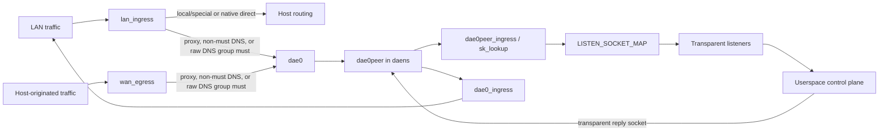

# eBPF 内核数据路径

内核侧拦截见本页；用户态路径见[控制平面](./control-plane.md)，持有首包的 UDP 路径见 [NFQUEUE](./nfqueue.md)。

## 网络命名空间与挂钩架构

普通代理路径通过隔离的网络命名空间重定向数据包，而不依赖主机侧 TPROXY 规则：

### 网络命名空间生命周期

一个临时线程调用 `unshare(CLONE_NEWNET)`，打开 `/proc/thread-self/ns/net`，再把得到的 `OwnedFd` 交给进程。该 FD 在进程生命周期内固定 `daens`。`/var/run/netns/daens` 只是尽力创建的兼容性 bind mount；引擎不依赖它持有网络命名空间。

内核支持时，rtnetlink 以 L2 netkit pair 创建 `dae0`/`dae0peer`；否则回退到 veth pair。随后通过网络命名空间 FD 移动 `dae0peer`，并配置链路、地址、邻居、策略规则与路由。当前地址为：

| 一侧 | IPv4 | IPv6 |
| --- | --- | --- |
| 主机 `dae0` | `169.254.0.1/32` | `fd00:686f:6e6b::1/64` |
| `daens` 的 `dae0peer` | `169.254.0.11/32` | `fd00:686f:6e6b::2/64` |

两个 IPv4 端点是独立的 `/32` 地址，并不共享 `/30`。链路作用域路由与静态邻居使对端可达。在 `daens` 中，fwmark `TPROXY_MARK` 选择表 `100`，其中的 IPv4 和 IPv6 local 默认路由把数据包交给本地透明套接字。

进程在其余时间都留在主机网络命名空间。`with_daens_netns` 用进程级 mutex 串行化每次切换，保存 `/proc/thread-self/ns/net`，进入 `daens`，执行完全同步的闭包，并在正常返回或 panic 的所有路径上恢复原网络命名空间。闭包绝不能跨越 `.await`，因为 `setns(2)` 作用于线程。若恢复失败，进程直接 abort，避免某个 worker 留在 `daens` 中并从那里发起后续拨号。

### 接口挂钩集合

以太网接口使用 `_l2` 程序；没有以太网头的接口使用 `_l3`。流量可能绕过 master 的挂钩，因此 bridge 和 bond slave 也安装等价且由进程持有的挂钩。

| 拓扑 | LAN 侧挂钩 | WAN 侧挂钩 |
| --- | --- | --- |
| 双网卡 | LAN 上的 `lan_ingress` + `lan_egress` | WAN 上的 `wan_ingress` + `wan_egress` |
| LAN/WAN 共用接口的单网卡 | `lan_ingress` | `wan_egress`；跳过 `lan_egress` 和 `wan_ingress` |
| 未配置 LAN 接口的纯 WAN | 无 | `wan_ingress` + `wan_egress` |

`lan_ingress` 对转发的客户端流量分类。`wan_egress` 独立地对主机创建的流量分类。拓扑提供独立方向时，反向 ingress/egress 挂钩刷新已有连接状态。只有正向 TCP SYN 发布 TCP 状态：反向的纯 SYN 既不创建也不刷新它。

Linux 6.12+ 上，Aya 使用 FD 持有的 TCX BPF link；启动、重绑定和关闭只释放自有 link。honk 既不创建也不删除物理接口上的 `clsact` qdisc 或旧式 filter；不需要的遗留项请手动移除。启动时会重建遗留的 `dae0`/`dae0peer` 对。内核选项见[开始使用](../how-to-start.md#内核配置)。

不写 mark 且不受所有权 guard 保护的直通退出点返回 `TC_ACT_UNSPEC`（`-1`，TCX `NEXT`），包括反向刷新与跳过 DNS，让后续 TCX 程序继续运行。最低支持内核上的 `TC_ACT_PIPE` 不是继续动作。写入 mark 的路径（包括显式写零的 WAN 路径）、LAN classified/pending 及 WAN 精确 socket-mark/classified 所有权 guard 返回 `TC_ACT_OK`（`0`，TCX `PASS`），终止链。

### 动态接口协调

`auto` 解析为当前默认路由接口。没有默认路由时，该项保持未挂载，而不会回退到 loopback。`IfaceWatcher` 订阅 rtnetlink 的链路、IPv4/IPv6 地址和 IPv4/IPv6 路由组；每 60 秒一次的协调 tick 作为事件交付的后备。协调过程重新解析 `auto`，通过 ifindex 识别接口重建，重新计算单网卡或双网卡角色，并安装或忘记进程持有的挂钩。

链路、地址、路由或接口角色变化时，接口地址仍用于拓扑检测与 ECS 刷新，不再发布生成的 `direct(must)` 规则，也没有隐藏的内核地址白名单。系统仍清除健康检查 cooldown 并触发新探测。在新探测成功前，失效 UDP 和多叶节点出站仍保持 fail-closed；未配置 `final` 的单叶节点 TCP 组仍可作为用户态最后尝试。

## 程序清单

| 程序 | 挂钩 | 内核职责 |
| --- | --- | --- |
| `lan_ingress_l2`, `lan_ingress_l3` | LAN TC ingress | 检查准入，绕过特殊/控制平面及非 DNS 本地流量，执行单源新流限制，执行包含端口 53 的有序路由策略、DNS 接管判断、连接状态、direct 卸载、代理重定向、TX 计数、分片 verdict 记录，以及可选的歧义 UDP 暂存。 |
| `wan_ingress_l2`, `wan_ingress_l3` | WAN TC ingress | 刷新反向连接状态；单网卡拓扑不挂载。 |
| `lan_egress_l2`, `lan_egress_l3` | LAN TC egress | 刷新反向连接状态，不从 `dae0` 的 UDP 包创建新条目；抑制本机生成的 ICMPv6 Redirect。单网卡拓扑在共用接口上跳过。 |
| `wan_egress_l2`, `wan_egress_l3` | WAN TC egress | 路由主机发起的 TCP/UDP，使用进程名与控制平面 bypass 数据，检查出站连通性，缓存决策并重定向代理流量；抑制本机生成的 ICMPv6 Redirect（单网卡拓扑下共用接口的 LAN-egress hook 被跳过）。 |
| `dae0_ingress` | 主机 `dae0` 的 TC ingress | 从 `REDIRECT_TRACK` 恢复回复帧信息与 RX 归属，或使用不计数的客户端回退；[续期符合条件的 UDP owner](#udp-生存期续期)。 |
| `dae0peer_ingress` | `daens` `dae0peer` 的 TC ingress | 在链路 scrub 后恢复 UDP53 provenance 与 SYN incarnation；分配 UDP listener。TCP 保留原生 established/TIME_WAIT 查找。 |
| `tproxy_sk_lookup` | `daens` 中的 `sk_lookup` | 用 `LISTEN_SOCKET_MAP` 中的透明监听器覆盖普通套接字查找。 |
| `tproxy_wan_cg_sock_create` | cgroup `sock_create` | 保留套接字首次捕获的进程身份；捕获失败只计数，创建照常进行。 |
| `tproxy_wan_cg_connect4`, `tproxy_wan_cg_connect6` | cgroup `connect4`, `connect6` | 保留已有身份，缺失时在 connect 前捕获；捕获失败只计数，连接照常进行。 |
| `tproxy_wan_cg_sendmsg4`, `tproxy_wan_cg_sendmsg6` | cgroup `sendmsg4`, `sendmsg6` | 保留已有身份，缺失时在发送前捕获；捕获失败只计数，发送照常进行。 |
| `honk_tcp_passive` | cgroup2 根上的必需 `sock_ops` | 在自有 `daens` 内 child 的 `PASSIVE_ESTABLISHED_CB` 上，验证 child 的 tuple、ISN 与 conn/handoff/redirect incarnation，再把已证明的 handoff 写入 child 的 socket storage。 |

`LISTEN_SOCKET_MAP` 的 key 固定为：`0` TCP4、`1` TCP6、`2..=5` UDP4、`6..=9` UDP6。所有 UDP 路径共用 `udp_listener_index`，输入为源/目的地址的低位地址字及端口，均取主机字节序。`tproxy_sk_lookup`（`src/sk_lookup.rs`）的 IPv4/IPv6 context 读取须保留为分离的 `#[inline(never)]` 子程序：优化级别 2 下，内联可能产生计算偏移读取，被 verifier 以解引用已修改 context 指针为由拒绝。

TC 入口点是接受 `*mut __sk_buff` 的原始 `#[unsafe(no_mangle)] #[unsafe(link_section = "classifier")]` 函数。它们不用 Aya 的 `#[tc]` 宏，因为该宏的结构化参数形状在 7.0 及更高版本内核上触发 verifier 拒绝。程序主体返回 `Verdict = Result<c_long, c_long>`（`action::Verdict`）：`Ok` 表示正常路径，`Err` 表示提前退出，但两者都携带真实的 `TC_ACT_*` 值，`flatten` 把任一变体归约为内核的 `i32` verdict。`flatten` 由 `action::flatten` 定义，`src/action.rs` 持有 `TC_ACT_*`。解析器与辅助函数的哨兵值（如 `transport::ERR_FALLBACK`、`ERR_FRAGMENT`、`PASS_UNSUPPORTED`）与 verdict 分离；`bpf_loop` 回调用于控制是否继续执行的返回值也独立。

`src/sk.rs` 中，`sk_assign_by_index` 是 TC 侧对应 aya `SockMap::redirect_sk_lookup` 的 helper，后者只接受 `SkLookupContext`；`probe_udp_socket` 查询非 DNS 本地 UDP socket。全部辅助函数都会释放隐式查找引用。程序分工：

- `lan_ingress_l2/l3` — LAN 分类、路由和重定向，以及有序策略下的 DNS 所有权、`CLASSIFIED_MARK` 去重；NFQUEUE 已启用且 ready 时，仅将有歧义的非 DNS UDP 决策以唯一 token 暂存为 Pending；已启用但未 ready 时 fail-closed（`src/ingress.rs`）。
- `wan_ingress_l2/l3` — 反向 conntrack 刷新，单网卡时跳过。
- `lan_egress_l2/l3`、`wan_egress_l2/l3`（`src/egress.rs`）— 反向 conn state；本机流量路由（经实际 skb socket 的 `SOCKET_IDENTITY` 匹配 pname、控制面旁路、`OUTBOUND_CONNECTIVITY_MAP` 活性及重定向控制面）。存活的非 DNS WAN UDP 条目只查询缓存路由；未命中时求值一次路由，再发布完整 conntrack 元数据。
- `dae0_ingress` — 重写回复 MAC，并重定向到原 LAN 接口。未知对端的 UDP 回复使用客户端帧信息，不归属任何出站；honk 自身链路源地址从不使用该回退。
- LAN 与 WAN egress 仅抑制本机发起的 ICMPv6 Redirect，使用扩展头遍历后的 ICMPv6 header；转发的 Redirect 与其他 ICMPv6 仍放行。单网卡拓扑的共用接口不挂载 `lan_egress`，该不变式在该接口上由 WAN hook 承担。`honk-core/tests/ebpf_datapath_test.rs` 通过 `BPF_PROG_TEST_RUN` 检查 L2、通过隔离 TUN 接口检查 L3，并覆盖精确 tuple RX 计数与 cached-route 策略。
- `dae0peer_ingress` — 恢复 UDP53 provenance 与 TCP SYN incarnation；按重定向点的 `cb[4]` 标记 `0x100 | index`，用 `bpf_sk_assign` 分配 UDP，不解析报文字节。缺少标记时 UDP 留给 `sk_lookup`；TCP SYN 保留其 `cb[3]`/`cb[4]` incarnation 载体及原生 established/TIME_WAIT 处理。
- cgroup sock_create/connect4/6/sendmsg4/6（`src/cgroup.rs`）— 原生 socket storage 保留首次捕获的 `SocketIdentity{pid, pname}`，供进程名规则及控制面旁路使用；`pname` 通过运行时 kernel-BTF offset 读取 `argv[0]` 可执行文件 basename，限制为 15 字节，不可用或读取失败时回退到线程 `comm`。内核在 socket 对象销毁时回收 storage，不再有 release hook 或 cookie janitor。缺失必需的 cgroup/storage 支持会拒绝启动。这些 hook 挂在根 cgroup 上，因此身份捕获失败（storage 分配或 optmem 计费失败）不会拒绝宿主机操作：只计数，该 socket 的流量没有身份，进程名规则不会匹配它。honk 自身的 socket 仍通过 `dae_socket_mark` 识别。

## Map 清单

`crates/honk-ebpf/src/maps.rs` 声明以下 map：

| Map | 形状与职责 |
| --- | --- |
| `CONN_STATE_MAP` | 不预分配的普通 hash，最多 524,288 项。原生 value lock 保护每流 TCP/UDP 状态及已发布路由元数据；用户态负责物理回收。 |
| `REDIRECT_TRACK` | 不预分配的 65,536 项 token-bound hash。加锁的有方向五元组 payload 保存原始 MAC/接口、出站、时间戳与决策身份，用于恢复回复路径。 |
| `CLIENT_REPLY_TRACK` | 16,384 项 LRU hash。对目的端口非 53 的 UDP，包括客户端源端口为 53 的流量，把客户端地址与端口映射到 `REDIRECT_TRACK` 的帧信息 payload，目的字段清零，不含 lock header，且 token 清零，使未联系对端的回复无需主机转发即可到达客户端。内核淘汰是近似的，尤其在 CPU 较多时，近期未发送的客户端可能在表满前被淘汰，这类回复随后退回主机转发。该缓存不持有 flow attribution，也不由用户态清扫。 |
| `ROUTING_HANDOFF_MAP` | 不预分配的 65,536 项 hash；TCP SYN handoff 包含已提交策略代际，暂存 UDP 携带 decision token。原始 must UDP/53 不发布 tuple handoff，所有权使用逐报文 mark；非 must UDP/53 保留供畸形 payload 回退使用的事实。 |
| `ROUTING_POLICY_ROOT` | 单项 map-in-map，选择不可变 policy descriptor 和两个同步生成函数槽之一。root 成功替换返回后，旧 non-sleepable 读者已完成 grace。 |
| 按代持有的 IP/MAC 索引 | 分离的目的/源 IPv4、IPv6 LPM maps 及 MAC LPM。value 是完整的本代谓词 bitmap，更具体前缀继承祖先位。 |
| 按代持有的 domain map | 不预分配的 IP 到域名谓词 bitmap hash。DNS/sniff 事实覆盖正负条件；存在的零 bitmap 表示 known-false。descriptor 提供其 map ID 供诊断读取。 |
| `OUTBOUND_CONNECTIVITY_MAP` | 1,536 项数组。每个出站有六个存活槽，覆盖 TCP/UDP 类别与 IPv4/IPv6；缺失槽按存活处理。 |
| `OUTBOUND_STATS` | 直接以 `u8` 出站编号为索引的 256 项（`MAX_OUTBOUNDS`）per-CPU 数组。每个 32-byte `OutboundStatsCounters` 值紧凑保存 `tx_packets`、`tx_bytes`、`rx_packets`、`rx_bytes`；当前 ABI 不使用 `outbound * 4 + counter` 索引。 |
| `LISTEN_SOCKET_MAP` | 16 槽 `SockMap`；key `0..=9` 保存两个 TCP 和八个 UDP 透明监听器。 |
| `DATAPATH_STATE_MAP` | 单槽准入数组。零值不改动地放行流量；非零值启用分类与重定向。 |
| `DATAPATH_FLAGS_MAP` | 单槽运行时策略字：Rule/Direct 卸载属性、`global.nfqueue_enable` 及 NFQUEUE ready 栅栏。新流分类读取它；已建立流的 direct 卸载使用缓存元数据。 |
| `SOCKET_IDENTITY` | 不克隆的 `SK_STORAGE`，保存 socket 首次捕获的 PID/可执行文件 basename。存储跟随实际 socket 生命周期，不受固定 hash 项数或用户态过期清理约束。WAN TC 只查询；cgroup create/connect/sendmsg 同步捕获缺失的身份。 |
| `CONN_STATE_OCCUPANCY` | 两槽 per-CPU 插入/内核删除计数，结合实际用户态删除计数估算占用。此路径不再由内核删除 tuple，故内核删除计数保持零。 |
| `AUX_OCCUPANCY` | 两槽 per-CPU redirect/handoff 插入计数器；用户态减去实际删除数。 |
| `ADMISSION_PRESSURE` | Janitor 写入的 conn-state 压力锁存；辅助 map 压力不会将其置位。 |
| `NEW_FLOW_RATE` | 16,384 项 per-CPU LRU hash，以 LAN 源地址为键。每个 CPU 为单源新流限制保存一个一秒 `(second, count)` 窗口。 |
| `FRAG_VERDICT` | 4,096 项 LRU，以源、目的与 IP identification 为键（IPv4 另含协议）；见[分片处置记录](#重定向数据报的分片)。 |
| `BPF_STATS_MAP` | 由 [`honk-tool bpf stats`](../reference/cli.md#bpf) 公开的计数器；标签与布局不匹配说明见该参考页。 |
| `EVENT_RINGBUF` | 262,144 字节 ring，记录为 80 字节，包含功能性的 tuple/incarnation 过期提示。Producer 直接预留并初始化 ring 存储，不再经有界 TC 栈复制事件。 |
| `FLOW_EXPIRY_HINT` | 私有的 4,096 项 per-CPU LRU hash，以 tuple 为键，保存最近一次提示的 incarnation 与时间戳。仅尽力抑制重复 `FlowExpired` 提示，从不持有流或提供回收授权。 |
| `UDP_DECISION_SEQUENCE` | NFQUEUE 决策身份的单槽 pinned allocator 状态；协议细节见 [NFQUEUE](./nfqueue.md)。 |
| `FLOW_INCARNATION_SEQUENCE` | 按代持有、spin-lock 保护、不可回绕的 56 位身份域，以 `u64` 表示；独立于持久化 UDP decision token。 |
| `RETIRE_FENCE`、`RETIRE_ACTIVE` | 不预分配的 65,536 项规范 tuple fence 加单槽 active 标志；每个 fence 保存独立的操作 owner 与 decision token。 |
| `RETIRE_GRACE_ROOT` | 私有单项 map-in-map；成功重装同一个 inner map 会同步排空 fence 前的 non-sleepable 内核读者。 |
| `TCP_PUBLISHING` | 不预分配的 65,536 项同键 SYN 发布互斥；owner 只持续一个 TC invocation，竞争 SYN 在修改前拒绝。无用户态清扫，已建立包不取得此 claim。 |
| `TCP_SOCKET_BINDING` | 不克隆的 socket storage：已接受 child 的原始 tuple/handoff，由 `honk_tcp_passive` 写入。用户态在接管前用 accepted FD 读取。 |
| `TCP_LIVE_PINS` | 不预分配的 65,536 项 incarnation 到 presence 的 hash。已验证的 accepted owner 取得精确 pin；只有老化 TCP 查询读取它。每个 guard 独立释放自己的 incarnation，不依赖 tuple-local 引用计数是否归零。 |

内核/用户空间共用的 map key 和 value 是 `#[repr(C)]` ABI。共享流结构中的 IPv4 地址都以网络字节序的 IPv4-mapped IPv6 值保存。

`ConnState`、`RedirectEntry`、`RoutingHandoffEntry` payload 分别为 72、40、72 字节，含独立的 `incarnation: u64`。对应 tuple map 使用 `FlowMapValue<T>`：原生 lock 位于 offset 0，payload 位于 offset 8，实际 value 大小为 80、48、80 字节。Payload 内的 decision token 偏移不变。`ConnState` 还记录原始 SYN ISN 与已提交拦截标志；payload offset 68 的 `reserved` 字恒为零。`TuplesKey` 仍为 40 字节，尾部 padding 显式清零，不可变 `TcpSocketBinding` payload 为 120 字节，offset 116 为 `syn_isn`。持久化 `UDP_DECISION_SEQUENCE` 严格保留 12 字节。Core 在 attach 前验证实际 map 的 BTF/value 布局，工具在解码前验证存储布局；须使用匹配版本，不提供兼容 shim。

既有 tuple element 只原地更新、不替换：Linux 普通 hash 替换可在 RCU 读者仍持有旧指针时复用其存储。内核在原生锁内取得一致快照或窄投影，修改时在同一锁内比较捕获的身份；持锁时除 unlock 外不调用 helper。物理删除仍必须经过 tuple fence、成功的内核 grace 与事后所有权复验。外部工具使用 bucket 保护的 batch 与加锁 value copy，不回退到不安全的单项读取。

无状态 UDP tuple 元数据使用 token/incarnation `0/0`：每个新求值报文只在另一个 `0/0` 项上原地更新完整 handoff/redirect payload，不能覆盖普通或 staged owner。原始 must 目的端口 53 仍使用逐报文 carrier，不使用 tuple handoff。无状态 redirect 更新在既有刷新间隔到期前保留原时间戳。

`auxiliary.rs` 统一持有客户端帧信息的首次发布与按间隔续期。目的端口非 53 的精确 LAN UDP 流量，包括源端口 53，可在任一方向沿用既有一秒时间戳刷新节奏补回被淘汰的客户端记录。先在原生锁内复制当前保存的 MAC/接口 payload，解锁后再投影；未知对端 fallback 不续期该缓存，也不取得出站归属。该操作仍为 best effort，不增加 timer 或逐包 LRU 写入。

`RoutingMeta` bit 58 仍表示 WAN UDP 用户态所有权，bit 57（`OFFLOAD`）区分原生直连。未发布 UDP claim 失败时，在原地记录精确 owner 的 `Aborted` 及实际已分配 token，辅助项保留到 fenced 用户态清理。Preparing/Aborted 报文不能续期 claim；Aborted 立即满足过期清理条件，但不能转发或激活。Advisory hint 丢失仍由既有 janitor 兜底。

新对象校验成功后，启动只删除六个已废弃的 honk pin（`COOKIE_PID_MAP`、`UDP_DECISION_EPOCH`、`UDP_DECISION_INFLIGHT`、`UDP_DECISION_RETIRE_FENCE`、`TCP_REQUEST_BINDINGS`、`REQUEST_FENCE`），不清扫无关 pin，也不删除持久化 UDP allocator。

`crates/honk-ebpf-common/src/lib.rs` — 共享 mark、NFQUEUE token 编码、`OutboundIndex`、`RoutingMeta`、`DaeParam`、`OutboundStatsCounters` 与 map 常量。
`crates/honk-ebpf-common/src/routing_policy.rs` — 固定 `RoutingInput`/`RoutingDecision`/`RoutingPolicyDescriptor` ABI（128/24/24 字节）、feature bit 与进程名归一化限制。`RoutingDecision` 含直连 mark 索引（未指定时为 `u32::MAX`）；loader 检查 slot 的 BTF 输出布局并拒绝旧外部对象。
`crates/honk-ebpf-common/src/redirect_need.rs` — `TuplesKey`、`Tuples`、携带 token 的 `RoutingResult`/`RoutingHandoffEntry`、256 位 `DomainRouting` 与 `SocketIdentity`。
`crates/honk-ebpf-common/src/conn.rs` — `ConnState`（含 `UdpDecisionState` 与 `decision_token`）、`ParseTransportCtx`、`BpfStatsKey`、`TcpState`，以及与用户态共享的辅助项过期时限。
`crates/honk-ebpf/src/maps.rs` — 静态 TC map 声明与内核侧容量。
`crates/honk-ebpf/src/contrack.rs` 持有 incarnation 分配、内核私有的 `ConntrackArgs` scratch 与共享的生命周期检查；`contrack/tcp.rs` 持有 SYN 分类与 TCP 发布，`contrack/udp.rs` 持有 UDP claim/发布/中止协议。`flow.rs` 持有加锁快照/投影；`auxiliary.rs` 持有辅助项过期、LAN 与 WAN 共用的 `AuxPrep` 发布策略、身份匹配的刷新与稳定发布。

`crates/honk-ebpf/src/route.rs` — 静态 root/slot facade 与固定 ABI dispatch；生成的 policy code 由用户态加载。
`crates/honk-ebpf/src/tcp_binding.rs` 与 `honk-core/src/ebpf/real/tcp_binding.rs` 持有必需的 SYN 发布桥与 `honk_tcp_passive` child 证明；二者都不读取内核内存，因此 TCP 不需要任何内核结构偏移。Peer ingress 恢复后，SYN 使用 mark 低 24 位与 priority 的 32 位携带 56 位身份；request 证明移除后，TCP 不再有该载体的读取方，写入方的移除推迟处理。身份耗尽后拒绝发布，不回绕。

被拦截 SYN 在 TC 中分类，不读取内核内存。`bpf_skc_lookup_tcp` 查询 FD 持有的 `daens`；查询为空、`LISTEN` 与 `NEW_SYN_RECV` 都视为不存在，因此从不检查 request 本身。`TIME_WAIT` 发布新 incarnation。已有 child 依据其 socket storage 判定：缺少 child storage 则拒绝，ISN 不同则发布新 incarnation，证明有效则复用存储的 incarnation。查询不存在时，按顺序取第一条匹配的规则，作用于 conn-state 条目：其 ISN 与该 SYN 不同，发布新 incarnation；状态不是 Active，发布新 incarnation；其 incarnation 被存活 relay pin 住，发布新 incarnation；handoff 或 redirect 辅助项缺失，拒绝；辅助项存在但已老化，发布新 incarnation；其余情况复用缓存的 incarnation 与原始路由快照，即使期间策略已改变。已提交拦截缺失证据时拒绝重传，不重建归属，也不转为原生放行。由于 TC 无从得知 request 的 ISN，重传可能复用缓存，而内核仍持有由更早且 ISN 不同的 SYN 创建的 request；该 request 的 ACK 无法通过回调的 ISN 检查，保持未证明并被关闭。原生直连流不取得拦截证明。

`honk_tcp_passive` 以 BPF link 挂载到 cgroup2 根，且为必需：缺少时启动失败，TCP 准入无法开放。它忽略除 `PASSIVE_ESTABLISHED_CB` 以外的所有回调，也忽略自有 `daens` 之外的 socket（其 netns cookie 必须等于用户态在加载前从 `daens` 内 socket 读到的 `SO_NETNS_COOKIE`；为零时该程序被停用）。已接受 child 的 tuple 取自回调上下文，ISN 为 `rcv_nxt - 1`。回调在既有 value lock 下要求：tuple 未在退役；conn-state 的 incarnation 非零、带 `ORIGINAL_INTERCEPT` 且 ISN 相同；handoff 与 redirect 的 incarnation 与之相等；handoff 仍在 established 时限内。conn-state 可能已是 Closing：TC 在任何 FIN 或 RST 上标记 Closing，而它可能先于完成握手的报文到达，也可能就在该报文上。随后用一次 `bpf_sk_storage_get(F_CREATE)` 写入完整的 `TcpSocketBinding`。回调始终返回成功，因此拒绝或存储失败都不会阻断连接：child 只是不带证明，接管时被关闭，存储失败还会累加 child 证明计数。child 存在到其 storage 写入之间有一小段窗口；窗口内被拒绝的 SYN 重传由客户端重试。ctx 读取仍是按地址族拆分的 `#[inline(never)]` 常量偏移读取，与 `tproxy_sk_lookup` 形态相同，回调只使用栈上 scratch。

自有 `daens` 关闭并校验 SYN cookies、request migration 与 Fast Open。只有缺失的 `tcp_syncookies` key 可作为内核未提供该功能处理；检查、写入或校验错误仍然致命。无法完成 `sock_ops` 挂载（包括根 cgroup 槽位已被旧式 flags=0 程序占用）会拒绝启动。证明缺失、未证明、分配失败或被新 owner 替代时，关闭 accepted socket，不授权删除 tuple。已取得证明的 child storage 跟随实际 socket 生命周期，没有单独的过期。Backlog 溢出依赖客户端重试，不猜测 cookie 归属；因此 LAN 主机发送大量不完成握手的 SYN 时，可占满透明 listener 的 backlog，在这些 request 过期前延迟新的被拦截 TCP 连接。IPv4-only 启动后再启用 IPv6 仍需要重启：IPv6 socket 族探测在加载时固定，TCP6 listener 在启动时绑定。

有两个窗口以重试或重新发布代替拒绝。内核先把 child 放入 accept 队列，再执行 `PASSIVE_ESTABLISHED_CB` 回调，因此已经在运行的 acceptor 可能在证明写入前看到该 child（x86 回环实测中位数约 1 µs、最坏约 17 µs；ARM64 仅有源码分析给出的上界）；`adopt_tcp_flow` 对缺失的证明间隔 1 ms 重试三次，之后才关闭 socket。仍存活的 request 的重传 SYN 若在 30 秒 handoff 时限之后到达，会发现发布已老化，在旧 request 仍存活时发布新的 incarnation 与路由快照；ISN 匹配的 child 绑定到当时有效的 incarnation，因此沿用替代者的路由。

历史归属证明构建中，最大的分类程序在 Linux 6.12.94 aarch64 上验证了 464,596 条指令（`verified_insns`），而引入归属证明前的 beta.82 发行版为 74,469。增加状态检查的改动应在同一 fixture 上报告改动前后的 `verified_insns`。

`crates/honk-ebpf-common/src/event.rs` — 固定布局的 ring event，包括 conntrack overflow 与 UDP decision-token exhaustion。
`crates/honk-ebpf-common/src/dae_ip.rs` — `In6Addr` union 与 v4-mapped helper。
`crates/honk-core/src/routing/ir.rs` — 规范 `CompiledPredicate` 与用户态 `PortRange`；`crates/honk-core/src/control/routing_matcher.rs` 将其转换为生成函数 ABI。

## Mark 及其所有权

| 常量 | 值 | 含义 |
| --- | --- | --- |
| `TPROXY_MARK` | `0x08000000` | 选择 `daens` 表 100 的 local-delivery 路由，并标记要交给监听器的重定向数据包。`global.tproxy_mark` 必须等于这个编译期值。 |
| `DAE_BYPASS_MARK` | `0x00000100` | `global.so_mark_from_dae` 为零时的默认值；非零时 honk 套接字和监听器识别使用配置值精确匹配。 |
| `CLASSIFIED_MARK` | `0x40000000` | 防止同时挂在 bridge master 和 slave 上的数据包被重复分类；也标记最终 direct verdict。 |
| `NFQUEUE_PENDING_MARK` | `0x80000000` | 标识必须在 conntrack/NAT 前持有的流量；有效的暂存 mark 还携带 `CLASSIFIED_MARK` 和非零 token。 |
| `NFQUEUE_TOKEN_MASK` | `0x3fffffff` | 选取 NFQUEUE 暂存数据包中承载决策 token 的 skb mark 低 30 bit。 |

`SKB_MARK_RESERVED_MASK` 为 `0xc0000000`，即 `CLASSIFIED_MARK` 与 `NFQUEUE_PENDING_MARK` 的并集。配置校验拒绝与这些 bit 重叠的 `global.so_mark_from_dae` 和路由规则 mark。NFQUEUE direct 完成路径在接受规则 mark 前重复相同检查。

最终带 mark 的直连报文携带 `rule_mark | CLASSIFIED_MARK`，包括 LAN 原生转发、NFQUEUE 接受以及用户态 TCP/UDP socket。Linux 策略路由只匹配用户位：`fwmark 0x200/0x3fffffff`。WAN egress 旁路精确匹配的非零全局 socket mark，或带分类位且不含 `NFQUEUE_PENDING_MARK` 的报文；仅含 `0x100` 位不再构成旁路。宿主发起且带非零直连 mark 的流量交给用户态，因为在 WAN TC 才修改 skb mark 已晚于原始 Linux 路由查询。

真实透明 UDP/53 从 `SO_RCVMARK` 启用的 `SOL_SOCKET`/`SO_MARK` 辅助数据取得逐报文出站及策略代际。同一个 skb 的 `cb[2]` 跨链路保存路由编码与不回绕的 20 位已提交策略代际，再由必需的 `dae0peer` TC 恢复。签名掩码为 `0xc8000000`，可变携带位为 `0x37ffffff`。位 `0x100` 表示 8 位字段为不可变直连 mark 索引，而非出站编号；索引通过当前 Router 的排序 mark 表解析。`daens` 内部 fwmark 规则忽略这些可变位。用户 mark 保留位和 `UDP_DECISION_SEQUENCE` 保持不变。原始直连/分组的归属绝不依赖可变 tuple handoff。

`RoutingInput`、`RoutingDecision`、`RoutingPolicyDescriptor` 的 ABI 分别为 128、24、24 字节。`RoutingDecision` 新增直连 mark 索引（缺省为 `u32::MAX`）；loader 校验路由槽输出的 BTF 布局，拒绝旧版本外部对象。

非 DNS 本地套接字探测通过完整 socket mark 与 `PARAM.dae_socket_mark` 的比较，区分 honk 的透明监听器和普通本地服务。主机网络命名空间中的 `dns.bind` 套接字仍是普通未标记监听器，但它的存在不能绕过 LAN 端口 53 策略。

## 数据包行为与不变量

### DNS 与本地监听器优先级

LAN/WAN TCP/UDP 目的端口 `53` 在既有入口与控制平面排除后执行一次正常有序策略，不单独扫描 must 规则。[流量规则所有权](../reference/routing.md#出站目标与-must)决定原生、丢弃、原始转发或控制器路径。具体地址或通配地址的本地 `:53` 监听均不能覆盖该策略。端口 `53` 仍豁免 LAN ingress 与 WAN egress 上的出站健康检查丢包，但不豁免已选用户 `must` 结果。

只有非 DNS 流量继续在流量策略之前探测本地 socket。探测使用报文所在的当前网络命名空间（负 netns ID），不是相对命名空间 ID `0`；匹配的非 honk socket 可以接收，通配匹配还要求完整 FIB 返回 `NOT_FWDED`。原有 TCP 纯 SYN 跳过探测的行为保留。解析后的目的端口 `53` 请求，在标记非零且完全匹配控制平面 bypass mark 时保留原生投递；普通请求继续执行路由，不探测本地监听器。后端回包仍受既有非 53 策略约束。空 bind 不代表关闭透明 DNS。

实际本地 socket 的优先接收不等于所有网关地址强制直连。非 DNS TCP 纯 SYN 的现有探测策略不变，因此不能承诺无需配置即可始终访问网关管理面；需要时使用[显式用户规则](../reference/routing.md#显式本地路由)。

原生直连仍受外部防火墙/NAT 影响；它与 `asis` 及客户端侧 anyfrom 回复的区别见[DNS 来源边界](./dns.md#入口路径)。
UDP53 不创建普通 UDP conn-state 或 decision token。LAN 查询分片需要控制器或原始组处理时，使用[内核重组与 NFQUEUE](./nfqueue.md#lan-dns-分片)；未分片查询仍走 TC redirect。持久化路由代际计数器隔离重启前的排队元数据。其他数据报遵循[分片处置记录](#重定向数据报的分片)。

### 单源新流限制

每个 LAN 源地址有始终开启、不可配置的 **256 次新流尝试/秒/CPU** 预算，使用固定一秒窗口：纯 TCP SYN（含重传）、未缓存流的首个普通 UDP 包，以及任一端口为 53 的每个被路由 UDP 包。direct 与代理流共用预算；同一个 NAT 路由器/接入点源地址后的所有客户端也共用预算；每个 IPv6 地址都是独立的源。超额尝试在状态分配前丢弃，增加 `honk-tool bpf stats` 中的 `new_flow_rate_limited`，计数增长时 janitor 记录 WARN。本地服务回复学习共用预算，但不丢弃请求（见[反向学习](#反向-udp-学习与-conn-压力)）。LRU 淘汰会忘记近期计数；限制不覆盖主机发起的 WAN 流量、已缓存流的辅助项重建，以及大量伪造或轮换的源地址。

由于窗口按 CPU 计，有效上限是 CPU 数 × 256/s。该预算只减缓、并不限制单个源对共享辅助 map 的占用：若其流量分散到所有 CPU，3 个及以上 CPU 时单个主机即可用 UDP 流占满 `REDIRECT_TRACK`（65,536 项，空闲 120 秒过期）；9 个及以上 CPU 时可用任一协议的新流占满 `ROUTING_HANDOFF`（65,536 项，30 秒过期）。janitor 的压力节奏与回收是兜底，map 写满由 `redirect_track_insert_failure` / `routing_handoff_insert_failure` 计数。

### 重定向数据报的分片

在 `lan_ingress`/`wan_egress`，首个分片（more-fragments 置位、偏移 0）的 verdict 为 `TC_ACT_SHOT` 或 `TC_ACT_REDIRECT` 时，进入 `FRAG_VERDICT` 保留 30 秒；匹配的后续分片丢弃，不为代理重组。其他首片 verdict 清除旧记录，保留 direct/staged/pending 流量。任一端口为 53 的 UDP 被排除；LAN DNS 保留[原生重组](./nfqueue.md#lan-dns-分片)。无法解析的微小首片放行。后续片先到达，或记录过期/被淘汰/无法插入时，后续片可能放行。IPv6 仅按源、目的与 identification 匹配，因此 UDP 之前的扩展头不会把同一数据报的分片分开。

### 反向 UDP 学习与 conn 压力

本地非 honk UDP 请求原生放行；创建其反向回复 tuple 消耗[单源预算](#单源新流限制)，缓存命中的请求与回复绕过 socket/FIB 探测。预算耗尽时跳过学习，不丢弃请求，也不增加 `new_flow_rate_limited`，因此回复可能作为新流路由。`wan_ingress`/`lan_egress` 也学习反向 tuple，不受该预算约束；反向观察不覆盖正向所有权。即使本地服务关闭，持续请求仍会续期学习条目，保持原生绕过，直到 [UDP 空闲超时](#udp-生存期续期)。

`ADMISSION_PRESSURE` 置位时，反向学习只查询：未命中增加 `udp_reverse_learning_suspended`，新观察到的服务回复可能作为新流路由，已有条目仍有效。压力之外，不请自来的反向观察可以抢先占据之后正向流的同一 tuple，使其原生放行。

### UDP 生存期续期

UDP conn state 的空闲超时为 120 秒，由正向流量、拓扑具备的 `wan_ingress`/`lan_egress` 反向 hook，以及经 `dae0_ingress`、精确匹配非 DNS `REDIRECT_TRACK` 的回复每秒至多续期一次。精确回复只在加锁检查身份/状态/fence 后续期匹配的存活 owner（含绑定 token 的代理流），不创建状态。无状态端口 53 UDP、`Preparing`、`Aborted`、已过期、`Pending`、`DirectArmed` 及 `CLIENT_REPLY_TRACK` 回退均不续期。代理回复在单网卡与双网卡网关上均有效；单网卡原生 direct 流量不增加反向 hook。用户态计时器见[长连接](../operations/long-connections.md)。

### 特殊与内部流量

在 LAN ingress/egress 和 WAN egress 上，`dst_is_special` 遇到以下目的地址时，会在路由和 conntrack 前放行流量：

- L2 目的 MAC 的 individual/group bit 已设置，覆盖 broadcast 和 multicast；
- IPv4 `255.255.255.255`、`224.0.0.0/4` 或 `0.0.0.0`；
- IPv6 `ff00::/8`。

这使 DHCP、mDNS、SSDP、LLMNR 等链路流量不进入代理。内部链路地址空间为 `169.254.0.0/16` 和 `fd00:686f:6e6b::/64`。当任一端点位于这些范围时，控制平面 UDP 准入拒绝初始化代理；引擎自身的交付路径由 `dae0`/`dae0peer` 挂钩处理。

### 出站存活状态

用户态把 group-OR 健康状态发布到 `OUTBOUND_CONNECTIVITY_MAP`。若新 LAN 流被路由到显式标为失效的槽，内核以 `TC_ACT_SHOT` 丢弃；这是有意的 fail-closed 行为。唯一的窄例外是：未配置 `final` 且只有一个唯一叶节点的 TCP 组保持槽开放，使真实流量可经同一代理尝试并验证恢复，而不会隐式回退到 `direct`。UDP 和全部叶节点失活的多叶节点组仍保持 fail-closed。含有 `direct`/`block` 内建成员的组永不失活：内建节点不会被判定死亡，因此 group-OR 槽保持开放。LAN ingress 与 WAN egress 上的 TCP 和 UDP 目的端口 `53` 均豁免该健康检查丢包，但仍遵循上述 DNS 所有权规则；该豁免从不绕过已选策略。网关管理访问不再由自动地址规则保障。

TCP 健康检查只作用于新 SYN 发布；已建立及缓存命中的重传 TCP 不受后续健康变化影响。UDP 在普通 LAN redirect 与 WAN 路由/缓存路径上逐包检查健康，但原生 direct 卸载和已提交、绑定 token 的 LAN `Proxy` redirect 除外。配置的 UDP block 保持 final。

### 路由时 direct 卸载

是否让非 `must`、非 DNS 流留在内核 direct 路由，只在路由时决定一次，并缓存到 `RoutingMeta` bit 57。已建立流检查该缓存 bit，而不再读取 `DATAPATH_FLAGS_MAP`。下表的模式卸载不适用于非 `must` DNS，不能剥夺 DNS 控制器的接管权限。

| 有效模式 | 路由时策略 |
| --- | --- |
| `Rule`（也包括没有 Clash 模式覆盖） | 仅当 SNI 不可能改变结果时，才卸载非 `must` 的 `direct` 结果：不存在域名类重新求值、DNS 学习已提供该流的域名 bitmap，或从首条 live 规则到当前 direct 规则（包含当前）的前缀没有域名谓词。后置域名规则不再阻止卸载；前置或当前规则中尚未确定的域名谓词仍保持保守。 |
| `Direct` | LAN ingress、WAN TCP 与 WAN UDP 都把每个非 `must`、非 `block` 流归一化为 `direct` 并卸载；不经过代理健康门控。仅当规则本身路由到 `direct` 时才保留规则 mark。与用户空间模式覆盖不同，这里不参考 SNI，因此只能靠 sniff 域名命中的 `block` 或 `must` 规则不会生效。 |
| `Global` | 全局选择恰为 `direct` 时使用相同的全 direct 策略。其他全局选择让非 final 流留在用户空间，以应用所选出站。 |

`direct(must)` 始终保持 direct，不需要 bit 57 标志。普通非 DNS 的 `block` 与 `block(must)` 保持 final；普通非 `must` DNS `block` 仍交给 DNS 控制器。完整规则求值与模式语义见[路由设计](./routing.md)。

### 主机发起的 WAN UDP

`wan_egress` 只分类本机生成的流量；转发数据包具有真实 ingress ifindex，因此原样放行。带有 honk 自有 mark 的套接字以及匹配控制平面 socket 身份的流量也会 bypass。对于具有已发布连接状态的存活非 DNS UDP 流，程序使用只查询的缓存路由路径。miss 时只运行一次路由，并发布完整状态，后续数据包再使用缓存。DNS 保持短生命周期，不创建该 UDP 缓存项。若准备 redirect 失败（handoff/redirect map 已满或归属不匹配），WAN TCP 与 UDP 数据包会被丢弃，不会原生放行；map 已满由现有插入失败计数记录。

## 准入顺序

`DATAPATH_STATE_MAP[0]` 保持为零、原样放行流量，直到所有挂钩安装完成、listener 绑定并发布完整 TCP/UDP FD 集合、接收循环启动，且已启用的 NFQUEUE ready。纯 WAN 部署也必须挂载 `dae0_ingress`；失败会在准入前中止启动。

关闭时，系统先在适用时阻止新的 NFQUEUE 暂存，在拆除监听器前关闭 `DATAPATH_STATE_MAP[0]`，然后 drain 并 detach producer。准入 map 操作失败是 fatal，而不会在所有权不明确的状态下静默继续。

## 用户空间维护与计数

`BpfJanitor` 每两秒唤醒。已接受 TCP relay 在其生命周期内 pin conn 与 redirect 项；未 pin 的 closing TCP 在 10 秒后过期，未 pin 的 active TCP 使用 120 秒 backstop，UDP 遵循[空闲续期](#udp-生存期续期)。未 pin 的 TCP 及无状态 token/incarnation `0/0` UDP53 redirect 在 30 秒后回收，不删除 conn state；其他 redirect 保留内核的 120 秒过期。

conn/redirect/handoff 的最高占用率决定每张 map 的清理节奏与候选预算：通常为 60 秒/1,024 项，70% 时为 15 秒/2,048 项，85% 时为两秒 tick/4,096 项。Overflow 计数增长、辅助扫描未完成或覆盖率 ≥85% 也会触发压力节奏。各 map 游标继续有界扫描，只有完整遍历才用新鲜插入/删除计数及用户态删除记录校准占用。独立的 `ADMISSION_PRESSURE` 锁存只取 conn-state 占用率（70% 置位、低于 60% 清除）。socket 身份不清扫。

Overflow、conn/辅助占用或健康统计读取失败时，保留上次样本（初始为零），至多每 10 秒记录一次 WARN 并指明失败信号，不停止清扫。漏读 overflow 不计为退出压力所需的安静轮次；校准要求新鲜计数。日志区分 conn/redirect/handoff 占用，overflow WARN 要求计数确实增长。退役或准入压力发布失败仍为 fatal，并记录完整原因链。

内核过期会拒绝报文并发出 advisory hint，不删除状态。UDP handoff 若仍匹配存活 conn 的 token/incarnation，则即使超过其名义的 30 秒，也在加锁检查身份后原地续期，每秒至多一次；不匹配仍拒绝。`FLOW_EXPIRY_HINT` 将缓存中的 tuple/incarnation 合并为每 CPU 每秒一个提示，仅在 ring 接受该提示后才记录；新 incarnation 重置抑制，淘汰/插入失败可丢失记录。因此 ring 满不会让某个 tuple 静默一秒，代价是 ring 保持满时每个符合条件的包都会多一次失败的预留。Hint 独立于诊断日志限速，不授予回收权；ring/queue 丢失由 janitor 清扫兜底，过载下不保证及时恢复。

Removal worker 每批最多处理 1,024 项 TCP/UDP/过期请求，使用 [NFQUEUE fence/grace 协议](./nfqueue.md#精确-tuple-退役)，对规范 tuple 去重并保留首个 token 及获取/释放顺序。TCP pin 在后端写锁内复验，已准入的清理在关闭告警后继续 join。实际 UDP conn 删除触发[精确 endpoint 退役](./control-plane.md#tcp-中继与-conn-state-所有权)。

每个出站的流量计数器均为 per-CPU。路由结果产生时，`lan_ingress` 对重定向和 direct 卸载结果都统计 TX 数据包与字节。`dae0_ingress` 在 `REDIRECT_TRACK` 识别返回流量所属出站后统计 RX 数据包与字节；经 `CLIENT_REPLY_TRACK` 交付的回复没有对应出站，不计数。未分类的直通流量与丢包没有出站计数。

Backend API 使用 `TuplesKey`/`ConnState`、有界 map 扫描和条件退役。旧 `ConnTuple` CRUD、字符串 IP/域名路由、参数缓存 setter 与 backend 统计适配器已删除；加载时配置的 `DaeParam` global、带 generation fence 的 IP/规则位投影、`StatsManager` 和 pinned `OUTBOUND_STATS` 仍是正式路径。

`just test-netns` 包含生产 TC 报文回归：完整反向 tuple 的 RX 计数、缓存路由的健康/就绪政策，以及 LAN 与 WAN egress 的本机 ICMPv6 Redirect 抑制。L2 使用 `BPF_PROG_TEST_RUN`；L3 使用隔离网络命名空间内的真实 TUN 接口，并验证转发报文与卸载 hook 后的对照行为。

## 相关文档

- [路由设计](./routing.md)
- [NFQUEUE 持包路径](./nfqueue.md)
- [控制平面](./control-plane.md)
