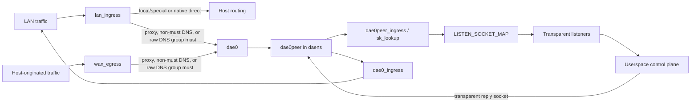

# eBPF 内核数据路径

内核数据路径负责流量拦截；用户态路径见[控制面](./control-plane.md)，持有首包的 UDP 路径见 [NFQUEUE](./nfqueue.md)。

## 网络命名空间与 hook 架构

需要代理的数据包由 honk 重定向到隔离的网络命名空间，主机上不需要 TPROXY 规则：

### 网络命名空间生命周期

honk 用一个临时线程建立 `daens`：该线程调用 `unshare(CLONE_NEWNET)`，打开 `/proc/thread-self/ns/net`，再把得到的 `OwnedFd` 交回进程。这个 FD 在整个进程生命周期内固定住 `daens`。`/var/run/netns/daens` 只是尽力创建的兼容 bind 挂载，引擎不依靠它持有网络命名空间。

内核支持时，honk 用 rtnetlink 创建 L2 netkit pair `dae0`/`dae0peer`；不支持时回退到 veth pair。随后 honk 通过网络命名空间 FD 把 `dae0peer` 移入 `daens`，再配置链路、地址、邻居、策略规则与路由。两端地址如下：

| 一侧 | IPv4 | IPv6 |
| --- | --- | --- |
| 主机 `dae0` | `169.254.0.1/32` | `fd00:686f:6e6b::1/64` |
| `daens` 的 `dae0peer` | `169.254.0.11/32` | `fd00:686f:6e6b::2/64` |

两个 IPv4 endpoint 各是独立的 `/32` 地址，不共享一个 `/30`。honk 用链路作用域路由和静态邻居让对端可达。在 `daens` 里，fwmark `TPROXY_MARK` 选中表 `100`；该表的 IPv4 与 IPv6 local 默认路由把数据包交给本地透明 socket。

其余时间进程都留在主机网络命名空间。每次切换由 `with_daens_netns` 串行执行：它用进程级 mutex 排队，保存 `/proc/thread-self/ns/net`，进入 `daens`，运行一个纯同步闭包，然后在正常返回或 panic 时恢复原网络命名空间。闭包不能跨越 `.await`，因为 `setns(2)` 只作用于线程。恢复失败时进程直接 abort，否则某个 worker 会留在 `daens` 里，并在那里发起后续拨号。

### 接口 hook 集合

honk 按每个接口的[帧格式分类](../reference/global.md#网卡语义)选用 `_l2` 或 `_l3` 变体。启动只验证初始计划要用的变体，需要时再加一个路由目标。之后新需要的变体在共享后端锁之外验证，通过后才能绑定。

配置里的每个名称先解析为规范根接口。bond 或 bridge 的成员解析到它的 master；本身是 bridge 端口的 bond 解析到该 bridge；其他 master 的成员也解析到 master，但 `vrf` 和 `openvswitch` 的成员保持自身。honk 支持一层 bond/bridge 嵌套，外加作为 bridge 端口的 bond。其他 bond/bridge 嵌套，或自身就是 master 的接口，honk 只拒绝该配置项并给出原因 `unsupported_type`，其余项照常在启动时绑定并 reconcile。各根接口独立规划：只出现在 `lan_interface` 的根算 LAN，只出现在 `wan_interface` 的算 WAN，两边都出现的算 LAN/WAN 共用：

| 根接口角色 | hook |
| --- | --- |
| LAN | `lan_ingress` + `lan_egress` |
| WAN | `wan_ingress` + `wan_egress` |
| LAN/WAN 共用 | `lan_ingress` + `wan_egress`；跳过 `lan_egress` 和 `wan_ingress` |

角色按接口各自判断，所以多 LAN 配置里出现一个共用接口，不会改变其他 LAN 接口的 hook。流量可能绕过 bridge master 上的 hook，因此 LAN bridge 根接口还会给每个端口绑定 hook，角色固定为 LAN，WAN 名称不会把它提升为共用。bond 根接口只把逻辑 master 按表中角色绑定，不绑定成员。作为 LAN bridge 端口的 bond 仍是一个逻辑 LAN 端口，保留 `lan_ingress` + `lan_egress`，不展开成员。假设 LAN 是 `br0`、WAN 是 `bond0`，而 `bond0` 属于 `br0`，那么 bridge 为 LAN/WAN 共用，`bond0` 与其他端口仍为 LAN。没有配置 `lan_interface` 的纯 WAN 部署不装任何 LAN hook。

bond 上只拦截经过逻辑 master TC hook 的正常软件 skb。bonding 先决定哪些接收帧进入 master，honk 随后才分类，所以不会抢在 bonding 的接收决策前接管 inactive 成员上的帧。直接注入成员的原始 `AF_PACKET` 帧，以及绕过这些 TC hook 的路径，包括这类硬件卸载，都不在覆盖范围内。

LAN TCP 与非 DNS UDP 在 bond 上被拦截时，`REDIRECT_TRACK` 记下 master ifindex；符合条件的 LAN UDP `CLIENT_REPLY_TRACK` 条目也保留这个 index。回复从 master 的 TX 发出，即 `dev_queue_xmit`，由 bonding 选择当前出端口。WAN 本机流量被拦截时保存 master ifindex 和 `from_wan=1`，回复经 master RX 回来，即 `BPF_F_INGRESS`，不依赖 `CLIENT_REPLY_TRACK`。active 成员切换和成员热插拔都不需要 honk 在成员上挂 hook。WAN 本机回复的目的 MAC 用的是捕获时读到的 bond MAC，所以 honk 不支持 `fail_over_mac=active`，内核在成员无法设置 MAC 时会强制使用该模式，honk 也未验证过：故障切换一旦改变 bond MAC，已有流上的后续回复就不再作为本机报文交给主机 socket。

`lan_ingress` 分类转发的客户端流量，`wan_egress` 单独分类主机自己创建的流量。拓扑提供独立方向时，反向 ingress/egress hook 只刷新已有连接状态。TCP 状态只由正向 SYN 发布：反向的纯 SYN 既不创建也不刷新它。

在 Linux 6.12+ 上，honk 把接口 hook 建成 FD 持有的 TCX BPF link，排在已有 TCX 程序之后。启动、重绑定和关闭只释放自己的 link。honk 不会创建或删除物理接口上的 `clsact` qdisc 和旧式 filter；遗留项如果不需要，请手动删除。启动时 honk 重建遗留的 `dae0`/`dae0peer` 对。内核选项见[开始使用](../how-to-start.md#内核配置)。

不写 mark、也不受所有权 guard 保护的直通出口返回 `TC_ACT_UNSPEC`，值为 `-1`，在 TCX 里等同 `NEXT`，让后面的 TCX 程序继续运行；反向刷新和跳过 DNS 都属于这类出口。在最低支持的内核上，`TC_ACT_PIPE` 不能当作继续动作。写 mark 的路径返回 `TC_ACT_OK`，值为 `0`，在 TCX 里等同 `PASS`，链到此为止；这类路径包括显式写零的 WAN 路径，以及 LAN classified/pending 和 WAN 精确 socket-mark/classified 的所有权 guard。

属于其他设备的帧同样以 `NEXT` 继续，因此同一设备上排在后面的 TCX 程序以及 legacy `clsact`/`cls_bpf` 过滤器都能看到它们：

- **带 VLAN 标签的帧。** 在以太网父设备上，也就是 `_l2` 变体，`lan_ingress` 和 `wan_egress` 不处理仍带标签、VID 非零的帧，把它们留给 VLAN 设备。VLAN 设备自己的 hook 会分类去标签后的帧。如果父设备把它们重定向进 `daens`，会在那里按 `PACKET_OTHERHOST` 丢掉。跳过的只有这两个 hook，反向的 `lan_egress` 和 `wan_ingress` 仍会刷新连接状态。VID 0 的优先级标签由父设备直接上交，照常分类。`_l3` 程序只在按以太网头解析的帧上遇到标签，见[帧格式](../reference/global.md#网卡语义)。
- **不支持的 LAN 入站帧。** 非 IP 的 EtherType 和不支持的 L4 以 `NEXT` 返回，并且不写 `CLASSIFIED_MARK`，好让 `macsec0` 这类上层设备能分类自己解密后的帧。非 IP EtherType 有 ARP 和 MACsec，不支持的 L4 有 GRE、IPIP、ESP、ICMPv4，以及 Redirect 之外的 ICMPv6。NDP Redirect、非首分片和畸形包则保持终结性的 classified `PASS`。不带标签、但已带 `CLASSIFIED_MARK` 或 pending 标记的帧也一样，因为所有权 guard 先于解析执行。

### 接口协调

`InterfaceBindings` 是接口绑定的唯一 owner。它保存已加载的 TC 程序 FD，并为每个自有 `(ifindex, direction)` 保存一个 FD 持有的 TCX link。启动时它先打开 rtnetlink 订阅，再读一次拓扑快照，打断的 link dump 最多重试三次。然后它推导计划、解析 `local_ip`、加载 BPF 对象并绑定。配置项的行为契约见[网卡语义](../reference/global.md#网卡语义)。

启动只在以下情况失败：

- 无法读取拓扑。打断的 dump 除外，其他错误立即失败。
- 有 `auto` 项时无法读取默认路由。
- 启动集合里的 TC 变体加载不了。启动集合指启动计划绑定的变体；若其中没有路由目标，再加上 `lan_ingress_l2`，没配 LAN 时换成 `wan_egress_l2`。
- 内部 link 失败，包括 `dae0`/`dae0peer`、cgroup 和 `sk_lookup`。

`dae0`/`dae0peer` 的 ifindex 为零，或 `dae0peer` 的 MAC 全零，同样算失败。

启动序列只有一个实现，真实 eBPF VM 测试用的也是它。序列在数据路径 admission 或 READY 之前结束。之后某个计划第一次需要的变体在阻塞线程上验证，不持有共享后端锁；`auto` 切换到 PPP 或 WireGuard 设备就是例子。提交时先挂上当时有效的路由 generation，再把变体发布为可绑定。一个变体加载或扩展失败，不影响其他独立变体的尝试。加载器始终持有未加载程序中嵌入的原始 map FD，日志和事件消费者拿的是副本，因此它们失败或取消不会让后续加载失效。

只有某项为 `auto` 时才读 `/proc/thread-self/net/route`。读取错误不等于“没有默认路由”：启动阶段它是致命错误，之后算 reconcile 失败，保留现有绑定。

[API 参考](../reference/api.md#原生-api)定义 `interface_binding` 降级与原因优先级。reconcile 失败时，绑定和降级保持最近一轮已完成 apply/commit 的结果。

`IfaceWatcher` 接管启动时在拓扑 dump 之前打开的 rtnetlink 订阅。每 60 秒一次的 tick 是事件交付的后备，首次 reconcile 无条件执行，覆盖启动期间的变化。订阅或它的 poll 注册失败时，reconcile 只由 tick 驱动，并报告 `iface_watch` 降级。拓扑发现、程序验证和 TCX link I/O 都在 backend 锁之外运行。watcher 只在读锁下准备验证任务或复制 link 快照；写锁下只做三件事，挂接当前路由扩展、发布已验证变体、转移 link commit。路由发布和接收追踪准备都不会持这把锁等 TC verifier。计划不变且 link 健康时不提交任何内容。角色变化时就地更新已有 link，不会再叠一个。

关闭时先发 stop，再 join watcher。watcher 会等进行中的批次完成；超过阶段超时只记 warning，仍继续等，之后才释放 BPF hook。

链路、地址、路由或接口角色变化时，接口地址仍用于拓扑检测和 ECS 刷新。honk 不再生成 `direct(must)` 规则，也没有隐藏的内核地址白名单。系统清除健康检查 cooldown 并触发新探测。新探测成功之前，失效的 UDP 和多叶节点出站仍保持 fail-closed；未配置 `final` 的单叶节点 TCP 代理组仍可在用户态作为最后尝试。

## 程序清单

| 程序 | hook | 内核职责 |
| --- | --- | --- |
| `lan_ingress_l2`, `lan_ingress_l3` | LAN TC ingress | 检查 admission，绕过特殊/控制面及非 DNS 本地流量，执行单源新流限制与包含端口 53 的有序路由策略、DNS 接管判断、连接状态、direct 卸载、代理重定向、TX 计数、分片 verdict 记录，以及可选的歧义 UDP 暂存。 |
| `wan_ingress_l2`, `wan_ingress_l3` | WAN TC ingress | 刷新反向连接状态；LAN/WAN 共用接口上不挂接。 |
| `lan_egress_l2`, `lan_egress_l3` | LAN TC egress | 刷新反向连接状态，不从 `dae0` 的 UDP 包创建新条目；抑制本机生成的 ICMPv6 Redirect。LAN/WAN 共用接口上跳过。 |
| `wan_egress_l2`, `wan_egress_l3` | WAN TC egress | 路由主机发起的 TCP/UDP，使用进程名与控制面旁路数据，检查出站连通性，缓存决策并重定向代理流量；抑制本机生成的 ICMPv6 Redirect（LAN/WAN 共用接口的 LAN-egress hook 被跳过）。 |
| `dae0_ingress` | 主机 `dae0` 的 TC ingress | 从 `REDIRECT_TRACK` 恢复回复帧信息与 RX 归属，或使用不计数的客户端回退；[续期符合条件的 UDP owner](#udp-生存期续期)。 |
| `dae0peer_ingress` | `daens` `dae0peer` 的 TC ingress | 在链路 scrub 后恢复 UDP53 provenance 与 SYN incarnation；分配 UDP listener。TCP 保留原生 established/TIME_WAIT 查找。 |
| `tproxy_sk_lookup` | `daens` 中的 `sk_lookup` | 用 `LISTEN_SOCKET_MAP` 中的透明 listener 覆盖普通 socket 查找。 |
| `tproxy_wan_cg_sock_create` | cgroup `sock_create` | 保留 socket 首次捕获的进程身份；捕获失败只计数，创建不受影响。 |
| `tproxy_wan_cg_connect4`, `tproxy_wan_cg_connect6` | cgroup `connect4`, `connect6` | 保留已有身份，缺失时在 connect 前捕获；捕获失败只计数，连接不受影响。 |
| `tproxy_wan_cg_sendmsg4`, `tproxy_wan_cg_sendmsg6` | cgroup `sendmsg4`, `sendmsg6` | 保留已有身份，缺失时在发送前捕获；捕获失败只计数，发送不受影响。 |
| `honk_tcp_passive` | cgroup2 根上的必需 `sock_ops` | 在自有 `daens` 内 child 的 `PASSIVE_ESTABLISHED_CB` 上，验证 child 的 tuple、ISN 与 conn/handoff/redirect incarnation，再把已证明的 handoff 写入 child 的 socket storage。 |

`LISTEN_SOCKET_MAP` 的 key 固定为 `0` TCP4、`1` TCP6、`2..=5` UDP4、`6..=9` UDP6。所有 UDP 路径共用 `udp_listener_index`；输入是源和目的地址的低位地址字以及端口，都取主机字节序。`tproxy_sk_lookup` 在 `src/sk_lookup.rs`，它的 IPv4/IPv6 context 读取必须保留为独立的 `#[inline(never)]` 子程序。优化级别 2 下内联可能产生计算偏移读取，verifier 会以解引用已修改的 context 指针为由拒绝。

TC 入口点是原始函数，接受 `*mut __sk_buff`，带 `#[unsafe(no_mangle)]` 和 `#[unsafe(link_section = "classifier")]`。它们不用 Aya 的 `#[tc]` 宏，因为该宏的结构化参数形状在 7.0 及更高版本内核上会被 verifier 拒绝。程序主体返回 `Verdict = Result<c_long, c_long>`，即 `action::Verdict`：`Ok` 表示正常路径，`Err` 表示提前退出，两者都携带真实的 `TC_ACT_*` 值；`flatten` 把任一变体归约为内核的 `i32` verdict。`action::flatten` 定义 `flatten`，实现在 `src/action.rs`，`TC_ACT_*` 常量也在那里。解析器和辅助函数的哨兵值单独表示，不与 verdict 混用，例如 `transport::ERR_FALLBACK`、`ERR_FRAGMENT`、`PASS_UNSUPPORTED`。`bpf_loop` 回调用来控制是否继续执行的返回值同样独立。

`src/sk.rs` 里，`sk_assign_by_index` 是 TC 侧对应 aya `SockMap::redirect_sk_lookup` 的 helper，后者只接受 `SkLookupContext`；`probe_udp_socket` 查询非 DNS 的本地 UDP socket。全部辅助函数都会释放隐式查找引用。各程序的分工如下：

- `lan_ingress_l2/l3`：分类、路由和重定向 LAN 流量，在有序策略下判断 DNS 所有权，并用 `CLASSIFIED_MARK` 去重。NFQUEUE 已启用且 ready 时，它只把有歧义的非 DNS UDP 决策以唯一 token 暂存为 Pending；已启用但未 ready 时 fail-closed，实现在 `src/ingress.rs`。
- `wan_ingress_l2/l3`：刷新反向 conntrack，LAN/WAN 共用接口上跳过。
- `lan_egress_l2/l3`、`wan_egress_l2/l3`：刷新反向 conn state，并路由本机流量。本机流量用实际 skb socket 的 `SOCKET_IDENTITY` 匹配 pname，查控制面旁路和 `OUTBOUND_CONNECTIVITY_MAP` 里的活性，再重定向到控制面。存活的非 DNS WAN UDP 条目只查询缓存路由；未命中时才求值一次路由，并发布完整 conntrack 元数据。实现在 `src/egress.rs`。
- `dae0_ingress`：重写回复 MAC，并把回复重定向到原 LAN 接口。未知对端的 UDP 回复使用客户端帧信息，不归属任何出站；honk 自己的链路源地址从不使用这个回退。
- LAN 与 WAN egress 只抑制本机发起的 ICMPv6 Redirect，判断依据是遍历扩展头之后的 ICMPv6 header；转发的 Redirect 和其他 ICMPv6 仍放行。LAN/WAN 共用接口不挂 `lan_egress`，这条不变式改由该接口上的 WAN hook 承担。`honk-core/tests/ebpf_datapath_test.rs` 用 `BPF_PROG_TEST_RUN` 检查 L2，用隔离 TUN 接口检查 L3，并覆盖精确 tuple RX 计数和 cached-route 策略。
- `dae0peer_ingress`：恢复 UDP53 provenance 和 TCP SYN incarnation。它按重定向点写进 `cb[4]` 的标记 `0x100 | index`，用 `bpf_sk_assign` 分配 UDP，不解析报文字节。缺标记时 UDP 留给 `sk_lookup`；TCP SYN 保留自己的 `cb[3]`/`cb[4]` incarnation carrier，继续走原生 established/TIME_WAIT 处理。
- cgroup sock_create/connect4/6/sendmsg4/6：原生 socket storage 保留首次捕获的 `SocketIdentity{pid, pname}`，供进程名规则和控制面旁路使用。`pname` 通过运行时 kernel-BTF offset 读取 `argv[0]` 可执行文件的 basename，最长 15 字节；不可用或读取失败时回退到线程 `comm`。内核在 socket 对象销毁时回收 storage，所以不再需要 release hook 或 cookie janitor。缺少必需的 cgroup/storage 支持会拒绝启动。这些 hook 挂在根 cgroup 上，所以身份捕获失败，例如 storage 分配或 optmem 计费失败，不会拒绝宿主机操作：只计数，该 socket 的流量没有身份，进程名规则也不会匹配它。honk 自己的 socket 仍通过 `dae_socket_mark` 识别。实现在 `src/cgroup.rs`。

## Map 清单

`crates/honk-ebpf/src/maps.rs` 声明以下 map：

| Map | 形状与职责 |
| --- | --- |
| `CONN_STATE_MAP` | 不预分配的普通 hash，最多 524,288 项。原生 value lock 保护每流 TCP/UDP 状态和已发布的路由元数据，物理回收由用户态负责。 |
| `REDIRECT_TRACK` | 不预分配的 65,536 项 token-bound hash。带锁的有方向五元组 payload 保存原始 MAC 和接口、出站、时间戳、决策身份，用来恢复回复路径。 |
| `CLIENT_REPLY_TRACK` | 16,384 项 LRU hash，把客户端地址和端口映射到 `REDIRECT_TRACK` 的帧信息 payload，让未联系过对端的回复不必经主机转发就能到达客户端。只用于目的端口非 53 的 UDP，客户端源端口为 53 时也算。写入时目的字段清零，payload 不含 lock header，token 也清零。内核淘汰是近似行为：CPU 较多时，近期没发过包的客户端可能在表满前就被淘汰，这类回复随后退回主机转发。该缓存不持有流归属，也不由用户态清扫。 |
| `ROUTING_HANDOFF_MAP` | 不预分配的 65,536 项 hash。TCP SYN handoff 里存已提交策略 generation，暂存 UDP 携带 decision token。原始 must UDP/53 不发布 tuple handoff，所有权改用逐报文 mark。非 must UDP/53 保留事实，供畸形 payload 回退时使用。 |
| `ROUTING_POLICY_ROOT` | 单项 map-in-map，在不可变 policy descriptor 和两个同步生成函数槽之间二选一。替换 root 成功返回时，旧的 non-sleepable 读者已经走完 grace。 |
| 按 generation 持有的 IP/MAC 索引 | 分离的目的和源 IPv4、IPv6 LPM maps，以及 MAC LPM。value 是本 generation 完整的谓词 bitmap，更具体的前缀继承祖先的位。 |
| 按 generation 持有的 domain map | 不预分配的 hash，把 IP 映射到域名谓词 bitmap。DNS 和 sniff 得到的事实都写入，正向和否定条件都覆盖；已存在的零 bitmap 表示 known-false。descriptor 记录它的 map ID，供诊断读取。 |
| `OUTBOUND_CONNECTIVITY_MAP` | 1,536 项数组。每个出站有六个存活槽，覆盖 TCP/UDP 类别与 IPv4/IPv6；缺失槽按存活处理。 |
| `OUTBOUND_STATS` | 直接以 `u8` 出站编号为索引的 256 项（`MAX_OUTBOUNDS`）per-CPU 数组。每个 32-byte `OutboundStatsCounters` 值紧凑保存 `tx_packets`、`tx_bytes`、`rx_packets`、`rx_bytes`；当前 ABI 不使用 `outbound * 4 + counter` 索引。 |
| `LISTEN_SOCKET_MAP` | 16 槽 `SockMap`；key `0..=9` 保存两个 TCP 和八个 UDP 透明 listener。 |
| `DATAPATH_STATE_MAP` | 单槽 admission 数组。零值不改动地放行流量；非零值启用分类与重定向。 |
| `DATAPATH_FLAGS_MAP` | 单槽运行时策略字，存 Rule/Direct 卸载属性、`global.nfqueue_enable` 和 NFQUEUE ready fence。新流分类时读它；已建立流的 direct 卸载只用缓存元数据。 |
| `SOCKET_IDENTITY` | 不克隆的 `SK_STORAGE`，保存 socket 第一次被捕获时的 PID 和可执行文件 basename。存储跟着实际 socket 的生命周期走，不受固定 hash 项数和用户态过期清理约束。WAN TC 只查询；cgroup 的 create/connect/sendmsg 会同步补捕缺失的身份。 |
| `CONN_STATE_OCCUPANCY` | 两槽 per-CPU 插入和内核删除计数，再结合用户态的实际删除数估算占用。这条路径不再由内核删除 tuple，所以内核删除计数一直是零。 |
| `AUX_OCCUPANCY` | 两槽 per-CPU 计数器，统计 redirect 和 handoff 的插入；用户态减去实际删除数。 |
| `ADMISSION_PRESSURE` | janitor 写入的 conn-state 压力锁存。辅助 map 有压力不会置位它。 |
| `NEW_FLOW_RATE` | 16,384 项 per-CPU LRU hash，key 是 LAN 源地址。每个 CPU 为单源新流限制保存一个一秒的 `(second, count)` 窗口。 |
| `FRAG_VERDICT` | 4,096 项 LRU，key 是源、目的和 IP identification，IPv4 还要加协议；见[分片处置记录](#重定向数据报的分片)。 |
| `BPF_STATS_MAP` | 由 [`honk-tool bpf stats`](../reference/cli.md#bpf) 公开的计数器。标签与布局不匹配的说明见该参考页。 |
| `EVENT_RINGBUF` | 262,144 字节的 ring，每条记录 80 字节，其中有实际使用的 tuple/incarnation 过期提示。producer 直接在 ring 存储里预留并初始化事件，不再经过有界 TC 栈复制。 |
| `FLOW_EXPIRY_HINT` | 私有的 4,096 项 per-CPU LRU hash，key 是 tuple，保存最近一次提示的 incarnation 和时间戳。它只尽力抑制重复的 `FlowExpired` 提示，从不持有流，也没有回收 authority。 |
| `UDP_DECISION_SEQUENCE` | NFQUEUE 决策身份的单槽 pinned allocator 状态。协议细节见 [NFQUEUE](./nfqueue.md)。 |
| `FLOW_INCARNATION_SEQUENCE` | 按 generation 持有、spin-lock 保护、不可回绕的 56 位身份域，用 `u64` 表示，独立于持久化的 UDP decision token。 |
| `RETIRE_FENCE`、`RETIRE_ACTIVE` | 不预分配的 65,536 项规范 tuple fence，加一个单槽 active 标志。每个 fence 保存独立的操作 owner 和 decision token。 |
| `RETIRE_GRACE_ROOT` | 私有单项 map-in-map。重新装入同一个 inner map 成功之后，fence 之前的 non-sleepable 内核读者会被同步排空。 |
| `TCP_PUBLISHING` | 不预分配的 65,536 项 hash，对同一个 key 的 SYN 发布做互斥。owner 只活一个 TC invocation，竞争的 SYN 在修改前就被拒绝。没有用户态清扫；已建立连接上的包不会取得这个 claim。 |
| `TCP_SOCKET_BINDING` | 不克隆的 socket storage，存已接受 child 的原始 tuple 和 handoff，由 `honk_tcp_passive` 写入。用户态在接管前用 accepted FD 读取。 |
| `TCP_LIVE_PINS` | 不预分配的 65,536 项 hash，把 incarnation 映射到 presence。已验证的 accepted owner 取得精确 pin，只有老化 TCP 的查询会读它。每个 guard 各自释放自己的 incarnation，不依赖 tuple-local 引用计数是否归零。 |

内核/用户态共用的 map key 和 value 是 `#[repr(C)]` ABI。共享流结构中的 IPv4 地址都以网络字节序的 IPv4-mapped IPv6 值保存。

`ConnState`、`RedirectEntry`、`RoutingHandoffEntry` 的 payload 分别是 72、40、72 字节，各含独立的 `incarnation: u64`。对应的 tuple map 用 `FlowMapValue<T>`：原生 lock 在 offset 0，payload 在 offset 8，实际 value 大小依次为 80、48、80 字节。payload 内的 decision token 偏移不变。`ConnState` 还记录原始 SYN ISN 和已提交拦截标志；offset 68 的 `reserved` 字恒为零。`TuplesKey` 仍是 40 字节，尾部 padding 显式清零。不可变的 `TcpSocketBinding` payload 为 120 字节，offset 116 是 `syn_isn`。持久化的 `UDP_DECISION_SEQUENCE` 严格保留 12 字节。Core 在挂接前验证实际 map 的 BTF/value 布局，工具在解码前验证存储布局。必须使用匹配版本，不提供兼容 shim。

既有 tuple element 只原地更新，从不替换。Linux 的普通 hash 替换会在 RCU 读者仍持有旧指针时复用存储，所以不能替换。内核在原生锁内取得一致快照或窄投影；修改时在同一把锁内比较之前捕获的身份。持锁期间除 unlock 外不调用 helper。物理删除仍要经过 tuple fence、成功的内核 grace，以及事后再验证所有权。外部工具使用 bucket 保护的 batch 和加锁的 value copy，不回退到不安全的单项读取。

无状态 UDP tuple 元数据的 token 和 incarnation 都是 `0/0`。每个新求值的报文只在一个专用的 `0/0` 项上原地更新完整的 handoff/redirect payload，不会覆盖普通或 staged owner。原始 must 目的端口 53 仍用逐报文 carrier，不用 tuple handoff。无状态 redirect 更新在既有刷新间隔到期前保留原时间戳。

`auxiliary.rs` 负责客户端帧信息的首次发布和按间隔续期。目的端口非 53 的精确 LAN UDP 流量，包括源端口 53 的流量，在任一方向都可以沿用既有的一秒时间戳刷新节奏，补回被淘汰的客户端记录。它先在原生锁内复制当前保存的 MAC 和接口 payload，解锁后再投影。未知对端的 fallback 不续期该缓存，也不取得出站归属。这个操作仍是 best effort，不增加 timer，也不逐包写 LRU。

`RoutingMeta` 的 bit 58 仍表示 WAN UDP 归用户态所有，bit 57 即 `OFFLOAD`，用来区分原生直连。未发布 UDP claim 失败时，honk 在原地给精确 owner 记下 `Aborted` 和实际已分配的 token，辅助项保留到 fenced 的用户态清理。Preparing/Aborted 报文不能续期 claim。Aborted 立即满足过期清理条件，但不能转发，也不能激活。advisory hint 丢失时，仍由既有 janitor 兜底。

新对象校验成功后，启动只删除六个已废弃的 honk pin：`COOKIE_PID_MAP`、`UDP_DECISION_EPOCH`、`UDP_DECISION_INFLIGHT`、`UDP_DECISION_RETIRE_FENCE`、`TCP_REQUEST_BINDINGS`、`REQUEST_FENCE`。它不清扫无关 pin，也不删除持久化的 UDP allocator。

`crates/honk-ebpf-common/src/lib.rs` — 共享 mark、NFQUEUE token 编码、`OutboundIndex`、`RoutingMeta`、`DaeParam`、`OutboundStatsCounters` 与 map 常量。
`crates/honk-ebpf-common/src/routing_policy.rs` — 固定 `RoutingInput`/`RoutingDecision`/`RoutingPolicyDescriptor` ABI（128/24/24 字节）、feature bit 与进程名归一化限制。`RoutingDecision` 含直连 mark 索引（未指定时为 `u32::MAX`）；loader 检查 slot 的 BTF 输出布局并拒绝旧外部对象。
`crates/honk-ebpf-common/src/redirect_need.rs` — `TuplesKey`、`Tuples`、携带 token 的 `RoutingResult`/`RoutingHandoffEntry`、256 位 `DomainRouting` 与 `SocketIdentity`。
`crates/honk-ebpf-common/src/conn.rs` — `ConnState`（含 `UdpDecisionState` 与 `decision_token`）、`ParseTransportCtx`、`BpfStatsKey`、`TcpState`，以及与用户态共享的辅助项过期时限。
`crates/honk-ebpf/src/maps.rs` — 静态 TC map 声明与内核侧容量。
`crates/honk-ebpf/src/contrack.rs` 持有 incarnation 分配、内核私有的 `ConntrackArgs` scratch 与共享的生命周期检查；`contrack/tcp.rs` 持有 SYN 分类与 TCP 发布，`contrack/udp.rs` 持有 UDP claim/发布/中止协议。`flow.rs` 持有加锁快照/投影；`auxiliary.rs` 持有辅助项过期、LAN 与 WAN 共用的 `AuxPrep` 发布策略、身份匹配的刷新与稳定发布。

`crates/honk-ebpf/src/route.rs` — 静态 root/slot facade 与固定 ABI dispatch；生成的 policy code 由用户态加载。
`crates/honk-ebpf/src/tcp_binding.rs` 与 `honk-core/src/ebpf/real/tcp_binding.rs` 持有必需的 SYN 发布桥与 `honk_tcp_passive` child 证明；二者都不读取内核内存，因此 TCP 不需要任何内核结构偏移。Peer ingress 恢复后，SYN 使用 mark 低 24 位与 priority 的 32 位携带 56 位身份；request 证明移除后，TCP 不再有该 carrier 的读取方，写入方的移除推迟处理。身份耗尽后拒绝发布，不回绕。

被拦截 SYN 在 TC 中分类，不读内核内存。`bpf_skc_lookup_tcp` 查询 FD 持有的 `daens`；查询为空、`LISTEN` 和 `NEW_SYN_RECV` 都视为不存在，所以 request 本身从不被检查。`TIME_WAIT` 会发布新 incarnation。已有 child 时，结论看它的 socket storage：缺少 child storage 就拒绝，ISN 不同就发布新 incarnation，证明有效则复用存储的 incarnation。

查询不存在时，honk 取第一条匹配的规则作用在 conn-state 条目上：

- ISN 与该 SYN 不同：发布新 incarnation。
- 状态不是 Active：发布新 incarnation。
- incarnation 被存活 relay pin 住：发布新 incarnation。
- handoff 或 redirect 辅助项缺失：拒绝。
- 辅助项存在但已老化：发布新 incarnation。
- 其余情况：复用缓存的 incarnation 和原始路由快照，即使期间策略已经改变。

已提交拦截缺少证据时，honk 拒绝重传，不重建归属，也不转为原生放行。TC 无从得知 request 的 ISN，所以重传可能复用缓存，而内核仍持有由更早、ISN 不同的 SYN 创建的 request。该 request 的 ACK 过不了回调的 ISN 检查，保持未证明并被关闭。原生直连流不取得拦截证明。

`honk_tcp_passive` 以 BPF link 挂接到 cgroup2 根，而且是必需的：没有它启动就失败，TCP admission 也无法开放。它忽略 `PASSIVE_ESTABLISHED_CB` 以外的所有回调，也忽略自有 `daens` 之外的 socket。判断 socket 是否在 `daens` 内，靠 netns cookie 等于用户态在加载前从 `daens` 内 socket 读到的 `SO_NETNS_COOKIE`；cookie 为零时该程序被停用。已接受 child 的 tuple 取自回调上下文，ISN 是 `rcv_nxt - 1`。

在既有 value lock 下，回调要求以下几项都成立：

- tuple 没有在退役。
- conn-state 的 incarnation 非零，带 `ORIGINAL_INTERCEPT`，且 ISN 相同。
- handoff 和 redirect 的 incarnation 与它相等。
- handoff 仍在 established 时限内。

conn-state 可能已经是 Closing：TC 在任何 FIN 或 RST 上标记 Closing，而 FIN/RST 可能先于完成握手的报文到达，也可能就在该报文上。条件满足后，回调用一次 `bpf_sk_storage_get(F_CREATE)` 写入完整的 `TcpSocketBinding`。回调始终返回成功，所以拒绝和存储失败都不会阻断连接：child 只是不带证明，接管时被关闭；存储失败还会累加 child 证明计数。child 存在到 storage 写入之间有一小段窗口，窗口内被拒绝的 SYN 重传由客户端重试。ctx 读取仍是按地址族拆分的 `#[inline(never)]` 常量偏移读取，形态和 `tproxy_sk_lookup` 相同，回调只用栈上 scratch。

自有 `daens` 关闭时会校验 SYN cookies、request migration 和 Fast Open。只有缺少 `tcp_syncookies` key 这一种情况，可以当作内核不提供该 feature 处理；检查、写入或校验出错仍然是致命错误。无法挂接 `sock_ops` 时拒绝启动，包括根 cgroup 槽位已被旧式 flags=0 程序占用的情况。证明缺失、未证明、分配失败，或被新 owner 替代时，honk 关闭 accepted socket，不授权删除 tuple。已取得证明的 child storage 跟随实际 socket 生命周期，没有单独的过期。Backlog 溢出依赖客户端重试，honk 不猜 cookie 归属。因此 LAN 主机大量发送不完成握手的 SYN 时，可以占满透明 listener 的 backlog，在这些 request 过期前拖慢新的被拦截 TCP 连接。先以 IPv4-only 启动、后来再启用 IPv6，仍需要重启：IPv6 socket 族探测在加载时固定，TCP6 listener 在启动时绑定。

有两个窗口用重试或重新发布代替拒绝。内核先把 child 放进 accept 队列，再执行 `PASSIVE_ESTABLISHED_CB` 回调，所以已经在运行的 acceptor 可能在证明写入前看到这个 child。x86 loopback 上实测中位数约 1 µs，最坏约 17 µs；ARM64 只有源码分析给出的上界。`adopt_tcp_flow` 对缺失的证明每隔 1 ms 重试三次，之后才关闭 socket。仍存活的 request 如果收到 30 秒 handoff 时限之后才到达的重传 SYN，会发现发布已老化，于是在旧 request 仍存活时发布新的 incarnation 和路由快照。ISN 匹配的 child 绑定到当时有效的 incarnation，因此沿用替代者的路由。

历史归属证明构建中，最大的分类程序在 Linux 6.12.94 aarch64 上验证了 464,596 条指令（`verified_insns`），而引入归属证明前的 beta.82 发行版为 74,469。增加状态检查的改动应在同一 fixture 上报告改动前后的 `verified_insns`。

`crates/honk-ebpf-common/src/event.rs` — 固定布局的 ring event，包括 conntrack overflow 与 UDP decision-token exhaustion。
`crates/honk-ebpf-common/src/dae_ip.rs` — `In6Addr` union 与 v4-mapped helper。
`crates/honk-core/src/routing/ir.rs` — 规范 `CompiledPredicate` 与用户态 `PortRange`；`crates/honk-core/src/control/routing_matcher.rs` 将其转换为生成函数 ABI。

## Mark 及其所有权

| 常量 | 值 | 含义 |
| --- | --- | --- |
| `TPROXY_MARK` | `0x08000000` | 选择 `daens` 表 100 的 local-delivery 路由，并标记要交给 listener 的重定向数据包。`global.tproxy_mark` 必须等于这个编译期值。 |
| `DAE_BYPASS_MARK` | `0x00000100` | `global.so_mark_from_dae` 为零时的默认值；非零时 honk socket 和 listener 识别使用配置值精确匹配。 |
| `CLASSIFIED_MARK` | `0x40000000` | 防止同时挂在 bridge master 和 slave 上的数据包被重复分类；也标记最终 direct verdict。 |
| `NFQUEUE_PENDING_MARK` | `0x80000000` | 标识必须在 conntrack/NAT 前持有的流量；有效的暂存 mark 还携带 `CLASSIFIED_MARK` 和非零 token。 |
| `NFQUEUE_TOKEN_MASK` | `0x3fffffff` | 选取 NFQUEUE 暂存数据包中承载 decision token 的 skb mark 低 30 bit。 |

`SKB_MARK_RESERVED_MASK` 是 `0xc0000000`，也就是 `CLASSIFIED_MARK` 和 `NFQUEUE_PENDING_MARK` 合起来占用的位。配置校验会拒绝与这些 bit 重叠的 `global.so_mark_from_dae` 和路由规则 mark。NFQUEUE direct 完成路径在接受规则 mark 之前会重复同样的检查。

最终直连报文会带 mark，值为 `rule_mark | CLASSIFIED_MARK`。LAN 原生转发、NFQUEUE 接受和用户态 TCP/UDP socket 都这样。Linux 策略路由只匹配用户位，也就是 `fwmark 0x200/0x3fffffff`。WAN egress 的旁路有两种：精确匹配非零的全局 socket mark，或报文带分类位且不含 `NFQUEUE_PENDING_MARK`。只含 `0x100` 位不再算旁路。宿主发起、带非零直连 mark 的流量会交给用户态，因为到 WAN TC 才改 skb mark 已经晚于原始 Linux 路由查询。

真实透明 UDP/53 从 `SO_RCVMARK` 启用的 `SOL_SOCKET`/`SO_MARK` 辅助数据里取逐报文的出站和策略 generation。同一个 skb 的 `cb[2]` 跨链路保存路由编码和一个不回绕的 20 位已提交策略 generation，由必需的 `dae0peer` TC 恢复。签名掩码是 `0xc8000000`，可变携带位是 `0x37ffffff`。位 `0x100` 表示这个 8 位字段是不可变直连 mark 索引，不是出站编号；索引通过当前 Router 的排序 mark 表解析。`daens` 内部的 fwmark 规则忽略这些可变位。用户 mark 的保留位和 `UDP_DECISION_SEQUENCE` 保持不变。原始直连和分组的归属绝不依赖可变 tuple handoff。

探测非 DNS 本地 socket 时，honk 比较完整 socket mark 和 `PARAM.dae_socket_mark`，据此区分自己的透明 listener 和普通本地服务。主机网络命名空间里的 `dns.bind` socket 仍是普通未标记 listener，但它的存在不能绕过 LAN 端口 53 策略。

## 数据包行为与不变量

### DNS 与本地 listener 优先级

LAN/WAN 的 TCP/UDP 目的端口 `53` 先经过既有入口和控制面排除，然后只执行一次正常有序策略，不另外扫 must 规则。走原生、丢弃、原始转发还是控制器，由[流量规则所有权](../reference/routing.md#出站目标与-must)决定。具体地址或通配地址上的本地 `:53` listener 都不能覆盖这个策略。端口 `53` 仍豁免 LAN ingress 和 WAN egress 上的出站健康检查丢包，但已选的用户 `must` 结果不豁免。

只有非 DNS 流量会在流量策略之前探测本地 socket。探测用的是报文所在的当前网络命名空间，即负 netns ID，不是相对命名空间 ID `0`。匹配到的非 honk socket 可以接收；通配匹配还要求完整 FIB 返回 `NOT_FWDED`。TCP 纯 SYN 跳过探测的行为保留。解析出的目的端口 `53` 请求，在标记非零且完全匹配控制面 bypass mark 时保留原生投递；普通请求继续执行路由，不探测本地 listener。后端回包仍受非 53 策略约束。bind 留空不代表关闭透明 DNS。

实际本地 socket 的优先接收不等于所有网关地址强制直连。非 DNS TCP 纯 SYN 的现有探测策略不变，所以不能承诺不做配置就能一直访问网关管理面；需要时使用[显式用户规则](../reference/routing.md#显式本地路由)。

原生直连仍受外部防火墙/NAT 影响；它与 `asis` 及客户端侧 anyfrom 回复的区别见[DNS 来源边界](./dns.md#入口路径)。
UDP53 不创建普通 UDP conn-state 或 decision token。LAN 查询分片需要控制器或原始组处理时，使用[内核重组与 NFQUEUE](./nfqueue.md#lan-dns-分片)；未分片查询仍走 TC redirect。持久化路由 generation 计数器隔离重启前的排队元数据。其他数据报遵循[分片处置记录](#重定向数据报的分片)。

### 单源新流限制

每个 LAN 源地址都有始终开启、不可配置的预算：每 CPU 每秒 1024 次新流尝试，按固定的一秒窗口计。计数范围包括纯 TCP SYN，含重传；未缓存流的第一个普通 UDP 包；以及任一端口为 53 的每个被路由 UDP 包。direct 流和代理流共用这份预算；同一个 NAT 路由器或接入点后面的所有客户端也共用；每个 IPv6 地址各算一个源。超额的尝试在分配状态前丢弃，并计入 `honk-tool bpf stats` 的 `new_flow_rate_limited`；计数增长时 janitor 记 WARN。本地服务回复学习也用这份预算，但请求不会被丢弃，见[反向学习](#反向-udp-学习与-conn-压力)。LRU 淘汰会忘掉近期计数。限制不覆盖主机发起的 WAN 流量、已缓存流的辅助项重建，以及大量伪造或轮换的源地址。

窗口按 CPU 计，所以有效上限是 CPU 数乘以 1024/s。这份预算只减缓、并不限制单个源占用共享辅助 map：一个 CPU 的预算就够一台主机用 UDP 流占满 `REDIRECT_TRACK`，该 map 有 65,536 项、空闲 120 秒过期；流量分散到 3 个及以上 CPU 时，可以用任一协议的新流占满 `ROUTING_HANDOFF`，它有 65,536 项、30 秒过期。janitor 的压力节奏和回收是兜底；map 写满由 `redirect_track_insert_failure` 和 `routing_handoff_insert_failure` 计数。

### 重定向数据报的分片

在 `lan_ingress` 和 `wan_egress` 上，首片带 more-fragments、偏移为 0，如果它的 verdict 是 `TC_ACT_SHOT` 或 `TC_ACT_REDIRECT`，honk 会把这个 verdict 记进 `FRAG_VERDICT` 并保留 30 秒；匹配的后续分片直接丢弃，不交给代理重组。其他首片 verdict 会清除旧记录，direct、staged、pending 流量照旧。任一端口为 53 的 UDP 被排除，LAN DNS 保留[原生重组](./nfqueue.md#lan-dns-分片)。解析不了的微小首片放行。后续片先到，或记录已过期、被淘汰、插不进去时，后续片可能放行。IPv6 只按源、目的和 identification 匹配，所以 UDP 之前的扩展头不会把同一数据报的分片拆开。

### 反向 UDP 学习与 conn 压力

本地非 honk 的 UDP 请求原生放行。创建它的反向回复 tuple 会消耗[单源预算](#单源新流限制)；缓存命中的请求和回复绕过 socket/FIB 探测。预算耗尽时 honk 跳过学习，不丢请求，也不增加 `new_flow_rate_limited`，于是回复可能作为新流被路由。`wan_ingress`/`lan_egress` 也学习反向 tuple，不受这份预算约束；反向观察不会覆盖正向所有权。即使本地服务已经关闭，持续请求仍会续期学习条目，让它继续原生绕过，直到 [UDP 空闲超时](#udp-生存期续期)。

`ADMISSION_PRESSURE` 置位时，反向学习只做查询：未命中就增加 `udp_reverse_learning_suspended`，新观察到的服务回复可能作为新流被路由，已有条目仍然有效。没有进入压力状态时，未经请求的反向流量可以抢先占据后续正向流的同一 tuple，让后续正向流原生放行。

### UDP 生存期续期

UDP conn state 的空闲超时是 120 秒。三种流量会续期它，至多每秒一次：正向流量、拓扑具备的 `wan_ingress`/`lan_egress` 反向 hook，以及经 `dae0_ingress` 精确匹配非 DNS `REDIRECT_TRACK` 的回复。精确回复先在加锁状态下检查身份、状态和 fence，通过后只续期匹配的存活 owner，包括绑定 token 的代理流；它不创建状态。以下都不续期：无状态端口 53 UDP、`Preparing`、`Aborted`、已过期、`Pending`、`DirectArmed`，以及 `CLIENT_REPLY_TRACK` 回退。代理回复在单网卡和双网卡网关上都有用；单网卡原生 direct 流量不会增加反向 hook。用户态计时器见[长连接](../operations/long-connections.md)。

### 特殊与内部流量

在 LAN ingress/egress 和 WAN egress 上，`dst_is_special` 遇到以下目的地址时，会在路由和 conntrack 前放行流量：

- L2 目的 MAC 的 individual/group bit 已设置，覆盖 broadcast 和 multicast；
- IPv4 `255.255.255.255`、`224.0.0.0/4` 或 `0.0.0.0`；
- IPv6 `ff00::/8`。

这样 DHCP、mDNS、SSDP、LLMNR 这类链路流量就不会进入代理。内部链路地址空间是 `169.254.0.0/16` 和 `fd00:686f:6e6b::/64`。任一 endpoint 落在这些范围时，控制面 UDP admission 会拒绝初始化代理；引擎自己的交付路径由 `dae0`/`dae0peer` hook 处理。

### 出站存活状态

用户态把 group-OR 健康状态发布到 `OUTBOUND_CONNECTIVITY_MAP`。新 LAN 流一旦被路由到显式标为失效的槽，内核就用 `TC_ACT_SHOT` 丢弃它，这是有意的 fail-closed 行为。只有一个窄例外：未配置 `final`、且只有一个唯一叶节点的 TCP 组会让槽保持开放，好让真实流量经同一代理尝试并验证恢复，同时不会隐式回退到 `direct`。UDP 流，以及所有叶节点都失活的多叶节点组，仍保持 fail-closed。组里只要有 `direct`/`block` 内置成员，就永远不会失活，因为内置节点不会被判定失活，group-OR 槽也因此保持开放。LAN ingress 和 WAN egress 上的 TCP/UDP 目的端口 `53` 都豁免这项健康检查丢包，但仍遵循上面的 DNS 所有权规则；豁免从不绕过已选策略。网关管理访问不再由自动地址规则保障。

TCP 健康检查只作用于新 SYN 的发布；已建立的连接和缓存命中的重传不受后续健康变化影响。UDP 在普通 LAN redirect 以及 WAN 路由/缓存路径上逐包检查健康，原生 direct 卸载和已提交、绑定 token 的 LAN `Proxy` redirect 除外。配置的 UDP block 保持 final。

### 路由时 direct 卸载

非 `must`、非 DNS 流是否留在内核走 direct 路由，只在路由时决定一次，结果缓存到 `RoutingMeta` 的 bit 57。已建立的流检查这个缓存 bit，不再读 `DATAPATH_FLAGS_MAP`。下表里的模式卸载不适用于非 `must` DNS，也不能剥夺 DNS 控制器的接管权限。

| 有效模式 | 路由时策略 |
| --- | --- |
| `Rule`（也包括没有 Clash 模式覆盖） | 只有 SNI 不可能改变结果时才卸载非 `must` 的 `direct` 结果。满足任意一条即可：不存在域名类重新求值；DNS 学习已经提供该流的域名 bitmap；或者从首条 live 规则到当前 direct 规则，包含当前这条，前缀里没有域名谓词。后置的域名规则不再阻止卸载；前置或当前规则里尚未确定的域名谓词仍按保守处理。 |
| `Direct` | LAN ingress、WAN TCP 和 WAN UDP 都把每个非 `must`、非 `block` 流当成 `direct` 卸载，不经过代理健康门控。只有规则本身路由到 `direct` 时才保留规则 mark。这里不参考 SNI，和用户态的模式覆盖不同，所以只靠 sniff 域名命中的 `block` 或 `must` 规则不会生效。 |
| `Global` | 全局选择正好是 `direct` 时，用同一套全 direct 策略。其他全局选择让非 final 流留在用户态，以便应用选出的出站。 |

`direct(must)` 始终保持 direct，不需要 bit 57 标志。普通非 DNS 的 `block` 与 `block(must)` 保持 final；普通非 `must` DNS `block` 仍交给 DNS 控制器。完整规则求值与模式语义见[路由设计](./routing.md)。

### 主机发起的 WAN UDP

`wan_egress` 只分类本机生成的流量。转发数据包带着真实的 ingress ifindex，因此原样放行。带 honk 自有 mark 的 socket，以及匹配控制面 socket 身份的流量，也会 bypass。存活且已发布连接状态的非 DNS UDP 流走只查询的缓存路由路径。miss 时只跑一次路由并发布完整状态，后续数据包再用缓存。DNS 是短生命周期，不创建这项 UDP 缓存。准备 redirect 失败时，例如 handoff/redirect map 已满或归属不匹配，WAN TCP 和 UDP 数据包会被丢弃，不会原生放行；map 已满由现有插入失败计数记录。

## admission 顺序

`DATAPATH_STATE_MAP[0]` 一直保持为零，流量原样放行，直到四件事都完成：内部 hook 全部就绪；listener 绑定并发布完整的 TCP/UDP FD 集合；接收循环启动；已启用的 NFQUEUE 已经 ready。已配置的接口是 lazy 绑定，不是 admission 的前提，见[接口协调](#接口协调)。纯 WAN 部署也必须挂 `dae0_ingress`；挂接失败会在 admission 前中止启动。

关闭时，系统先在适用的情况下阻止新的 NFQUEUE 暂存；接着在拆除 listener 之前关闭 `DATAPATH_STATE_MAP[0]`；然后 drain 并 detach producer。admission map 操作失败是 fatal，不会在所有权不明确时静默继续。

## 用户态维护与计数

`BpfJanitor` 每两秒醒一次。已接受的 TCP relay 在自己的生命周期内 pin 住 conn 和 redirect 项；没有 pin 的 closing TCP 在 10 秒后过期，没有 pin 的 active TCP 有 120 秒 backstop，UDP 按[空闲续期](#udp-生存期续期)处理。没有 pin 的 TCP，以及 token/incarnation 为 `0/0` 的无状态 UDP53 redirect，30 秒后回收但不删 conn state；其他 redirect 保留内核的 120 秒过期。

conn、redirect、handoff 的最高占用率决定每张 map 的清理节奏和候选预算：通常 60 秒扫 1,024 项，占用 70% 时 15 秒扫 2,048 项，85% 时每两秒 tick 扫 4,096 项。以下情况同样切到压力节奏：overflow 计数增长，辅助扫描没做完，或覆盖率 ≥85%。各 map 的游标继续有界扫描，只有完整遍历时才用新鲜的插入/删除计数加上用户态删除记录来校准占用。独立的 `ADMISSION_PRESSURE` 锁存只看 conn-state 占用率，70% 置位，低于 60% 清除。socket 身份不做清扫。

overflow、conn/辅助占用或健康统计读失败时，系统保留上次的样本，初值为零，至多每 10 秒记一次 WARN 并指出是哪个信号失败，清扫不会停。漏读 overflow 不算退出压力所需的安静轮次，校准也要求计数是新鲜的。日志会区分 conn/redirect/handoff 占用；overflow 的 WARN 只在计数确实增长时才出现。退役或 admission 压力发布失败仍是 fatal，并记录完整的原因链。

内核过期会拒绝报文并发出一条 advisory hint，但不删状态。UDP handoff 如果仍匹配存活 conn 的 token/incarnation，即使超过名义上的 30 秒，也会在加锁检查身份后原地续期，每秒至多一次；不匹配仍然拒绝。`FLOW_EXPIRY_HINT` 把缓存里的 tuple/incarnation 合并成每 CPU 每秒一条提示，只有 ring 接受后才记下来。新 incarnation 会重置抑制；淘汰或插入失败可能丢记录。因此 ring 满不会让某个 tuple 静默一秒，代价是 ring 一直满时，每个符合条件的包都多一次失败的预留。hint 不受诊断日志限速影响，也不授予回收 authority。ring/queue 丢提示由 janitor 清扫兜底，过载下不保证及时恢复。

Removal worker 每批最多处理 1,024 项 TCP/UDP/过期请求，使用 [NFQUEUE fence/grace 协议](./nfqueue.md#精确-tuple-退役)。它会按规范 tuple 去重，并保留第一个 token 以及获取/释放顺序。TCP pin 在后端写锁内复验；已经通过 admission 的清理在关闭 warning 之后仍会 join。真正的 UDP conn 删除会触发[精确 endpoint 退役](./control-plane.md#tcp-中继与-conn-state-所有权)。

每个出站的流量计数器都是 per-CPU。路由结果一产生，`lan_ingress` 就对重定向和 direct 卸载结果统计 TX 数据包与字节。`dae0_ingress` 在 `REDIRECT_TRACK` 认出返回流量属于哪个出站后，统计 RX 数据包与字节；经 `CLIENT_REPLY_TRACK` 交付的回复没有对应出站，不计数。未分类的直通流量和丢包没有出站计数。

Backend API 使用 `TuplesKey`/`ConnState`、有界 map 扫描和条件退役。旧 `ConnTuple` CRUD、字符串 IP/域名路由、参数缓存 setter 与 backend 统计适配器已删除；加载时配置的 `DaeParam` global、带 generation fence 的 IP/规则位投影、`StatsManager` 和 pinned `OUTBOUND_STATS` 仍是正式路径。

`just test-netns` 包含生产 TC 报文回归：完整反向 tuple 的 RX 计数、缓存路由的健康/就绪政策，以及 LAN 与 WAN egress 的本机 ICMPv6 Redirect 抑制。L2 使用 `BPF_PROG_TEST_RUN`；L3 使用隔离网络命名空间内的真实 TUN 接口，并验证转发报文与卸载 hook 后的对照行为。

## 相关文档

- [路由设计](./routing.md)
- [NFQUEUE 持包路径](./nfqueue.md)
- [控制面](./control-plane.md)
