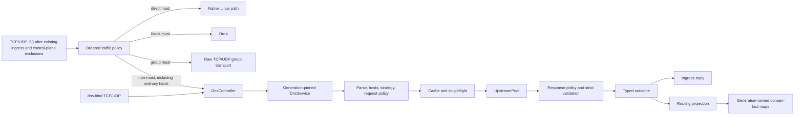

# DNS 子系统

透明 53 端口拦截与可选 `dns.bind` listener 共用用户态 DNS 架构。

字段级设置、可接受的 URI 形式及默认值见 [DNS 配置参考](../reference/dns.md)。缓存完全位于用户态；由 generation 持有的路由投影与域名事实 map 保存学习到的谓词事实，不保存 DNS 应答。

## 架构



非 `must` 的透明入口和独立的 `dns.bind`，这两个 adapter 共用同一个 `DnsController`、当前 `DnsServiceProvider`、forwarder、缓存、singleflight 集合、上游池和路由投影。adapter 从 admission 开始持有所有权，一直到应答 I/O 完成；它不会直接写 domain route。终局的 `group(must)` 走原始 TCP relay 或 UDP `PacketTransport`，不进入这条 DNS 管线，也就跳过 hosts、缓存、请求和响应策略，以及投影。

独立 UDP listener 在同一个 socket 上运行 `min(runtime worker 数, 4)` 个接收 supervisor。每个 supervisor 每批最多收八个报文，各自保留目的地元数据、独立 admission，并复用自己的 512 KiB payload 缓冲，每个 listener 最多 2 MiB。socket 请求 4 MiB 的内核接收缓冲区，Linux 会静默截断到 `net.core.rmem_max`。每个查询先在 supervisor 上 poll 一次，再决定要不要 spawn，所以已经就绪的缓存应答不需要任务。未完成的查询在停止和排空期间仍被持有并 join，查询 panic 会让 teardown 失败。批处理不会绕过容量或 generation 检查。接收错误的 warning 按 supervisor 计，同一个 socket 故障最多记四次 warning。

- [`src/dns.rs`](../../../crates/honk-config/src/dns.rs) — `DnsConfig`，字段包括
  `bind`、`upstream`、`routing`、`strategy`、`cache` 和 `fixed_domain_ttl`。
  `DnsBindEndpoint`、`DnsBindTransport`、`DnsBindError` 负责解析当前的 dae
  listener 配置，并支持语义相等判断；`DnsConfig::bind_endpoint` 把空值映射为关闭。
  listener 绑定语法见[配置指南](../configuration.md)。`DnsUpstream` 包含 `name`、
  `address`、`protocol: DnsProtocol`、`tls_server_name`，以及拨号路径的代理 tag
  `outbound: Option<String>`。Dae 路由按首次匹配执行
  `DnsRequestRule`/`DnsResponseRule`；`DnsCond` 之间是 AND，支持否定。请求规则支
  持 `Qname`、`Qtype`、`Sip`；响应规则支持 `Qname`、`Qtype`、`Upstream`、`Ip`。
  `Sip` 接受混合的主机地址和 CIDR 参数，不能用在响应规则里。动作有 `Reject`、
  `AsIs`、`Accept`、`Upstream(name)`，旧的 `rules`/`fallback` 会被转换。
  `types.rs::DnsProtocol` 有六个变体：`Udp`、`Tcp`、`Tls`（DoT）、`Https`（DoH）、
  `H3`（DoH3）、`Quic`（DoQ）。只有 dae 解析器会填充请求和响应规则，规则类型不参
  与 serde；路由包装类型只序列化默认值，只反序列化 null 值。

[`honk-config/src/dns/validation.rs`](../../../crates/honk-config/src/dns/validation.rs) 负责命名上游的引用校验，由启动、SIGHUP 和公开的运行时 reload 入口里的 `Config::validate` 调用。`DnsRouting` 的私有请求来源选择逻辑同时供校验和 `effective_request` 使用，既保留旧版字段的诊断路径，也避免在校验时分配转换后的规则。只解析配置的接口不执行完整配置校验。

- DNS hosts 使用不可变、固定 generation 的快照。有序 `use_host` 来源在请求路由、缓存查询及上游交换前合并。来源语法、优先级与事务性 SIGHUP 行为见[配置指南](../configuration.md)。
- [`src/dns/`](../../../crates/honk-core/src/dns/) 的模块分工：
    - `runtime.rs` / `runtime/provider.rs` — `DnsRuntime` 与 `DnsServiceProvider`；[generation 与退役](#generation-与-reload)。
    - `forwarder/`、`engine/`、`planner.rs`、`policy.rs` — [解析管线](#解析管线)与请求/响应策略。
    - `cache/` — [应答缓存与持久化](#缓存与持久化)。
    - `upstream_pool/`、`transport/` — [上游 session 与 driver](#上游-transport)；`transport/retry.rs` 负责重试判定，`transport/lifecycle.rs` 负责 session 退役，`transport/udp_pool/error_queue.rs` 负责 Linux 错误引用报文接收。
    - `projection/` — 由 generation 持有的路由投影与域名事实协调（[路由投影](#路由投影)）。
    - `service.rs`、`resolver.rs` — 供透明 DNS、`dns.bind`、Clash API 与应用查询访问当前 provider。

## 入口路径

| 路径 | Socket 与目的地址模型 | 应答模型 |
| --- | --- | --- |
| 透明拦截的 53 端口，无终局用户 `must` 结果 | 按[流量规则所有权](../reference/routing.md#出站目标与-must)admission 的有效查询进入 `DnsController`。 | 控制器接管的透明 UDP 使用绑定到原始目的地址的 anyfrom socket；TCP 在被拦截的 stream 上应答。请求动作 `asis` 拨该原始目的地址并保留 TCP/UDP，包括 UDP `TC` 后回退 TCP。 |
| 独立 `dns.bind` | 所选 TCP/UDP socket 是 host network namespace 中普通且未打 mark 的 socket。它们没有拦截所得的目的地址。 | TCP 在 accept 得到的 socket 上应答。UDP 使用 packet info，使通配 bind 从查询实际命中的本地地址与网卡应答。 |

`DnsRequestMeta { source_ip, original_dst }` 用一个不可变值同时承载逻辑客户端来源与拦截所得目的地址。透明 adapter 和独立 adapter 都从 socket peer 设置 `source_ip`；只有透明拦截设置 `original_dst`。IPv4-mapped IPv6 peer 会规范化为 IPv4。代表已通过 admission 的 TCP/UDP 流执行的查询使用该流的客户端地址，且没有拦截所得的 DNS 目的地址。内部、bootstrap、prefetch 与 Clash API 查询两者都为空。

`asis` 仍然通过 honk 新建的 socket 查询原始目的解析器，不保留客户端的网络源地址。只有原生 `direct(must)` 绕过用户态重发；是否仍发生 SNAT/MASQUERADE 取决于其他防火墙和网络配置。原生直连或原始分组转发绕过的 DNS 应答不会补充 honk 的域名路由事实；anyfrom 负责客户端侧回复源地址，不是上游源地址伪装。私网 DNS 绕过迁移见[路由参考](../reference/routing.md#显式本地路由)。

[TCP handoff 与 UDP 逐报文 admission](./control-plane.md#透明代理入口)由控制面负责，包括两者不同的路由 generation 要求。

过期缓存刷新与偏好地址族的附加查询保留发起者的 `DnsRequestMeta`。为流执行的 DNS 解析按客户端来源进行，但没有被拦截的目的地址；策略选择 `asis` 时会 fail-closed。

独立 listener 具有以下生命周期与 admission 不变量：

- 启动 supervisor 前，同步绑定全部所选 transport。任一绑定失败都会关闭已绑定的部分，并令启动失败。
- 只转发完整、结构有效的单问题请求。无效 UDP 请求收到 `FORMERR`；畸形或不完整 TCP frame 会关闭连接。
- UDP 入口 profile 将声明的应答大小钳制到 `512..=1232`。Packet-info provenance 保留通配应答源地址选择。
- TCP 使用持久 RFC 7766 双字节 framing。每次长度读取、正文读取和应答写入都有 30 秒限制。
- 独立 TCP 最多占用进程级全局连接预算的四分之一。持久连接上的每个 frame 都分别进入 DNS 查询预算。
- `DnsListener` 为进程级对象，由 `ControlPlane::run` 持有。关闭时先停止 admission，再排空或中止子任务，并在 DNS runtime 退役前 join 每个 supervisor。
- SIGHUP 中 `dns.bind` 的语义变化要求重启。未变化的 listener 继续使用新发布的 DNS generation。
- 独立请求传入 `original_dst=None`；选择 `asis` 因而产生 DNS 失败（`SERVFAIL`），不会递归拨回 listener。

将 `dns.bind` 留空不关闭透明 TCP 与 UDP 拦截。本地端口 53 listener 不能让普通 LAN DNS 跳过流量策略。

## DNS 所有权状态机

下表区分 LAN 入站查询和普通主机、loopback 投递。honk 的透明代理依赖真实 eBPF 数据路径和已经挂接的 LAN hook，mock 模式拦截不到报文。`must` 保留已选出的出站，不再用嗅探重新判断，但也不绕过所有处理。

| 查询路径 | 流量策略结果 | 接收者 | 应答路径 |
| --- | --- | --- | --- |
| LAN 查询网关或外部 `:53`，无论本机是否有 dnsmasq / `dns.bind` listener | 非 `must` | Honk DNS 控制器 | Honk hosts、缓存、请求/响应策略与选定上游；透明 anyfrom/stream 回包 |
| LAN 查询由 dnsmasq 监听的网关 `:53` | `direct(must)` | Linux 原生投递到 dnsmasq | dnsmasq 本地数据、缓存或上游 |
| LAN 查询网关或外部 `:53`，即使有本地 listener | `block(must)` | 无 | 丢弃 |
| LAN 查询网关或外部 `:53`，即使有本地 listener | `group(must)` | Honk 原始 TCP/UDP 代理组传输 | 原始 DNS 流量经已选组转发，不经过 `DnsController` |
| 不经过透明 admission 的普通主机/loopback 查询 `127.0.0.1:53` | 不适用 | dnsmasq | dnsmasq 本地数据、缓存或上游 |
| 投递到非 53 端口的 `dns.bind`，例如 `127.0.0.1:54` | 不是透明端口 53 admission | Honk bind | 同一套 Honk DNS 策略与上游栈 |
| 数据路径未启用或流量不经过已挂接 hook | 不执行 Honk 策略 | 普通目的 socket | 对应本地服务；没有监听则拒绝或超时 |

有效的非 `must` DNS 查询按[流量规则所有权](../reference/routing.md#出站目标与-must)处理；畸形 UDP payload 保留既有回退。具体地址或通配地址上的本地 `:53` socket，都不能提前终结 LAN admission。非 DNS 的本地 socket 探测保留原有的 transport、FIB 和 TCP 纯 SYN 规则。

解析后的 DNS 请求只有带着非零、且与配置的控制面 bypass mark 完全相等的标记时，才保留原生投递。这是请求侧的豁免，跟用户规则里的 `must` 无关；回包仍按非 53 路由规则走。不经过 LAN hook 的普通 loopback 后端访问不变。Honk 和 dnsmasq 绑定同一个已占用端口时，仍会产生普通的 socket bind 冲突；透明拦截本身不占主机端口 `53`。

需要控制器或原始组处理的 LAN UDP 分片查询要求 NFQUEUE ready，并使用[内核重组](./nfqueue.md#lan-dns-分片)，这不是原生策略旁路；这条路径不处理 TCP 分片。

以 dnsmasq 为后端时，LAN 查询可以先进入 Honk，而 dnsmasq 保留端口 53 的 listener：

```text
LAN client -> gateway :53 -> transparent Honk DNS policy
                              | local upstream -> 127.0.0.1:53 -> dnsmasq -> external resolver
                              | remote upstream -> selected direct/proxy transport
```

Honk 的独立 bind 可以是 `:53530`、其他空闲端口，或者关闭；它不是 LAN 端口 53 的接管开关。主机 loopback 到 dnsmasq 的请求，不会因为启动了 Honk 就变成 LAN 请求。如果改成 dnsmasq 把未命中的请求转给 Honk，Honk 的选定上游就不能再指回这个 dnsmasq，否则会形成递归环。只有 Honk DNS 策略选中 dnsmasq 后端时，才会获得它的本地和 DHCP 名称以及缓存应答。

## 解析管线

生产路径中的 `DnsService` 调用方在发布缓存之前，要求严格校验查询和响应的报文格式。原始 `DnsForwarder::resolve*` 兼容接口仍供旧的内部调用方使用。

生产路径顺序如下：

| 阶段 | 不变量 |
| --- | --- |
| 1. admission 与 generation | `DnsController` 固定一个 runtime，取得该 generation 的 owned query permit；UDP 入口同时取得 controller 持有的进程级 UDP permit。两种 permit 都保留到应答完成；饱和时降级为 `REFUSED`。 |
| 2. 解析与校验 | adapter 要求一条完整请求。`DnsEngine` 解析 wire，拒绝没有可用问题或有多个问题的请求，生成小写的路由域名而不改变 qname 的大小写，并记录入口 profile。 |
| 3. 地址族 gate 与 hosts | `ipv4only`/`ipv6only` 在 hosts 或上游工作前，以 NODATA 拒绝另一地址族。除此之外，不可变 hosts 快照先于请求路由、缓存与上游交换执行。 |
| 4. 请求规划 | 按源码顺序的请求规则依据路由域名、QTYPE 与逻辑客户端来源选择 reject、`asis` 或命名上游。首条命中。 |
| 5. 复用 | 符合资格的请求先查询精确身份的正/负缓存；未命中时共用一次 singleflight 交换。不符合资格的请求绕过两者。 |
| 6. 交换 | 请求 scope 选择拦截所得目的地址或某个 `UpstreamPool` transport。 |
| 7. 响应规划 | 策略使用每个上游响应前，都会严格核对其与查询是否匹配。响应规则执行 accept、reject 或经命名上游重新查询；遍历无环且最多包含三个上游。 |
| 8. 发布与渲染 | 只有严格校验后的最终 wire 响应才能进入缓存或发布给 singleflight waiter。偏好地址族压制在保存已校验、可复用的应答后，才应用于调用方渲染。 |
| 9. 结果与投影 | forwarder 返回类型化结果。`DnsController` 使用固定 generation 的投影快照提交该结果，随后入口 adapter 写应答。 |

每个 generation 有两个互相独立的 2,048 上限：controller 查询的生命周期，以及活跃的 singleflight key。UDP 客户端 admission 和普通 UDP 初始化是分开的，启动时封顶为 `min(1536, MemTotal / 4 / 256 KiB)`。`DnsController` 持有这份进程级 UDP 预算，活跃和退役的 generation 共用；reload 不补发额度，permit 保留到应答完成。每查询 256 KiB 是容量估算，不是强制的 RSS 上限；共享的 2,048 查询上限也不是给 TCP 专用预留的。每个 flight 最多接受 256 个 follower。flight 饱和时直接拒绝，不会开启无限上游交换；controller 把这个过载渲染成 `REFUSED`。发布结果时，删除 flight 和向已加入的 follower 广播结果是原子完成的，之后的缓存未命中请求可以开新 flight。已完成的失败保留原始原因，但不进入缓存，所以已加入的 follower 不会各自重复那次失败的交换。leader 丢弃未发布的结果时会删除 flight 并唤醒 follower 重新竞争所有权；取消属于这种情况，缺少已验证的 response template、只被 compatibility mode 接受的成功结果也一样。

DNS 自己的 socket 用一份独立扣减的进程级描述符分区，活跃和退役的 generation 共用。额度跟着实际 socket、空闲 stream、endpoint poller 或 packet-adapter worker 走，保留到 teardown。Endpoint 的网络 bootstrap 会为并发的 A/AAAA 一次预留两个额度。Literal IP 和 pinned 地址绕过这个 admission；`/etc/hosts` 只有在没有先查询配置的 resolver 时才不需要网络额度。配置 resolver 的 admission 放在 hosts 回退之前，被拒就立即返回。

代理 TCP stream 和非原始 UDP 的 packet 准备，共用一份保守的逻辑 lease 上限，大小不超过 DNS socket 分区，并在代理节点 bootstrap 之前取得 lease。Direct、Shadowsocks、SOCKS5 的原始 UDP 使用物理额度；SOCKS5 的控制 TCP 和其他代理 carrier 保留原有的 outbound 所有权。两额度预留只覆盖 DNS 上游的 endpoint 名称。解析原始 Shadowsocks/SOCKS5 代理节点或 SOCKS5 relay 名称时，准备过程只持有一个额度，却可能为并发的 A/AAAA 短暂打开两个没有计入的 resolver socket。Shadowsocks 会在打开 UDP socket 之前把它们关掉；SOCKS5 解析 relay 时可能和控制 TCP 重叠。这不等于所有代理 carrier 或代理准备阶段 resolver socket 的总 FD 上限。

必要的 admission 阻塞时，按 generation 注册的弱 owner 通过保留的 close/join 路径，回收没有被借用的缓存 UDP socket 以及空闲的 TCP/TLS/H2/QUIC 资源。完成和取消在释放借用后会重新检查压力，其他等待中的上游不必依赖维护定时器；已经开始交换的不会被淘汰。Socket admission 失败时，重试和 resolver hook 里保留类型化的 `Capacity`，可能渲染成 `SERVFAIL`，这不同于 singleflight 的 `REFUSED`。入口饱和时，独立 listener 仍返回拒绝，透明 UDP 仍丢弃，行为和原来一样。

Clash [`/stats.dns`](../reference/api.md#dns-字段) 暴露进程生命周期内物理 admission 的拒绝和超时计数、逻辑代理 admission 的超时计数，以及因为压力而选中退役的资源数。这些计数不表示已经释放的描述符，也不按 singleflight follower 重复统计失败；原生 DNS 诊断和历史仍只提供原有的结果视图。

初始化与 flight fan-out 使用 `SharedError`。这个 Arc-backed error 给 builder 和
waiter 克隆的是原始 causal chain，不是从 display 文本重建的。已完成的 failure 不
进入 cache；所有已加入的 waiter 看到同一个 typed source，包括
`PacketRejection::Capacity`。

### Hosts 快照

构建 generation 时，按声明顺序读取并合并每个可重复的 `use_host` 来源。`true` 表示 `/etc/hosts`，它的解析器索引精确名称和别名；写成路径时，读取 OxiDNS 兼容的规则文件，支持精确、domain 后缀、regexp 和 keyword。后定义的同名规则覆盖先定义的规则。精确匹配和最长后缀匹配优先于有序的 regexp、keyword 匹配。规则文件的目标也可以是一个域名，这时匹配到的名称是别名。加载时先合并全部来源，再拒绝环路和超过 8 级的别名链。查询时，CNAME 链会和目标在完整管线里嵌套解析得到的应答合成；经节点域名 hook 解析的域名同样跟随别名，见[参考](../reference/dns.md#hosts-快照use_host)。查询处理不执行文件 I/O。

只有 IN class 的 A 和 AAAA 查询会用到这个快照。地址条目缺少请求的地址族时返回 `NOERROR`/NODATA，绝不泄漏给上游。本地地址记录和生成的别名 CNAME 用 60 秒 TTL；复制的目标记录保留目标自己的 TTL 策略。Hosts 应答绕过正缓存和负缓存的复用；嵌套的别名目标查询保留调用者的缓存策略。合成结果仍经过正常的路由投影。别名合成会保留目标最终应答的 `TC` 和完整 RCODE；非 EDNS 客户端无法表示的扩展错误，变成不带记录的 `SERVFAIL`。派生查询只接受一个问题、空的 answer 和 authority section，以及至多一个 additional OPT；它保留 ID、全部 flags、type、class，以及精确的 OPT class/TTL/选项，并单独编码那个根名称 owner。不支持的 section 在目标 I/O 之前就失败，不会丢记录，也不会回退到原始名称。快照在自己的 generation 内不可变；改了来源就发 SIGHUP 来发布替换项。加载或解析失败会让启动失败，或者在发布前中止 reload。

Bootstrap hook 通过别名或选中的 `subtag()` 规则接管原始域名。直接地址条目本身不会接管这个域名，但别名链终止于地址条目时，会使用这些地址。被接管的本地地址、bootstrap 目标和 subtag 查询，共用 DNS 运行时的 admission 和取消机制。一旦选定解析路径，它的失败就是最终结果。hook 的使用方和排除范围见[节点域名参考](../reference/dns.md#节点服务器域名)。

### 地址族策略

| 策略 | 转发与结果语义 |
| --- | --- |
| `both` | 内部/应用 A+AAAA 名称解析并发启动两个符合资格的地址族查询，并保留两者的可用记录。调用方的单条 DNS 查询不会被压制。 |
| `preferipv4` | A+AAAA 名称解析并发启动两者，但以 IPv4 作为偏好结果集。对普通 AAAA 请求，forwarder 通过正常管线发起 A sibling；仅当 sibling 含可用 IPv4 记录时才返回 NODATA。 |
| `preferipv6` | 与 `preferipv4` 对称：仅当 AAAA sibling 含可用 IPv6 记录时才压制 A 响应。 |
| `ipv4only` | 只有 A 符合资格。AAAA 不执行上游 I/O，直接应答 NODATA。 |
| `ipv6only` | 只有 AAAA 符合资格。A 不执行上游 I/O，直接应答 NODATA。 |

偏好地址族的 sibling 查询只改第一个问题的 QTYPE。事务 ID、flags、QCLASS、EDNS 数据、入口 profile、逻辑客户端来源、原始目的地址，以及其余 wire profile 都不变。Sibling 普通失败或返回 NODATA，不会压制可用的非偏好响应；typed local packet refusal 则用原始原因结束调用方的解析。内部和应用主机名解析时，bootstrap fallback 只在所有符合资格的地址族都不可用时运行一次，之后用同一套地址族资格过滤 fallback 地址。

这个策略也决定 bootstrap 解析出的上游拨号目标顺序。`both` 用 IPv4 优先的兼容顺序；偏好模式把对应地址族放前面，同时保留另一个地址族。stream 和 QUIC transport 会依次尝试候选地址。直连 UDP 保持现有的两次尝试上限：首个候选失败后，唯一的一次重试先换另一个地址族，再考虑同族其他地址，并缓存成功的 socket。

包括 capacity 在内的类型化 local packet refusal 不算 availability failure。
DoH3/DoQ 和代理 reusable-session 初始化，给 builder 和每个 waiter 保留同一个
`SharedError` cause。外层 route loop 和地址族 aggregation 不会把它变成另一条
route、bootstrap 或 system-DNS 尝试。health 和 URLTest 的 resolver hook 会把这个
错误保留到最终消费者，所以被拒绝的 lookup 不会降低节点 health，也不会替换默认的
UDP check target。独立允许的 probe 和配置里的 literal fallback IP 仍然可用。
Typed refusal 不会变成 stale-cache 应答，也不会变成成功的非偏好地址族应答；普通
失败、空 response 和已接受的 SERVFAIL 仍按文档规定的 fallback 行为处理。这条规则
同样覆盖经代理 TCP session 承载的 `udp://` 冷启动和缓存路径：收到拒绝后不再继续
解析重试地址，最后一次尝试被拒时也保留类型化原因，而不是只剩一段显示文本。QUIC
健康目标在 generation 内延迟解析。类型化拒绝不会初始化缓存，后续符合条件的 probe
仍可重试；目标解析和那次 QUIC 尝试共用一个 timeout 预算。不支持 UDP 的节点，以及
被显式策略拒绝的目标，完全跳过解析。

### DNS 路由

同一规则内的条件按 AND 组合，一个条件内的参数按 OR 组合，每个条件都可以取反。编译后的条件模型覆盖 qname、qtype、只对请求可用的来源 IP、只对请求可用的订阅 tag、上游名和响应 IP。规则按源码顺序求值，命中第一条就停。来源未知时，`sip(...)` 和 `!sip(...)` 都为 false；response 规则里的 `sip` 会在配置阶段被拒绝。同样，除[节点服务器域名](../reference/dns.md#节点服务器域名)查询外，`subtag(...)` 和 `!subtag(...)` 对所有查询都为 false；节点域名查询只评估 `subtag()` 规则。

| 阶段 | 策略使用的输入 | 动作 |
| --- | --- | --- |
| 请求 | 规范 qname、QTYPE 与逻辑客户端来源；`asis` 还要求存在拦截所得的原始目的地址。 | `reject`、`asis` 或 `upstream(name)` |
| 响应 | 规范 qname、QTYPE、当前上游与提取出的应答 IP。 | `accept`、`reject` 或用于重新查询的 `upstream(name)` |

响应重新查询始终向所选上游发送原始请求 wire。环会被拒绝，遍历深度最多为三个上游。

### 缓存与 singleflight 身份

缓存与持久化使用以下不可变 `CacheKey`：

```text
canonical query wire (TXID zeroed)
+ ingress profile
+ logical request scope
+ DNS policy identity
+ operation (resolve or refresh)
```

wire 身份保留 flags、精确的 question 编码、QCLASS 和 EDNS 内容。UDP 声明的大小仍属于入口 profile。逻辑 request scope 在请求路由之后确定，它区分命名上游和 `asis` 目的地址；policy identity 防止跨语义 reload 复用。

客户端 IP 不进缓存身份，也不进持久化身份。不同来源选中同一个命名上游时，共享这份与来源无关的应答；选中不同上游时，scope 会自然隔离，`asis` 仍按原始目的地址隔离。前台的 `FlightKey::Resolve` 包含 resolve 的 `CacheKey`，始终额外区分 strict 和 compatibility mode；只有 preference-sensitive 的 sibling 查询可能改变发布应答时，才加入 `DnsRequestMeta`。其他前台 flight 仍可跨客户端合并。后台的 `FlightKey::Refresh` 只包含 refresh 的 `CacheKey`，发起方 metadata 和 mode 由 leader 捕获。正缓存、负缓存和 stale 命中，都会用当前调用方的 metadata 重新做偏好地址族渲染。

只被 compatibility mode 接受的响应链，不会进入共享内存缓存，也不会持久化。例如终止于响应路由环或深度上限的链，或者没通过 strict response-template 校验的链。所以后续的 strict 查询不会继承 compatibility-only 的接受结果。HDNS v2 不存执行模式来源，因此恢复的条目在当前进程完成一次上游交换并替换它们之前，只有 compatibility mode 能用；持久化 codec 仍是 v2。

复用只适用于标准的单问题 QUERY：没有 answer 或 authority record，至多一个无 option 的 EDNS-v0 OPT。ECS、COOKIE、任何其他 EDNS option、EDNS-v1、多个 OPT record 或异常 flags，会同时绕过缓存和 singleflight。请求仍走正常的严格交换路径。

配置生成的 ECS 属于 generation 固定的命名上游 transport policy，不属于入口身份。有效的 IPv4 prefix 会写进 `PolicyId`，原始查询仍是 cache/singleflight key。上游池只在 admission 之后添加 ECS，保留客户端自带的 ECS，校验生成 option 的回显，并在响应分析和缓存发布之前移除生成的 EDNS 状态。`asis` 绕过这套转换。自动推断在启动、reload 和网络事件时以事务方式刷新，所以替换 generation 的探测和构建期间，活动查询仍用旧 generation。

## 缓存与持久化

| 机制 | 不变量 |
| --- | --- |
| 容量 | 最多 16 个 LRU 分片精确划分 `max_cache_size`（钳制为 1–100,000）。每个分片的应答字节预算为 `max(条目容量 × 1 KiB, 65,535 字节)`；单条超过 65,535 字节的应答不缓存。 |
| 正缓存 TTL | `fixed_domain_ttl` 优先级最高；零表示该域名不缓存。否则，非零 `optimistic_cache_ttl` 覆盖应答最小 TTL。两者均未覆盖时，NOERROR 正应答取所有已遍历非 OPT 记录的最小 TTL，包括零；最小值为零时移除精确缓存槽，不保留新应答。选定的非零 TTL 也会写入缓存中的记录。失败响应码仍使用原有的 TTL 提取规则。 |
| 负缓存 TTL | NXDOMAIN 使用 `min(SOA TTL, SOA MINIMUM, 300)` 秒；缺少 SOA 或生命周期为零时移除精确缓存槽，不保留应答。SERVFAIL 仍缺省为 60 秒，并将 SOA 得出的生命周期限制在 `1..=300` 秒。`fixed_domain_ttl: 0` 禁止缓存所有响应码的应答，但不移除已有条目。 |
| NODATA TTL | `ANCOUNT=0` 的 NOERROR 应答以完整报文保留在正缓存槽中。非零 `fixed_domain_ttl` 优先于 SOA 和上限；否则生命周期为 `min(SOA TTL, SOA MINIMUM, 300)`，缺少 SOA 或生命周期为零时移除精确缓存槽，不保留新应答。`optimistic_cache_ttl` 不适用。NODATA 仍可作为过期应答返回；过期改写只改变 SOA TTL，不改变 MINIMUM。 |
| Stale 处理 | 过期正应答在一小时内仍可用于 serve-stale。普通上游交换失败或已接受的 SERVFAIL 可返回该应答；typed local packet refusal 不可。`optimistic_stale_reply_ttl` 默认为 30 秒；非零值替换每个非 OPT RR 的 TTL，并设置 outcome TTL。`0` 保留缓存中已按策略改写的 TTL，而不是权威 TTL；此时 outcome TTL 由该 wire 的 `extract_min_ttl` 得出，不存在正 TTL 时回退为 60 秒。接近过期的命中会启动去重的 stale-while-revalidate refresh。 |
| Flush fence | publication epoch 防止 flush 前开始的前台或后台工作在 flush barrier 后重新填充内存或持久化。 |

正、负缓存命中的 outcome，在等待偏好地址族时保留条目原来的过期时刻，不用取整后的 TTL 元数据重算生命周期。

后台刷新命中正缓存时，会一并读出 `Resolve` 缓存槽的发布版本号，即 `revision`。每次已接受的精确 key 发布都会推进版本号，包括负缓存合并和持久化恢复。发布时在分片锁内检查：版本号必须一致，正缓存也必须还在。版本号不符、缓存槽只剩负缓存，或槽已被淘汰时，刷新结果直接丢弃；已淘汰的槽不会因为刷新完成而被重新写入。

匹配且可缓存的 NXDOMAIN，先移除被刷新的正缓存，再写入负缓存；可缓存的正应答或 NODATA 则替换整个缓存槽。NXDOMAIN、NODATA 或零 TTL 的正应答没有可用生命周期时，移除整个槽，包括槽里的负缓存。SERVFAIL 如果没有可用的过期应答回退，就保留正缓存并合并负缓存。

前台仍以最后完成的发布为准。不可缓存的 NXDOMAIN、NODATA 或零 TTL 正应答会移除整个精确缓存槽；可缓存的 NXDOMAIN 仍合并在正缓存之上。举例来说，严格模式的前台 SERVFAIL 可以让兼容模式对已恢复正缓存发起的刷新失去发布资格；等负缓存过期，那个正缓存又会可见。替换受发布 epoch 约束，通过分片的计数维护接口移除条目；转发器禁用缓存时不执行替换。缓存命中时不会递减报文 TTL。

这个保证只适用于内存；缓存槽版本号只在进程内有效，不改变持久化格式，也不改变严格模式的应答 admission。移除正缓存不会让已经保存的 SQLite 行失效。如果在这一行过期前重启，该正缓存可能恢复成只有兼容模式可用：严格模式不会复用它，兼容模式则可能在持久化过期时间之后的一小时内继续提供过期应答。刷新触发条件会把剩余秒数向下取整，所以刷新开始时原应答可能还有至多 `max(min_ttl / 10, 1) + 1` 秒的实际有效期。

启用 `store_dns` 后，一个有界 actor 会把仍保留的正缓存插入同步到 SQLite。actor 把命令队列和 pending set 都限制在 1,024 项，批量写入并按 epoch 隔离；flush 在接纳当前状态之前会丢弃更旧的排队 epoch。

`HDNS` version 2 的条目保存在状态数据库的 `dns_answer` 表里，编码 canonical wire、入口 profile、scope、policy、operation、expiry 和已校验的 response wire。恢复时跳过已过期、损坏、version 不匹配、collision 不匹配和 policy 不匹配的行。编码后超过 4 KiB 的条目在进入批量写入前就被丢弃，并计入 `oversize`，因为表的长度 `CHECK` 会让整个批量事务失败。

## 上游 transport

| 协议 | 复用模型 | 拨号路径代理 |
| --- | --- | --- |
| UDP | 每个直连上游地址由 generation 持有一个主 connected socket 及最多三个压力触发的 socket 分片，每个 socket 各有一个 receive task；`TC` fallback 由 TCP 池处理。 | 配置代理时，查询由池化 TCP-DNS 承载。 |
| TCP | RFC 7766 空闲 stream 池。 | 支持经所选节点或组叶节点。 |
| DoT | 空闲 TLS stream 池。 | 支持经代理 TCP 基础 stream。 |
| DoH | 一个长生命周期、可复用并发请求的 HTTP/2-only TLS session。 | HTTP/2 session 可经由代理 TCP 连接建立。 |
| DoQ | 一个长生命周期 QUIC connection；每个查询一条双向 stream。 | 支持经所选叶节点的 `PacketTransport`。 |
| DoH3 | 一个长生命周期 QUIC 与 HTTP/3 session。 | QUIC session 可使用所选叶节点的 `PacketTransport`。 |

代理 DoQ 和 DoH3 把固定 generation 的叶节点 `PacketTransport` 适配成 quinn 的 `AsyncUdpSocket`。每个池化的 QUIC connection 或 HTTP/3 session 持有一个有界 adapter 和 client endpoint，直到 retry 或 shutdown 关闭它们。datagram 边界和 peer 元数据保持不变，内层 QUIC payload 上限为 1252 bytes。adapter 的接收 worker 每读 32 次 transport 就让出一次调度，让 endpoint driver 能在从不挂起的 transport 两批读取之间得到调度。队列还是满的时候，丢弃该 datagram 并计入 `transportRxDrops`，不会对 transport 施加背压。缺少代理 registry 或 packet capability 时 fail-closed，不会绕成直连。直连 QUIC 每次拨号都重新绑定带 bypass mark 的原生 endpoint，重拨不会继承失效路径的本地端口。

DNS client task owner 和捕获的 runtime owner 保留同一份 packet-adapter worker join，覆盖 session 发布前握手失败或被取消的路径。关闭和暂停都会等这些 join；worker panic 在回收后仍保留，并让暂停失败。零 timeout 的 endpoint close 只请求关闭，不确认 joined cleanup；健康探测共用同一套 endpoint 关闭协议。

`-> node-or-group` 强制选一个由 generation 固定的拨号叶节点。没有显式目标时，上游 endpoint 走固定的流量 Router 和组快照。UDP 加代理是有意使用 TCP-DNS；这个策略和普通代理 UDP 流量用的 SOCKS5 RFC 1928 UDP transport 互不相干。

直连 UDP 查询的 future 只为直连交换保留状态。经路由的 transport 交换，包括 `TC` fallback 和代理 UDP，以及 endpoint 地址解析，只在实际走到时才把状态装箱；否则每次缓存未命中都要为用不到的路径分配并复制几十 KB 状态。

直连上游 socket 带 bypass mark，流量不会重新进入透明拦截。主机名 endpoint 通过 generation 捕获的 bootstrap resolver 解析；拨号从不依赖 honk 被拦截的 resolver 路径。

拨号、TLS、QUIC、HTTP session 建立用 dial/handshake timeout，请求和响应交换用独立的 query timeout。一次查询尝试只有一个绝对的交换 deadline。每个 transport 失败后最多重试一次，需要时重置无效的可复用 session，所以总查询工作有界。Transport slot 对并发初始化做 singleflight，每个正在关闭的资源保留唯一的 teardown future。池关闭先停止 admission，等已通过 admission 的交换结束，再关闭空闲资源，并显式 join 每个 receive 或协议 driver task。

DoH 和 DoH3 在分配或读取响应体之前先判断 HTTP 状态。以下情况不会重置或重试
session：2xx/5xx 之外的状态、长度不足 DNS 头的响应体，以及超过 DNS 大小上限的响
应。5xx 和传输错误保留一次查询级 reset/retry；typed packet refusal 仍是终局拒绝。
已关闭的 sender 在使用前会刷新。`send_request` 发现的 HTTP/3 GOAWAY 由外层重试
owner 处理，不会在单次查询可取消的 timeout 内关掉 session，也不增加嵌套的查询尝
试。重试决策由 `transport/retry.rs` 管理。

DoH、DoH3 和 DoQ 的失败只通过弱引用关联到 session，错误对象本身不会延长 driver
的生命周期。退役在 slot 锁内核对身份，所以迟到的失败关不掉替代 session。closer
取消后，teardown 仍留在 slot 里；后续的 acquire 或 close 会继续同一份清理，完成
后才重建。Shutdown 仍会关闭当前资源，不取决于最后使用它的是哪个查询。销毁最后一
个 owner 仍会中止它的 driver；任务计数也覆盖首次 poll 之前的取消。

直连 UDP 从 CSPRNG 随机起点搜索占用 bitmap，分配一个新的 16-bit ID。接收时同时校验 ID 和 question，再恢复调用方的 ID。已经收到应答的 ID 隔离 500 ms；取消、超时、发送失败和已归属的 ICMP 错误走独立队列，隔离三秒。交换期间，pending ID 始终占用。因此延迟报文无法在 ID 复用后满足另一个问题；不过这个有限的隔离窗口并不保证同一问题的重复报文都是真实的。

每个上游和地址族为当前地址保留最多四个可复用 socket，每个 socket 最多 1,024 个 pending 交换。pending 超过 768，或者发送前 ID/容量耗尽时，可以增加分片。整个进程包括退役的 generation 在内，最多持有 16 个额外 socket，每个分片还必须持有物理 socket 额度。切换分片不会重放已经接受的发送。失败的分片只做局部替换，空闲的额外分片由既有维护过程回收；压力下也可以回收没被借用的主 socket。已通过 admission 的工作还在完成时，旧 socket 可以和替换项重叠，它的额度和接收任务一直保留到 join teardown。

UDP 冷路径和 cached-current 快捷路径走同一个取池入口，在交换前替换已关闭或已停止
的 socket，不把地址尝试浪费在旧池上。Linux 下由
`transport/udp_pool/error_queue.rs` 读取 `IP_RECVERR`/`IPV6_RECVERR` 提供的原始
报文；ERROR 就绪位和普通报文的 READABLE 就绪位由不同的消费者处理。只有完整匹配
DNS ID 和 question 的错误引用才能结束对应请求，并保留原始的 I/O 错误原因。过短、
已退役或不相关的引用不影响其他请求；已归属的 ICMP 错误按 abandoned ID 隔离三秒。
没有可用引用的接收错误让请求继续受自己的 deadline 限制，不支持 error queue 的平
台也按这种保守方式处理。send 系统调用失败仍按既有行为把原始错误返回给当前交换，
也不声称对 send 错误做了引用归属，并且不在该交换内重新发送；发送和等待响应共用一
个绝对 deadline。只有 socket-fatal 的接收错误会停掉池并结束其余等待者；重复的目
的地错误本身不能证明 socket 已经死亡。

透明 DNS 的回复 socket 遇到目的地相关的发送错误时也保持复用；其他发送错误保留原
有的一次替换和重试路径。独立 `dns.bind` 的回复仍用原 listener socket。

## 路由投影

`DnsController` 将解析结果转换为 desired state，而不是内联写 active policy 的 domain map：

| 结果 | 投影 observation |
| --- | --- |
| 已接受的 A 或 AAAA positive | 可缓存时，用 outcome 的有效 TTL 替换该名称在所查询地址族下的 IP 集合与 expiry；不可缓存的正应答改用已有 wire TTL 规则：非 OPT 记录中的最小正 TTL，不存在正 TTL 时回退为 60 秒。拒绝缓存不应抹去已接受地址的路由寿命。同一 IP 的多个域名 owner 会贡献按 OR 合并的路由 bitmap。 |
| 已接受的 A 或 AAAA NODATA | 只清除该名称在所查询地址族下的 owner。 |
| 已接受的 NXDOMAIN | 清除该名称两个地址族的 owner。 |
| 其他 QTYPE（如 HTTPS）、已接受的 SERVFAIL 或被策略拒绝 | 保留当前状态。 |

同一名称的 A 与 AAAA owner 相互独立，各用自己的 TTL。所以一个已经学到 IPv4 地址的名称，收到空的 AAAA 或 HTTPS 应答时，IPv4 事实仍然保留。

每个 policy generation 内的域名 association 仍是全局的，与来源无关。带来源的请求路由只隔离 DNS 交换的 scope 和应答，不划分 eBPF 的 domain observation，也不影响普通流量路由。投影会独立于其他条件，逐一计算全部域名谓词，包括用于否定的谓词；已知域名没有匹配项时，可以投影成一个存在的零 bitmap。

投影最多保留 10,000 个 owner，同一名称的 A 和 AAAA owner 分别计数。它向容量 65,536 的 domain map admission 最多提交 49,152 个唯一 IP key。选入 desired 或 reload 集合的零 bitmap 另有 32,768 个 key 的上限，给后续命中规则的 DNS 事实留出空间；等待成功删除的过时零值 key 可以暂时超过这个子上限，但仍受 applied 总上限约束。剩下的 16,384 个 map 槽位不供 DNS 投影使用，留给 sniff 写入。IPv4 和 mapped-IPv6 owner 共用一个 key，事实按 OR 合并。增量协调和 reload 用同一套 admission 策略：先淘汰零 bitmap，同一优先级内淘汰地址最大的 IP。被省略的 owner 仍可以在后续的 policy generation 重新参与投影；普通刷新也能在空间可用时，让被省略的 IP 重新通过 admission。容量压力会产生 warning。

在同一个 generation 内，每个 owner 缓存自己的谓词 bitmap，每个 IP 按名称和地址族成员记录各 bitmap 的贡献次数。改一个 owner 时只合并不同的 bitmap，不再重新匹配共享这个 IP 的所有名称。reload 投影在候选快照下，对每个保留名称只计算一次；发布时重建缓存的贡献，不改变 admission 策略。

延长 TTL 和更新 LRU 时，复用已经在堆里的条目。过期唤醒和淘汰候选先重新校验当前 owner，再重排或删除；缩短 TTL 则立即安排更早的 deadline。独立的入队 sequence 标记用来隔离清除后的重建和地址族变化，并保留原有的有界堆压缩。

由 DNS 缓存返回的正应答使用该缓存项的精确剩余寿命。地址集合没变时，重新提交只刷新 TTL 和 LRU 新近度，不重建集合。缓存命中还可以跳过投影的 publication fence 和 state lock，前提是：距上次加锁提交不到一秒，policy generation、owner 结构和规范化地址集合都相同，报告的到期时间不晚于已应用值，且最多早一秒。被合并的命中会跳过最多一秒的寿命缩短，也不会安排后续更新，所以路由到期时间最多比缓存报告的到期时间晚一秒；LRU 新近度也可能滞后同样的窗口。新增、删除、重建 key，因容量被省略的 owner，更新的 generation，以及新鲜、过期或上游应答，始终走加锁路径。

每个正应答 observation 都在首次提交前固定好绝对到期时间。等待发布和重试都会消耗原有寿命，不会重新计时；reload 被拒绝后也是这样。如果实际应用时已经到期，只清除所查询地址族的 owner，不插入一个能被后续 reload 预填的过期 owner。

被省略的 key 按普通的缺失域名事实处理，不伪造零 bitmap。现有的 dial-mode 和终态 `must`/`block` 语义仍然有效：符合条件的未确定 direct 结果会进入 control-plane routing，但这个容量策略不会把所有未知事实都推进慢路径，也不改变 `ip` 模式。sniff 写入共享同一张物理 map，仍可能耗尽自己预留的空间；backend 写入失败继续可观测，并在适用的路径上重试。

worker 每批最多处理 256 个 set/remove，协调带 generation 的 desired state，然后自己调度剩余已就绪的工作，不必等下一次 DNS observation。过时的 key 优先于新增项进入批次；已经写入的投影达到 IP 上限后，新增的 DNS key 必须等删除确认，删除失败期间也不释放额度。失败的写入保持 dirty，并按有界退避重试。修改 backend 之前，worker 先获取 backend lock，并在持有 publication fence 时重新检查 generation。reload 在同一个 backend lock 下安装替换的投影快照。所以旧批次在替换 generation 发布之后，既进不来，也改不动 map。

同一 generation 的 DNS observation 和 worker 批次共享 publication fence；desired-state mutex 仍串行化 observation 和写入确认。只有携带更新快照的 observation 才独占 fence。查询和 reload 争用时，查询在应答前异步等待，并受自己捕获的 runtime 取消约束。取消和发布释放同时就绪时优先取消，于是这个等待者不发布 observation，而是经现有应答路径返回终态 SERVFAIL。只有争用时的等待会被装箱，未争用应答的 future 大小不变。这不会把缓存 flush 的取消范围扩展到解析之后，也不改变独立 listener 的 reload admission。

重试唤醒和批次 admission 共用同一个带容量判断的逐 IP deadline；投影已满时，一个已经过期但过不了 admission 的新增项不会在删除退避期间空转。成功 reload 会先把实际写入新 map 的完整 IP 集合记为 applied，再协调当前 owner，包括加载期间已经到期的 owner。worker 的 map 写入和确认保持在同一个 generation fence 内，旧的完成事件覆盖不了新发布的记账。保留物理 map 的 reload 也保留原有的 applied 状态。

增量确认把成功写入和当前期望位图或缺失状态比较，不保留历史 IP revision 账本。owner 的 TTL sequence 和策略 generation 仍各自保护自己的边界。

## Generation 与 reload

一个 `DnsRuntime` 包含 forwarder 和 policy、不可变的 hosts 表、routing/group snapshot、transport manager、路由投影、捕获的 bootstrap resolver，以及 generation 内的 query admission。每个新 forwarder 独占 singleflight 和 refresh/prefetch worker；clone 仍属于这个 generation。每个 DNS pool 持有新的 outbound runtime fork，不复用 traffic session，也不复用旧 DNS generation 的 session。fork 和来源配置 generation 共享 dial semaphore、进程 physical-dial ceiling 和进程 VLESS-carrier gate，但不共享 retirement state 或 protocol pool。

现有维护任务也会回收当前 DNS registry 里已经结束的任务和空闲 VLESS carrier。registry 终止关闭时会释放它缓存的 connector，即使已退役的 runtime 仍被保留。

发布后，新 generation 立刻拥有独立的 query 和 singleflight 资源。旧 generation 即使饱和，也占不到新 generation 的 generation 内 query 配额，也不能让新查询加入旧 flight。UDP admission 仍跨 generation 共享，旧 UDP caller 在释放 permit 前可能占满这份进程级配额。已完成答案的缓存、publication/flush fence 和持久化继续共享；它们不持有在途工作。旧查询 lease 自然排空到应答 I/O 完成，然后退役流程等后台 worker 结束并关闭 DNS transport；只有这些 transport 排空后，才关闭它们私有的 outbound runtime fork，再退役捕获的普通流量 registry 里未转移的可复用状态。

30 秒期限只限制等待查询 lease 排空，不限制 transport 和 outbound pool 整体拆除的时间。它是一条安全限制，不是新 generation 服务的前置条件；到期时会取消 runtime 所有的 forwarding 和已通过 admission 的应答 future。应用解析的 bootstrap fallback 仍在原查询 lease 内执行，drain 会等它，强制 shutdown 也会取消它。最多保留四个已退役 generation；超过上限和 provider 关闭会触发同样的强制取消。某个 generation 退役完成、lease 也排空后，就释放它的 runtime，只保留 outbound registry 给上面的强制关闭使用。已经就绪的终态 `SERVFAIL` 应答仍会尝试发送，但停滞的、已通过 admission 的应答 I/O 会被取消；TCP 写入被取消时关闭连接。

查询完成时，已经发布的 runtime 取消优先，即使查询结果在同一次执行器轮询里已经就绪。应答 I/O 是有意保留完成优先的；尚未完成的应答仍可被取消。

`DnsServiceProvider` 持有并回收全部退役与强制关闭的 supervisor，关闭时等它们结束。listener socket 和进程级物理资源限制仍然共享，所以 generation 隔离并不承诺描述符耗尽后还能服务。

SIGHUP 在 commit point 之前构建 policy、`/etc/hosts`、组、路由、上游 transport、投影数据和 outbound runtime。发布时持有控制面的 routing/config lock；准备失败会完整保留当前 generation。`dns.bind` 的语义变化是例外：listener 属于进程级资源，reload 会被拒绝并要求重启。

路由发布在 admission 前拒绝旧 generation 排队元数据；已通过 admission 的查询保留原 generation lease。20 位 carrier 使用持久化、启动周期内不回绕的分配器，也计入只替换 descriptor 的 NFQUEUE fence。失败预留值不复用，普通重启不重置耗尽；见[路由发布](./routing.md)。

## 可观测性

DNS 诊断用一组互相独立、单调递增的 atomic counter。覆盖的类别包括：缓存的 hit、miss、stale；singleflight 的饱和、cancel、retry、amplification avoided；持久化的 drop 和 flush failure；runtime 的退役和 forced close；transport 的初始化和 reset；投影的 stale-generation、write failure、retry；以及 positive、NODATA、NXDOMAIN、SERVFAIL、rejected、error 这些结果。

记录不获取共享的 metrics gate。内部 scrape 用 relaxed ordering 独立加载每个 counter；它是 best-effort，不代表同一时刻的一致快照，所以不能拿它建立跨 counter 的等式。

结构化的 DNS 失败事件把错误归到有界的 `error_kind` 类别。forwarder 有 `engine`、`exchange`、`response`、`internal`、`rejected_plan`、`overloaded`；持久化有 `worker_closed`、`ack_dropped`、`worker_failed`、`database`；投影有 `map_full` 和 `backend_write`；transport 有 `exchange_failed`，另带有界的 transport label。这些事件字段里没有 query name、upstream 地址，也没有自由格式的 error payload。

上面的 atomic counter 快照只在内部使用，不对外提供 DNS metrics endpoint。原生 API 另外从真正的 DNS owner 取有界的 query、cache、log 资源；这些观测接口不构成同一个原子快照。

### 原生诊断、精确失效与客户端历史

`/api/v1/dns/query` 把 cache access 和可选的强制配置 upstream 作为同一个请求的局部 options，贯穿 planning、preferred-family sibling 和 exchange；一次请求固定同一个 DNS generation。强制 upstream 会替换普通请求路由，但保留 hosts/strategy 和响应侧 requery，hosts 命中时也不会虚构一次 upstream exchange。`bypass` 不读正、负、stale 答案，不写缓存，不加入普通 singleflight/refresh，也不启动后台 refresher；普通生产请求不带 override 时语义不变。最多 8 个不同 type，共享 10 秒请求期限、262144 字节的完整 JSON 预算，以及每分钟 30 次的 principal/global 限额。

Cache list 的 opaque ID 对应 exact-key 的一个 incarnation，检查它不会触发 LRU promotion，也不计入 hit 统计；`persistent:false` 明确表示只覆盖运行时记录。分页固定 filters 和 instance，最多 8 个 snapshot、30 秒、合计 8 MiB；底层淘汰不会释放仍由 snapshot 持有的预算。按 ID 删除只影响那个 incarnation；按完整 name/type 删除可以覆盖不同的 exact 变体。原生和 Clash 的失效共用 DNS/cache owner 的 publication→shard 顺序，并等待持久化删除以及此前 queued put 的确认；旧的 foreground/refresh 复活不了已经确认失效的记录。Flush 只清答案缓存，不清域名路由投影；持久化失败不能假报成功。

`record_dns_log` 默认为 `true`。当独立的 DNS 日志需求有效，或运行时显式设置 `record_dns_log: "on"` 时，才会记录；实际记录停止时会释放历史并让游标失效。进程级环形缓冲区在客户端请求真正完成时捕获普通 DNS 查询结果，以及来源已知的客户端解析结果；原生和 Clash 的诊断调用、后台刷新产生的重复记录都会排除。它保留实际的 `SocketAddr`、问题、最终状态、缓存/上游/路由和时间，最多 512 条、8 MiB，原始报文和元数据一起计入预算；不截断 RRset，超限就淘汰整条旧记录。列表最新优先，支持 `name`、`type`、`src` 过滤、每页最多 500 条，以及和过滤器绑定的游标；淘汰会让旧游标失效。查询、缓存和日志的响应投影装不进 262144 字节时返回 503 和 `Retry-After`，不会返回截断后仍标为完整的答案。缓存和日志分页在会超限的记录之前结束，并返回 `next_cursor`；单条记录本身超限时独占一页完整返回，因为原始报文最多 65535 字节，展开后大小有界，分页遍历不会因此中断。配置里禁用记录器需要重启；运行时的 `"off"` 可以强制关掉配置已允许的记录器。运行时设置由同一个 owner 原子发布；临时缩容在显式配置激活时重置，provider 刷新或网络刷新时保留。

## 相关文档

- [控制面设计](./control-plane.md)
- [路由设计](./routing.md)
- [DNS 配置参考](../reference/dns.md)
- [DNS 灰度操作](../operations/dns-rollout.md)
