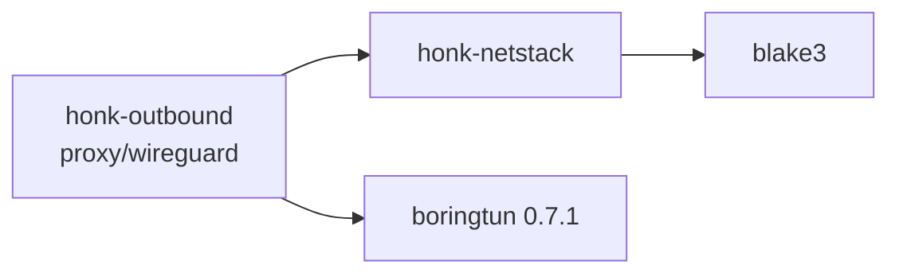

# 用户态网络栈与 WireGuard 隧道

`honk-netstack` 是 sans-I/O 的 IPv4/IPv6 TCP/UDP 栈。`Mode::Endpoint` 仍是 WireGuard 的默认客户端行为；`Mode::Transparent` 提供被动 TCP、无状态 UDP、有界重组和 ICMP 生成。core packet-endpoint 嵌入和显式配置的 [XDP daemon 后端](./datapath.md#full-xdp-启动)使用它；Stack API 本身不授予抓包或原生续行权威。除非另有说明，本页描述未改变的 Endpoint 行为。与其他用户态子系统一样，这些代码主要由 AI 编写，仍须维护者审查。

出站侧的行为（注册表、流、失败归因）在下文从栈的角度概述，规范见[出站设计](./outbound.md#wireguard-隧道)。节点字段和分享链接见[节点参考](../reference/nodes.md)。

## Crate 边界

- `honk-netstack` 只依赖 `blake3` 和 `thiserror`，`publish = false`，禁止 `unsafe`。outbound、datapath 和 core 依赖它；它不知道节点、Tokio 或 socket。固定版本 `smoltcp` 仅作为开发测试基线。
- 它从不读取时钟、环境变量或配置文件。调用方提供 `Instant`、接口地址和 MTU、32 字节私有 secret 以及内存上限（`Config`）。默认值：MTU 1420、4096 个流、256 MiB 内存、每流 8 MiB 接收缓冲和 6 MiB 发送缓冲、`Mode::Endpoint`；透明模式的字段见[配置与计数器](#配置与计数器)。
- `wire` 公开 IPv4/IPv6/TCP/UDP/ICMP 编解码和校验和；`transit` 仅为路由器暴露已有的预算计费重组器和带抑制/限速的 ICMP 生成器，不创建 TCP/UDP 端点。

## 编程模型

栈由唯一的 owner 通过 `&mut Stack` 驱动，没有锁或无界队列。TCP 待发义务一直保留在流上，直到被拉取；有界的控制回复和分片队列遵守下文所列限制。只有 owner 拉取时才物化为报文（quinn-proto 模型）。

| 调用 | 约定 |
| --- | --- |
| `receive(now, packet) -> Rx` | 借用一个完整 IP 包并验证校验和（`RxMeta::VERIFY`）。需要保留的 TCP 字节会复制进栈自有的环。UDP 返回 `Rx::Datagram`（Endpoint）或 `Rx::Transparent`（透明模式）：**返回的范围只在调用方复用或回收输入 buffer 之前有效**。`Rx::TransparentOwned` 自带重组后的包。`Rx::Dropped(reason)` 会被计数。 |
| `receive_with(now, packet, RxMeta) -> Rx` | 在透明模式下附带可信的 TCP/UDP 校验和来源和/或 GRO/USO 元数据。Endpoint 模式将 `RxMeta::VERIFY` 之外的元数据以 `Unsupported` 丢弃；WireGuard 不能跳过验证。见[校验和信任](#校验和信任)和[分段卸载](#分段卸载)。 |
| `receive_with_source(now, packet, callback) -> (Rx, Option<ValidatedSource>)` | 复用同一 parser/reassembler/checksum 路径，仅当前完成验证的 TCP/UDP 包返回 `{src, dst, protocol, tcp_flags}`；TCP flags 是已校验的首部事实，不是准入证明。callback 先于协议状态变更/UDP 分发执行；false 以 `NotForUs` 丢弃。即使被拒绝，receipt 仍只是有效性事实，**不是**握手、交付或内核 accepted-child 证明。未完成/无效分片、坏校验和均无 receipt。 |
| `poll_transmit(now, out) -> Option<usize>` | 把一个完整 IP 包写入 `out[..n]`。`out` 过小时返回 `None` 且不丢包。`None` 也表示 cwnd、rwnd 或 pacing 当前不允许发送。 |
| `poll_transmit_with(now, out, TxCaps) -> Option<Transmit>` | 同一调度器，在透明模式下可选用 TCP 分段卸载；返回 `len`、`gso`、`csum` 和已知 TCP 输出的原始 `flow` 句柄，无状态或未知流输出的 `flow` 为 `None`。Endpoint 模式忽略卸载能力。`poll_transmit` 是使用 `TxCaps::NONE` 的普通包封装，会丢弃这些元数据。 |
| `poll_control_transmit(now, out)` | 复用 TCP emitter，但不发送 TCP/UDP 载荷；保留普通 readiness、DRR 和载荷 TLP 义务，允许符合协议条件的 ACK/RST/SYN/FIN/探测、TIME_WAIT ACK 和 ICMP。调用前须取得控制 frame/descriptor credit。 |
| `poll_timeout()` / `handle_timeout(now)` | 所有流或重组中最早的 deadline；条目可能已过期，因此提前唤醒是合法的。 |
| `poll_event()` | 合并后的 `Ready` 位（`CONNECTED`、`READABLE`、`WRITABLE`、`READ_CLOSED`、`ERROR`）；每个流在事件链表上最多出现一次。 |
| `tcp_retained(id)` | 原始 TCP 句柄仍在本 Stack 持有应用/协议状态、紧凑 TIME_WAIT 或排队控制回复时为 true；不包含已经交给 driver 的输出包。 |
| `take_tx_wakeup()` | 由 `tcp_write`、`tcp_shutdown`、`tcp_close`、`tcp_abort`、`tcp_connect`、`tcp_accept`、`tcp_complete`、`tcp_refuse`、产生 ACK 义务的 `tcp_read`，以及留下待发分片的 `udp_send_from` 置位。返回 true 时调用方必须唤醒 owner。 |
| `tcp_*`、`udp_*` | 语义同 `write(2)`：用 `WouldBlock` 代替阻塞，`tcp_read` 返回 `Ok(0)` 为 EOF，终止错误具有粘性，并在缓冲数据读完之后才返回。`FlowId` 带 generation，过期 id 返回 `Stale`，绝不会命中新占用者。 |

同一个接收批次（最多 64 个包）内的所有 `receive` 必须传入同一个入口时间戳，避免 RTT、RACK 和自动调优把处理延迟当作网络延迟。

### 输出调度

`poll_transmit` 按五个类别轮转服务，并跨调用记住轮转位置，因此没有哪一类会饿死其他类：

1. **控制回复**：对未知流的包回复 RST。队列容量 128，满了就丢弃并计数（`control_dropped`），语义上等同链路丢包。透明模式下，被拒绝 SYN 的 ICMP 错误也走这个队列。
2. **TIME_WAIT 回复**（对重传 FIN 或旧的重复数据的 ACK），按位合并在条目上，不会丢失。
3. **就绪的 TCP 流**，按 deficit round robin 调度，quantum 为一个 MTU。同一个流内 ACK 和重传先于新数据。
4. **排队的 UDP 分片**：`udp_send_from` 发送超长数据报时剩余的分片（透明模式），按 FIFO 输出。
5. **ICMP Time Exceeded**：重组超时产生（透明模式）。

流的回复义务是位（`DATA`、`OOO`、`WINDOW_UPDATE`、`PROBE_RESPONSE`、`CHALLENGE`、`FIN_ACK`），而不是通过“`rcv_nxt` 是否前移”推断，因为窗口更新、零窗口探测响应和 challenge ACK 都不推进 `rcv_nxt`。所以调用方停止拉取不会丢失任何义务，这本身就是背压。

仅控制拉取使用独立、惰性分配的 ready 队列和类别游标，不能轮转普通 readiness 或消耗其 DRR credit。适配器还须提供普通拉取，才能推进载荷。显式 core packet runtime 轮换优先输出类别，每次拉取前先预留该类别的 frame 和 descriptor。从不使用仅控制拉取的调用方（包括 WireGuard）不会分配该队列。

RACK 记账扩容无法获得预算时，只延后该流：保留待重传义务和原有 DRR credit，其他已有预算的 TCP 流及排队 UDP 分片仍可发送。输出 buffer 太小仍是独立的 blocked-output 结果。

### 定时器

每个流给出 RTO/persist、延迟 ACK、tail loss probe、RACK reorder、pacing 和关闭 deadline 的最小值。全局最小堆中每个流最多一个有效条目：只有 deadline 提前时才 push；推迟则沿用旧条目，弹出时重新检查。改变流状态的调用把堆刷新请求合并到标记列表（至多 64 个不同槽位），在处理定时器前或向已满列表加入另一槽位前刷新。`poll_timeout` 同时直接计算被标记流的 deadline，因此延后刷新不会导致晚醒。堆超过流 slab 大小的两倍（至少 32 项）时整体重建；上限跟随 slab，因为重建要遍历每个槽位。TIME_WAIT 过期使用同一个堆。

## 报文处理

- 解析带选项的 IPv4 头；IPv6 扩展头（hop-by-hop、routing、destination options，最多八个）会被跳过，带剩余段的 routing 头为 `Unsupported`。巨型载荷、ESP/AH 和未知协议为 `Unsupported`。Endpoint 模式下，IPv4 和 IPv6 分片在头校验和之后被丢弃（`Fragment`）：**没有重组，也没有分片**；透明模式会重组分片并对超长 UDP 回复做分片（见[重组](#重组)）。IP 长度之外的链路层填充被忽略。
- 普通出站 IPv4 包设置 DF、TTL/hop limit 为 64，不带选项；透明模式的 `udp_send_from`/`udp_send_gso_from` 不设置 DF，IPv6 UDP 分片会添加 Fragment 头。
- Endpoint 模式下，目的地址不是本族已配置本地地址的包为 `NotForUs`。没有本地地址的地址族完全不可用（`NoLocalAddress`）。透明模式改为接受任意单播目的地址（见[范围与寻址](#范围与寻址)）。
- `StackStats` 按原因计数丢包：`Malformed`、`Checksum`、`Fragment`、`NotForUs`、`NoFlow`、`Unsupported`，透明模式下还有 `HalfOpen` 和 `Capacity`。（`Stale` 已定义但从未产生。）
- **普通接收在两种模式下都验证校验和**（IPv4 头、TCP、UDP、ICMP），且发生在流状态变化之前。IPv4 UDP 校验和为 0 表示没有；IPv6 UDP 为 0 在验证路径上无效。只有透明模式的 `receive_with` 才能信任 driver 的 TCP/UDP `Csum::Valid`/`Partial`；IPv4 头、ICMP 和重组后的数据报仍然验证。Endpoint 模式拒绝此类元数据，所以 WireGuard 总会验证内层包：它认证的是隧道对端，而不是发送方的 inner 校验和。完整发送输出先复制载荷，再使用本机字节序的并行累加道计算校验和；卸载输出改为携带部分校验和（见[校验和信任](#校验和信任)）。
- UDP 按其声明长度校验，该长度可以小于 IP payload；尾随的 IP 字节不属于 UDP 数据或校验和，但 Core 转发仍保留这些 IP 字节。连续与 scatter/gather 输入使用同一边界。
- **ICMP 在两种模式下都会被消费，只有透明模式才发送。** packet-too-big（RFC 1191/8201）或 destination-unreachable 仅在报文地址族与流一致、且被引用的 TCP 序号落在未确认窗口内时才生效：PTB 降低该流的路径 MTU（只减不增），并让所有变得过大的段重新可发，包括已按旧尺寸重传过的段；`SYN_SENT` 流收到 unreachable 时 connect 以 `Unreachable` 失败。不带 MTU 的旧式 PTB 使用 RFC 1191 plateau 表。ICMP echo 和其他 ICMP 一律忽略。Endpoint 模式下栈从不生成 ICMP；生成见 [ICMP 生成](#icmp-生成)。
- **Endpoint 模式的 UDP** 没有接收队列，也没有发送队列。发往未绑定端口的数据报为 `NoFlow`（不发 ICMP 错误）。`udp_send` 直接把一个 IP 包序列化进调用方的 buffer；超过 MTU 的数据报返回 `TooLarge`。透明 UDP 是无状态的，见[透明 UDP](#透明-udp)。

## TCP

### 连接模型

Endpoint 模式只支持主动打开：`tcp_connect` 用 RFC 6056 算法 3 选择源端口（对本地/远端地址和远端端口做 keyed hash，再加每个 bucket 的计数器，范围 32768..65535），ISN 取 keyed hash（RFC 6528）加 4 µs 时钟，并为每个地址对使用稳定的时间戳偏移（RFC 6191）。secret 来自 `Config::secret`（blake3 keyed hash）。Endpoint 模式**没有 listen API**；未知四元组的 SYN 会得到 RST；同时打开（simultaneous open）已处理。被动打开只存在于透明模式（[TCP 接纳](#tcp-接纳)）。

每个 SYN 都提供 MSS（MTU − 40/60）、窗口缩放（shift 根据 `tcp_rcv_buf_max` 一次选定，最大 14）、SACK-permitted 和时间戳；只有对端回显的选项才会启用。缺失对端 MSS 时默认 536（IPv4）或 1220（IPv6），并至少提升到 48（Linux `tcp_min_snd_mss`），恶意服务器无法换取逐字节发包。每个线上数据段的载荷不超过 `min(对端 MSS, PMTU − IP 头 − 该段的 TCP 头)`，按包计算，因为时间戳加 SACK block 会让 TCP 头增长到 60 字节；TSO super-packet 在一个头部之后聚合多个这样的段。

校验：RFC 5961（RST 只在恰好等于 `rcv_nxt` 时生效，否则回 challenge ACK；已同步状态下收到 SYN 回 challenge ACK；challenge ACK 每流每 100 ms 至多一个）、24 天截止的 PAWS、可接受 ACK 的窗口检查。

### 关闭与生命周期

- `tcp_shutdown` 只关闭写半边。`tcp_close` 立即释放应用句柄，由协议继续完成（排队数据之后发 FIN）；**带未读数据关闭，或处于 `SYN_RECEIVED` 时关闭，会发 RST**，与 Linux 一致。处于 `FIN_WAIT_2` 的孤儿流有 60 秒超时。
- TIME_WAIT 与应用句柄分离。流保留 slab 槽（环、就绪位），直到应用读完所有数据并关闭句柄、最后一个 ACK 已发出；之后才压缩为不占 chunk 的小表项 `{tuple, snd_nxt, rcv_nxt, ts_recent, expiry, ack_due}`，持续 60 秒。收到合法的重传 FIN 时回 ACK 并重启计时；旧的重复数据段只回 ACK（[关闭语义](#关闭语义)）。到同一四元组的新连接只有在 RFC 6191 的时间戳与序号比较证明对端能区分两个化身时才可复用该表项，否则继续搜索端口（最多 32768 个候选，之后 `AddrInUse`）。哪一方保留 TIME_WAIT，以及透明模式的 SYN 如何重开四元组，见[关闭语义](#关闭语义)。
- 终止错误：`Reset`、`TimedOut`（6 次 SYN 重传、15 次连续 RTO 退避、连续 15 次无 ACK 应答的零窗口探测、孤儿超时，或对启用了 keepalive 的透明模式已接受流，keepalive 探测无应答）和 `Unreachable`。TCP keepalive 默认关闭，只有 `AcceptOpts::keepalive` 设置后才启用（[Keepalive](#keepalive)）。

`tcp_state(id) == None` 只表示应用不可见，不表示已经退休。只读的 `tcp_retained(id)` 使用压缩前的原始句柄，TCB 消失后排队的 RST/ICMP 拒绝回复也继续算作保留义务。driver 先保存每个返回包的 `Transmit::flow`，再检查保留状态，避免把最后一个包归给复用该四元组的新流。查询为 false 后，适配层仍须完成设备 buffer、producer、任务及 scoped incarnation 的回收证明，才能删除投递状态。其他 Stack 的 `FlowId` 或一次 CQ 完成都不能替代该证明。generation 耗尽后槽位永久停止复用，不回绕。

### 接收侧

- **SACK/DSACK。** 乱序数据直接写到接收环内对应偏移。区间表最多记录 32 段；若某个段会产生第 33 段，则丢弃并计数（`ooo_drops`）。ACK 带时间戳时最多 3 个 SACK block（不带时 4 个），最近变化的 block 排第一，其余轮转；收到重复数据时第一个 block 是 DSACK。未协商 SACK 时，每个乱序段各回一个重复 ACK。
- **ACK 策略。** 连接开始后或空闲超过一个 RTO 之后的前 16 个段立即确认（quickack）；之后在两个满尺寸段未确认、乱序或填洞、窗口更新、FIN 时发送 ACK。否则运行 40 ms 延迟 ACK 定时器。读取使零窗口重开，或使右沿前移至少 2 MSS 时发送窗口更新。TCP GRO run 按其代表的帧数推进这套节奏，但只产生累计 ACK 义务，不会逐段重放 ACK（[分段卸载](#分段卸载)）。
- **窗口自动调优（DRS）。** 每个测得的接收 RTT，目标窗口取 `2 × 应用读走的字节数 + 16 × MSS`，只增不减，上限为 `tcp_rcv_buf_max`。窗口增长在通告之前先从内存池承诺（见下一节）。

### 发送侧

- **丢包检测：** SACK 对端使用 RACK-TLP（RFC 8985）：按发送时间排序检测，对从未重传的描述符用序号游标，对重传使用惰性 FIFO；自适应 reorder 窗口从 min RTT/4 起，随乱序增长并衰减；reorder 定时器；约 2·SRTT 的 tail loss probe（只有一个段在途时再加 200 ms）。不支持 SACK 的对端使用 NewReno（RFC 6582）。恢复期间新发送、恢复结束时仍丢失的数据会开启新的拥塞事件（Linux `tcp_time_to_recover`）。
- **减窗与撤销：** PRR（RFC 6937，SSRB 变体）；伪恢复通过 DSACK、时间戳回显（Eifel）或 F-RTO 撤销。
- **RTO：** RFC 6298 估计器，以微秒计，下限 200 ms（与 Linux 相同的有意偏离），上限 120 s，初始 1 s，指数退避，SYN 重传的退避不会带入第一个数据超时。超时保留已 SACK 的数据为已交付，只把其余标记为丢失；仅当队首本身已被 SACK（reneging）时才丢弃全部 SACK 状态，因此 F-RTO 只会撤销“从未 SACK、从未重传的数据被确认”的超时，并在无新数据可发时回退到常规恢复。零窗口下仍有在途数据时，超时重传队首；只有无在途数据时才发送 persist 探测。
- **拥塞控制：** 定点 CUBIC（RFC 9438），不使用浮点，配合 HyStart++（RFC 9406）。初始窗口 `min(10·MSS, max(2·MSS, 14600))`；从最后一个数据段起空闲超过一个 RTO 后恢复写入时，窗口（及 HyStart++ 状态）重置为初始值。控制器位于 `Cc` 枚举之后；Reno 变体只用于参照测试。
- **pacing：** 令牌桶，慢启动 2.0 × cwnd/SRTT，之后 1.2 × cwnd/SRTT；通常突发 10 个段，但不超过 2 ms 的流量，且至少 1 个段。TSO 可以增大桶的段数，但仍受 2 ms 上限约束。下一次放行时刻是流的 deadline 之一。
- **计分板：** 每个已发送段一个描述符（结束序号、发送时间、SACKED/LOST/RETRANS 标志、速率采样字段）。`packets_out`、`sacked`、`lost`、`retrans` 字节计数增量维护，debug 构建下每个 ACK 之后与从头重算的结果断言相等。每个 ACK 按 draft-cheng-iccrg 采样 delivery rate，跟踪 app-limited，并通过 `TcpStats` 报告。
- **发送缓冲。** `tcp_write` 复制进发送环；被接受的字节由栈负责，直到被累计 ACK（SACK 过的数据不会释放，因为对端可能 renege）。记 `chunk = Config::chunk()`，缓冲上限随窗口变化：`min(max(2 × cwnd, 4 × chunk), 限制后的 tcp_snd_buf_max)`，剩余空间至少为 `min(chunk, 上限的一半)` 且池或环尾有空间时报告 `WRITABLE`。Endpoint 默认 16 KiB chunk 下，仍是原来的 64 KiB 下限和 16 KiB 就绪阈值。

零窗口处理（persist 探测）、窗口更新恢复和 `snd_wl1/snd_wl2` 窗口跟踪遵循 RFC 9293。探测间隔翻倍直至 120 s，只在窗口打开时复位；使窗口保持关闭的 ACK 只复位重试计数（连续 15 次无应答的探测仍会使流失败），不复位间隔。与接收窗口有重叠的段即被接受，已记录的 FIN 之后的数据不被接受。

## 内存模型

载荷存储是 chunk 池，每个 TCP 流有两个环（发送、接收），另加发送描述符。`Config::tcp_chunk` 默认为 `None`：Endpoint 模式 16 KiB，透明模式 4 KiB。显式大小限制在 4..=64 KiB；`Config::chunk()` 返回实际大小。

- **进展保底。** 每个已接纳的 TCP 流无论全局压力如何，都有权持有 1 个发送 chunk、1 个接收 chunk 和 16 个描述符槽。保底预先预留：`floor_flows = min(max_flows, memory_limit / 保底大小)`，`memory_limit` 扣除保底后的余量是共享池。没有剩余保底时 `tcp_connect` 返回 `Memory`，达到 `max_flows` 时返回 `FlowLimit`；`max_flows` 同时统计 UDP 关联。保底防止这样的死锁：窗口占满整个池，使 `tcp_write` 没有空间，而对端恰恰在等这个请求。
- **承诺。** 保底之外的接收窗口空间在通告之前先从共享池*承诺*，而 chunk 在数据到达时惰性分配。因此窗口内的数据不会因缺少内存被丢弃。栈记住曾通告的最大右沿且从不收回；窗口缩放取整只会把线上值向下取整，绝不超过承诺。初始接收目标是 `min(65535, 限制后的 tcp_rcv_buf_max)`，而不是一个 chunk：共享空间足够时，通告窗口会承诺多于保底的空间，即使流已空闲且没有驻留的载荷 chunk。
- **诚实计账。** 预算按 chunk 容量（和描述符存储）计费，而非逻辑字节。`StackStats.memory_committed` 为已用保底加共享 TCP 承诺；`memory_allocated` 是实际驻留的 chunk 和描述符存储，加上池缓存的空闲 chunk。只要有 chunk 在用，缓存最多保留 64 个（一次突发写入及其 ACK 从缓存取还，不经过分配器）；没有 chunk 在用时只留一个备用，所以空闲栈的 `memory_allocated` 至多一个 chunk。这两个值只覆盖 TCP 池，不含重组或排队的 UDP；配置共享预算时，`MemoryBudget::used()` 还包括重组、排队的超时引用报文和待发 UDP 数据报的容量计费。
- **空闲流。** 保底是计账上的保证，而不是驻留内存。环变空（接收环已读完且没有乱序数据，发送环已被全部确认）就把所有 chunk 还给池；没有在途数据时，描述符存储（包括保底部分）也被释放。下一次写入或到达的段再从池缓存取，所以保底永远不会无法兑现。乱序区间表、chunk 列表桩和定时器堆在变空或变稀疏时同样收缩。空闲的已建立流保留 `Tcb`（有大小断言，不超过 1 KiB）、slab 槽、流表桶、定时器项和 chunk 列表桩。`tests/idle_footprint.rs` 在 1000 条已建立流重复请求/响应后按分配器取整统计堆占用，要求最多保留一个共享缓存 chunk，且每流不超过 1.5 KiB。紧凑 TIME_WAIT 表项不占 chunk。
- **进程共享预算。** `Config::shared_budget`（`Option<Arc<MemoryBudget>>`，`MemoryBudget::new(limit_bytes)`、`limit()`、`used()`）让多个栈在各自 `memory_limit` 之外共用一个上限。保底在接纳时计入（预算无法支付时 `tcp_connect` 返回 `Memory`），每次共享 chunk 或描述符承诺也在栈内池计费的同一路径上计入；流结束退还其保底，丢弃 `Stack` 退还其仍持有的全部份额。在预算下被接纳的流保有自己的保底，因此预算耗尽时仍能前进。预算无锁（每次 chunk 粒度的计费一次原子更新），不做 I/O。
- 每流缓冲上限被限制在一个 chunk 到 1 GiB 之间，使序号运算保持模运算安全。

### 计账构造与保留报文

`Stack::new_accounted(cfg, now, max_slots)` 要求 `cfg.shared_budget`，并在构造前预留保守的容量上界。缺预算、算术溢出和容量不足分别返回 `ConstructionError`。`max_slots` 包括活动、空闲、TIME_WAIT 和代际耗尽的槽位；新接纳失败不能删除旧墓碑。`set_accepting(false)` 只关闭新的被动接纳，包括重组后出现的 SYN；既有流和协议输出继续推进。

`overhead_reserved()` 表示预留容量，不是实测驻留字节或 RSS。它覆盖元数据、集合扩容/rehash 峰值及保留缓存/临时容量；动态载荷、ring 索引和 RACK 承诺使用同一预算。计账 scope 需要同时容纳该预留量和已接纳载荷承诺；普通 `Stack::new` 与 WireGuard 默认值不变。

`MemoryBudget::reserve` 返回不可 Clone 的 `MemoryReservation`。完整/atomic 重组在源存储仍计费时预留目标副本；`OwnedPacket` 让字节及其计费一起保留到消费者释放，即使 Stack 已销毁。容量不足只丢弃该数据报，不删除已建立流的所有权证据。借用的 UDP 范围仍须在输入回收前消费或复制。

## Core packet-endpoint 嵌入

`honk-datapath` 提供不回绕的 `ScopeId` 和固定 frame/descriptor 账本，不授予抓包或路由权威。`control::netstack::PacketScope` 持有一个计账 Stack、一把互斥锁、有界 frame/waiter 和须由外层 join 的 timer owner。输出 lease 保留原始 TCP `FlowId`、字节和 credit，直到真实消费者释放。本地归还不是 NIC CQ，CQ 地址也没有虚构的 generation；控制与 bulk 各有预留。

AF_XDP TX 仍逐包立即发布。具体的同步设备轮次只把逐包 NEED_WAKEUP 检查合并到轮次出口，独立发送仍立即 kick。每个正常出口保留工作错误和最终 kick 错误，批次不跨 await。panic 只关闭准入，不在析构中执行 I/O 或释放已发布 owner；这些 owner 只能由真实 CQ 归还。

`control::packet_endpoint::PacketEndpoints` 消费未启动的控制面及共享同一预算的显式 scopes。supervisor 会 join scope、TCP、UDP 和退休工作；取消 shutdown 等待者不会取消已接纳清理。TCP 复用既有路由/dial/Score 路径，采用 copy relay，不伪造内核接纳或 splice。UDP 复用同一个 endpoint/source pool 和捕获的 packet reply sender，不占 reply FD。endpoint/source/foreign-reply/sniffer 键均包含 scope；packet 退休不能修改碰巧相同的内核状态。DNS 仍先执行流量策略，must/Block 保持终端性。

已接受的 packet DNS 应答写入同一 scope 的 canonical [路由投影](./dns.md#路由投影)，新建数值目标的 TCP/UDP 流无需嗅探名称即可消费这些事实。它们不授予 HOST/内核投影权威。

正常关闭在共享准入边界立即启动协议 abort，然后才等待正在执行的 selector 精确退休。应用关闭以及已导出/CQ 持有输出的实际释放仍必须完成；命令完成或空 scope owner 退出都不能伪造这些释放。

`PacketScope::receive_with_source` 在既有输出互斥锁内调用 source callback；callback
不得重入该 scope 或阻塞 I/O。设备可先安装当前包的 reverse L2 关联，再让输出
消费者继续；关联冲突则在协议状态变更前拒绝。`PacketEndpoints` 传递这个精确
receipt，不从 `poll_accept` 推导来源，因为它可能取出更早的 pending SYN。
UDP queue/capacity 错误保持不变：callback 能报告有效来源事实，但随后的 UDP work
仍可能因容量不足失败。旧 receive API 使用编译期禁用 reporting 的路径，没有
reporting 分配，也不维护跨调用的“上一个包”状态。

启动先打开 scope 准入，再报告 Endpoint supervisor 就绪；非 XDP 嵌入仍在该提交点发布 native `Running`。显式 XDP owner 只有在全部真实 capture gate 激活后才调用 `PacketEndpoints::capture_ready()`，同一个 supervisor 等到该通知才发布 native `Running`。启动失败须等待 supervisor 清理后才返回。关闭保留第一次 UDP 排空结果，不能把强制取消报告为优雅成功。清理超过五秒只告警，不释放所有权，也不承诺硬性完成期限。条目元数据计费保留到精确退休完成，任务分配及 buffer credit 保留到 join；下一次入口复制计费前先回收已完成的 UDP 任务。健康回调只观察 UDP pool，不延长其生命周期。

单个连接任务 panic 只终止该 TCP 流，不停止其他 packet 服务。TCP 任务接纳先回收已完成工作，确实无法接纳时显式 reset 该流。周期 UDP 维护也会在空闲期间 join 已完成任务并返还 credit。关闭入口后仍须等待此前预留的 producer permit，处置其迟到消息，再 join scope owner；只关闭 receiver 不能证明此后不会再收到 `FlowIo`。

就绪提交与取消使用原子竞争；关闭先于该提交时不能激活 native `Running`，scope 闸门也不能在关闭后重新打开。任务账本按弹性准入上界预留，而不只按初始保底。账本异常析构会将子任务和计费转交给原 runtime 上预先计费的 reaper；即使析构阻塞或错误载荷析构 panic，也不能提前退还另一个存活任务的 credit。嵌入方须让该 runtime 存活到清理完成。

Packet TCP 写半关闭会等待握手完成，不把暂时的 `WouldBlock` 变成 reset。flush 仍是本地 no-op，不承诺 ACK 或交付，但 scope 显式 abort 后会失败。raw/非 DNS UDP/53 的 endpoint 身份包含初始 outbound/mark 和最终性：改变判决不能复用旧 transport，而非最终 fallback 仍保留配置允许的嗅探。有效的非 must DNS 继续走控制器，must 保持固定 raw 路径。

所给预算统计 packet 存储/预留，不是全进程 RSS，也不代表既有 outbound runtime 的全部分配均已计入；内核 socket buffer 另算。该入口是显式 Endpoint 路径，**不是**原生转发、抓包 metadata 校验、生产后端发布门禁或性能结果。

### 实验性 AF_XDP 消费端

`honk-xsk` 提供 Linux XDP link/program 与 AF_XDP ring 原语；`honk-core`
的 `xsk_endpoint` example 将其接入 `PacketEndpoints`，不是 daemon 后端或生产配置项。
固定 fixture 只覆盖一个 IPv4 TCP 或 UDP tuple、一个实测发现的队列、无 VLAN 的以太网及 MTU 1500。
DISCOVER 丢弃测试流量，DATA 的 redirect 失败动作也是 DROP。分片及 IPv4 options
在声明的地址/protocol 域内统一丢弃，因此该域必须由实验独占。
Direct 仍是实际 socket relay，不是原生续行。PF0 强制 zero-copy；显式 copy 模式
仅允许 virtme guest 中的 `dut0` 虚拟接口 fixture，绝不自动回退。

设备 owner 先观察 FILL 消费再接纳 RX，消费借用的 IP 字节后才回收 frame，
并将每个 core output lease 保留到实际 CQ 归还。
`PacketScope::poll_output_class` 在只有控制 credit 时允许控制输出越过排队的 bulk，
保留各类别内部顺序。RX 的 IP slice 排除以太网 padding，TX padding 单独计入 frame。
core 关闭与设备排空并行进行；CQ 是资源归还，不证明对端收到。
supervisor 必须保留 native link，并在 detach 前停止独立上游，消费者失败时也一样。

UMEM 映射和预算计费一直保留到进程退出。socket close 或 ring 为空均不能证明
延迟 pool 释放或 DMA 静止；这不是生产释放栅栏，也不承诺进程内关闭后零常驻。
硬件 zero-copy、完整 X0 验收、TC A/B、多队列、SG/offload 和原生续行仍须分别提供执行证据。

### 显式 routed-only CoreForward

`honk-datapath::forward::CoreForward` 是安全的 sans-I/O transit owner，不经过
`Stack::receive`，也不是 Direct socket relay。Linux 的
`honk-core::control::core_forward::RoutedCore` 复用 canonical Router 和已有的
router/config 发布屏障。routed-only fixture 使用 `execution: "routed-only"` 和
`nat: false`；daemon 使用 `MixedEndpoints`，可启用独立编译的 firewall/NAT。
原生续行、必须经过内核 firewall/qdisc 及 skb classification 的要求仍不支持。
routed-only 策略只允许 `dial_mode: ip`、无 mark 的 `direct`/`block`；
不兼容 reload 保留原 generation。

`ControlPlane::core_forward_policy(Execution)` 在 `PacketEndpoints` 消费 plane 前
返回窄化的注册 `RoutingAuthority`；两者保留同一已发布 router/config，不另建策略
owner。显式 `MixedEndpoints` profile 仅接纳 IP 模式且不依赖 domain、pname、MAC
或 mark 的策略。普通最终 Direct 动作进入 Core；非 must DNS53 和 group 动作把
原计费包交给 Endpoint，Block 仍终结。需要未决 TCP/domain 事实的策略应显式选择
Endpoint，不能把要求 Core 的 Direct 静默降成 relay。

Core 和 Endpoint 复用既有 Rule/Global/Direct mode override，包括 native typed
target 和 must/Block 终端优先级。Core 的 `PolicyGeneration` 同时捕获 routing
generation 与不回绕的 mode revision；submit 把 router/config/mode 读锁持有到
实际 writer 完成。mode 的 ABA 变化不能重新授权排队输出，拒绝后只处置、不重放。
借用缓存路径对普通 Global 判决返回 Cold，不在没有判决所有权时发出 Endpoint
handoff。Core transport 跨 traffic-class 变化和精确 reverse ingress 保留执行
owner，但保留关系不能覆盖当前 Block。firewall binding 保留独立的
security/address authority；路由或 mode 变化不会把已准入的 transit 字节
重放进新建 Stack。

`Decision::Endpoint` 携带计费的 `EndpointAdmission`，保存实际路由 action、config、
group/runtime handle 和生效 mode 判决。capture consumer 将其传给
`PacketEndpoints::receive_admitted_with_source`。UDP 随 datagram 排队同一个 authority；
TCP 在 scope 互斥锁内将其绑定到 `Stack::receive_with_tcp_admission` 返回的当前
新建 `FlowId`，先绑定再唤醒输出。重传保留原 authority，`poll_accept` 只移交已经
绑定的精确 incarnation。延迟 dispatch 不按新 config 重路由，也不重新应用新 mode。
pending snapshot 的预算计费保留到消费或精确流处置，没有跨调用的“上一个包”快照。

capture consumer 在选择 Core 前（包含重组完成时）查询
`PacketEndpoints::retains(scope, source, destination, protocol)`。这只是只读分类，
不替代 checksum 校验。既有 Stack TCP tuple、TIME_WAIT、flow-owned control 和
packet runtime 排队/已导出的输出均保留 Endpoint 执行权。ICMP 错误在 Core 选择前
按引用的 TCP owner 分派，checksum、family 和未确认序号仍由 Stack 验证。
普通非 53 UDP 先预留 Initializing owner，再发布到独立有界 initializer channel；
runtime-mutating command 等待 reload 时清理被取消的 lease，其他 TCP/DNS 工作
保留原 FIFO。Initializing、Ready 和 Retiring 都保留 scoped tuple，mode 变化
不能同时建立第二个 Core owner。

控制器 DNS53 仍按 query 接纳，不是 transport flow：排队/已接纳 query 保留各自
捕获的判决，后续新的 must/direct query 可以选择 Core。实际预留 UDP transport 的
raw/group/must DNS53 则使用既有 pool entry 的正常保留所有权。不会把控制器 query
合并成一个 transport lease，也不添加另一张 conntrack 表。

回复路径保留还覆盖待处理 DNS、shared-source receiver 尾部、Stack control/分片及
排队/已导出输出。source callback 在既有 scope mutex 内检查 CPU 待发输出，不能
重入该 scope。已导出的包保存完整 VLAN TCI，不再读取后来的 peer priority。
正常 command 回复仍是真实结果；致命设备错误时，对外回执可先终止，但在途工作与
CQ 资源继续被持有。已接受 reload 丢失 supervisor handoff 仍须 fail-closed，不能
与普通 HTTP 请求断连混淆，也不能据此重放配置工作。

一个 Core owner 覆盖整个 namespace/routing domain 和注册的所有逻辑 ingress。
同一逻辑入口的所有队列共用已有重组器；输入 identity 保留真实 logical ifindex 和
attachment，不只依靠共同 ScopeId。flow directory 和内存预算跨入口共享。
`Packet::rewrite` 保留原存储计费，转换或校验失败后禁止提交，仅成功时刷新 tuple。

缓存路径接受借用的 `wire::PacketView` segments，复用 IP/传输 codec 和流式校验和，
仅暂存有界首部。`ForwardView` 与计费 `ForwardPacket` 共用同一 writer：adapter
先预留整个 TX chain，再通过 `write_next_segments` 直接写入这些 segments，包括
调用方提供的真实 L2 framing。借用路径的 CQ lease 只保留 slow-flow owner，不分配
完整 staging Packet。冷 FIB 等待或分片存储可以保留必要计费副本；没有热路径便利性
线性化或第二套重组器。下方固定 example 仍限无 VLAN IPv4；SG 设备证据属于 full-XDP
消费者，不能由此 fixture 代替。

Ingress 分别携带 scope、实际 socket namespace cookie、逻辑 ifindex、attachment
identity 和 mark provenance。未知 mark 拒绝，绝不代换为零；`BeforeSkb` 显式声明
部署不依赖 skb classifier。namespace-bound provider 在有界 route/rule/link/address/
neighbor/nexthop/netconf dump 前先订阅，真正发送包含 `RTA_IIF`、源/目的地址、TOS、
protocol、ports、已证明 mark 的 input `RTM_GETROUTE`，transit 不伪造 UID。RPDB
由内核执行，不镜像规则；MTU、forwarding 开关和 neighbor MAC 来自真实回复。
缺 neighbor 时通过 `NTF_USE` 请求内核 ARP/ND，绝不编造 MAC。事件使全部 route
lease 失效；ENOBUFS、截断/畸形消息、dump interruption、迟到回复或同步上限耗尽
均关闭 provider。一秒 lease 上限也触发重新同步，授权不无限缓存。冷 miss 的有界
同步 netlink 工作必须由独立 owner 执行，不属于逐包热路径。实际提交时在既有发布
读锁下同时复核 FIB 和策略 generation。
组播通知以 `NETLINK_PKTINFO` 判别，不假定 sequence 为零。合法 blackhole
仅丢弃当前包；经不可用逻辑链路的路由，以及 Core 无法执行的封装或多路径路由，同样
只丢弃匹配的包，不会使 provider 失同步。route lease 丢失只重试或抑制相应工作。IPv6 重复 preferred-source
属性必须一致。地址 epoch 与 route/neighbor 刷新独立，普通重新同步不会撤销
MASQUERADE binding。

两种 IP 地址族都在 flow admission 前验证包与传输校验和，复用已计费重组器，
保留原 TCP/UDP/ICMP 字节，仅在物化输出时把 TTL/hop limit 减一。IPv4 无 DF 时按
出口 MTU 分片；IPv4 DF 和普通 IPv6 返回 fragmentation-needed/PTB。
完成的 IPv6 重组保留原 fragment ID 与最大接收分片长度；该长度不超过出口
MTU 时恢复对齐分片，目标大小遵循 Linux 至少 1280、再受出口 MTU 限制的边界，
否则返回 PTB。未分片的 IPv6 不能凭空获得分片权威。TTL 错误是 code 0，
公开的重组超时 quote 是 code 1；ICMP 使用路由器真实本地地址、共用抑制/限速以及
独立的内核 local-output route query。LocalInput 不等于转发许可，example 将其丢弃。
Core TCP 执行保留到空闲 7440 秒，UDP 为 120 秒，其他流量 60 秒；有输出 lease
时继续持有。未经窗口验证的 FIN/RST 不能缩短保护。过期后的非 SYN TCP 包不能
创建新 Endpoint 或伪造反向 RST；新 initial SYN 可创建新 incarnation。
FIB 变化不升级成原生转发，排队包截止时间仍为两秒。

转发邻居未解析时仍可取得路由权威和 MTU，已知 hop-limit/超 MTU 错误不等待
这个不需要的邻居。生成错误仍需独立 local-output 路由、回程邻居，以及同步本地
地址 snapshot 中同族且满足 transit 单播条件的 `RTA_PREFSRC`；无效或缺失的源
证明仅抑制该错误。input FIB prohibit 可授权 AdminProhibited，LocalInput/blackhole
则不授予转发权。TCP RST 与 ICMP error 不触发另一份 refusal。

设备 timer 使用至少 1280 字节的已计费控制输出存储调用
`poll_reassembly_error(now, out)`。返回 `GeneratedError` 携带真实返回 route、策略
generation 和输出长度；此 owner 必须保留到 CQ 或显式本地丢弃，而不是仅到提交。
已导出 timeout quote 只保留匹配的 scoped NAT/native-history 域，不全局冻结回收。
未解析 neighbor 至多占一个 quote 等待槽，保留原始两秒 deadline；每次最多退役
64 个受抑制或策略拒绝的 quote。启用 firewall 时，timeout 必须有实际引用的
ports、可信 ingress role 和 original-chain Allow；截断 quote
绝不创建或续期 conntrack。真实 input unicast/source FIB 证明先于独立 local-output
返回查询。Core 引用至多 20 字节**连续已收到的**传输首部以保留 TCP RST flags，
不会把 hole 的零填充值当作真实字节；缺少 flags 时抑制错误。普通 Stack 的超时
quote 仍保持八字节。

Core 执行拒绝需路由器处理的 IPv4 options、不支持的 IPv6 extension 语义、
非零 IPv6 flow label、bridge/VRF/bond 执行和 route encapsulation。
限制在处置判决之后、FIB/NAT/Reject 工作之前检查；Endpoint 不继承 Core 专用
限制。Linux 6.12 的 [IPv6 getroute 实现](https://github.com/torvalds/linux/blob/v6.12/net/ipv6/route.c#L6030-L6095)
不能表达非零输入 flow label，Core 不会偷偷查询另一条 flow。普通以太网和至多
两层已配置 802.1Q/802.1ad VLAN 分开保留 logical iif 与 physical egress；
不支持的 VLAN QoS/binding 语义或无法恢复的 RX stripping 在准入时拒绝。
窄化 example 仍是无标签 fixture；daemon 才是通用设备消费者，不代表 X1 或 DMA 释放验收。

#### 隔离 VM smoke 入口（此处未执行）

构建 `cargo build -p honk-core --example xsk_core_forward`，仅在已配置 virtme guest
的新 network namespace 中运行 `xsk_core_forward run.json`。外部 supervisor 独占
client–DUT–server 拓扑、地址、forwarding sysctl、路由、两个单 RX queue veth
`dut0`/`dut1` 及独立 TCP/UDP peers。MTU 为 1500、无 VLAN，不依赖 firewall/qdisc/
NAT，使用普通无 mark input route。收到两条 `attached` 后，必须保留两份 link FD
副本再发送纯文本行 `armed`；只有 `ready` 后才能发送流量。先停止两侧 generator，
再发 `close`；要求 `closed`、CQ 排空及独立对端的端到端证据，最后发 `exit`。
失败时也必须先停 peers，再释放 link 或销毁 namespace。UMEM 与 `xsk_endpoint`
一样计费至进程退出。

严格 JSON 字段为 `requirements`（上述六项）、`policy`（dae 文件）、
`root_netns_inode`（supervisor 根 namespace）、`devices`（恰好两个对象，包含
`ifname`、`ifindex`、六字节整数数组 `mac`/`peer_mac`）、`client`/`service`
（`IPv4:port`）、`protocol`（`tcp` 或 `udp`）、`budget_bytes`（如 67108864）。
双向路径均使用真实 XSK RX/TX 和内核 FIB；MockEbpfBackend 仅用于不启动无关 TC relay。

必需证据：独立 payload 交换、原 tuple 保持、TTL 恰好减一、正确 Ethernet next-hop、
TTL=1 ICMP、较小出口 MTU 的 DF 开/关、空 neighbor 下 ARP 解析、输出排队期间
route/rule/link/address/MTU/neighbor 变化、不支持部署拒绝、不兼容 reload 保留原
generation，以及 receive loss/dump/迟到回复注入后 fail-closed。
纯回归为 `cargo test -p honk-datapath --test forward`；还需
`cargo test -p honk-core core_forward`、`cargo test -p honk-core netlink::fib`、
`cargo test -p honk-netstack`、`just outbound-ci` 和隔离真实内核 gate。
fixture 只抓 IPv4，不能作为 IPv6 设备收发验证。

## 透明终结

`Config::mode = Mode::Transparent { exclude }` 让栈成为客户端目的地址的 TCP/UDP 端点。报文脚本、模拟器、fuzz、core 嵌入与显式 XDP daemon 使用它，WireGuard 仍采用默认 `Mode::Endpoint`。相同的内存、拥塞控制、恢复和单 owner 规则继续适用；不声称透明模式性能门禁或吞吐数字。

### 范围与寻址

- 流的本地端是报文的原始目的地址，因此所有回复（SYN-ACK、数据、RST、ICMP 错误、UDP）都以它为源。入站包不与 `local_v4`/`local_v6` 比对，栈会把 MTU 至少提升到 1280。
- `ExcludeSet`（`insert(addr, prefix_len)`）列出栈以 `NotForUs` 拒绝的目的前缀。它只是兜底：driver 前面的分类/抓包后端才是真正的闸门，在这里被丢弃的包对该客户端是黑洞。
- 组播、受限广播和未指定目的地址（tun 设备自身的路由器请求、MLD 和 DAD）以 `Unsupported` 静默丢弃。
- IPv4-mapped IPv6 源或目的地址不是合法的透明线上端点；完整包和重组准入前都以 `Unsupported` 拒绝，不能借此挤掉有效分片状态。
- 源地址不是单播、源与目的地址相同，或端口为 0 的 SYN 不会开流，像其他游离段一样回 RST。

### TCP 接纳

未知四元组的普通 SYN 会创建一个处于 `SYN_RECEIVED` 的待定流，且不发送任何内容；流在未决定或被延迟期间忽略所有输入，所以重传的 SYN 被吸收，不会产生第二个流或第二次上报。待定流已持有内存保底，但尚未承诺接收窗口；窗口由 `tcp_accept` 承诺。

| 调用 | 约定 |
| --- | --- |
| `poll_accept() -> Option<SynInfo>` | 每个新流上报一次：`id`、`client`、`original_dst`、客户端的 `mss`（缺失时 536 或 1220，至少 48）、`wscale`、`sack`、`timestamps`。 |
| `tcp_accept(id, AcceptOpts)` | `when: AcceptWhen::Now` 排队发送 SYN-ACK；`AcceptWhen::Deferred { deadline }` 持有 SYN-ACK 直到 `tcp_complete`（上游拨号之后）；若 `deadline` 先到，流以 `TimedOut` 失败且不发送任何内容。`max_mss` 在两个方向上限制 MSS（下限 48）；应使用客户端真实的出口 MTU，tun 的 MTU 不能说明它。`keepalive` 启用 [Keepalive](#keepalive)。默认值（`AcceptOpts::default()`）：`Now`、不限制、无 keepalive。流已死亡时返回该流的错误（例如 `TimedOut`），已决定过则返回 `Closed`，旧句柄返回 `Stale`。 |
| `tcp_complete(id)` | 放行被延迟流的 SYN-ACK。流不在被持有状态时返回 `Closed`。 |
| `tcp_refuse(id, Refuse)` | 在 `poll_transmit` 真正输出被动 SYN-ACK 之前有效，包括 `tcp_accept(Now)` 或 `tcp_complete` 之后，以及因 buffer 过小而未能输出之后（输出后和主动打开的流上被忽略，改用 `tcp_abort`）。遗忘该流并释放句柄。`Refuse::Rst` 回 RST\|ACK，`Drop` 什么也不回，`IcmpUnreachable` 回 host unreachable，`IcmpAdminProhibited` 回 administratively prohibited（见 [ICMP 生成](#icmp-生成)）。RST 和 ICMP 回复经过容量 128 的控制队列。 |

`MAX_DEFERRED` 为 25 秒，使栈先于边缘 classifier 自己 30 秒的交接过期放弃。`poll_accept` 从未上报的 SYN 在到达 25 秒后被静默遗忘（客户端会重试）；已上报或被延迟、但到截止时间（不晚于 SYN 之后 25 秒）仍未被接受或完成的流，以 `TimedOut` 失败且不发送任何内容，并产生 `ERROR`，应用仍须关闭自己的句柄。

接纳限制：

- **半开上限。** 流从 SYN 起到握手完成或流死亡为止是半开的。`Config::half_open_max`（默认 1024）限制总数，`Config::half_open_per_source`（默认 128）限制每个客户端地址。超出上限的 SYN 被丢弃并计数（`DropReason::HalfOpen`）：从不回 RST 或 ICMP，也没有 SYN cookie。由于每个待定流已持有保底，这些上限同时也限制了 SYN 洪泛能钉住的内存。
- **流与内存限制。** 流表（`max_flows`）、保底上限，或内存保底与共享预算无法接纳的 SYN 被丢弃并计数（`DropReason::Capacity`），不予应答，客户端会重试。

### 关闭语义

- 先关闭的一方（主动关闭，含同时关闭）经 `FIN_WAIT_1`/`FIN_WAIT_2`/`CLOSING` 进入 TIME_WAIT，保留 60 秒的紧凑墓碑表项（RFC 9293）。后关闭的一方走 `LAST_ACK` 到 `CLOSED`，不保留任何东西。由于先关闭者总会保留 TIME_WAIT，服务端的 TIME_WAIT 绝不会被跳过。
- 墓碑对合法的重传 FIN 回 ACK 并重启 60 秒计时。完全位于已消费 FIN 之前的数据段（带 ACK，允许 PSH，无 SYN/RST/FIN，ACK 号与时间戳通过与 FIN 相同的检查）可能是对端在我方最终 ACK 丢失后重传其未确认的尾部：它只换来一个合并的 ACK，使对端离开 `CLOSING`。接收该数据不重置过期时间，也不更新 `ts_recent`。既有的待发送义务仍有效：处理过期时若 ACK 尚未输出，计时器会重新延后 60 秒而非丢弃待发输出，因此 driver 必须继续拉取。其他段被忽略。同一四元组的新 SYN 只有在 RFC 6191 检查通过时才会取代墓碑：其时间戳比最后一次见到的更新，或在没有可用时间戳时，其序号超出旧的 `rcv_nxt`；时间戳更旧的 SYN 被视为游离的重复包并被忽略。新流的 ISS 被强制置于旧 `snd_nxt` 之后。
- **Driver 约定。** 该表项在最后一次 FIN 交换之后至少在栈内存活 60 秒。这段时间内 driver 必须继续把该四元组的包送给 `receive`：栈前面的任何投递状态（eBPF redirect 表项、流表）都必须比流活得更久，否则客户端重传的 FIN 会到达真实服务器而不是墓碑，并被回以 RST。`StackStats::timewait_entries` 统计存活的墓碑。

### 透明 UDP

- `receive` 对数据报返回 `Rx::Transparent { src, dst, payload }`：没有流、没有 bind，两端地址都在其中。`payload` 是输入包中的范围。
- `Rx::TransparentOwned { src, dst, packet, payload }` 对应由分片重组出的数据报：返回值拥有 `packet`，`payload` 索引它。
- `receive_with` 对包含多个数据报的 UDP super-packet 返回 `Rx::TransparentSplit { src, dst, payload, size }`。遍历 `packet[payload].chunks(usize::from(size))`：每个 chunk 是一个数据报，最后一个可较短，必须保留这些边界。最多接受 128 个数据报（`MAX_USO_RX`），超出为 `Malformed`。至多包含一个数据报的 run 改为返回 `Rx::Transparent`。
- **借用载荷的生命周期。** `Rx::Datagram`、`Rx::Transparent` 和 `Rx::TransparentSplit` 的范围只在调用方回收或复用输入 buffer 之前有效。输入 buffer 是 TUN 读缓冲（或将来归还给 fill ring 的 AF_XDP UMEM 帧）的 driver，必须在释放 buffer 之前消费或复制每一份载荷。`TransparentOwned` 没有这个限制。
- `udp_send_from(src, dst, payload, out)` 无状态，可使用任意源地址（回复以数据报的原始目的地址为源）。不超过 MTU 的数据报作为一个包写入 `out`（无 DF，设置 identification）。更大的数据报，UDP 长度至多 65535 字节（IPv4 总长度同理，超出返回 `TooLarge`），会被分片：第一个分片写入 `out`，其余是栈内状态（已算好校验和的数据报，只复制一次），通过 `poll_transmit` 每次调用输出一个分片，按 FIFO；存在待发分片时 `take_tx_wakeup()` 置位。待发数据报容量上限 512 KiB，并计入 `Config::shared_budget`，第一个排队的数据报也不例外。发送若会超出任一上限，在写出首分片之前返回 `Busy`。输出 buffer 过小时费用继续保留，直到最后一个分片输出或栈被丢弃；初次调用的 `out` 过小则返回 `BufferTooSmall`，不产生费用。地址族不一致为 `FamilyMismatch`。
- `udp_send_gso_from((src, dst), payload, size, caps, out)` 以 UDP 分段卸载发送一组数据报，而不是做 IP 分片。它返回 `Transmit`；上限和 driver 约定见[分段卸载](#分段卸载)。
- `udp_refuse(now, UdpRefuse, original, out)` 用 ICMP 回应被拒绝的数据报（`PortUnreachable`、`HostUnreachable`、`AdminProhibited`）；`original` 是该数据报的 IP 包。`Ok(None)` 表示错误被抑制或被限速。

### 重组

透明模式重组任意协议的 IPv4 和 IPv6 分片；Endpoint 模式仍然丢弃分片。任何分片占用条目或预算之前，都会先检查目的地址排除集和特殊地址，因此被排除的分片不会产生超时回复。重组完成的数据报重新进入常规接收路径，因此目的地址过滤和校验和对它同样生效。完成后的 IPv6 数据报若仍含 Fragment 头（包括藏在其他扩展头之后），则以 `Fragment` 丢弃，绝不再次重组。

- `FragmentLimits`（`Config::fragment_limits`）默认值：`max_entries` 64，`max_bytes` 4 MiB（载荷存储、分片 0 保存的头部、区间表和排队的超时引用报文的实际保留容量，另加每个数据报 256 B 的固定簿记开销），`max_holes` 32，`timeout` 30 秒，从数据报的第一个分片起算。
- 重叠分片（包括完全相同的重复分片）会终结该数据报（RFC 5722、RFC 8200 第 4.5 节）：buffer 立即释放，一个无 buffer 的墓碑吸收其余分片（`Fragment`）直到超时。空洞多于 `max_holes`，或长度不一致，同样终结数据报。空分片、长度不是 8 的倍数的非末尾分片，以及超过 64 KiB 的数据报为 `Malformed`。原子分片作为完整数据报交付（RFC 6946）。
- 重组保留任意分片上的 CE；Not-ECT 与具备 ECN 能力的分片混合时，按普通终结路径留下墓碑。DSCP 及没有 CE 时的 ECN codepoint 取自分片零，IPv6 flow label 不变；原子 IPv6 分片独立保留自己的首部。
- `Transit::reassemble` 在接收时也执行原始重组 deadline，即使调用者尚未轮询 timer。恰在或超过 deadline 的片不能完成旧数据报；已保留的超时 quote 独立持有其资源。
- 表或 `max_bytes` 耗尽时，最旧的数据报被静默驱逐，因此洪泛的首分片无法饿死能够完成的突发。
- 超时仅当分片 0 已到达时才回 ICMP Time Exceeded（IPv4 type 11 code 1，IPv6 type 3 code 1）；引用内容是保存的头部加至多 8 字节，在入队前截断到 548 字节（IPv4）或 1232 字节（IPv6）。最多 16 个这样的错误等待 `poll_transmit`；`poll_timeout` 和 `handle_timeout` 覆盖重组 deadline。
- **共享预算。** 重组字节计入 `Config::shared_budget`（不计入栈自己的 `memory_limit`；没有预算时只受 `FragmentLimits` 限制）。计费被拒绝时驱逐最旧的数据报并重试；没有可驱逐的数据报时丢弃该分片：若它会开启新数据报，丢弃为 `DropReason::Capacity`；若是唯一剩下的现有数据报无法增长，则终结该数据报（`Fragment`）。完成、驱逐、终结和栈被丢弃时退还存储费用；超时则将保留引用报文的实际容量费用转移给待发队列，直到发出、被抑制、被限速或丢弃。输出 buffer 过小时费用继续保留。因此，分片洪泛最多可占用共享预算中的 `FragmentLimits::max_bytes`，而新流也是按同一个预算接纳的：请为此留出余量，否则洪泛期间 SYN 会以 `Capacity` 被丢弃。

### ICMP 生成

只有透明模式的路径会生成错误：`Refuse::IcmpUnreachable`/`IcmpAdminProhibited`、`udp_refuse`、`packet_too_big(now, mtu, original, out)` 以及重组超时。Endpoint 模式下栈自己从不生成 ICMP。（`udp_refuse` 和 `packet_too_big` 不检查模式，它们是为透明 driver 准备的。）错误以原始目的地址为源，发往原始源地址。

| 拒绝类型 | IPv4（type/code） | IPv6（type/code） |
| --- | --- | --- |
| `UdpRefuse::PortUnreachable` | 3/3 | 1/4 |
| host unreachable（`Refuse::IcmpUnreachable`、`UdpRefuse::HostUnreachable`） | 3/1 | 1/3 |
| administratively prohibited（`Refuse::IcmpAdminProhibited`、`UdpRefuse::AdminProhibited`） | 3/13 | 1/1（RFC 4443 第 3.1 节） |
| 重组超时 | 11/1 | 3/1 |
| `packet_too_big` | 3/4（MTU 在低 16 位，上限 65535） | 2/0 |

- **抑制**（不发错误，也不消耗限速额度）：原始包是非首分片、源或目的地址为未指定/组播/广播、本身就是 ICMP 错误（IPv4 type 3、4、5、11、12 以及大于 18；IPv6 type 小于 128）或不带 type 字节的 ICMP 包，或引用内容无法解析。IPv6 检查会继续遍历首个 Fragment 头之后的扩展头；若再次出现 Fragment 头，或截断导致无法检查上层协议/type，同样抑制错误。
- **大小。** 整个错误包不超过 576 字节（IPv4）或 1280 字节（IPv6）；对原始包的引用被截断以适应。
- **限速**（`IcmpLimits`，Linux 风格）：全局桶每秒 `per_sec` 1000 条、`burst` 50；按目标（原始源地址）的桶每 `target_interval`（1 秒）一条，突发 `target_burst` 6 个间隔，记住 `max_targets` 128 个目标（替换最久未用者）。两者都同意才扣费。Packet-too-big 豁免，与 Linux 一致。
- 输出 buffer 过小时所有限速器保持不变，调用可以重试。

### Keepalive

`Keepalive { idle, interval, probes }` 通过 `AcceptOpts::keepalive` 按流设置，默认关闭；主动打开的流没有相应 API。它在握手完成时启动。对端每一个被接受的段都会重启空闲计时和探测计数。静默 `idle` 之后，栈每隔 `interval` 发送一个序号为 `snd_una - 1` 的空 ACK；连续 `probes`（至少 1）个探测无应答、并再过一个 `interval` 之后，流以 `TimedOut` 失败。它在 `SYN_RECEIVED`、`TIME_WAIT`、`CLOSED` 状态下不启用，失败或 abort 后停止。

### 校验和信任

`receive(now, packet)` 在所有模式下都是仅验证的入口，等同于 `receive_with(now, packet, RxMeta::VERIFY)`。`receive_with` 只在 `Mode::Transparent` 下接受拥有本地设备的 driver 提供的 `RxMeta { csum, gso }`。在 `Mode::Endpoint` 下，`RxMeta::VERIFY` 以外的元数据在处理报文之前就以 `Unsupported` 丢弃：WireGuard 无法选择受信任的校验和或 super-packet，因为它的内层包来自网络。

- `Csum::Verify` 正常验证 TCP/UDP 校验和。`Csum::Valid` 信任设备已经验证过它。`Csum::Partial { start, offset }` 接受本地 `CHECKSUM_PARTIAL` 报文，其字段只有伪首部和，没有可供验证的最终校验和；`start` 必须是 L4 头偏移，`offset` 必须指向其中的校验和字段（TCP 16，UDP 6），否则报文为 `Malformed`。
- IPv4 头校验和和每个 ICMP 校验和总会被验证。分片元数据不为重组后的数据报担保：完成后以 `RxMeta::VERIFY` 重新进入接收路径。分片或 ICMP 包上的 GSO 元数据为 `Malformed`。
- `gso: Some(GsoRx { kind, size })` 描述一个头部之后每段 `size` 字节的载荷（最后一段可较短）。`size` 必须非零，`GsoKind::Tcp`/`UdpL4` 必须与报文协议一致，否则为 `Malformed`。

### 分段卸载

- **TCP RX（GRO）。** `receive_with` 把 TCP super-packet 作为一个连续段接收。延迟 ACK 和 quickack 节奏按 `ceil(被接受的载荷长度 / size)` 个帧计数，不会把头部当成多个 TCP 输入重放。该 run 只产生一个受正常 ACK 时序约束的累计 ACK 义务，而不是一串可能触发伪丢包恢复的重复 ACK。UDP RX 改为通过 `Rx::TransparentSplit` 暴露数据报边界（[透明 UDP](#透明-udp)）。
- **TCP TX（TSO）。** `poll_transmit_with(now, out, TxCaps { tso4, tso6, uso4, uso6 })` 只在透明模式下使用按地址族的 `tso4`/`tso6` 能力。TCP 数据可作为 `GsoKind::Tcp` super-packet 输出，分段大小按 MSS/PMTU，最后一段可较短。当前 emitter 把含头部的聚合包限制在 65535 字节和 `out.len()` 内；拥塞与接收窗口、描述符空间、pacing 令牌和约 1 ms pacing 速率的自动定长进一步限制它。pacing 突发仍不超过 2 ms 流量（至少一个段）。每个被代表的段保留自己的发送描述符；连续丢失的段可以作为一个 TSO 包重传。输出 buffer 较小时退化为普通包；SYN、纯 ACK、控制回复、TIME_WAIT 回复、ICMP 和排队的 UDP IP 分片仍是普通包。Endpoint 模式忽略所有 `TxCaps`；`TxCaps::NONE`（也是默认值）与 `poll_transmit` 输出相同。
- **UDP TX（USO）。** `udp_send_gso_from((src, dst), payload, size, caps, out)` 把 `payload` 当作连续数据报，在透明模式下使用该地址族的 `uso4`/`uso6` 能力。每个 super-packet 至多 64 个数据报（`MAX_USO_TX`）；每个 `size` 字节数据报加 IP/UDP 头必须装进 MTU，聚合 UDP 长度（IPv4 总长度同理）必须装进 65535。大小为零或超出大小/数量上限为 `TooLarge`；地址族不一致为 `FamilyMismatch`；多数据报 run 缺少透明模式或对应能力时为 `Offload`。载荷至多 `size` 字节时，即使无对应能力也使用普通 `udp_send_from`，包括其分片与唤醒行为。整个 super-packet 直接写入 `out`，不排队；buffer 过小为 `BufferTooSmall`，所有错误都不消耗任何东西。
- **TX 描述符与 driver 约定。** `Transmit { len, gso, csum, flow }` 描述 `out[..len]`；`flow` 具有上文的 Stack 局部生命周期含义。普通包带 `gso: None` 和 `TxCsum::Full`。卸载包带 `GsoTx { kind, size, hdr_len }`（IP 加 L4 头长度）和 `TxCsum::Partial { start, offset }`：校验和字段包含整个 super-packet L4 长度的未取反伪首部和。driver 必须把此元数据交给有能力的内核/设备，由其分段并完成每段的头部/校验和，不能把聚合包当普通线上包发出。不支持 `TUN_F_TSO_ECN`。目前没有实现此约定的 TUN 或 AF_XDP driver。

### 内存与 chunk 大小

`Config::tcp_chunk: Option<usize>` 选择 TCP 池的 chunk 大小。`None` 表示 `Mode::Endpoint` 下 16 KiB，`Mode::Transparent` 下 4 KiB；显式值经 `Config::chunk()` 限制在 4096..=65536 字节。保底是 `2 × chunk + 16 × size_of::<Descriptor>()`（Endpoint 默认约 33 KiB，透明默认约 9 KiB）。chunk 粒度的承诺、从不后退的通告右沿和空闲释放，其余均遵循[内存模型](#内存模型)。

**保底不是空闲流的总承诺。** 只收到 SYN 的待定流仅预留保底；`tcp_accept`（包括延迟接纳）随后承诺初始接收窗口。目标起始为 `min(65535, 限制后的 tcp_rcv_buf_max)`，在可用共享空间内，按保底 RX chunk 之外的整 chunk 计费。例如接收缓冲上限为 1 MiB 时，初始目标仍是 65535 字节，而不是 4 KiB。已接受的空闲流即使没有驻留载荷 chunk，其保留的预算承诺也可能显著多于约 9 KiB 的接纳保底。不要仅用预算除以保底来决定进程预算或承诺流数：还要计入接收窗口承诺、TX/描述符和重组，并观察 `StackStats` 与 `MemoryBudget::used()`。

### 配置与计数器

| `Config` 字段 | 默认值 | 含义 |
| --- | --- | --- |
| `mode` | `Mode::Endpoint` | 栈为谁应答。 |
| `half_open_max` | 1024 | 透明：半开流总数。 |
| `half_open_per_source` | 128 | 透明：每个客户端地址的半开流数。 |
| `icmp_limits` | `IcmpLimits::default()` | 透明：ICMP 生成限制。 |
| `fragment_limits` | `FragmentLimits::default()` | 透明：重组限制。 |
| `shared_budget` | `None` | 所有模式；透明模式的重组也计入其中。 |
| `tcp_chunk` | `None` | 两种模式：默认 Endpoint 16 KiB / 透明 4 KiB；显式值 4..=64 KiB；`Config::chunk()` 返回实际大小。 |

`StackStats` 包含 `drops`（按 `DropReason`，现含 `HalfOpen` 和 `Capacity`）、`half_open`（SYN 到握手结束之间的流数）、`timewait_entries`、`control_dropped`、`rx_packets`、`tx_packets`、`flows`、`memory_committed` 和 `memory_allocated`。RX/TX 包计数统计传入/输出的包，一个 super-packet 算一个，而不是它代表的线上段数。重组和 ICMP 的计数器是内部的，不导出。

## 尚未实现

以下内容目前不在 `crates/honk-netstack/src` 中，或不在仓库中；这份清单就是本页论断的边界。

- TUN、netmap 和 Windows 后端不在当前实现范围。Linux XDP daemon 已有配置入口，但实现不代表生产或硬件验收通过。
- eBPF/TC 一侧：classifier 的投递位、把流导向栈的 steering、必须比 TIME_WAIT 活得更久的投递状态（[关闭语义](#关闭语义)），以及在 TC 层代理非首分片。
- ICMP 代理：在客户端与真实上游之间转发 echo 或错误。栈只会针对未确认的 TCP 序号消费 ICMP，并生成上文列出的错误。
- 透明模式的任何性能门槛或实测数字。

## Driver 约定（WireGuard）

driver 位于 `honk-outbound/src/proxy/wireguard/`；规范在[出站设计](./outbound.md#wireguard-隧道)，此处只写对栈有约束的部分。

- **所有权。** 每条隧道一把 `Mutex<Inner { Stack, Tunn, .. }>`。应用流（TCP 的 `FlowIo`、UDP 的 `WgUdpTransport`）直接加锁调用 `tcp_read`/`tcp_write`/`udp_send`；其余全部由唯一的 owner 任务完成（outer 接收、解密、`receive`、`poll_transmit`、加密、outer 发送、定时器）。每次应用调用之后，由 `take_tx_wakeup()` 决定是否经 `Notify` 通知 owner；`Notify` 会存一个 permit，所以 owner 开始等待之前发出的通知不会丢失。没有数据的读者在 owner 发布就绪状态时持有的同一把锁内登记 waker，所以两者之间不存在丢失唤醒的窗口。
- **批处理。** owner 每次持锁最多处理 64 个包（收发两个方向相同），每次持锁取一次 `Instant`（即接收批次中每个 ≤64 包的片段一次），该次持锁内所有 `receive` 共用；每个发送轮次最多拉取 64 个包，并加密进一个最多容纳 256 个数据报的 buffer。outer socket 使用带 GRO 的 `recvmmsg`，并把等长密文组成 GSO 发送。
- **拷贝。** 满尺寸段在每个方向上被复制三次（应用 ↔ 环、环 ↔ 明文 buffer、boringtun 自己的 `src → dst`）。稳态每包不分配（`tests/alloc_free.rs` 在批量收发期间统计分配）；scratch、输出和接收 buffer 都被复用。在途数据完全排空的流会释放描述符存储，下一次突发需要重新增长，每次突发几次分配，而不是每包一次。
- **注册表与空闲回收。** 隧道注册表对每个（本地私钥，peer 公钥，端点主机，端点端口）恰好保留一条活动隧道，因为同密钥、同 peer 的两个会话会使彼此的握手失效；不同端点共用的密钥对各有隧道。注册表归一个 control plane 的 runtime 各代所有（重载后继代、DNS fork 与冷探测继承它），所以同一进程中的两个 plane 绝不共享或关闭对方的隧道；不带 runtime 的拨号共用一个无人关闭的进程级注册表。设置相同的 runtime 共享活动隧道；同一密钥与端点的不同设置会替换它，并以 `RuntimeClosed` 关闭其流（不是节点失败）。owner 任务属于注册表而不是节点的 task owner，在失败、被替换、该 plane 的 `shutdown_wireguard_tunnels`（其终止流程 join 它）、最后一个使用它的 runtime 关闭且没有可承载数据的流时（立即），或 120 秒无流且无 warm 持有者时结束。warm 保留持有隧道（计数，因此重新装入同一隧道不丢失钉住），最后一次释放会撤销持有但不切断流。进程内存份额被划分为固定的每隧道切片并限制活动隧道数（见规模）。
- **DNS fork 共享（偏离）。** DNS fork runtime 通常拥有全新的协议状态；WireGuard 则与业务 runtime 共用隧道（该 plane 的注册表），因为第二个会话会把它顶掉。runtime 关闭只终止它自己打开的流（`RuntimeClosed`）。
- **Reserved 字节。** WARP 风格的 reserved 字节在加密之后写入每个出站数据报的第 1–3 字节，并在解密之前对每个入站数据报清零；Noise MAC 从不覆盖它们。
- **Allowed IPs（单 peer）。** 拨号或 UDP 关联的目标若在 `wg_allowed_ips` 之外（或所在地址族没有隧道地址），会在发出任何包之前被拒绝；之后对其他不被允许目的地的 UDP 发送是 `Policy` 拒绝；源地址在其之外的入站 inner 包在进入栈之前被丢弃。列表被聚合为有序、不相交的网络并用二分查找。目标始终是数字地址，目标域名不会在远端解析。Allowed IPs 不用于在多个 peer 之间选择，因为 peer 只有一个。
- **Endpoint。** 所有解析出的地址都是候选（地址族交替；双栈 IPv6 socket 以映射地址承载 IPv4 peer）。会话建立之前 initiation 在 1 秒与再过 2 秒后重发（刻意偏离 boringtun 首次重试在 5 秒，使一个丢失的数据报不会让 3 秒拨号失败），每次发往下一个候选，之后沿用 boringtun 的 5 秒节奏。握手尝试超时会让下一次获取重新解析域名。来自新源地址并通过认证的数据报会移动 outer endpoint（roaming）；cookie reply 不算认证。
- **UDP。** 每个已准备的 source 一个栈 socket，服务所有目的地（`MultiTargetTransport`）；收到的数据报复制进容量 256 的有界队列，溢出按 socket 缓冲区语义丢弃。confirmed 发送只有在 owner 把数据报交给 socket 之后才完成。
- **错误归因。** 对 SYN 的 inner RST 或 ICMP unreachable，以及 allowed IPs 之外或所属 IP 族没有隧道地址的目标（TCP 拨号或打开 UDP 关联，在任何握手之前拒绝），是目标失败。SYN 超时仅当对端在拨号期间送达过其他 inner 包时才是目标失败，否则保持为无类型超时，Score 按节点保守处理。握手预算耗尽的等待者得到节点失败，同一次尝试上的等待者共享它，但隧道本身不失败；存在流时 boringtun 会话过期以及 owner 任务意外结束，会让隧道对所有等待者失败一次（同一个共享节点失败事件）。认证失败的数据报被静默丢弃（没有失败阈值：源地址可伪造）。本地耗尽（`FlowLimit`、`Memory`、`AddrInUse`）是 `Capacity` 拒绝。隧道被其所有者关闭（runtime 关闭、设置被替换、进程关闭）时，流以 `RuntimeClosed` 失败，它不是节点失败。handler 自身不报告 Score 或健康。

## 验证

- 单元测试位于 `honk-netstack/src/` 各模块旁。`tests/tcp_receive.rs`、`tcp_send.rs`、`tcp_recovery.rs` 是确定性报文脚本：只通过公开 API 驱动脚本化对端，并精确比对输出段。
- `tests/sim/` 是确定性链路模拟器（种子化的延迟、iid 与 Gilbert-Elliott 丢包、乱序、重复、限速和 drop-tail 队列），连接 honk↔honk 或 honk↔固定版本 smoltcp 0.14.0。`sim_honk.rs` 检查 1% 丢包、IPv6 与多流下字节恰好一次按序交付并完成，每次只拉 1 个包与不限量拉取交付相同的流，撤销由链路乱序引起的伪恢复，以及修复既无 SACK 也无重组的对端；`sim_baseline.rs` 刻画 smoltcp，并测试模拟器本身（包括拉取预算恢复）。debug 构建下计分板在每次修改后重算（计数、描述符顺序、游标和被记住的 SACK 区间），且每次调用后 `Tcb::check` 会把它与 `snd_una`/`snd_nxt` 对账。两个 `#[ignore]` 网格会打印对比表（`cargo test -p honk-netstack --test sim_honk -- --ignored --nocapture`）。
- 透明模式：`tests/transparent_tcp.rs` 是报文脚本套件（接纳、延迟接纳及其 25 秒过期、重传 SYN、拒绝及其 ICMP code、半开与容量丢弃、MSS 限制、keepalive、主动对被动关闭、墓碑处的迟到 FIN、RFC 6191 重开、范围与排除、UDP 与分片）。`tests/sim_transparent.rs` 在虚拟时间里让 honk 和 smoltcp 客户端对接 honk 终结器（`tests/sim/honk_server.rs`），覆盖丢包、IPv6、多流以及延迟接纳期间的 SYN 重传。`tests/sim_termination.rs` 增加 honk 对 honk 的端到端用例：关闭顺序矩阵、墓碑处的迟到 FIN，以及在较小共享预算下的多流与 soak；透明模拟器测试断言所有流、墓碑、半开计数与内存计费最终归零。`benches/stack.rs` 的透明用例在 endpoint 用例旁报告逐包开销。
- Offload：`tests/offload_rx.rs` 覆盖校验和来源、Endpoint 隔离、TCP GRO ACK 节奏/OOO/SACK/PAWS 与 UDP 分割；`offload_tx.rs` 对照独立内核模型检查 TSO/USO 分段与部分校验和、窗口/pacing/描述符边界、重传及普通输出等价性；`offload_memory.rs` 覆盖按模式的 chunk、保底、承诺与空闲释放；`offload_e2e.rs` 在有无丢包下连接 TX 与 RX 卸载路径。`benches/stack.rs` 有用于透明 TCP GRO/TSO 的 `OFFLOAD` 开关（默认 false）；吞吐单位仍统计被代表的线上段，而不是 super-packet。这些是进程内测试与微基准，不是设备或实验室证据。
- `honk-outbound/src/proxy/wireguard/tests/` 对独立的进程内 peer 运行 driver（回环 UDP 上的 boringtun `Tunn`，后面是 smoltcp 接口）。
- `fuzz/` 有三个 libFuzzer 目标：`netstack_packet`（任意字节，可选修复长度和校验和，送入有七种状态流的栈的 `receive`）、`netstack_schedule`（按字节解码的操作序列：构造的对端段、应用调用、时间推进、拉取预算 0/1/N 和 ICMP）和 `netstack_transparent`（透明栈上的 SYN 与重传 SYN、立即与延迟接纳、拒绝、握手 ACK、数据、FIN/RST、keepalive、时间推进以及原始/UDP 包）。三者都来自 `honk-netstack` 的 `fuzz-checks` feature，也作为 `tests/fuzz_replay.rs` 在 stable 上回放已提交的种子和已保存的崩溃产物。断言：不 panic、输出有界且格式正确、每次操作后整栈重算（`Stack::check`）、定时器不会遗留已过期 deadline、全部关闭后归还所有池占用且所有流结束。`cargo bench -p honk-netstack --bench stack` 报告接收+ACK、批量发送、SACK 处理和透明用例的每包纳秒数。
- 真实网络的实验室工具和结果只放在 `bench` 分支。截至目前 `main` 上没有 honk 臂的结果记录，所以本页没有任何吞吐、丢包恢复或 CPU 结论属于实测。

## 已知限制与缺口

| 范围 | 限制 |
| --- | --- |
| IP | Endpoint 模式：无分片与重组（分片被丢弃，超长 UDP 为 `TooLarge`），不生成 ICMP。透明模式在 `FragmentLimits` 内重组并保留 IP ECN，对 UDP 回复分片，至多 64 KiB。发送不带 IPv4 选项。 |
| TCP | listen/accept 仅在透明模式，由显式 XDP daemon 使用。accepted-flow keepalive 可选；无 urgent-data API、TCP Fast Open、ECN 协商或 PLPMTUD，仅 CUBIC。未知 TCP options 被忽略，格式错误的长度终止 option 解析。 |
| 接收 | 每流最多 32 个乱序区间；ACK 拉伸受 64 包接收批次限制。 |
| 规模 | 空闲的已建立流约占 1.4 KiB 堆（无 chunk）；每条隧道 4096 个流，每条被接纳的流从进程预算预留约 33 KiB 的 floor；预算即份额（默认 256 MiB，honk 取内存的 1/8，限制在 64 MiB..4 GiB），所有隧道的栈共同使用，64 MiB / 256 MiB / 1 GiB 下仅 floor 约可容纳 2,000 / 8,000 / 32,000 条流；活动隧道数由其固定开销限制，`share / 4 MiB`，夹在 1..128；`max_flows` 统计 UDP 关联；每条隧道一把锁、一个 owner 任务，因此单条隧道受限于一个核。 |
| WireGuard | 每条隧道恰好一个 peer；无入站连接；IPv4 与 IPv6 各自需要配置隧道地址；endpoint 域名只在握手尝试超时之后的下一次获取时重新解析，已有会话时端点集合不变；每个 control plane 每个（密钥对，端点）只有一条隧道（不带 runtime 的拨号共用一个单独的进程级 registry），每个 registry 的活动隧道最多 `share / 4 MiB` 条（1..128，见规模）；共享密钥对与端点的节点必须所有隧道设置一致，否则互相替换，主机名与 IP 字面量写法的同一端点是不同的隧道；内层 MTU 至多 65472，使外层数据报装得进一个 UDP 载荷。 |
| 透明 | core packet 嵌入及已配置的 Linux XDP 后端；无 TUN/netmap/Windows 后端或原生续行。约 9 KiB 进展保底不是 accepted/idle 总承诺。GRO/TSO/USO 设备集成和实验室性能尚未验证。 |
| 验证 | 没有对非 Linux TCP 实现的互通测试，没有 ARM 实测，也没有跑 `test-routing`/`test-netns` 虚拟机门槛。设计阈值在一台 x86-64 4-vCPU 虚拟机上以内核 WireGuard + 内核 TCP 为对照实测（不是设计里的同一外层引擎 + TUN 对照臂，且 honk 一侧多一跳本地中继）：G1–G4 通过，G5 下行公平性按中位数通过，G5 空闲内存（含驱动与中继状态约每流 4 KiB）未达到 1 KiB 目标；证据在 `bench` 分支的 `bench/netstack/results/` 下。 |

## 设计验证（P1）

`tests/sim_termination.rs` 有九个顶层用例：honk 对 honk 的关闭顺序矩阵（客户端先、服务端先、同时关闭，各含 IPv4/IPv6，共六种组合），smoltcp 客户端的同样六种组合，三条流各方向发送 2 MiB 并经过 1% 丢包 / 3% 乱序 / 0.5% 重复，两个半关闭方向，最终 ACK 丢失后经审计确认迟到 FIN 到达紧凑 TIME_WAIT 墓碑，400 条延迟接纳 1500 ms 的流，以及下列三个接纳/soak 用例。driver 逐字节比对，检查恰好一次按序交付，并核对回复是否来自已接受流的原始目的地址。

下表是**当前透明默认 4 KiB** 在这些确定性模拟器配置中的已报告观察值（耗时是虚拟时间，不是真实网络性能或接纳保证）：

| 接纳/soak 场景 | 共享预算 | 已报告观察值 |
| --- | --- | --- |
| 320 条流，40 个 source 各 8 条，source 间隔 60 ms 到达 | 1.5 MiB | 峰值计费 1,572,864 B；338 个 SYN 因容量被丢弃；全部在 8.465667209 s 完成；单 source 最长耗时 7.145667209 s。 |
| 120 条流同时到达，15 个 source 各 8 条 | 3 MiB | 峰值计费 3,145,728 B；105 个 SYN 因容量被丢弃；全部在 3.224096304 s 完成。 |
| 一个贪婪 source 开 120 条流，二十个温和 source 各开 4 条，全部同时到达 | 3 MiB | 350 个 SYN 因容量被丢弃；全部在 15.489163696 s 完成；每个温和 source 均在到达后 2.406434511 s 内完成。 |

丢弃数统计的是 SYN 包（含重试），不是丢失的应用字节或永久拒绝的流数。间隔到达用例断言每个 source 在 10 s 内完成；贪婪 source 用例断言每个温和 source 在 10 s 内且先于贪婪 source 完成。这些特定负载下的检查不是 Jain 指数、性能公平性或通用接纳门槛。微基准测量另行报告；此处不声称任何实验室性能门槛或数字。

**历史 16 KiB 观察值，发生于导入 4 KiB 之前：** 另一组同时到达的 320 条流在 3 MiB 共享预算下，仅通过初始 SYN 和六轮重试接纳了 266 条流（每轮 38 条）；剩余 54 个客户端约在 127 s 超时，尽管轮次之间预算处于空闲状态。这不是当前默认 4 KiB 的结果。它揭示的是接纳问题，而不是已接纳流进展保底的失败：仅静默丢弃 SYN 不能保证有界接纳。后端/driver 的接纳、背压与按 source 策略必须考虑突发；更小的保底不是通用接纳保证（[内存与 chunk 大小](#内存与-chunk-大小)）。

句柄关闭且 TIME_WAIT 排空后，测试断言流、TIME_WAIT 条目、半开流和已承诺 TCP 内存均归零；soak 还断言 `MemoryBudget::used() == 0`。栈仍可能缓存一个**未承诺**的备用载荷 chunk（默认透明 4 KiB / Endpoint 16 KiB），直到 `Stack` 被丢弃；零承诺不等于零驻留缓存。重组另按保留的数据/头部/区间容量和每条目固定簿记开销计费（[重组](#重组)）。

## 相关文档

- [出站设计：WireGuard 隧道](./outbound.md#wireguard-隧道)
- [节点参考：WireGuard 字段与分享链接](../reference/nodes.md)
- [架构总览](./overview.md)
