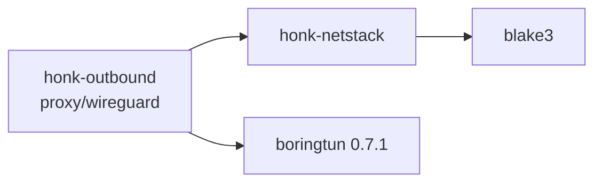

# 用户态网络栈与 WireGuard 隧道

`honk-netstack` 是 sans-I/O 的 IPv4/IPv6 TCP/UDP 栈，唯一的使用者是 WireGuard 出站：它充当用户态隧道的内层网络，honk 是隧道内的 TCP/UDP 客户端，因此栈只实现主动打开和数据报 socket。本页描述已实现的内容。与其他用户态子系统一样，它主要由 AI 编写，仅经过维护者的部分审查，见[已知限制](#已知限制与缺口)。

出站侧的行为（注册表、流、失败归因）在下文从栈的角度概述，规范见[出站设计](./outbound.md#wireguard-隧道)。节点字段和分享链接见[节点参考](../reference/nodes.md)。

## Crate 边界

- `honk-netstack` 只依赖 `blake3` 和 `thiserror`，`publish = false`，并禁止 `unsafe`。依赖方向是 `honk-outbound` → 它；它对节点、tokio、socket 一无所知。`smoltcp` 是 dev-dependency，只用于测试基线。
- 它从不读取时钟、环境变量或配置文件。调用方提供 `Instant`、接口地址和 MTU、32 字节私有 secret 以及内存上限（`Config`）。默认值：MTU 1420、4096 个流、256 MiB 内存、每流 8 MiB 接收缓冲和 6 MiB 发送缓冲。
- `wire` 模块是公开的（IPv4/IPv6/TCP/UDP/ICMP 编解码和校验和），因为集成测试用它构造报文；其余均为私有。

## 编程模型

栈由唯一的 owner 通过 `&mut Stack` 驱动，没有锁，也没有可能溢出的队列：所有待发内容都是流上的状态，只有 owner 拉取时才物化为报文（quinn-proto 模型）。

| 调用 | 约定 |
| --- | --- |
| `receive(now, packet) -> Rx` | 借用一个完整 IP 包。需要保留的字节会复制进栈自有的环，因此返回后 buffer 可立即复用。不需要输出容量：回复变为状态。UDP 通过 `Rx::Datagram` 返回输入包中的范围；`Rx::Dropped(reason)` 会被计数。 |
| `poll_transmit(now, out) -> Option<usize>` | 把一个完整 IP 包写入 `out[..n]`。`out` 过小时返回 `None` 且不丢包。`None` 也表示 cwnd、rwnd 或 pacing 当前不允许发送。 |
| `poll_timeout()` / `handle_timeout(now)` | 所有流中最早的 deadline；条目可能已过期，因此提前唤醒是合法的。 |
| `poll_event()` | 合并后的 `Ready` 位（`CONNECTED`、`READABLE`、`WRITABLE`、`READ_CLOSED`、`ERROR`）；每个流在事件链表上最多出现一次。 |
| `take_tx_wakeup()` | 由 `tcp_write`、`tcp_shutdown`、`tcp_close`、`tcp_abort`、`tcp_connect` 以及产生 ACK 义务的 `tcp_read` 置位。返回 true 时调用方必须唤醒 owner。 |
| `tcp_*`、`udp_*` | 语义同 `write(2)`：用 `WouldBlock` 代替阻塞，`tcp_read` 返回 `Ok(0)` 为 EOF，终止错误具有粘性，并在缓冲数据读完之后才返回。`FlowId` 带 generation，过期 id 返回 `Stale`，绝不会命中新占用者。 |

同一个接收批次（最多 64 个包）内的所有 `receive` 必须传入同一个入口时间戳，避免 RTT、RACK 和自动调优把处理延迟当作网络延迟。

### 输出调度

`poll_transmit` 按三个类别轮转服务，并跨调用记住轮转位置，因此没有哪一类会饿死其他类：

1. **控制回复**：对未知流的包回复 RST。队列容量 128，满了就丢弃并计数（`control_dropped`），语义上等同链路丢包。
2. **TIME_WAIT 回复**（对重传 FIN 的 ACK），按位合并在条目上，不会丢失。
3. **就绪的 TCP 流**，按 deficit round robin 调度，quantum 为一个 MTU。同一个流内 ACK 和重传先于新数据。

流的回复义务是位（`DATA`、`OOO`、`WINDOW_UPDATE`、`PROBE_RESPONSE`、`CHALLENGE`、`FIN_ACK`），而不是通过“`rcv_nxt` 是否前移”推断，因为窗口更新、零窗口探测响应和 challenge ACK 都不推进 `rcv_nxt`。所以调用方停止拉取不会丢失任何义务，这本身就是背压。

### 定时器

每个流给出 RTO/persist、延迟 ACK、tail loss probe、RACK reorder、pacing 和关闭 deadline 的最小值。全局最小堆中每个流最多一个有效条目：只有 deadline 提前时才 push；推迟则沿用旧条目，弹出时重新检查。堆超过流 slab 大小的两倍（至少 32 项）时整体重建；上限跟随 slab，因为重建要遍历每个槽位。TIME_WAIT 过期使用同一个堆。

## 报文处理

- 解析带选项的 IPv4 头；IPv6 扩展头（hop-by-hop、routing、destination options，最多八个）会被跳过，带剩余段的 routing 头为 `Unsupported`。巨型载荷、ESP/AH 和未知协议为 `Unsupported`。IPv4 和 IPv6 分片在头校验和之后被丢弃（`Fragment`）：**没有重组，也没有分片**。IP 长度之外的链路层填充被忽略。
- 发送的 IPv4 包设置 DF，TTL/hop limit 为 64，没有选项和扩展头。
- 目的地址不是本族已配置本地地址的包为 `NotForUs`。没有本地地址的地址族完全不可用（`NoLocalAddress`）。
- `StackStats` 按原因计数丢包：`Malformed`、`Checksum`、`Fragment`、`NotForUs`、`NoFlow`、`Unsupported`。（`Stale` 已定义但从未产生。）
- **校验和总是验证**（IPv4 头、TCP、UDP、ICMP），且发生在任何流状态变化之前。IPv4 UDP 校验和为 0 表示没有；IPv6 UDP 为 0 无效。没有“trusted”模式：WireGuard 只认证隧道对端，并不认证发送方的 inner 校验和。验证是对报文的单独一遍读取，随后才复制载荷；发送校验和在复制载荷的同一遍中计算。
- **ICMP 只消费，从不发送。** packet-too-big（RFC 1191/8201）或 destination-unreachable 仅在报文地址族与流一致、且被引用的 TCP 序号落在未确认窗口内时才生效：PTB 降低该流的路径 MTU（只减不增），并让所有变得过大的段重新可发，包括已按旧尺寸重传过的段；`SYN_SENT` 流收到 unreachable 时 connect 以 `Unreachable` 失败。不带 MTU 的旧式 PTB 使用 RFC 1191 plateau 表。ICMP echo 和其他 ICMP 一律忽略。
- **UDP** 没有接收队列，也没有发送队列。发往未绑定端口的数据报为 `NoFlow`（不发 ICMP 错误）。`udp_send` 直接把一个 IP 包序列化进调用方的 buffer；超过 MTU 的数据报返回 `TooLarge`。

## TCP

### 连接模型

只支持主动打开：`tcp_connect` 用 RFC 6056 算法 3 选择源端口（对本地/远端地址和远端端口做 keyed hash，再加每个 bucket 的计数器，范围 32768..65535），ISN 取 keyed hash（RFC 6528）加 4 µs 时钟，并为每个地址对使用稳定的时间戳偏移（RFC 6191）。secret 来自 `Config::secret`（blake3 keyed hash）。**没有 listen API**；未知四元组的 SYN 会得到 RST；同时打开（simultaneous open）已处理。

每个 SYN 都提供 MSS（MTU − 40/60）、窗口缩放（shift 根据 `tcp_rcv_buf_max` 一次选定，最大 14）、SACK-permitted 和时间戳；只有对端回显的选项才会启用。缺失对端 MSS 时默认 536（IPv4）或 1220（IPv6），并至少提升到 48（Linux `tcp_min_snd_mss`），恶意服务器无法换取逐字节发包。数据段的载荷不超过 `min(对端 MSS, PMTU − IP 头 − 该段的 TCP 头)`，按包计算，因为时间戳加 SACK block 会让 TCP 头增长到 60 字节。

校验：RFC 5961（RST 只在恰好等于 `rcv_nxt` 时生效，否则回 challenge ACK；已同步状态下收到 SYN 回 challenge ACK；challenge ACK 每流每 100 ms 至多一个）、24 天截止的 PAWS、可接受 ACK 的窗口检查。

### 关闭与生命周期

- `tcp_shutdown` 只关闭写半边。`tcp_close` 立即释放应用句柄，由协议继续完成（排队数据之后发 FIN）；**带未读数据关闭，或处于 `SYN_RECEIVED` 时关闭，会发 RST**，与 Linux 一致。处于 `FIN_WAIT_2` 的孤儿流有 60 秒超时。
- TIME_WAIT 与应用句柄分离。流保留 slab 槽（环、就绪位），直到应用读完所有数据并关闭句柄、最后一个 ACK 已发出；之后才压缩为不占 chunk 的小表项 `{tuple, snd_nxt, rcv_nxt, ts_recent, expiry, ack_due}`，持续 60 秒。收到合法的重传 FIN 时回 ACK 并重启计时。到同一四元组的新连接只有在 RFC 6191 的时间戳与序号比较证明对端能区分两个化身时才可复用该表项，否则继续搜索端口（最多 32768 个候选，之后 `AddrInUse`）。
- 终止错误：`Reset`、`TimedOut`（6 次 SYN 重传、15 次连续 RTO 退避、连续 15 次无 ACK 应答的零窗口探测，或孤儿超时）和 `Unreachable`。没有 TCP keepalive。

### 接收侧

- **SACK/DSACK。** 乱序数据直接写到接收环内对应偏移。区间表最多记录 32 段；若某个段会产生第 33 段，则丢弃并计数（`ooo_drops`）。ACK 带时间戳时最多 3 个 SACK block（不带时 4 个），最近变化的 block 排第一，其余轮转；收到重复数据时第一个 block 是 DSACK。未协商 SACK 时，每个乱序段各回一个重复 ACK。
- **ACK 策略。** 连接开始后或空闲超过一个 RTO 之后的前 16 个段立即确认（quickack）；之后在两个满尺寸段未确认、乱序或填洞、窗口更新、FIN 时发送 ACK。否则运行 40 ms 延迟 ACK 定时器。读取使零窗口重开，或使右沿前移至少 2 MSS 时发送窗口更新。
- **窗口自动调优（DRS）。** 每个测得的接收 RTT，目标窗口取 `2 × 应用读走的字节数 + 16 × MSS`，只增不减，上限为 `tcp_rcv_buf_max`。窗口增长在通告之前先从内存池承诺（见下一节）。

### 发送侧

- **丢包检测：** SACK 对端使用 RACK-TLP（RFC 8985）：按发送时间排序检测，对从未重传的描述符用序号游标，对重传使用惰性 FIFO；自适应 reorder 窗口从 min RTT/4 起，随乱序增长并衰减；reorder 定时器；约 2·SRTT 的 tail loss probe（只有一个段在途时再加 200 ms）。不支持 SACK 的对端使用 NewReno（RFC 6582）。恢复期间新发送、恢复结束时仍丢失的数据会开启新的拥塞事件（Linux `tcp_time_to_recover`）。
- **减窗与撤销：** PRR（RFC 6937，SSRB 变体）；伪恢复通过 DSACK、时间戳回显（Eifel）或 F-RTO 撤销。
- **RTO：** RFC 6298 估计器，以微秒计，下限 200 ms（与 Linux 相同的有意偏离），上限 120 s，初始 1 s，指数退避，SYN 重传的退避不会带入第一个数据超时。超时保留已 SACK 的数据为已交付，只把其余标记为丢失；仅当队首本身已被 SACK（reneging）时才丢弃全部 SACK 状态，因此 F-RTO 只会撤销“从未 SACK、从未重传的数据被确认”的超时，并在无新数据可发时回退到常规恢复。零窗口下仍有在途数据时，超时重传队首；只有无在途数据时才发送 persist 探测。
- **拥塞控制：** 定点 CUBIC（RFC 9438），不使用浮点，配合 HyStart++（RFC 9406）。初始窗口 `min(10·MSS, max(2·MSS, 14600))`；从最后一个数据段起空闲超过一个 RTO 后恢复写入时，窗口（及 HyStart++ 状态）重置为初始值。控制器位于 `Cc` 枚举之后；Reno 变体只用于参照测试。
- **pacing：** 令牌桶，慢启动 2.0 × cwnd/SRTT，之后 1.2 × cwnd/SRTT；突发 10 个段，但不超过 2 ms 的流量，且至少 1 个段。下一次放行时刻是流的 deadline 之一。
- **计分板：** 每个已发送段一个描述符（结束序号、发送时间、SACKED/LOST/RETRANS 标志、速率采样字段）。`packets_out`、`sacked`、`lost`、`retrans` 字节计数增量维护，debug 构建下每个 ACK 之后与从头重算的结果断言相等。每个 ACK 按 draft-cheng-iccrg 采样 delivery rate，跟踪 app-limited，并通过 `TcpStats` 报告。
- **发送缓冲。** `tcp_write` 复制进发送环；被接受的字节由栈负责，直到被累计 ACK（SACK 过的数据不会释放，因为对端可能 renege）。缓冲上限随窗口变化：`clamp(2 × cwnd, 64 KiB, tcp_snd_buf_max)`，剩余空间至少为 `min(16 KiB, 上限的一半)` 时报告 `WRITABLE`。

零窗口处理（persist 探测）、窗口更新恢复和 `snd_wl1/snd_wl2` 窗口跟踪遵循 RFC 9293。探测间隔翻倍直至 120 s，只在窗口打开时复位；使窗口保持关闭的 ACK 只复位重试计数（连续 15 次无应答的探测仍会使流失败），不复位间隔。与接收窗口有重叠的段即被接受，已记录的 FIN 之后的数据不被接受。

## 内存模型

载荷存储是 16 KiB chunk 池，每个 TCP 流有两个环（发送、接收），另加发送描述符。

- **进展保底。** 每个已接纳的 TCP 流无论全局压力如何，都有权持有 1 个发送 chunk、1 个接收 chunk 和 16 个描述符槽。保底预先预留：`floor_flows = min(max_flows, memory_limit / 保底大小)`，`memory_limit` 扣除保底后的余量是共享池。没有剩余保底时 `tcp_connect` 返回 `Memory`，达到 `max_flows` 时返回 `FlowLimit`；`max_flows` 同时统计 UDP 关联。保底防止这样的死锁：窗口占满整个池，使 `tcp_write` 没有空间，而对端恰恰在等这个请求。
- **承诺。** 保底之外的接收窗口空间在通告之前先从共享池*承诺*，而 chunk 在数据到达时惰性分配。因此窗口内的数据不会因缺少内存被丢弃。栈记住曾通告的最大右沿且从不收回；窗口缩放取整只会把线上值向下取整，绝不超过承诺。
- **诚实计账。** 预算按 chunk 容量（和描述符存储）计费，而非逻辑字节。`StackStats.memory_committed` 为已用保底加共享承诺；`memory_allocated` 是实际驻留的 chunk 和描述符存储，加上池缓存的空闲 chunk。只要有 chunk 在用，缓存最多保留 64 个（一次突发写入及其 ACK 从缓存取还，不经过分配器）；没有 chunk 在用时只留一个备用，所以空闲栈的 `memory_allocated` 至多一个 chunk。
- **空闲流。** 保底是计账上的保证，而不是驻留内存。环变空（接收环已读完且没有乱序数据，发送环已被全部确认）就把所有 chunk 还给池；没有在途数据时，描述符存储（包括保底部分）也被释放。下一次写入或到达的段再从池缓存取，所以保底永远不会无法兑现。乱序区间表、chunk 列表桩和定时器堆在变空或变稀疏时同样收缩。空闲的已建立流只剩自身状态：`Tcb`（有大小断言，不超过 1 KiB）、slab 槽（144 B）、流表一个桶、一个定时器项和两个 48 B 的 chunk 列表桩。`tests/idle_footprint.rs` 在 1000 条已建立流完成一次请求/响应后统计堆占用，断言没有驻留 chunk 且每流不超过 1.5 KiB（实测约 1.44 KiB，按 glibc chunk 大小计）；要达到设计的缓冲区外 1 KiB，需要先缩小 `Tcb`。TIME_WAIT 表项不占 chunk。
- **进程共享预算。** `Config::shared_budget`（`Option<Arc<MemoryBudget>>`，`MemoryBudget::new(limit_bytes)`、`limit()`、`used()`）让多个栈在各自 `memory_limit` 之外共用一个上限。保底在接纳时计入（预算无法支付时 `tcp_connect` 返回 `Memory`），每次共享 chunk 或描述符承诺也在栈内池计费的同一路径上计入；流结束退还其保底，丢弃 `Stack` 退还其仍持有的全部份额。在预算下被接纳的流保有自己的保底，因此预算耗尽时仍能前进。预算无锁（每次 chunk 粒度的计费一次原子更新），不做 I/O。
- 每流缓冲上限被限制在一个 chunk 到 1 GiB 之间，使序号运算保持模运算安全。

## Driver 约定（WireGuard）

driver 位于 `honk-outbound/src/proxy/wireguard/`；规范在[出站设计](./outbound.md#wireguard-隧道)，此处只写对栈有约束的部分。

- **所有权。** 每条隧道一把 `Mutex<Inner { Stack, Tunn, .. }>`。应用流（TCP 的 `FlowIo`、UDP 的 `WgUdpTransport`）直接加锁调用 `tcp_read`/`tcp_write`/`udp_send`；其余全部由唯一的 owner 任务完成（outer 接收、解密、`receive`、`poll_transmit`、加密、outer 发送、定时器）。每次应用调用之后，由 `take_tx_wakeup()` 决定是否经 `Notify` 通知 owner；`Notify` 会存一个 permit，所以 owner 开始等待之前发出的通知不会丢失。没有数据的读者在 owner 发布就绪状态时持有的同一把锁内登记 waker，所以两者之间不存在丢失唤醒的窗口。
- **批处理。** owner 每次持锁最多处理 64 个包（收发两个方向相同），每次持锁取一次 `Instant`（即接收批次中每个 ≤64 包的片段一次），该次持锁内所有 `receive` 共用；每个发送轮次最多拉取 64 个包，并加密进一个最多容纳 256 个数据报的 buffer。outer socket 使用带 GRO 的 `recvmmsg`，并把等长密文组成 GSO 发送。
- **拷贝。** 满尺寸段在每个方向上被复制三次（应用 ↔ 环、环 ↔ 明文 buffer、boringtun 自己的 `src → dst`）。稳态每包不分配（`tests/alloc_free.rs` 在批量收发期间统计分配）；scratch、输出和接收 buffer 都被复用。在途数据完全排空的流会释放描述符存储，下一次突发需要重新增长，每次突发几次分配，而不是每包一次。
- **注册表与空闲回收。** 隧道注册表对每个（本地私钥，peer 公钥，端点主机，端点端口）恰好保留一条活动隧道，因为同密钥、同 peer 的两个会话会使彼此的握手失效；不同端点共用的密钥对各有隧道。注册表归一个 control plane 的 runtime 各代所有（重载后继代、DNS fork 与冷探测继承它），所以同一进程中的两个 plane 绝不共享或关闭对方的隧道；不带 runtime 的拨号共用一个无人关闭的进程级注册表。设置相同的 runtime 共享活动隧道；同一密钥与端点的不同设置会替换它，并以 `RuntimeClosed` 关闭其流（不是节点失败）。owner 任务属于注册表而不是节点的 task owner，在失败、被替换、该 plane 的 `shutdown_wireguard_tunnels`（其终止流程 join 它）、最后一个使用它的 runtime 关闭且没有可承载数据的流时（立即），或 120 秒无流且无 warm 持有者时结束。warm 保留持有隧道（计数，因此重新装入同一隧道不丢失钉住），最后一次释放会撤销持有但不切断流。进程内存份额被划分为固定的每隧道切片并限制活动隧道数（见规模）。
- **DNS fork 共享（偏离）。** DNS fork runtime 通常拥有全新的协议状态；WireGuard 则与业务 runtime 共用隧道（该 plane 的注册表），因为第二个会话会把它顶掉。runtime 关闭只终止它自己打开的流（`RuntimeClosed`）。
- **Reserved 字节。** WARP 风格的 reserved 字节在加密之后写入每个出站数据报的第 1–3 字节，并在解密之前对每个入站数据报清零；Noise MAC 从不覆盖它们。
- **Allowed IPs（单 peer）。** 拨号或 UDP 关联的目标若在 `wg_allowed_ips` 之外（或所在地址族没有隧道地址），会在发出任何包之前被拒绝；之后对其他不被允许目的地的 UDP 发送是 `Policy` 拒绝；源地址在其之外的入站 inner 包在进入栈之前被丢弃。列表被聚合为有序、不相交的网络并用二分查找。目标始终是数字地址，目标域名不会在远端解析。Allowed IPs 不用于在多个 peer 之间选择，因为 peer 只有一个。
- **Endpoint。** 所有解析出的地址都是候选（地址族交替；双栈 IPv6 socket 以映射地址承载 IPv4 peer）。会话建立之前 initiation 在 1 秒与再过 2 秒后重发（刻意偏离 boringtun 首次重试在 5 秒，使一个丢失的数据报不会让 3 秒拨号失败），每次发往下一个候选，之后沿用 boringtun 的 5 秒节奏。握手尝试超时会让下一次获取重新解析域名。来自新源地址并通过认证的数据报会移动 outer endpoint（roaming）；cookie reply 不算认证。
- **UDP。** 每个已准备的 source 一个栈 socket，服务所有目的地（`MultiTargetTransport`）；收到的数据报复制进容量 256 的有界队列，溢出按 socket 缓冲区语义丢弃。confirmed 发送只有在 owner 把数据报交给 socket 之后才完成。
- **错误归因。** 对 SYN 的 inner RST 或 ICMP unreachable，以及 allowed IPs 之外或所属 IP 族没有隧道地址的目标（TCP 拨号或打开 UDP 关联，在任何握手之前拒绝），是目标失败。SYN 超时仅当对端在拨号期间送达过其他 inner 包时才是目标失败，否则保持为无类型超时，Score 按节点保守处理。握手预算耗尽的等待者得到节点失败，同一次尝试上的等待者共享它，但隧道本身不失败；存在流时 boringtun 会话过期以及 owner 任务意外结束，会让隧道对所有等待者失败一次（同一个共享节点失败事件）。认证失败的数据报被静默丢弃（没有失败阈值：源地址可伪造）。本地耗尽（`FlowLimit`、`Memory`、`AddrInUse`）是 `Capacity` 拒绝。隧道被其所有者关闭（runtime 关闭、设置被替换、进程关闭）时，流以 `RuntimeClosed` 失败，它不是节点失败。handler 自身不报告 Score 或健康。

## 验证

- 单元测试位于 `honk-netstack/src/` 各模块旁。`tests/tcp_receive.rs`、`tcp_send.rs`、`tcp_recovery.rs` 是确定性报文脚本：只通过公开 API 驱动脚本化对端，并精确比对输出段。
- `tests/sim/` 是确定性链路模拟器（种子化的延迟、iid 与 Gilbert-Elliott 丢包、乱序、重复、限速和 drop-tail 队列），连接 honk↔honk 或 honk↔固定版本 smoltcp 0.14.0。`sim_honk.rs` 检查 1% 丢包、IPv6 与多流下字节恰好一次按序交付并完成，每次只拉 1 个包与不限量拉取交付相同的流，撤销由链路乱序引起的伪恢复，以及修复既无 SACK 也无重组的对端；`sim_baseline.rs` 刻画 smoltcp，并测试模拟器本身（包括拉取预算恢复）。debug 构建下计分板在每次修改后重算（计数、描述符顺序、游标和被记住的 SACK 区间），且每次调用后 `Tcb::check` 会把它与 `snd_una`/`snd_nxt` 对账。两个 `#[ignore]` 网格会打印对比表（`cargo test -p honk-netstack --test sim_honk -- --ignored --nocapture`）。
- `honk-outbound/src/proxy/wireguard/tests/` 对独立的进程内 peer 运行 driver（回环 UDP 上的 boringtun `Tunn`，后面是 smoltcp 接口）。
- `fuzz/` 有两个 libFuzzer 目标：`netstack_packet`（任意字节，可选修复长度和校验和，送入有七种状态流的栈的 `receive`）和 `netstack_schedule`（按字节解码的操作序列：构造的对端段、应用调用、时间推进、拉取预算 0/1/N 和 ICMP）。两者来自 `honk-netstack` 的 `fuzz-checks` feature，也作为 `tests/fuzz_replay.rs` 在 stable 上回放已提交的种子和已保存的崩溃产物。断言：不 panic、输出有界且格式正确、每次操作后整栈重算（`Stack::check`）、定时器不会遗留已过期 deadline、全部关闭后归还所有池占用且所有流结束。`cargo bench -p honk-netstack --bench stack` 报告接收+ACK、批量发送和 SACK 处理的每包纳秒数。
- 真实网络的实验室工具和结果只放在 `bench` 分支。截至目前 `main` 上没有 honk 臂的结果记录，所以本页没有任何吞吐、丢包恢复或 CPU 结论属于实测。

## 已知限制与缺口

| 范围 | 限制 |
| --- | --- |
| IP | 无分片与重组（分片被丢弃，超长 UDP 为 `TooLarge`）；不生成 ICMP；无 ECN；发送不带 IPv4 选项。 |
| TCP | 无 listen/accept；无 keepalive；无 urgent 数据 API；无 TCP Fast Open；无 PLPMTUD（只响应路径上的 PTB）；仅 CUBIC（BBRv3 推迟）；IW10，无按路由调优。未知 TCP 选项被忽略，选项长度格式错误会终止选项解析。 |
| 接收 | 每流最多 32 个乱序区间；ACK 拉伸受 64 包接收批次限制。 |
| 规模 | 空闲的已建立流约占 1.4 KiB 堆（无 chunk）；每条隧道 4096 个流，每条被接纳的流从进程预算预留约 33 KiB 的 floor；预算即份额（默认 256 MiB，honk 取内存的 1/8，限制在 64 MiB..4 GiB），所有隧道的栈共同使用，64 MiB / 256 MiB / 1 GiB 下仅 floor 约可容纳 2,000 / 8,000 / 32,000 条流；活动隧道数由其固定开销限制，`share / 4 MiB`，夹在 1..128；`max_flows` 统计 UDP 关联；每条隧道一把锁、一个 owner 任务，因此单条隧道受限于一个核。 |
| WireGuard | 每条隧道恰好一个 peer；无入站连接；IPv4 与 IPv6 各自需要配置隧道地址；endpoint 域名只在握手尝试超时之后的下一次获取时重新解析，已有会话时端点集合不变；每个 control plane 每个（密钥对，端点）只有一条隧道（不带 runtime 的拨号共用一个单独的进程级 registry），每个 registry 的活动隧道最多 `share / 4 MiB` 条（1..128，见规模）；共享密钥对与端点的节点必须所有隧道设置一致，否则互相替换，主机名与 IP 字面量写法的同一端点是不同的隧道；内层 MTU 至多 65472，使外层数据报装得进一个 UDP 载荷。 |
| 验证 | 没有对非 Linux TCP 实现的互通测试，没有 ARM 实测，也没有跑 `test-routing`/`test-netns` 虚拟机门槛。设计阈值在一台 x86-64 4-vCPU 虚拟机上以内核 WireGuard + 内核 TCP 为对照实测（不是设计里的同一外层引擎 + TUN 对照臂，且 honk 一侧多一跳本地中继）：G1–G4 通过，G5 下行公平性按中位数通过，G5 空闲内存（含驱动与中继状态约每流 4 KiB）未达到 1 KiB 目标；证据在 `bench` 分支的 `bench/netstack/results/` 下。 |

## 相关文档

- [出站设计：WireGuard 隧道](./outbound.md#wireguard-隧道)
- [节点参考：WireGuard 字段与分享链接](../reference/nodes.md)
- [架构总览](./overview.md)
