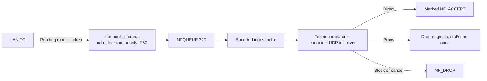

# NFQUEUE 持有首包的 UDP 路径

NFQUEUE 以 fail-closed 方式持有语义尚不明确的 LAN 转发 UDP 原始包，直到用户态得到 direct、proxy 或 block 终态决策。

## 启用与范围

该路径通过 `global.nfqueue_enable` 默认开启。设置为 `false` 可关闭：

```dae
global {
    nfqueue_enable: false
}
```

修改该设置通常必须重启进程；除实际记录了数据路径准入前的启动降级外，reload 会拒绝开关变更（例外详见[全局配置参考](../reference/global.md)）。降级后 reload 不会重试启用。启动阶段 NFQUEUE 采用 best-effort：mock 模式、不带 `ebpf` 的构建、固定队列前置检查失败，或数据路径准入前的队列/规则/健康检查失败时记录 warning，仅在本进程关闭暂存且不改写配置文件。持久化 token generation 恢复失败仍为 fatal，因为分配器状态已无法确定。真实模式会先取得单实例锁，再执行该前置检查，因此正常交接会等待旧队列所有者，不会误降级；保留的 nftables table 会在绑定队列后由安装阶段回收。服务准入后，listener、queue、watchdog、verdict、cleanup 和 retirement 的失败仍为 fatal。

该 hook 按流量类型和状态决定是否暂存：

| 流量或状态 | 行为 |
| --- | --- |
| 经过 LAN TC 后语义尚不明确的新 LAN 转发 UDP | 启用且 ready 时，暂存唯一 token 并在 NFQUEUE 中持有原始 skb |
| 主机发起的 WAN UDP | 保持规范 TPROXY 路径；主机 egress 不经过这个 `inet prerouting` hook |
| UDP 端口 `53` | 遵循[流量规则所有权](../reference/routing.md#出站目标与-must)；需要控制器/原始组处理的 LAN 分片查询走下述完整数据报路径，不创建普通 conn-state 或 decision token |
| 内部/特殊或反向流量 | 绝不暂存 |
| 非 DNS 的 `must` 或 `block` 路由结果 | 视为终态；绝不暂存 |
| 路由时已经确定安全的 direct 结果 | 走内核 direct 路径；绝不暂存 |
| 已启用但尚未 ready 时的暂存候选 | 丢弃新流；无关的非暂存 UDP 保持正常路径 |

语义尚不明确是指初步路由仍可能在用户态路由、模式/组选择或域名/QUIC 检查后改变。该路径不会仅因初步结果不完整，就将数据包重定向到用户态 relay。

## 持包机制



| 机制 | 当前契约 |
| --- | --- |
| 队列传输 | `honk-nfqueue` 使用原始 `NETLINK_NETFILTER`；不调用防火墙命令，也不使用 netfilter helper 库 |
| 队列参数 | 固定队列 `320`、内核 maxlen `4096`、packet-copy range `65535`，并请求 `8 MiB` 套接字接收缓冲区 |
| Verdict 所有权 | 不可 `Clone`、恰好一次的 `VerdictGuard`；未提交的 guard 在 drop 时发送 `NF_DROP` |
| Ingest 所有权 | 单 actor，队列上限为 `256` 项和 `8 MiB` payload；仅当 actor dequeue 时才尝试取得 UDP slow-path permit |
| nftables 所有权 | 单个原子事务独占精确的 `inet honk_nfqueue` / `udp_decision`，即优先级 `-250` 的 `inet prerouting` filter chain；只有携带 Pending 签名的 UDP 才进入队列 |
| 失败策略 | 不设置 queue bypass、fanout 或 fail-open flag。可识别的坏包、UDP payload 截断和校验和错误发送 `NF_DROP`；畸形队列元数据、无法识别的报文头、`ENOBUFS`、listener 退出和 verdict socket 失败仍为 fatal |

服务先绑定队列 `320`，再发布 nftables 事务。安装阶段在单实例锁保护下回收残留的保留 table；最终有序关闭时，它会 drain 所有已分发 guard、关闭队列，并最后删除自有 table。同一网络命名空间的防火墙管理器不得在 honk 运行期间修改任一保留 nftables 对象。

此 Linux 机制仅用于 `honk-core` 的 `ebpf` feature。解析只分配一份与数据报大小相等的缓冲区。core 采样器与 `StatsManager` 区分当前实例队列深度与跨 hard rebind 累积的进程级丢包数，报告最近一次内核读取的可用性与错误，并始终刷新 held-guard/effective-buffer gauge。

每次内核统计采样先在调用线程所在的队列网络命名空间中打开 procfs 文件，再通过已绑定该命名空间的文件描述符异步读取；采样对象不由进程主线程或阻塞工作线程的命名空间决定。

## LAN DNS 分片

TC 按普通流量策略判定 offset-zero 的 UDP/53 首片。原生 `direct(must)`、`block(must)` 和可信的精确控制平面 mark 保留原动作。需要 DNS 控制器或原始 must 组的查询在 host skb mark 中携带路由/代际，不进入 `daens`；后续片也留在 host。内核 IPv4/IPv6 重组在优先级 `-400` 执行，早于队列 `-250` 与 conntrack `-200`。DNS 没有分片缓存；[非 DNS 分片记录](./datapath.md#重定向数据报的分片)由数据路径维护。

Actor 在成功、饱和和拒绝路径均先区分完整 DNS 数据报与普通 token 流；验证 carrier、当前代际和准入 epoch，对原包确认 `NF_DROP` 后，才发布到透明 socket 共用的有界 DNS/原始 UDP 管线。回复沿用现有 redirect 元数据恢复原目的地址。分发前验证 UDP 校验和，允许 IPv4 零校验和并识别内核 checksum-partial 元数据；没有该元数据的 IPv6 零校验和被拒绝。

队列关闭或未 ready 时，需要控制器/原始组处理的分片丢弃，不能回退原生绕过 DNS 策略。未分片 DNS 保留 TC 快路径；本路径不增加 TCP 分片支持。与 TC redirect 不同，它经过 host raw hook，前置防火墙丢包或改写 mark 可以阻止准入。复制截断时丢弃已识别报文，不转发不完整查询。

需要该路径的以太网首片必须发给本机（`PACKET_HOST`）；纯二层转发候选 fail-closed，不假设 bridge-to-inet hook 已启用。LAN 和 WAN egress 还会丢弃未被消费的 DNS queue carrier，准入关闭时也不例外。不改写桥接防火墙 sysctl。桥与 slave MAC 不同的情况下，分片查询可能被保守拒绝；未分片 DNS 和原生 direct-must 保持既有行为。

`ROUTING_GENERATION_SEQUENCE` 是 core 持有并 pin 的单项计数器。在每次路由发布或 NFQUEUE fence 前预留不回绕的 20 位值；fence 只替换不可变 descriptor，保留编译策略和 maps。普通清理/重启保留计数器，旧首片不能授权新进程的组索引。耗尽或 fence 失败保持 NFQUEUE readiness 关闭，重启不重置计数器。只要 host 命名空间仍可能保留报文，就必须像 `UDP_DECISION_SEQUENCE` 一样保留该 pin；重启系统同时清除重组队列和 bpffs 状态。

## 决策 token 协议

`UDP_DECISION_SEQUENCE` 是 pinned、持久化的单槽 spin-lock allocator。其 legacy 值恰好是 12 字节：lock、`next` 中的完整 raw token，以及 `exhausted`。启动只验证该 ABI 和值，绝不重写。普通重启和清理会保留该 pin，因此回滚后的旧版程序可以从同一 raw-token 边界继续。

| bit 或字段 | 含义 |
| --- | --- |
| skb mark bit `31..30` | `CLASSIFIED_MARK | NFQUEUE_PENDING_MARK` = `0xc0000000`，即 nftables 规则选择的暂存签名 |
| Token mask | `NFQUEUE_TOKEN_MASK` = `0x3fffffff`；token 占用 mark 的其余 bit |
| Token bit `29..28` | 2 bit generation `0..=3` |
| Token bit `27..0` | generation 内单调递增的 28 bit sequence |

Token 表示所有权，而不只是相关性元数据。它必须在 skb mark、`CONN_STATE_MAP`、`ROUTING_HANDOFF_MAP`、`REDIRECT_TRACK`、用户空间 verdict cell、`UdpInitLease`、endpoint 或 retirement tombstone，以及后端终态转换之间一致。任何终态操作都不能只凭 tuple 身份执行。

## 终态转换

| 决策 | 有序转换 |
| --- | --- |
| Direct | 检查 token 的 `ArmDirect` → 按 FIFO 顺序为每个被持有的原始 skb 发出带 mark 的 `NF_ACCEPT` → 检查 token 的 `ActivateDirect` |
| Proxy | 提交 token-bound 最终出站和 mark → 把唯一保留的 payload 转移到规范 UDP initializer → 对原始包发出 `NF_DROP` → 拨号并发送一次 |
| Block | 提交 token-bound `Block` → 丢弃所有原始 skb → 以 kernel handoff 方式退役 initializer |
| Cancel 或过期 | 只 abort 匹配的 Pending incarnation → 丢弃所有原始 skb，并退役其 lease identity |

Direct 不创建用户空间 UDP 套接字、payload copy 或 replay、`Ready` endpoint 或 `/connections` 条目。其最终 verdict mark 保留 classified 状态，并移除 Pending/token carrier。如果流的另一个包在 Arm 后到达，correlator 只追加其 verdict guard，丢弃 payload 和 slow permit，并在 activation 前返回 FIFO accept 循环。

Proxy 不会创建第二条路由路径。它复用普通透明 UDP 使用的同一个 `UdpInitLease` 和 `UdpEndpointPool` initializer。在拨号/发送前发布最终内核状态可以防止 reply race；只转移保留的 payload 并丢弃原始包，可确保只发送一次且没有 replay fallback。

## 截止时间与 fatal 策略

每个包只有一个从 raw-netlink listener 收包到 verdict 的绝对 3 秒截止时间。Actor 延迟、commit 队列等待和每一次后端锁等待都消耗同一预算，包括 Direct Arm 与 Activate 之间的第二次取锁。队列、correlator 或 slow path 饱和，或截止时间到期时，均按 fail-closed 丢包，不延长所有权，也不继续增加内存占用。

`PendingUdpVerdicts` 持有 joined pump，每批最多处理 1,024 个终态请求，按后端写锁 → correlator cell 取锁，并在释放后端锁后交接 endpoint 给内核。同步后端工作在多线程 runtime 上用 `block_in_place`，在 current-thread runtime 上内联执行。Pump 在调用方取消后仍持有 direct/block lease；在出队、取得后端锁后、grace 后及每项执行前复验原始 deadline，过期请求不修改 conn。取消等待已 Arm Direct 在同一期限内完成。

Watchdog 独立检查持有的 cell，并强制执行硬持有上限。Token、endpoint generation 或后端状态不匹配时会丢包，且不会修改更新的 incarnation。Verdict 失败或 Direct 已 Arm 后的任何失败都会使进程 fatal，因为用户空间已无法安全判断内核接受了哪些原始包。

## 栅栏与生命周期

### 重载与关闭

Reload 和 shutdown 共用同一 producer fence：

1. 发布 `DATAPATH_FLAG_NFQ_READY=false`。现在需要暂存的新流会 fail closed。
2. 完成同步 `RETIRE_GRACE_ROOT` barrier，再以有界、检查 incarnation 的 tuple-fence batch 移除残留 `Preparing`、`Pending`、`Aborted` 状态。延迟 queue delivery 随后因 token lookup 失败而终止；descriptor generation 发布仍对排队 DNS fragment 实施 fence。
3. 关闭 correlator admission，在改变 runtime 所有权前 drain 或 cancel verdict guard、initializer lease、scheduled token cleanup、endpoint tombstone、retirement work 及已准入 commit。最终 shutdown 停止并 join pump；reload 保留它。已 Arm Direct 可使 reload 延迟到其原始三秒[收包至 verdict 截止时间](#截止时间与-fatal-策略)；取消既不提前中止，也不重新计时。
4. 成功 reload 会发布 replacement runtime generation，最后再重开 correlator admission 和 readiness。Shutdown 会 detach producer、关闭 queue 所有权，并最后删除 `inet honk_nfqueue`。

Listener、queue、watchdog、cleanup、verdict 或 retirement 生命周期中的失败或歧义均为 fatal；runtime 绝不会在所有权不确定时重新开放暂存。

### 精确 tuple 退役

Retirement 发布 `RETIRE_ACTIVE`，再用 `BPF_NOEXIST` 插入 `RETIRE_FENCE[tuple]`，分别保留操作 owner 与 decision token。成功重装 `RETIRE_GRACE_ROOT` 的同一 inner map 会排空 fence 前的 non-sleepable 读者；之后后端复验 incarnation、token、state 与辅助项所有权才删除。Batch 对 fence 去重，保留每个请求的结果、部分删除计数及操作/释放错误；释放时检查精确 owner，未解决的所有权禁止准入。初始 `ArmDirect`/`ActivateProxy`/`Block` commit 共用该协议，每批一次 grace。只有 `ActivateDirect` 在原生锁下原地更新不可变 `DirectArmed`（`BPF_EXIST | BPF_F_LOCK`），不取 fence/grace：后端写锁排除其他写者，内核从不续期 `Pending`/`DirectArmed` 时间戳。

WAN 与 LAN 用户态 UDP 即使 token 为零也共用 fence：endpoint 保留准入 incarnation，WAN ownership bit 区分带 mark 的 direct/must 与原生直连。先回收匹配辅助项再回收 conn，过期清理也相同；保留外来元数据，所有权缺失或已被替代时拒绝。用户态 [endpoint 退役](./control-plane.md#tcp-中继与-conn-state-所有权)要求实际删除 conn 的证据。

内核 producer 在成功发布前失败时，记录捕获 incarnation 和实际已分配 token 的终态 `Aborted`（尚未分配则为零），不删除 tuple 项，也不把已完成的 Pending/native/proxy/block 改成 Aborted。Preparing 与 Aborted follower 都不能续期时间戳；Aborted 不得激活或转发，立即满足精确 fenced hint/janitor 清理条件。全部物理 tuple 回收仍共用后端协议。

## Sequence 耗尽与 generation 轮转

耗尽使用生命周期 fence，而不会重置仍存活的 allocator：

1. Fence readiness，quiesce 内核 stager，cancel 并 drain 用户空间 cell，再对固定队列执行 hard rebind，确保旧的被持有 skb 和 guard 无法跨越轮转存活。
2. 检查全部四个存活 token-bearing map：`CONN_STATE_MAP`、`RETIRE_FENCE`（读取 `decision_token`，不是操作 owner）、`ROUTING_HANDOFF_MAP` 和 `REDIRECT_TRACK`。
3. 仅当候选 generation **以及数值上比它更高直至 `3` 的所有 generation** 都不存在于四张 map 中时才重置。从候选值开始的回滚 legacy allocator 恰好可以沿该 suffix 前进，因此只检查候选值会允许 token 重用。
4. 只有锁定 allocator 重置成功后，才重新开放 admission 和 readiness。

使用 batch lookup 时，短的成功 map batch 不能证明扫描完成；absence scan 会持续到终态 `ENOENT`。如果没有 rollback-safe suffix 可用，暂存保持 fenced，并按 `1`、`2`、`5`、`30` 秒重试，后续失败保持 `30` 秒。非暂存 UDP 继续运行；只有需要暂存的新流 fail closed。

## 容量上限

| Owner | 上限 |
| --- | --- |
| 内核 NFQUEUE | `4096` 个排队数据包 |
| 用户空间 ingest actor | `256` 项和 `8 MiB` 保留的排队 payload |
| Verdict correlator | `4096` 个存活 flow cell |
| Commit pump 队列 | `4096` 个排队请求，每个存活 flow cell 一个；槽位预留等待消耗[原始截止时间](#截止时间与-fatal-策略) |
| 单个 flow cell | `64` 个被持有的 verdict guard，包括首包 |
| UDP slow path | 启动时有效预算上限为 `256`；仅在 actor dequeue 时获取 permit |

有效的 slow-path、endpoint、dial 和文件描述符预算来自进程启动时的 `RLIMIT_NOFILE` 规划，因此 `256` 是上限，而不是保证可用的 permit 数。预算推导与所有权见[控制平面](./control-plane.md)。

## 可观测性

启用 API 后，`GET /stats` 会公开 `udp.nfqueue`（文档中的 dotted path `/stats.udp.nfqueue`）：listener/correlator 计数、actor 深度/字节数/最老 age、内核队列/drop/read 状态、held/peak guard 与实际接收缓冲区、终态 verdict 和 token 计数、verdict 错误，以及从收包到 verdict 成功的延迟。字段清单见 [API 参考](../reference/api.md)。

`EVENT_RINGBUF` 会发送受速率限制的 `udp_decision_token_exhausted` 警告，作为即时耗尽提示。恢复不依赖这个有损通道：supervisor 会定期锁定读取 `UDP_DECISION_SEQUENCE`，即使事件丢失也能发现耗尽；该 backstop 失败为 fatal。

## 相关文档

- [eBPF 数据路径](./datapath.md)
- [控制平面](./control-plane.md)
- [全局配置参考](../reference/global.md)
