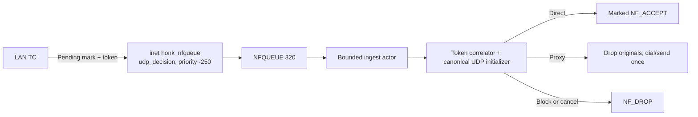

# NFQUEUE 持有首包的 UDP 路径

NFQUEUE 以 fail-closed 方式持有语义尚未明确的 LAN 转发 UDP 原始包，直到用户态做出 direct、proxy 或 block 终态决策。

## 启用与范围

这条路径由 `global.nfqueue_enable` 控制，默认开启。设为 `false` 即关闭：

```dae
global {
    nfqueue_enable: false
}
```

改动这个开关通常要重启进程。除了确实记录过数据路径 admission 之前的启动降级以外，reload 会拒绝开关变更，例外见[全局配置参考](../reference/global.md)。降级之后，reload 也不会重试启用。

启动阶段 NFQUEUE 是 best-effort。遇到以下情况时只记录 warning，并在本进程内关闭暂存，不改写配置文件：mock 模式；构建里没有 `ebpf`；固定队列的前置检查失败；数据路径 admission 之前的队列、规则或健康检查失败。持久化 token generation 恢复失败仍是 fatal，因为分配器状态已经无法确定。真实模式先取得单实例锁，再做前置检查，所以正常交接会等旧队列 owner 退出，不会误降级。绑定队列之后，安装阶段会回收保留的 nftables table。服务 admission 之后，listener、queue、watchdog、verdict、cleanup 和 retirement 的失败都是 fatal。

这个 hook 按流量类型和状态决定要不要暂存：

| 流量或状态 | 行为 |
| --- | --- |
| 经过 LAN TC 后语义尚未明确的新 LAN 转发 UDP | 启用且 ready 时，暂存唯一 token 并在 NFQUEUE 中持有原始 skb |
| 主机发起的 WAN UDP | 保持规范 TPROXY 路径；主机 egress 不经过这个 `inet prerouting` hook |
| UDP 端口 `53` | 遵循[流量规则所有权](../reference/routing.md#出站目标与-must)；需要控制器或原始代理组处理的 LAN 分片查询走下述完整数据报路径，不创建普通 conn-state 或 decision token |
| 内部、特殊或反向流量 | 绝不暂存 |
| 非 DNS 的 `must` 或 `block` 路由结果 | 视为终态；绝不暂存 |
| 路由时已经确定安全的 direct 结果 | 走内核 direct 路径；绝不暂存 |
| 已启用但尚未 ready 时的暂存候选 | 丢弃新流；无关的非暂存 UDP 保持正常路径 |

语义还不明确，是指初步路由结果仍可能被用户态路由、模式或组选择、域名或 QUIC 检查改变。这条路径不会只因为初步结果不完整，就把数据包重定向到用户态 relay。

## 持包机制



| 机制 | 当前契约 |
| --- | --- |
| 队列传输 | `honk-nfqueue` 使用原始 `NETLINK_NETFILTER`；不调用防火墙命令，也不使用 netfilter helper 库 |
| 队列参数 | 固定队列 `320`、内核 maxlen `4096`、packet-copy range `65535`，并请求 `8 MiB` socket 接收缓冲区 |
| Verdict 所有权 | 使用不可 `Clone`、只允许提交一次的 `VerdictGuard`；未提交的 guard 在 drop 时发送 `NF_DROP` |
| Ingest 所有权 | 单 actor，队列上限为 `256` 项和 `8 MiB` payload；仅当 actor dequeue 时才尝试取得 UDP slow-path permit |
| nftables 所有权 | 由单个原子事务独占 `inet honk_nfqueue` / `udp_decision`，即优先级 `-250` 的 `inet prerouting` filter chain；只有携带 Pending 签名的 UDP 才进入队列 |
| 失败策略 | 不设置 queue bypass、fanout 或 fail-open flag。可识别的坏包、UDP payload 截断和校验和错误发送 `NF_DROP`；畸形队列元数据、无法识别的报文头、`ENOBUFS`、listener 退出和 verdict socket 失败仍为 fatal |

服务先绑定队列 `320`，再发布 nftables 事务。安装阶段在单实例锁保护下回收残留的保留 table。最终有序关闭时，它先 drain 所有已分发的 guard，再关闭队列，最后删除自有 table。同一网络命名空间里的防火墙管理器不得在 honk 运行期间修改这些保留的 nftables 对象。

这套 Linux 机制只在 `honk-core` 的 `ebpf` feature 下使用。解析时只分配一份和数据报同样大小的缓冲区。core 采样器和 `StatsManager` 会区分当前实例的队列深度与跨 hard rebind 累积的进程级丢包数，报告最近一次内核读取是否成功以及错误内容，并始终刷新 held-guard/effective-buffer gauge。

每次采样内核统计时，先打开调用线程所在队列网络命名空间的 procfs 文件，再通过绑定到该命名空间的文件描述符异步读取。采样哪个命名空间，取决于队列所在的 netns，而不是进程主线程或阻塞 worker 的 netns。

## LAN DNS 分片

TC 按普通流量策略判断 offset-zero 的 UDP/53 首片。原生 `direct(must)`、`block(must)` 和可信的精确控制面 mark 保留原动作。需要 DNS 控制器或原始 must 组处理的查询，在 host skb mark 里携带路由和 generation，不进入 `daens`；后续分片也留在 host。内核的 IPv4/IPv6 重组在优先级 `-400` 执行，早于队列的 `-250` 和 conntrack 的 `-200`。DNS 没有分片缓存；[非 DNS 分片记录](./datapath.md#重定向数据报的分片)由数据路径维护。

不管走成功、饱和还是拒绝路径，actor 都先区分完整的 DNS 数据报与普通 token 流。它验证 carrier、当前 generation 和 admission epoch，对原包确认 `NF_DROP` 之后，才把数据报发布到透明 socket 共用的有界 DNS/原始 UDP 管线。回复沿用现有的 redirect 元数据恢复原目的地址。分发前会验证 UDP 校验和：IPv4 允许校验和为零，并识别内核的 checksum-partial 元数据；IPv6 没有该元数据时，校验和为零会被拒绝。

队列关闭或尚未 ready 时，需要控制器或原始组处理的分片会被丢弃，不能退回原生路径绕过 DNS 策略。未分片的 DNS 仍走 TC 快路径；这条路径也不增加 TCP 分片支持。它要经过 host raw hook，和 TC redirect 不同，前置防火墙丢包或改写 mark 都能阻止 admission。数据包复制被截断时，丢弃已经识别的报文，不转发不完整的查询。

需要这条路径的以太网首片必须发给本机，即 `PACKET_HOST`。纯二层转发的候选按 fail-closed 处理，不假设 bridge-to-inet hook 已经启用。LAN 和 WAN egress 还会丢弃未被消费的 DNS queue carrier，admission 关闭时也一样。honk 不改写桥接防火墙 sysctl。桥和 slave 的 MAC 不同时，分片查询可能被保守拒绝；未分片 DNS 和原生 direct-must 保持原有行为。

`ROUTING_GENERATION_SEQUENCE` 是 core 持有并 pin 的单值计数器。每次路由发布或 NFQUEUE fence 之前，先预留一个不回绕的 20 位值。fence 只替换不可变的 descriptor，编译策略和 maps 保持不动。普通清理和重启会保留计数器，旧首片不能授权新进程的组索引。耗尽或 fence 失败时，NFQUEUE readiness 保持关闭，重启也不会重置计数器。只要 host 命名空间还可能保留报文，就必须像 `UDP_DECISION_SEQUENCE` 一样保留这个 pin；重启系统会同时清除重组队列和 bpffs 状态。

## decision token 协议

`UDP_DECISION_SEQUENCE` 是 pinned、持久化的单槽 spin-lock allocator。它的 legacy 值固定为 12 字节：lock、`next` 里的完整 raw token，以及 `exhausted`。启动时只校验这个 ABI 和值，绝不重写。普通重启和清理会保留该 pin，所以回滚后的旧版程序可以从同一个 raw-token 边界继续。

| bit 或字段 | 含义 |
| --- | --- |
| skb mark bit `31..30` | `CLASSIFIED_MARK | NFQUEUE_PENDING_MARK` = `0xc0000000`，即 nftables 规则选择的暂存签名 |
| Token mask | `NFQUEUE_TOKEN_MASK` = `0x3fffffff`；token 占用 mark 的其余 bit |
| Token bit `29..28` | 2 bit generation `0..=3` |
| Token bit `27..0` | generation 内单调递增的 28 bit sequence |

Token 表示所有权，不只是用来关联的元数据。它必须在这些位置保持一致：skb mark、`CONN_STATE_MAP`、`ROUTING_HANDOFF_MAP`、`REDIRECT_TRACK`、用户态 verdict cell、`UdpInitLease`、endpoint 或 retirement tombstone，以及后端终态转换。任何终态操作都不能只凭 tuple 身份执行。

## 终态转换

| 决策 | 有序转换 |
| --- | --- |
| Direct | 检查 token 的 `ArmDirect` → 按 FIFO 顺序为每个被持有的原始 skb 发出带 mark 的 `NF_ACCEPT` → 检查 token 的 `ActivateDirect` |
| Proxy | 提交 token-bound 最终出站和 mark → 把唯一保留的 payload 转移到规范 UDP initializer → 对原始包发出 `NF_DROP` → 拨号并发送一次 |
| Block | 提交 token-bound `Block` → 丢弃所有原始 skb → 以 kernel handoff 方式退役 initializer |
| Cancel 或过期 | 只 abort 匹配的 Pending incarnation → 丢弃所有原始 skb，并退役其 lease identity |

Direct 不创建用户态 UDP socket，也不复制或重放 payload，不创建 `Ready` endpoint 或 `/connections` 条目。最终的 verdict mark 保留 classified 状态，去掉 Pending/token carrier。如果该流的另一个包在 Arm 之后到达，correlator 只追加它的 verdict guard，丢弃 payload 和 slow permit，并在 activation 之前回到 FIFO accept 循环。

Proxy 不创建第二条路由路径。它复用普通透明 UDP 的同一个 `UdpInitLease` 和 `UdpEndpointPool` initializer。拨号或发送之前先发布最终内核状态，可以避免 reply race。只转移保留的 payload，丢掉原始包，就能保证只发送一次，也没有 replay fallback。

## 截止时间与 fatal 策略

每个包只有一个 3 秒的绝对 deadline，从 raw-netlink listener 收到包算起，到 verdict 为止。actor 延迟、commit 队列等待和每一次后端锁等待都消耗同一份预算，包括 Direct Arm 与 Activate 之间第二次取锁。队列、correlator 或 slow path 饱和，或者 deadline 到期时，一律按 fail-closed 丢包：不延长所有权，也不再增加内存占用。

`PendingUdpVerdicts` 持有一个 joined pump，每批最多处理 1,024 个终态请求。取锁顺序是先后端写锁，再 correlator cell；释放后端锁之后，才把 endpoint 交给内核。同步的后端工作在多线程 runtime 上用 `block_in_place`，在 current-thread runtime 上直接内联执行。调用方取消之后，pump 仍持有 direct/block lease，并在四个时点重新校验原始 deadline：出队时、取得后端锁后、grace 结束后、每一项执行前。过期请求不会修改 conn。取消会等待已 Arm 的 Direct 在同一期限内完成。

watchdog 独立检查持有的 cell，强制执行硬持有上限。token、endpoint generation 或后端状态不匹配时，它丢掉这个包，也不改动更新的 incarnation。verdict 失败，或 Direct 已经 Arm 之后的任何失败，都会让进程 fatal，因为用户态已经无法安全判断内核接受了哪些原始包。

## fence 与生命周期

### reload 与关闭

reload 和 shutdown 共用同一套 producer fence：

1. 发布 `DATAPATH_FLAG_NFQ_READY=false`。此时需要暂存的新流会 fail-closed。
2. 完成同步的 `RETIRE_GRACE_ROOT` barrier，再用有界、检查 incarnation 的 tuple-fence batch 移除残留的 `Preparing`、`Pending`、`Aborted` 状态。之后延迟到达的 queue delivery 会因 token lookup 失败而终止。descriptor generation 发布仍会对排队的 DNS fragment 实施 fence。
3. 关闭 correlator admission，并在改动 runtime 所有权之前 drain 或 cancel 这些工作：verdict guard、initializer lease、scheduled token cleanup、endpoint tombstone、retirement work，以及已通过 admission 的 commit。最终 shutdown 会停止并 join pump；reload 保留 pump。已 Arm 的 Direct 会让 reload 延迟到它原来的三秒[收包至 verdict deadline](#截止时间与-fatal-策略)；取消既不会提前中止，也不会重新计时。
4. 成功 reload 会发布 replacement runtime generation，最后才重开 correlator admission 和 readiness。Shutdown 先 detach producer，释放 queue 所有权，最后删除 `inet honk_nfqueue`。

listener、queue、watchdog、cleanup、verdict 或 retirement 生命周期中的失败或歧义都是 fatal。所有权不确定时，runtime 绝不会重新开放暂存。

### 精确 tuple 退役

retirement 先发布 `RETIRE_ACTIVE`，再用 `BPF_NOEXIST` 插入 `RETIRE_FENCE[tuple]`，分别保留操作 owner 和 decision token。成功重装 `RETIRE_GRACE_ROOT` 的同一 inner map，会排空 fence 之前的 non-sleepable 读者。之后后端重新校验 incarnation、token、state 和辅助项所有权，通过才执行删除。batch 会对 fence 去重，保留每个请求的结果、部分删除计数以及操作和释放错误。释放时检查精确的 owner；所有权没有解决时禁止 admission。初始的 `ArmDirect`、`ActivateProxy`、`Block` commit 共用这套协议，每批一次 grace。只有 `ActivateDirect` 在原生锁下原地更新不可变的 `DirectArmed`，标志为 `BPF_EXIST | BPF_F_LOCK`，不取 fence 或 grace：后端写锁排除了其他写者，内核也从不续期 `Pending`/`DirectArmed` 时间戳。

WAN 和 LAN 的用户态 UDP 即使 token 为零也共用同一套 fence。endpoint 保留 admission incarnation，WAN ownership bit 区分带 mark 的 direct/must 与原生直连。回收顺序是先匹配的辅助项，后 conn；过期清理也走同一顺序。外来元数据会保留；所有权缺失或已被替代时则拒绝。用户态 [endpoint 退役](./control-plane.md#tcp-中继与-conn-state-所有权)要求提供实际删除 conn 的证据。

内核 producer 在成功发布之前失败时，会记录一个终态 `Aborted`，里面包含捕获的 incarnation 和实际分配的 token；还没分配 token 时记为零。它不删除 tuple 项，也不把已完成的 Pending/native/proxy/block 状态改成 Aborted。Preparing 和 Aborted 的 follower 都不能续期时间戳。Aborted 不能激活，也不能转发，会立即满足精确 fenced hint/janitor 的清理条件。所有物理 tuple 的回收仍共用后端协议。

## Sequence 耗尽与 generation 轮转

耗尽使用生命周期 fence，不会重置仍存活的 allocator：

1. 先 fence readiness，让内核 stager 停下来，cancel 并 drain 用户态 cell，再对固定队列执行 hard rebind。这样旧的已持有 skb 和 guard 就无法活过这次轮转。
2. 检查全部四个存活 token-bearing map：`CONN_STATE_MAP`、`RETIRE_FENCE`、`ROUTING_HANDOFF_MAP` 和 `REDIRECT_TRACK`。其中 `RETIRE_FENCE` 读的是 `decision_token`，不是操作 owner。
3. 只有候选 generation 以及所有数值更高的 generation，直到 `3`，都不在这四张 map 中时，才执行重置。回滚后的 legacy allocator 会从候选值开始，恰好沿这个 suffix 前进；只检查候选值会允许 token 被重用。
4. 只有锁定 allocator 重置成功之后，才重新开放 admission 和 readiness。

使用 batch lookup 时，短的成功 map batch 不能证明扫描完成；absence scan 会一直做到终态 `ENOENT`。如果没有 rollback-safe suffix 可用，暂存保持 fenced，并按 `1`、`2`、`5`、`30` 秒重试，后续失败保持 `30` 秒。非暂存 UDP 继续运行；只有需要暂存的新流 fail-closed。

## 容量上限

| Owner | 上限 |
| --- | --- |
| 内核 NFQUEUE | `4096` 个排队数据包 |
| 用户态 ingest actor | `256` 项和 `8 MiB` 保留的排队 payload |
| Verdict correlator | `4096` 个存活 flow cell |
| Commit pump 队列 | `4096` 个排队请求，每个存活 flow cell 一个；槽位预留等待消耗[原始 deadline](#截止时间与-fatal-策略) |
| 单个 flow cell | `64` 个被持有的 verdict guard，包括首包 |
| UDP slow path | 启动时有效预算上限为 `256`；仅在 actor dequeue 时获取 permit |

有效的 slow-path、endpoint、dial 和文件描述符预算来自进程启动时的 `RLIMIT_NOFILE` 规划，因此 `256` 是上限，不是保证可用的 permit 数。预算推导与所有权见[控制面](./control-plane.md)。

## 可观测性

启用 API 后，`GET /stats` 会公开 `udp.nfqueue` 段，文档里写作 `/stats.udp.nfqueue`。内容包括 listener 和 correlator 的计数、actor 深度与字节数、最旧条目的 age、内核队列与 drop/read 状态、held/peak guard 和实际接收缓冲区、终态 verdict 与 token 计数、verdict 错误，以及从收包到 verdict 成功的延迟。字段清单见 [API 参考](../reference/api.md)。

`EVENT_RINGBUF` 会发送受速率限制的 `udp_decision_token_exhausted` warning，作为即时的耗尽提示。恢复不靠这个有损通道。supervisor 会定期加锁读取 `UDP_DECISION_SEQUENCE`，事件丢了也能发现耗尽；这个 backstop 失败就是 fatal。

## 相关文档

- [eBPF 数据路径](./datapath.md)
- [控制面](./control-plane.md)
- [全局配置参考](../reference/global.md)
