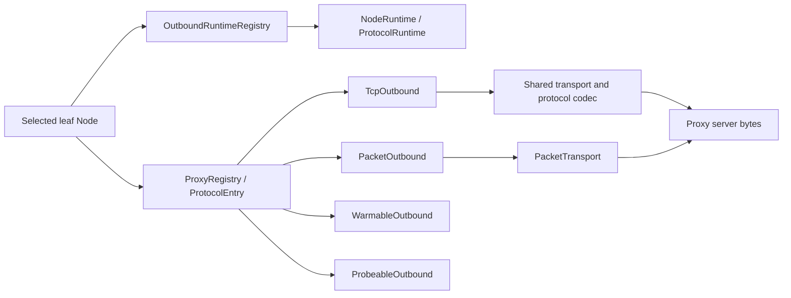

# 出站与代理栈

出站栈把选定的叶节点连接到代理服务器或目标，并处理协议字节。

## 范围

路由和代理组选择确定叶节点 `Node` 后，出站栈接手后续工作：按 capability 分派 handler、
维护可复用的协议状态、建立 transport、完成 TLS 与 REALITY 握手以及代理 framing。
建立好的 TCP 或 UDP 对象由它返回给控制面。

节点配置见[节点参考](../reference/nodes.md)，组成员选择与健康策略见[组设计](./groups.md)。
这两项不归出站栈管。

普通调用方会收到两种对象之一：

- `ProxyStream`：已经建立并绑定目标的 TCP 字节流。
- `Arc<dyn PacketTransport>`：已经建立、面向一个 UDP 目标的分帧报文路径。

推测式 UDP 拨号先返回 `PreparedUdpTransport<T>`。commit 可能失败；成功时只返回被选中值的 `Arc<T>`，未选中的 preparation 在 drop 时回滚。VLESS XUDP/Mux.Cool、Hysteria2、TUIC 和所有 `MultiTargetTransport` 都属于来源共享协议，它们把 transport 提交给 core 所有的 source attachment，同一 source scope 下的多个五元组因此共用同一个 receiver。

`direct` 不使用代理协议，直接连接目标。`block` 终止请求。其他 handler 根据选定节
点，生成代理服务器能理解的协议字节。

`honk-outbound` 负责出站拨号、组和健康检查，`honk-core` 通过 `honk_core::{proxy, group, outbound}` 重新导出这些模块。

## 实现模块归属

公开的 `proxy::*`、`quic::*` 与 `quic_boring::*` import 路径仍受支持。实现按职责
拆成普通 Rust 模块：

| 范围 | 实现模块 |
| --- | --- |
| Proxy 契约 | `proxy/{error,packet,outbound,registry}.rs` |
| 协议族 | `proxy/shadowsocks/{mod,aead2022,stream}.rs`；`proxy/vless/{mod,handler,mux,cool,encryption}.rs` |
| QUIC | `quic/{path_health,flow_control,metrics,endpoint,client,stream,boring}.rs` |
| AnyTLS | `proxy/anytls/{padding,writer,overflow}.rs` |
| Score 与健康 | `group/score/{evidence,ranking,feedback}.rs`；`alive/{health,urltest}.rs` |
| Session pool | `session/{maintenance,speculative}.rs` |
| Stream transport | `proxy/transport/{grpc,h2_io}.rs`；`proxy/transport/xhttp/{browser,preparation,request,response,runtime,session,stream,upload}.rs` |
| Pooled runtime 生命周期 | `runtime/pooled.rs` |

共享状态仍留在共同的父模块里，子模块不公开这些字段。REALITY、TLS、stream
transport 和 UoT 仍由多个协议共用，不归 VLESS 独占。既有的测试名称保留在对应协议
族内。物理文件、行号和定义模块的 metadata 会随归属变化；公开 reexport 不会保留
`type_name` 或默认 tracing target。旧的 `quic_boring`、`vless_mux`、
`shadowsocks_2022` 日志过滤目标，应改成 `honk_outbound::` 前缀下的
`quic::boring`、`proxy::vless::mux`、`proxy::shadowsocks::aead2022`。

## Registry 与 capability 模型



`ProxyRegistry` 只做协议分派，不持有 session。每个 `ProtocolEntry` 包含一个
`ProtocolDescriptor`、一个必需的 TCP handler，以及可选的 packet、warm 和 probe
capability 槽。槽为 `None` 表示协议没有实现该 capability，分派会直接拒绝，不会静
默换成别的实现。

`src/proxy/mod.rs` 里，`ProxyStream::into_tcp_stream` 保持 zero-copy splice 的
downcast 不变量。`proxy/vless/handler/stream.rs` 的
`ProxyStream::into_vision_splice` 对未包装的 Vision TLS/REALITY carrier 类型遵循
同一套 vtable 分派规则。因此，只要给这个 carrier 加一层包装，它就不能再交给
splice。`PreparedUdpTransport<T>` 用一次消费式 commit 隔离推测式发布，并返回精确
选中的 `Arc<T>`。`WarmAttempt` 在建立期间持有 retention lock；失败或取消时，只回
滚自己插入的 bit。

### Capability trait

`WarmRequirement::Session|Udp` 选择要建立哪种可复用状态。VLESS 会分别从 TCP path
和 UDP path 解析这两种 requirement，所以 Selector 预热不会打开仅 UDP 的 Xray
pool。

| Trait | 操作 | 契约 |
| --- | --- | --- |
| `TcpOutbound` | `dial`、`dial_with_tcp`、`dial_runtime`、`dial_runtime_marked` | 打开绑定目标的 `ProxyStream`。`dial_with_tcp` 可以使用已经连接的裸服务器 socket。`dial_runtime` 把拥有 session 的工作固定到捕获的 generation。`dial_runtime_marked` 携带已路由直连流的 `DirectMark`；只有 Direct 应用它，其他 handler 拒绝该调用。`ProxyRegistry` 让带 mark 与不带 mark 的拨号经过同一组 generation fence。 |
| `PacketOutbound` | `dial_udp_transport`、`dial_udp_transport_runtime`、`dial_udp_transport_runtime_marked`、`dial_udp_transport_speculative_runtime` | 打开或准备普通 `PacketTransport` 契约。runtime 与 speculative 变体防止 reload 或冷 race 的工作查询可变的当前状态。带 mark 变体遵循 `dial_runtime_marked`。 |
| `WarmableOutbound` | `warm(runtime, timeout, WarmRequirement)` | 只建立 requirement 指定的可复用状态。Hysteria2 用 `Udp` 验证服务端 admission；VLESS 可以把 `Session` 与 `Udp` 映射到不同 pool。 |
| `ProbeableOutbound` | `test_connectivity` | 测试原始代理服务器可达性。协议可以覆盖默认的带 mark TCP 连接。 |

`PacketTransport` 暴露 relay 目标、`send_packet`、`send_packet_confirmed` 和
`recv_packet`。对带队列的 tunnel，`send_packet_confirmed` 是更强的首包 admission
点。full-cone 协议还可以声明：服务端 metadata 能权威指定回包源地址。来源共享协议
由 core 串行化各 endpoint view 的发送，并持有 transport 唯一的 receive loop。

生产环境的 UDP handler 不返回裸 socket 或 loopback bridge。Direct 和 SOCKS5 把
native socket 包在 `PacketTransport` 后面；tunnel 协议在自己的真实 transport 上
实现 framing。

### 协议 descriptor

`src/descriptor.rs` 里的 `ProtocolDescriptor` 是唯一的逐协议事实表。predicate 接
收具体节点，因为 VLESS 的 `network` 和 TCP path，以及 Trojan 的 transport，会影
响 capability 或 pooling。Trojan 与 AnyTLS 共用 `network_allows_udp`；VLESS 使用
规范的 `VlessConfig::udp_enabled()`。

| 协议 | `supports_udp` | `pool_ready_streams` | `pool_bare_tcp` | Generation runtime | 分享链接 scheme |
| --- | --- | --- | --- | --- | --- |
| Shadowsocks（含 2022） | 是 | 否 | 是 | `None` | `ss` |
| Trojan | `network` 缺省或包含 `udp` 时 | 仅 `tcp`/空 transport | XHTTP 之外 | `None` | `trojan` |
| VMess | 否 | 否 | XHTTP 之外 | `None` | `vmess` |
| VLESS | `network` 允许 UDP 时 | 否 | direct TCP path 且非 XHTTP | `Vless` | `vless` |
| SOCKS5 | 是 | 是 | 是 | `None` | `socks5`、`socks4`、`socks4a` |
| Hysteria2 | 是 | 否 | 否 | `Quic` | `hysteria2`、`hysteria` |
| TUIC | 是 | 否 | 否 | `Quic` | `tuic` |
| Juicity | 是 | 否 | 否 | `Quic` | `juicity` |
| AnyTLS | `network` 缺省或包含 `udp` 时 | 否 | 否 | `AnyTls` | `anytls` |
| Direct | 是 | 否 | 否 | `None` | 无 |
| Block | 否 | 否 | 是 | `None` | 无 |

Ready-stream pooling 保存已完成、已绑定目标的握手。Bare-TCP pooling 只保存已经连
到代理服务器的 socket，目标握手留给之后的 `dial_with_tcp` 完成。TCP multiplex 和
QUIC 协议不进入这两种 pool，因为 generation runtime 已经持有复用状态。Direct 也
不进入这两种 pool，因为每条流的 socket 各自带着规则 mark 或全局 mark。即使配置了
独立的仅 UDP Xray pool，direct TCP 的 VLESS 仍可以进入 bare pool。XHTTP 不进入这
两类 preconnect pool，物理 H2 复用由它自己的 transport runtime 持有。

Ready stream 按 runtime generation、节点身份和目标分别保存。只有流所属
generation 与被拨号时的 generation 一致，才能取出。reload 发布新 generation 后，
连接池会在同一把锁内做几件事：移除旧 generation 的 ready stream、目标计数、预热
任务记录和目标访问计数；拒绝旧 generation 之后发来的 ready 写入、访问计数更新和
预热请求。新 generation 的 ready 命名空间从空开始；reload 被拒绝时，当前连接池状
态保持不变。Bare-TCP 仍以代理服务器地址为 key。节点失效时，清除该地址的 bare 连
接，但只清除当前 generation 中属于该节点身份的 ready 连接。

Bare entry 只完成了到代理服务器的 TCP connect。复用它之前，pool 会拒绝任何已经排
队的入站字节，包括 fatal TLS alert。此时协议和 TLS 建立都还没开始，服务端不可能
发出有效字节。这个 socket 不做 SNI 或 alert 特判，也不重试握手。Ready entry 已经
完成绑定目标的协议握手，所以缓冲的目标数据仍然有效，不算 stale。

Registry 组装时会检查三件事是否一致：descriptor 声明的 capability、已填充的槽、
runtime 的种类。依赖节点的 entry 即使默认节点没有 UDP，也可以带 packet 槽。
`block` 是显式例外：descriptor 声明它没有 UDP capability，但分派允许它的 packet
槽通过，让选定的 block 决策能够终结并拒绝该流。关闭 UDP 的节点返回普通的
capability 拒绝，调用方可以继续回退到配置中的冷候选。显式目标策略的拒绝仍是终态，
不影响健康状态，也不等于缺少 UDP 支持。

### 协议与 UDP 清单

| Handler | TCP 行为 | `dial_udp_transport` |
| --- | --- | --- |
| `direct` | Native 带 mark 目标连接 | `PacketTransport` 后的 native 带 mark UDP |
| `block` | 拒绝 | 显式拒绝路径例外；不承载 UDP |
| `socks5` | SOCKS CONNECT | RFC 1928 UDP association。每个客户端源有一条控制流和一个连接到中继的 socket，供其所有目的地共用。每个 header 写入自己的目的地，每个应答返回真实线上来源（IPv4-mapped IPv6 规范化为 IPv4）。域名来源仅在等于拨号域名且端口一致时才投影为捕获的目标，其他名字不经 DNS 直接丢弃。发送时只写入拨号域名，其他名字以数值目标发出。被截断、RSV 非零、分片（`FRAG != 0`）或域名不是 UTF-8 的中继 datagram 只丢弃该包并记 DEBUG；未知 ATYP 或控制流 EOF 结束 association。协商和认证、ASSOCIATE 请求和应答（含中继域名解析）各有五秒超时。 |
| `ss` / Shadowsocks 2022 | Shadowsocks stream | Shadowsocks packet framing；每个客户端源一个已连接的服务端 socket 与加密状态，可发往任意目的地（见下文） |
| `trojan` | 共享 transport 上的 Trojan stream | `network` 允许 UDP 时使用 Trojan UDP framing；每个客户端源一条 associate 流，每个 frame 自带对端地址 |
| `vmess` | VMess stream | 未实现 |
| `vless` | 由独立 multiplex policy 选择 direct、H2 或 Mux.Cool | `network` 允许 UDP 时可用；encoding 与可选 UDP multiplex 决定路径 |
| `hysteria2` | QUIC stream | Hysteria2 QUIC datagram |
| `anytls` | AnyTLS 逻辑 stream | UoT v2 逻辑 stream |
| `tuic` | TUIC v5 QUIC stream | QUIC datagram 或 uni-stream fallback |
| `juicity` | Juicity QUIC stream | 每个客户端源一条长度分帧 QUIC bi stream，承载所有目的地 |

Shadowsocks 的传统 AEAD 和 2022 版本用一个 `MultiTargetTransport` 承载同一客户端
source 的所有目的地。它只有一个连到服务端的带 mark socket 和一份加密状态。2022
还多了客户端 session ID、单调递增的包计数器，以及一对服务端 session 重放窗口，这
些状态都不会因目的地变化而重置。默认目标的地址头预先编码，其他目的地编码到栈缓冲。
`recv_packet` 返回经认证的内层地址作为对端，因此从未联系过的主机回包，也会以该主
机的身份到达核心；IPv4-mapped IPv6 会规范化为 IPv4。域名来源只有在等于拨号域名和
端口时才会被接受，比较按 ASCII 不区分大小写，并映射到拨号目标；其他域名一律丢弃，
不做 DNS。发送时每个 datagram 只写入拨号域名，其他名字以数值目标发出。过短、key
错误、重放、地址错误或无法映射的数据报只丢弃自身；2022 的重放状态只在地址解码成
功后提交。外层 socket 仍连接服务端，所以未经请求的对端能否到达客户端，取决于服务
端自己的 NAT 行为。

VMess 和 VLESS entry 只在 `rprx` feature 下编译，`honk-core` 和 `honk-tool` 的默
认 feature 集启用了它。不带 `rprx` 时，这些节点形式仍能解析，但 registry 里没有
对应的 entry，拨号会以普通的 `No handler for protocol` 拒绝。feature-off 构建不
分配 VLESS runtime pool，也不分配 carrier semaphore。单元测试通过 `cfg(test)` 保
留 backend 覆盖；feature 边界集成测试链接正常的 library，用来验证这两种构建的区
别。

## Runtime 所有权与 reload

`src/runtime.rs` 定义 `OutboundRuntimeRegistry`。控制面在一个不可变配置
generation 中，可复用的出站状态都由它持有。它把 `Node.id` 映射到 `NodeRuntime`，
每个 `NodeRuntime` 包含：

- 不可变的 `Arc<Node>` 配置；
- 节点相关的 `udp_capable` 结果；
- 由 descriptor 选择的一个 `ProtocolRuntime`；
- 可选的 XHTTP transport 状态，它与协议 runtime 并存，不替代协议 runtime。

`ProtocolRuntime` 可以是 `None`、AnyTLS 状态、`VlessRuntime`，或类型擦除的 QUIC
client 槽。每个 VLESS 节点都持有 `VlessRuntime`，其中只创建配置选中的 H2、
shared-Cool 或 separate-Cool pool，并保存 lazy private source-ID key。这些资源归
generation 所有，handler 保持无状态。

遇到未知 transport、无效的 pin 或 REALITY key、保留的内置名称或协议时，一律 fail-closed。

- 结构化或导入的 raw TCP TLS ALPN 存于 `TlsOptions.alpn`，对应的 flat serde 字段是 `tls_alpn`，空列表时省略。`Node::validate_protocol` 要求 AnyTLS 或 TCP Trojan/VMess/VLESS 启用普通 TLS，并拒绝 REALITY、WS、gRPC、QUIC 的 override。ALPN 名称长度为 1–255 字节，编码后的列表最多 65,533 字节。非空 ALPN 以基础 ID 作为命名空间，以 JSON 元组 `["tls-alpn", <ordered list>]` 作为名称，派生 UUID v5 子 ID，与任意凭据文本分开。空列表保留基础 ID，包括 VLESS 重新派生的身份。URI/v2rayN 的 ALPN 兼容行为和 TUIC 独立的 `tuic_alpn` 不变。

XHTTP 使用独立的 H2-only profile。规范节点携带 `["h2"]`，普通 TLS 和 REALITY 都会设置这个 offer，但不会改变 raw TCP、WS 或 gRPC profile。普通 TLS 在发送代理字节之前，会拒绝没有协商 H2 的对端。认证后的 REALITY 按 transport 契约选择 H2；官方 Xray 会故意省略服务端 ALPN。显式的明文 XHTTP 要求对端支持 H2。规范请求形态以及 TLS/明文安全配置都参与节点身份和 reload 复用。

admission 范围内的 TCP 反馈只会开始一次：在首个获准的物理尝试开始时，或者在复用
session 或 QUIC connection 上打开逻辑流之前。冷 admission 还在等待时，反馈不会开
始。已经完成、但没有经过上述任一边界的路径，仍使用完成时的回退机制。

### Generation 生命周期

启动时先构建并校验完整的 runtime registry，然后才发布。reload 基于前一份
registry 构建 replacement。只有完整节点配置相等时，runtime 才能迁移；比较时忽略
解析期的 `created_at` 和 `updated_at` metadata。

迁移发生在 reload commit 点。replacement 发布之后，旧 generation 才记录已经移出
的 `Node.id`，并在后续的 drain 和 shutdown 中跳过这些 runtime。因此，未变化的节
点会保留：

- TUIC、Juicity 和 Hysteria2 的 QUIC client 和连接；
- AnyTLS 物理 session；
- 完整的 VLESS runtime，包括 H2/Mux.Cool carrier 和 source-ID key。

退役 generation 首先对新工作变成 terminal。未迁移的 AnyTLS 和 VLESS pool 进入
draining：不再接收新的逻辑 stream，但现有 stream 保留 carrier 直到结束。QUIC 流
持有连接 clone，所以 terminal generation 检查会拒绝新工作，当前流则自然完成。进
程 shutdown 在可选的[业务连接宽限等待](../reference/global.md#关闭)之后，强制关
闭剩余 pool 和 QUIC client。

standalone probe 这类没有 generation 的调用方使用 `EphemeralRuntimeGuard`。
AnyTLS 或 VLESS stream 与 packet transport 在整个生命周期内都保留 guard。正常完
成时可以等待 `close`；drop 也会启动确定性的 teardown，所以一次性 pool 不会在调用
方 abort 后残留。Single XUDP 也用 VLESS runtime 生成逐 source key，但它的
private carrier 不进入可复用 session pool。

### 拨号 admission

direct TCP 与代理的 TCP/QUIC 尝试都属于物理出站连接，它们连同协议握手会取得两个 permit：

1. 捕获 generation 的配置拨号 gate；
2. 所有重叠 reload generation 共享、启动时固定的进程级 ceiling。

先取得 generation gate，避免低限额 generation 在等待时占住进程容量。replacement
可以立刻采用新的 generation 局部限额，旧的在途工作继续占用共享进程 gate。已经预
热的 session 上，逻辑 stream 不再执行物理拨号。

Session pool 自主发起的 replacement dial 只绑定已发布 owner 的 admission。reload
发布时，会原子地把迁移的 pool 重新绑定到新 generation；迟到的 speculative commit
不能恢复前任 generation 的 gate。退役会立即清除已存储的 admission。未 commit 的
`PreparedUdpTransport` 不保留 generation 或进程级 dial-admission permit。

Pool waiter 在检查容量之前，先注册容量变化通知。pool 持有的每个 stream permit 释
放时都会通知 waiter，包括 detached session 的首个 permit。carrier 发布会唤醒所有
符合条件的 waiter。这样，不预留 stream 的 warm offer 不会消耗掉唯一一次通知，也
不会让仍有可用容量的 stream checkout 一直等下去。

拨号发起者在启动 task 之前订阅结果，并直接消费这次尝试的结果。即使已有 warm
session 可以承接普通 spread 拨号的失败，已经完成的本地拒绝仍保持终态。Pool-owned
task 在 poll 拨号之前会重新检查终态。在途的普通拨号会预留一个可复用 slot。如果普
通 offer 或进行中的拨号占满上限，detached winner commit 会把超出的 private
carrier 以 drain-only 方式发布，并保留已经 admission 的 stream；多 carrier 批次
也一样。批次先校验全部成员，再发布其中任何一个。丢弃 loser，或者向已退役 pool 提
交时，仍然只关闭它的 private carrier。

解除 warm retention 时，多余的 live carrier 进入 Draining 后也会唤醒容量 waiter，
不需要等这些 carrier 上已有的 child 结束。maintenance 按 max-age 退役，或者清理
已关闭 session 而释放容量时，也会发布通知，即使没有关闭 idle carrier 或执行
prewarm。backend 关闭或从 Active 进入 Draining 时，会通知同一个所属 pool，包括
child permit 仍被持有时 H2 driver 终止。session 在发布或 detached attach 之前绑
定 pool 通知；手动清理已关闭 carrier 时也会广播容量变化。

VLESS 物理 carrier 还持有不可变进程级 VLESS-carrier gate 的一个 permit。启动资源
预算先扣除 DNS socket 分区，再在计算 UDP endpoint 之前分出
`min(after_dns / 8, 8192)`；零值保持为零。reload 流量和 DNS runtime fork 共用同
一个 gate。permit 随实际 carrier I/O 经过 provisional、active、draining 和 idle
状态，一直保留到 task teardown。因此，描述符的权威边界来自这个 gate，而不是各节
点 pool cap 的总和。

## 共享 stream、socket 与 bootstrap 层

### Stream transport

Trojan、VMess 和 VLESS 共用 `src/proxy/transport.rs`。具体行为由 `node.transport()` 返回的 `StreamTransportOptions` 决定，用到其中 `transport`、`ws_path`、`ws_host`、`grpc_service`、`xhttp` 这几个字段。建立顺序固定：

```text
TCP -> optional TLS or REALITY -> optional WebSocket, gRPC or XHTTP -> protocol header
```

`maybe_tls_wrap_concrete` 保留 Vision 需要的具体 TCP/TLS 类型。有 REALITY 参数时，
它走[有界认证建立过程](#服务端认证与指纹约束)，不走普通 TLS。因此，同一条共享路
径为 Trojan、VMess 和 VLESS 提供一致的 TLS、REALITY、WS、gRPC 和 XHTTP 建立过程。

Trojan 冷连接和 pool 中取出的裸连接使用同一套完整 transport。

Trojan UDP 让一个客户端源的所有目的地共用一条 UDP-associate 流。header 指定首个
目的地，之后每个 frame 的格式是 `address | u16 length | CRLF | payload`，两个方
向上各自携带对端地址。`recv_packet` 返回 frame 中的真实对端；IPv4-mapped IPv6 规
范化为 IPv4。因此核心可以接纳来自从未联系过的对端的首个回复。域名 frame 只有与捕
获的拨号域名和端口一致时，才投影为捕获的目标。其他域名 frame 会被整帧消费并丢弃，
包括 length、CRLF 和 payload，也不做 DNS。发送时每个 frame 只写入拨号域名，其他
名字以数值目标发出。未知 ATYP 无法推导长度，会终止该流。各 frame 共用该流的
writer：写到一半就停滞的 frame 会终止整个 source，绝不按拥塞处理。各目的地因此共
享队头阻塞和失败命运。域名目标 scope 仍按原始目的地区分。TLS 批量读取先返回已经
读到的字节，再在下一次非空读取中报告后续的 I/O 错误，不会把该错误转换成 EOF。


`transport_quality` 按 runtime owner 管理 carrier 压力提示。共享的
TCP/TLS/REALITY 和 AnyTLS 在物理 I/O 层观测，Shadowsocks 借用已有的 socket half。
Linux `TCP_INFO` 每个活跃秒最多读一次。各字段按内核返回的 ABI 长度分别检查；字段
缺失或读取失败时保持未知，也不改变 I/O。Vision Direct 和 ready pool 的 FD 存活性
检查仍走 socket 路径。Hy2/TUIC/Juicity 复用已有的每秒物理 QUIC 采样，隔离握手确
认或发布之前的历史，peer 改变时重建基线；逻辑 mux child 不会重复报告同一事件。这
里不额外持有 FD，也不创建逐 TCP 定时任务；静止的 TCP 不会产生新的事件驱动观测。
详见 [Score 压力语义](./groups.md#score-评分与生命周期)。

`proxy/transport/grpc.rs` 使用已有的 `h2` client 承载 gRPC gun framing。HTTP/2
帧、HPACK/Huffman、CONTINUATION 拼接和连接级动态表都交给 `h2` 管理。响应头限制为
64 KiB，动态表采用默认的 4 KiB 上限。返回的流直接拥有连接 driver 和 socket；丢弃
流就关闭 transport，不会留下脱离 owner 的任务。

opening request 不设置 `END_STREAM`。TLS 请求使用 `:scheme: https`，且始终协商
`h2`，与指纹 profile 无关。DATA 保留 gRPC 长度前缀，也保留 gun 对端使用的
protobuf 单 bytes 字段 envelope。最多允许一个 16 KiB 的应用消息排队等待发送；取
消不会把已经取得所有权的字节算进后一次调用的 buffer。`h2` 可以把消息拆到正在发送
的窗口里，窗口小于 envelope 也可以。flush 会同时等待排队 DATA 和底层 transport
刷新完成，不能只看控制帧是否刷新。请求 shutdown 发送 `END_STREAM`，但保留响应方
向；拆分后的读写任务都能收到 driver 唤醒。

非 200 响应、trailers-only 拒绝、非零 gRPC status、流重置，以及携带错误或排除当
前流的 GOAWAY，都会返回流错误，而不是正常 EOF。已缓存的 payload 先交付，终止读取
错误随后交付，后续读取仍然保留该错误。接收方向已经成功完成时，不会因为稍后的写入
失败而失去 EOF。优雅 GOAWAY 允许已接受的流完成，不会自动重放应用字节。

VMess 在关闭 duplex 半边前记录 relay 返回的错误，使响应头及消息体解码
失败传递到流 owner，而不是变成 EOF。

#### XHTTP carrier 与逻辑流所有权

`proxy/transport/xhttp.rs` 把原始 H2 body 适配成已有的 stream 契约，并持有节点级 `SessionPool`。它不是新的代理协议，也不是 loopback relay。开启下载后会多一个 peer：它有自己的 pool 和拨号节点，只承载 GET。调用方传入的 socket 始终属于上传 peer。winner commit 在同一次 lifecycle 锁内同时持有两个 pool 锁，先校验两侧的 private carrier，再发布；任何一侧的 carrier 已经断开，两侧都不会发布。每个 pool 最多保留两条可复用物理 carrier。draining carrier 可以在既有的进程 FD/VLESS-carrier gate 下与 replacement 短暂重叠。物理 driver 拥有 socket、观测和 carrier permit；HTTP 请求和逻辑代理流使用独立的 reservation。对端公布的并发 stream 上限保持权威，包括零、一和后续的缩小。

每条 carrier 最多保留 2048 个本地 reset 请求，相当于 16 个 admission 窗口。它使用 h2 默认的一秒在途 frame 宽限期，也保留 h2 默认的终身协议错误 reset 预算：最多 1024 次。持续的短流 churn 会在旧 reset 状态过期前取消多个 admission 窗口，所以保留数量必须高于活跃请求上限。

Stream-one 使用一个 POST，stream-up 使用 GET 和流式 POST，packet-up 使用 GET 和有序的有限 POST。建链不必等响应头，就能返回可写流。上传响应里的 padding 会被持续排空并丢弃，不计入应用 RX。Packet-up 在空闲后的第一批数据到达时立即发送，不额外等凑批。连续的 POST 遵守 `scMinPostsIntervalMs`。POST 等待节奏间隔、或其 body 正在发送时接纳的字节，会合并到下一次 POST。每流字节缓冲和最多八个未完成响应的 POST 一起限制背压；前一个 body 物理写完之后，就可以继续后续 POST，不必等它的响应。

legacy 上传 padding 的 Referer 使用配置的基础 path，query 换成生成的 `x_padding` 值；请求本身仍保留配置的 query。

Stream-one 和 stream-up 的 flush 在当前 H2 流控下，等待字节所有权释放和物理 I/O 刷新。Packet-up 的协议建立 flush 和首次应用写入 flush，都会等待完整的已接纳字节前缀完成物理刷新，跨多个 POST 也一样。VLESS Encryption 额外预留一个建立屏障；在恢复的 0-RTT 连接里，即使握手和协议头共用一次 flush，也保留这个屏障。没有新字节的 flush 不消耗这些屏障。之后的 packet-up flush 只检查保留的错误，不等待 POST，所以逐 datagram 的 write/flush 循环可以跨节奏间隔合并批次。

如果没调 shutdown 就丢掉 packet-up stream，已经接纳但还没上传的字节也会丢；shutdown 是唯一的上传完成屏障。缓冲的下载字节先于终止错误交付。上传 shutdown 保留响应方向；stream-up 在请求 END_STREAM 完成物理刷新后结束，并继续排空 POST 响应，保留延迟到达的上传拒绝。Packet-up 的 shutdown 等待每个已接纳字节所属 POST 的响应完成并检查状态，不伪造 EOF 标记。

优雅 GOAWAY 停止向该 carrier 开新请求，保留已通过 admission 的 stream；只有未来的新 POST 转到 replacement，不重放交付状态不明的应用字节。退役会关闭新逻辑流 admission，但已经 admission 的 packet 流保留完成所需的请求容量。

如果对端缩小 stream 上限，导致已保留的 packet-up 上传 lane 不可用，就先把该 carrier 转为 draining，再接纳 replacement。已有 GET 保持存活，replacement 取得上传容量；旧 reservation 不会占住可复用 carrier 上限。

Stream-up 上传响应错误已经可以报告时，会优先于同时完成的请求 END_STREAM 处理。因此 shutdown 返回该拒绝错误，而不是报告半关闭成功。

ephemeral 建立过程在取消期间也受 guard 管理。由 pool 自己管理的握手有 deadline。
speculative UDP carrier 只有在胜者完成 fallible commit 之后才发布；关闭或丢弃
preparation 会回滚 reservation。清理由既有的 runtime shutdown、retirement 和
idle maintenance 负责，没有新增协议 janitor，也不产生逐包 telemetry。

### 带 mark socket 与名称解析

`crates/honk-outbound/src/bootstrap.rs` 提供与 dae `bootstrap_resolver` 对应的进程级解析，`util::connect_marked` 和 QUIC 建立路径都会调用它。ECH 的 raw-query 发现由 `tls::discover_ech_config` 调用 `query_ech_config`。

`util.rs` 集中创建出站 socket：

- `connect_marked` 先解析，再连接 TCP，并设置 timeout、nodelay、keepalive 和可选
  的 `SO_MARK`。
- `connect_outbound` 对代理服务器 TCP 应用 bypass mark。
- `udp_marked_bind` 和 `marked_udp_socket` 创建带 bypass mark 的 UDP socket。

控制面 socket 使用进程级 `global.so_mark_from_dae`，值为零时选 `DAE_BYPASS_MARK`，
即 `0x100`。非零直连规则 mark 改用 `rule_mark | CLASSIFIED_MARK`，不会把覆盖值传
给 bootstrap 或代理 carrier。WAN egress 识别这两类标记。只有在没有生产 datapath
的非特权 `EPERM` 环境里，mark 应用才是 best-effort；其他错误都会向上传播。

订阅和直连 UI 下载也走同样的带 mark TCP 拨号，之后用 Hyper HTTP/1 处理帧，并沿用
既有的 rustls/platform-verifier TLS 策略。挂接 eBPF 之前的首次订阅抓取也一样。
TLS 初始化失败会返回下载错误，不会 panic。订阅 URL 里的凭据会转成标记为敏感的
Basic Authorization header；显式配置的 Authorization 优先。同源重定向保留认证信
息；host、端口或 scheme 一旦变化，认证信息就永久移除，即使之后又跳回原始源也不会
恢复。重定向 URL 的 userinfo 不会提供新凭据。响应体上限和 HTTP(S) 环境代理连接仍
受各自下载边界的约束。

`bootstrap.rs` 避免代理主机名解析依赖 honk 自己拦截的 DNS 路径。节点拨号点经
`connect_marked` 或 QUIC 建立调用 `bootstrap::resolve`，绝不直接调用裸
`lookup_host`；否则代理主机名解析会和 honk 自己拦截的 DNS 路径形成死锁。
`resolve` 先交给 core 的进程级 `NodeHostResolver`。它只接管当前 DNS generation
中由 [`subtag()` 规则](../reference/dns.md#节点服务器域名)路由的主机名。
`resolve_with*` 用于 DNS 上游 endpoint，会跳过它，因此上游自己的域名不会递归。其
余情况下，配置的 bootstrap resolver 通过带 bypass mark 的 UDP/TCP 发出查询。查询
失败时回退到 `/etc/hosts` 及 `/etc/resolv.conf` 中第一个数字 nameserver；DNS
socket 同样带 mark，不调用 libc NSS，也不追加搜索后缀。A 和 AAAA 并发查询，各自
有独立的 3 s 预算。只接受与随机查询 ID 及原问题完全匹配的响应；被截断的 UDP 应答
会改用带 mark 的 TCP 重试。`query_ech_config` 通过同一 raw 路径查询 DNS HTTPS 记
录，`qtype 65`，并提取 SVCB `ech` 参数。

解析完成后，`src/address_race.rs` 为代理服务器的 TCP `connect_marked` 和共享
QUIC `QuicClient` 安排连接尝试。IPv4 和 IPv6 稳定交错，最多同时 race 两个地址。
首个地址立即开始，fallback 在 250 ms 后启动。首个地址更早失败时会提前 fallback，
但物理尝试之间仍至少相隔 10 ms。每个在途的地址尝试分别持有 generation 和进程级拨
号 permit；达到配置上限时，fallback 必须等先前的尝试结束，所以
`max_concurrent_dials: 1` 会串行尝试地址。race 始终发生在已经选定的同一节点内部，
socket mark 和安全配置保持一致。TCP TLS 建立与 QUIC 协议初始化，包括 QUIC 协议认
证，只在胜出的 transport 上执行；QUIC TLS 握手也参与地址 race。错误按原始地址顺
序确定性地上报。

`crates/honk-outbound/src/util.rs` 提供 `connect_marked`、`connect_outbound` 和 `udp_marked_bind`。`connect_marked` 与 `connect_outbound` 负责 TCP `SO_MARK`、保活和超时。`marked_udp_socket` 请求 8 MiB 的 `SO_RCVBUF`/`SO_SNDBUF`；Linux 会分别按 `rmem_max`/`wmem_max` 限制，并报告两倍的记账值。honk-core 在非 mock 启动时尝试把 `net.core.rmem_max`/`wmem_max` 提高到 16 MiB，失败时只记录 warning。208 KiB 的默认窗口会让 QUIC 在 1 ms RTT 下大约受限于 2 Gbps。必须遵守 runtime 的 Bypass mark 不变量，否则 `wan_egress` 会把 socket 循环导入 `daens`。

## TLS、指纹、ECH 与 pin

出站和 DNS transport 栈里的生产 TLS 全部使用 BoringSSL。TCP 用 `boring` 和
`tokio-boring`；QUIC 用自定义的 `quinn-proto` crypto backend。信任库由
`webpki-root-certs` 构建。显式 no-verify connector 只用于配置的不安全模式和
REALITY；REALITY 用自己的握手后检查替代 PKI。

`src/tls.rs` 提供 BoringSSL TLS client，进程级 `set_tls_mode` 选择 TLS profile。`build_reality_connector(chrome)` 使用 `reality.rs` 的握手后 ed25519 认证替代 PKI，只允许 TLS 1.3，不提供 REALITY resumption。显式结构化的 TCP ALPN 在 tls 和 utls 模式下都会传给 `build_connector`。空列表保留 profile 默认值；Chrome ALPS 取决于列表是否精确包含 `h2`。Registry 发布和直接构造 connector 都会校验非空 override，共享 stream dispatch 会在选择 plaintext 或 REALITY 之前校验。直接 QUIC 配置会拒绝 TCP ALPN，不会忽略它。

`build_connector` 和 `build_reality_connector` 返回共享的 BoringSSL context。每种组合各有一个 context：REALITY、是否验证、pin、ALPN 覆盖、Chrome 模式。它们保存在进程级缓存里，达到 128 种组合时清空重建。每个 context 持有进程级 webpki 信任库，不用 `SslConnector::builder` 默认解析的系统 CA 证书包。因此拨号不再解析证书，存活连接也不会各自占用一份 CA 副本。

### 进程级 TLS profile

`tls_implementation = "utls"` 在进程范围内启用目前唯一实现的 Chrome-oriented 模
拟 profile。这个 profile 配置：

- GREASE 与逐连接扩展乱序；
- 先 `X25519MLKEM768`、后 `X25519` 的 key share；
- Chrome-derived signature algorithm、curve、cipher 集与 ALPN；
- brotli 证书压缩；
- h2 ALPS 使用历史 `0x4469` codepoint；本次核对的[uTLS Chrome_133
  profile](https://github.com/refraction-networking/utls/blob/aa6edf4b11af/u_parrots.go)
  使用 `0x44cd`；
- 没有真实 ECHConfigList 时的 ECH GREASE。

其他 `utls_imitate` 名称会记录 warning，并使用这个 profile。
`tls_implementation = "tls"` 保持普通的 BoringSSL ClientHello。两者都不承诺完整
的浏览器身份；REALITY 还必须加上 ed25519 signature algorithm。

### ECH 与证书 pin

节点可以内联提供静态 ECHConfigList，也可以通过文件提供。显式配置无效时，registry
构建会失败。服务端返回 `ECH_REJECTED` 时 fail-closed；服务端提供的 retry config
会记录日志，但不持久化。

只启用 ECH discovery 时，connector 会在连接期间通过 bootstrap 路径查询 DNS HTTPS
记录。正结果采用受限的记录 TTL，负结果缓存五分钟。discovery 是 best-effort，采用
fail-open：查询失败时，这条连接不使用真实 ECH，Chrome 模式仍可发送 ECH GREASE。

`pinSHA256`，对应 `tls_pin_sha256`，会比较叶证书的 SHA-256 digest，并替代 PKI
chain 校验和主机名校验。无效 pin 一律 fail-closed。TCP TLS 和 QUIC crypto
backend 使用同一规则。

## REALITY client

`src/reality.rs` 通过 `RealityConfig`、`parse_reality_config` 和 `reality_connect`，实现只允许 TLS 1.3 的专用 REALITY BoringSSL 握手。workspace 里打过补丁的 `boring-sys` 提供两个客户端 hook，详见 [Technology stack](../../../AGENTS.md#technology-stack)：

- `SSL_set1_client_x25519_private_key` 为独立的 X25519 share 预置 honk 的临时
  private key。
- `SSL_set_client_hello_fixup_cb` 在序列化的 ClientHello 进入握手 transcript 之
  前重写它。

### ClientHello 认证

首次 ClientHello 先声明 `X25519MLKEM768`，再声明独立的 `X25519`。即使 peer 协商
了 hybrid share，REALITY 认证仍刻意从预置的 classic X25519 private key/share 派
生。fixup callback 把 32 字节的 legacy `session_id` 槽清零，然后计算：

- `authKey = HKDF-SHA256(X25519(eph, pbk), salt=clientRandom[:20], "REALITY")`；
- nonce `clientRandom[20:32]`；
- `AES-256-GCM(authKey).Seal([ver:3][0][ts:4][shortId:8])`，版本字节保持 `1,3,3`，保留字节为 `0`，时间戳为大端 u32，short ID 为八字节。AAD 是 `session_id` 置零后的完整 ClientHello。

16 字节的加密 plaintext 加 16 字节 GCM tag，恰好填满 session ID。空 short ID 是
八个零字节。配置值必须是偶数长度的 hex，最多八字节，并向右补零。解析或 fixup 失
败时，会在发送未认证 ClientHello 之前中止。callback 只 seal 一次；第二次调用会在
复用 GCM key/nonce 之前中止，HRR 的第二条 ClientHello 也一样。因此客户端不声称支
持 HRR。

### 服务端认证与指纹约束

REALITY 用自己的认证替代普通证书校验。对端叶证书必须是临时 ed25519 证书，签名必须精确等于 `HMAC-SHA512(authKey, raw ed25519 public key)`。

不匹配、普通的 mask-target 证书或其他认证失败都会 fail-closed。客户端不会据此推
断唯一的远端原因。它不会回退到 PKI，也不使用 session resumption。

如果共享的 VLESS/Trojan/VMess transport 在首次 TLS 握手完成后收到非 ed25519 叶证
书，就允许一次兼容尝试。做法是关闭该连接，向同一个 peer 地址新建带 bypass mark
的 TCP socket，只通告 X25519。SNI、服务端 public key 和 short ID 保持不变；SSL
状态、client random 和临时 key 全部重新生成。新连接仍要通过同一个 REALITY HMAC
认证，之后才能发送代理头或应用数据。ed25519 HMAC 错误、证书缺失、TLS/IO 错误或
HRR 不会触发兼容尝试。第二次尝试只要失败就是最终失败。

这个证书结果本身没有通过认证，不能据此证明服务端是旧版本。错误凭据或主动攻击者也
可能诱发 classical 尝试，但无法绕过它的认证。profile 不缓存，也不增加配置项。两
次尝试、配额等待以及连接本身共用一个 `3 × connect_timeout` 的 setup deadline；外
层调用方的 deadline 可以更早到期。冷连接替换期间，已关闭 socket 的配额会保留到认
证结束。替换传入或池化的 socket 必须申请新配额，不能借用同级连接持有的 permit。
直接调用底层 `reality_connect` helper 仍只尝试一次。

REALITY profile 在 Chrome-derived signature algorithm 列表前面加入 ed25519，让
BoringSSL 能用该叶证书的 public key 验证服务端的 TLS CertificateVerify。这与本次
核对的 uTLS Chrome_133 profile 不同。honk 不承诺完整的 Chrome identity 或特定的
JA4 值。

target 缓冲限制取决于服务端版本，不是 honk 客户端统一的证书大小上限。文档中的
sing-box 1.12 / MetaCubeX-uTLS 1.8.0 peer 使用 [8192 字节的 target TLS record 缓
冲区](https://github.com/MetaCubeX/utls/blob/v1.8.0/reality.go)，这个数字包含
record framing，不是只限制 DER 证书长度。本次核对的 [XTLS/REALITY 实现](https://github.com/XTLS/REALITY/blob/8cdf7bf9c7f0/tls.go)
使用 17 KiB 缓冲区。应按实际部署的服务端版本选择兼容的 target。

## VLESS wire 契约

规范配置是 `honk-config/src/node/vless.rs` 里的 `VlessConfig`。UDP permission、
协议 packet encoding 和 multiplex 是三个互相独立的维度：

| 轴 | 值 | 路径作用 |
| --- | --- | --- |
| `network` | 仅 TCP 或允许 UDP | 唯一 UDP capability gate；关闭 UDP 不会选择 encoding。 |
| `udp_encoding` | `auto`、`native`、`xudp`、`uot-v2` | 选择非 multiplex packet 协议。无 Vision 时，`auto` 在 53/443 使用 native command-UDP，其他情况使用 Single XUDP。 |
| `multiplex` | `off`、H2、Xray | 独立选择 direct/H2/Mux.Cool TCP 与 protocol/H2/Mux.Cool UDP path。只有 H2 持有其 padding flag。 |

Xray TCP concurrency 为零时按 8 处理，负值关闭 TCP mux。XUDP concurrency 为零时
跟随 TCP pool，负值让 UDP 回到协议 encoding。正的 XUDP concurrency 会创建独立的
UDP pool，并被规范化为 `1..=128`。UDP/443 policy 默认是 `allow`：使用配置的 UDP
pool，没有 pool 时用协议 encoding。显式 `reject` 即使在两个 pool 都关闭时仍是终
态。`skip` 使用协议 encoding，不使用 pool。Vision 不会隐式限制 443 端口。

客户端不会探测另一条服务端 path，不会换成别的 framing 重试，也不会重放首个 UDP
packet。原生 VLESS 使用 u16 分帧的 connected command-UDP，不发送 UoT magic
destination 或 setup preamble。发送范围是 1–8190 字节。收到的零长度 frame 是
datagram，不是 EOF。writer 会确认 flush，不会重放取消后结果不明确的写入。

显式 `uot-v2` 使用 non-connect UoT v2。request 是模式字节 `0` 加第一个目的地；此
后双向每个 datagram 都是 `[ATYP 0/1/2][地址][端口][u16 长度][payload]`，采用 UoT
v1 编号，payload 最多 65535 字节。因此一条 stream 服务一个客户端源的全部目的地，
也就是 core 的 `Shared` source。每个回复都保留真实 peer：数字 peer 直接返回，
IPv4-mapped IPv6 规范化为 IPv4；捕获的拨号域名和端口投影回逻辑目标；其他域名不经
DNS 直接丢弃，并整帧消费；未知 ATYP 终止该 stream。与 XUDP 不同，这里没有
empty-first 或 poisoned-child 规则。request 和第一个 datagram 在一次写入中发送；
写入被中断会使 stream 失效，且不重放。按域名拨号的流会在 request 和每个 datagram
中发送该域名。其他任何名字，以及按数值拨号的流，都以数值目标发出。

真实 sing-box 1.12.4 的 direct outbound 由第一个目的地决定形态。域名 request 之
后，同名的逐包 FQDN 会被映射；数值 request 之后，逐包 FQDN 会报
`invalid AddrPort: missing address`，并终止整个 association。H2MUX PacketAddr、
AnyTLS、Trojan、SOCKS5 和 Shadowsocks 适用同一规则，即 `addr::dialed_name`。
Juicity 未改动，也无法验证，因为没有 juicity-server 可用。

类型化的 policy、size 和 carrier-capacity 拒绝都是终态的本地结果，与拥塞或
transport failure 分开。它们不会降低健康状态或 Score。候选 admission 在提交协议
状态之前检查 policy。DNS、health 和 CLI 调用方会保留这个拒绝，不选择 fallback，
也不把路径报告为不适用。

### H2MUX

`src/proxy/uot.rs` 和 `src/proxy/vless/mux.rs` 实现共享的 UoT v2 framing 和
sing-box H2MUX。H2MUX 把物理 VLESS 请求发往 `sp.mux.sing-box.arpa:444`，选择
backend `2`，然后在 carrier 上运行 HTTP/2。逻辑 stream 承载 TCP 或 UDP。UDP
stream 设置 sing-mux flags `UDP|Addr`，值为 `3`；在命名第一个目的地的 request 之
后，双向都携带 `[SOCKS5 地址][端口][u16 长度][payload]`，使用 SOCKS5 ATYP，不同
于 UoT v1 编号。一条 stream 就是客户端的共享 source，按与 UoT 相同的投影和丢弃规
则返回真实 peer；被丢弃的帧同样归还 HTTP/2 credit。不存在 loopback bridge。

可选的 H2 padding 会为每个方向最初的 16 条 record 增加 sing-mux v1 随机 preface
和 record framing。每个节点最多有两条可复用或正在拨号的 H2 carrier，每条最多并发
128 条 stream。draining carrier 可以与 replacement 重叠。这里的 128 是并发限制，
不是 carrier 生命周期或 open-count 轮转。

HTTP/2 流控驱动背压。GOAWAY 让 carrier 进入 draining，新工作转到 replacement。
driver failure 会向 child 扩散；half-close、reset、receive-window 释放和 lazy
response error 仍按 stream 隔离。每个 stream 的接收 credit 保持 2 MiB。
connection credit 仍能为每条已通过 admission 的 stream 容纳一个最大的 response
frame：状态字节、最宽地址 259 字节、长度和 65535 字节 payload。credit 按每帧完整
消费的 wire 长度归还，不管该帧被交付还是被丢弃。

### Mux.Cool 与 XUDP

`src/proxy/vless/cool.rs` 及其 `codec`、`child` 模块实现 Xray mux command、child
TCP 和 XUDP record。一个有序 writer 串行化所有 child frame。每条 carrier 的有效
并发取配置正值与 128 中的较小值。Session ID 单调增长，且不复用。发出 ID 128 后，
carrier 进入 draining，由 replacement 接纳新工作。这里没有逐节点两 carrier 上限；
进程级 VLESS-carrier FD gate 才是权威边界。

接收 payload 共用每 carrier 8 MiB 的预算。TCP delivery 在瞬时预算或队列压力下保
留 100 ms 宽限；超时只 reset 停滞的 child。UDP 在仍然满载时丢包。池化的 Mux.Cool
packet 保持 8 KiB 上限；Single XUDP 保持 7,526 字节上限。

### Source/session ownership and capacity

来源共享协议包括 Single XUDP、shared/separate Mux.Cool、Hysteria2、TUIC 和各个
`MultiTargetTransport`。对于这些协议，`honk-core` 按四项内容索引 source owner：
复用的 `NodeRuntime` identity、规范化后的 client 地址、所选协议与 UDP path，以及
reply projection，即 `ActualPeer` 或 `RewriteTo(original destination)`。一个
owner 持有一条协议 association 和一条 receiver，多个规范五元组 endpoint entry 提
供串行的 send view。Single XUDP 每个 scope 使用一个私有且未池化的 SID 0。
Mux.Cool 给各 scope 分配不同的 child SID，这些 SID 可以共享物理 pool。

Hysteria2 在 scope 的不同目的地之间复用一个 Session ID，TUIC 复用一个
association ID。不同 scope 可以共用物理 QUIC connection，但不共用逻辑
association。关闭 `rprx` 时，这些 QUIC source 路径以及它们的 shutdown join 仍可
用；只有 VLESS 分支依赖这个 feature。

Hysteria2 和 TUIC 的两种接收模式都用既有的有界重组器保留实际回包来源。Hysteria2
各分片的来源必须一致。TUIC 的后续分片可以省略地址，等第零片提供来源，即使第零片
最后到达也一样。来源元数据随所属 packet entry 过期。已知的请求域名和端口可以使用
捕获的目标投影，域名按 ASCII 大小写不敏感比较。未知域名不会触发 DNS，也不会伪造
foreign IP。TUIC 的零长度 payload 仍是 datagram；Hysteria2 保留既有的空入站
payload 拒绝。保留来源并不保证远端 NAT 的映射或过滤行为。

`MultiTargetTransport` 是 Shadowsocks、Juicity、SOCKS5、Trojan、AnyTLS 和 VLESS
UoT v2/H2MUX 共用的通用 source transport。Hysteria2、TUIC 和 VLESS XUDP/Mux.Cool
保留具体分支，使发送路径不被装箱。每个客户端源为其所有目的地持有一条逻辑
association：一个 Shadowsocks socket 与加密 session、一条 Juicity 双向流、一条
SOCKS5 控制连接加一个中继 socket、一条 Trojan associate 流、一条 non-connect UoT
v2 流，或一条 H2MUX PacketAddr 流。对 Shadowsocks 来说，SS2022 不会因为目的地变
化而重置 session ID、包计数器或重放窗口。

`recv_packet` 返回服务端报告的真实 peer。IPv4-mapped peer 规范化为 IPv4。域名来
源只有在等于捕获的域名和端口时才接受；其他域名，包括空名和非 UTF-8 名字，都不经
DNS 直接丢弃，流式协议会整帧消费被丢弃的帧，再读下一帧。未知地址类型仍是终止性错
误。

`send_packet` 和 `send_to` 共用一个未装箱 helper。`confirmed` 只在各 view 的首个
datagram 上传给 transport 时设置；`admitted` 在 datagram 进入线路或 writer 队列
时设置。对于可靠流 carrier，例如 Trojan、Juicity、AnyTLS、UoT 和 H2MUX，部分帧超
时对整个 source 仍是终止性的，因此共用一条流的各目的地也共享队头阻塞和失败命运。
H2MUX 只有在第一个分块交给 h2 时才 admit 该 datagram，并开始标记中毒。因此，任何
字节入队前的流控等待超时属于包局部拥塞，流仍可继续使用。包局部拥塞只在 source 仍
能 admit datagram 时成立。一串未 admit 的超时如果没有被任何 admit 的 datagram 打
断，不管彼此间隔多远，持续满 30 秒后就会像其他传输失败一样让 source 失败。所以回
包无法让卡死的上行一直存活，而什么都不发的空闲 source 也不会被误判。

写到一半被取消的帧会让该流带着类型化的 `FrameInterrupted` 中毒：下一次发送失败，
并退役该 source 的所有目的地，不会接在残帧后面。若这次写入是被其 view 自身的退役
取消的，这次退役属于中性取消，不向节点记入健康或 Score；因超时造成的撕裂仍是传输
失败。原生 UDP 的大小拒绝，即 `EMSGSIZE`，是类型化的本地 `InvalidSize` 拒绝，不
触发终止处理。最后一个 view 的 endpoint permit 会保留到 source receiver 退出或另
一个 view 绑定，让退役中的 source 不超出描述符分区；这也意味着饱和的 pool 短时间
内可能拒绝新 endpoint。core 的 send gate 是唯一的外层锁：后端只在它下面持有自己
的叶子锁，也不回调 core。

完整的 `(client, destination)` endpoint map 仍然是 route、decision token 和逐
flow Score 的权威持有者。Ready entry 的 reply 只在 endpoint 属于该 source owner
时投递。wrong owner、`Initializing` 或 `Retiring` entry 必须丢弃，绝不能重新分类
为 foreign。只有 `ActualPeer` scope 中不存在 key 时，才可以使用 foreign
full-cone reply；它会更新 source transport accounting，但没有 flow Score owner。
domain route 使用 `RewriteTo(original)`，永远不会变成 foreign reply。

VLESS runtime 会从该 scope lazy 生成 private keyed source-ID hash。复用 runtime
时替换 carrier 会保持 ID；替换 runtime 或重启进程会生成新 key。这样有意保留了
honk 的 per-source 行为，不等同于 Xray 的 source-only global identity，也不保证
NAT 无碰撞。迟到的 callback 会在动作之前重新检查 source owner 和 endpoint
token/generation；语义不明确的 send 不会自动重放。

作为对照，本次核对的 [Xray 实现](https://github.com/XTLS/Xray-core/blob/c412e77a9b712082ac9ebf27fa793951cb5a7d85/common/xudp/xudp.go)
默认在进程内生成随机 base key。跨客户端重启保留 `XRAY_XUDP_BASEKEY` 是显式选项，
不是 Xray 的默认保证。honk 没有持久化 base-key 选项，并额外区分 runtime、path 和
reply projection。ID 字节稳定或 carrier 复用，都不保证远端 NAT 状态能跨过期或服
务端重启保留。

source owner 负责报告共享 DataUdp transport 的 health。每个绑定的 endpoint 保留
自己的 Score reporter；匹配的 reply 和共享的 terminal outcome 会分别结算这些流。
foreign reply 没有逐 flow Score。source 容量耗尽时返回
`PacketRejection::Capacity`：该候选到此终结，但不影响 health 或 Score。

source 关闭 admission 时，会同时发布中性或失败的结算结果。即使 driver cleanup 抢
先取得 reporter，统一的 endpoint Score 结算入口也会使用这个结果。未绑定的 view，
以及在 source 关闭前已经退役的 view，保留自己的局部结果；shutdown 仍保持中性。最
后一个已绑定 view 只在 pending attachment 也全部释放之后才退役 source；sibling
view 退役时，已有 attachment 仍可以完成 commit。

对于 VLESS，endpoint 在 packet 入队后有意退役时，会终结结果不明确的 source，但不
重放 packet，也不产生负向 transport health。后续 sender 和 receiver 保留相同的取
消原因，避免兄弟流的发送把它重新解释为 carrier 故障。发送开始、完成和退役意图共
用 source-state 临界区。先记录匹配 sender 的意图，再在同一临界区发布 endpoint 和
source-view 退役标志，之后发送端或接收端才能分类取消原因。

QUIC source 只有在通过 source gate 并开始 I/O 之后才创建 send token，但 token 由
endpoint driver 保留到 success/timeout/failure 分类完成。等待 gate 会消耗既有的
发送 deadline，不创建 QUIC attempt。Datagram 拥塞和 TUIC stream failure 保留各自
的语义；取消或部分接受都不会授权重放 packet。

Selector 与 UDP warm retention 分别决定：TCP 选中的 pool 响应
`WarmRequirement::Session`，UDP 选中的 pool 响应 `WarmRequirement::Udp`。因此仅
UDP 的 Xray pool 可以参加 UDP 预热，direct TCP 仍可使用 bare pool。现有的
outbound maintenance pass 回收未被 retention 持有的 idle VLESS session，没有
VLESS 专用 timer。active、provisional、draining 和 idle carrier 都会持有进程
carrier permit，直到实际 I/O task teardown。同步未变化的 retention 不会 drain 任
何 pool；只有实际解除保留，才会 drain 该 pool 的多余 carrier，已有 child 仍可继
续完成。只有 Active carrier 计入可复用的 warm/standby 下限。携带活动 child 的
Draining carrier 独立保留，不能挤掉空闲 replacement；idle 回收和解除保留的删除过
程都线性遍历 pool。

文件描述符分区在进程启动时固定，并在 reload 和 DNS fork 之间共享。启用 `rprx` 时，
先扣除 DNS socket 分区，再在划分 UDP endpoint 定额之前预留
`min(after_dns / 8, 8192)` 个 carrier slot，即使初始配置没有 VLESS 节点。原生
VLESS UDP、UoT 和 Single XUDP 也使用这个 gate。关闭 `rprx` 时不预留 carrier，相
关余量留给 UDP endpoint。容量耗尽后立即返回类型化的 Capacity 拒绝，不排队等待。

| 生效 `nofile` | 不预留 carrier 时的 UDP endpoint 上限 | 预留后的上限 | 减少 |
| ---: | ---: | ---: | ---: |
| 1,024 | 45 | 39 | 13.33% |
| 4,096 | 192 | 168 | 12.50% |
| 65,536 | 4,563 | 3,992 | 12.51% |
| 1,048,576 | 32,768 | 32,768 | 0%（已达 endpoint 封顶） |

这些上限是从描述符推导出来的，不是预先分配 endpoint 内存。启动时还会按[内存](./control-plane.md#queue-与描述符预算)
进一步限制 endpoint。reload 不会重新划分，也不会扩大启动时的分区。

### Vision 与 VLESS Encryption

VLESS addon 携带 `xtls-rprx-vision`。response header 在第一次 read 时才 lazy
strip，因为它可能和目标字节同时到达。Vision 会移除 response padding。没有 VLESS
Encryption 时，Vision 要求 raw TCP 搭配 TLS 1.3 或 REALITY。即使启用 Encryption，
TCP multiplex 也始终非法；只有仅 UDP 的 Xray multiplex 合法。Vision 拒绝 native、
UoT 和 H2 UDP path。基础的 `xtls-rprx-vision` 默认允许经 Single XUDP 访问
UDP/443，`mux=off` 时也一样；用户可以用路由规则阻断 QUIC。输入中的
`xtls-rprx-vision-udp443` 会在派生身份和判断 runtime 复用之前，规范化为基础
Vision。显式 Xray `reject` 仍是终态，`skip` 使用协议回退。wire addon 始终是基础
Vision flow。

Vision 的上行从拨号开始。拨号时，VLESS 请求和 Vision 首帧一起发出：UUID 加一个内
容为空、带长 padding 的 Continue 帧，与 Xray 客户端在还没有 payload 时的做法一致。
因此请求仍在拨号的失败处理和 deadline 范围内。之后的上传按 Xray 默认的 padding
逐帧填充。已识别的 application-data 终止位置遵循内层 TLS record 边界，不按读写调
用边界。非 TLS payload 在完成分类后使用 End。出现 ClientHello 时，padding 会持续
到第一个完整 application-data record 结束。若下行 ServerHello 选择了 TLS 1.3，
cipher 属于 Xray 接受的范围 0x1301–0x1304，且 codec 具备 direct writer，该帧就携
带 Direct，否则携带 End。每个方向的检查预算是 64 KiB，在每帧或每次 read 后检查。
如果在观察到符合条件的 ServerHello 之前就出现 early application data，或者检查预
算在做出 application-record 决定前耗尽，就改用 End 结束 padding，并在后续上行中
保留所选 outer transport。

上行 Direct 帧离开 outer codec 并 flush 之后，上传绕过该 codec。在 TLS/REALITY
上，SSL 写半部被标记为关闭，但不发送任何数据，因此之后的 fatal alert 或
KeyUpdate 确认不会写入 raw 上行；shutdown 关闭 TCP 写方向，不发送 close_notify。
下行 Direct 命令仍只切换读取，SSL session 已解码的明文先于 raw 字节交付。两个方
向各自独立切换。padding 会给每条 Vision 连接增加字节。与引入上行之前的 relay 做
loopback A/B 时，短 Vision 连接在上行 1 KiB、下行 4 KiB 的情况下，relay CPU 约增
加 2.6%，几乎全部来自 padding；交接记账的开销在噪声范围内。足够长、能进入 Direct
和 splice 的连接开销更低；非 Vision relay 不变。

`src/proxy/vless/encryption.rs` 在 VLESS 请求之前包装选定的 transport。实现的协
议是 `mlkem768x25519plus`，wire mode 有 `native`、`xorpub` 和 `random`。它接受
X25519 或 ML-KEM-768 服务端 key，包括 chained relay key。新的 1-RTT 连接会组合
ML-KEM-768 和 X25519，认证 record 使用选定的 AEAD。可选的 0-RTT cache 按规范化节
点 identity 建立 key，并让被拒绝的 ticket path 失效。

Encryption 可以包装 direct 和 Xray/Mux.Cool path，包括受支持的 Vision 组合，但不
能使用 H2 或 UoT framing。任一方向的 Vision Direct 都只移除 AEAD framing。outer
transport 和 random 模式逐 record 的 header XOR 保持不变，并遵循 Xray `XorConn`，
包括它对 TLS 形态 header 的跳过规则。这不表示 encrypted Vision 会 cut over 到
raw socket。random-mode Direct 每次 write 最多确认并复制 8 KiB。Header XOR 状态
跨这些短写保留；native Direct 不增加 wire-copy buffer。

数据持续流动时，codec 复用一块写缓冲，与 random-mode Direct 共用，并在两块读缓冲
之间轮换，因此稳定传输的 frame 不再分配。超过一个最大 frame 的写缓冲，例如较大的
0-RTT prewrite，用完即丢弃。flush 完成后释放写缓冲；读取在 frame 边界等待时释放
明文缓冲。所以空闲 stream 只保留 5 字节 header 缓冲。

## QUIC 栈

TUIC、Juicity 和 Hysteria2 使用 quinn 0.11。`src/quic.rs` 负责 transport 调优、
带 mark endpoint、连接 single-flight、rotation、stream wrapper 和共享分片支持。
协议 handler 把节点设置转换成 `QuicClientOptions`，共享层不读取协议特有字段。

异步的 `client_config(node, alpn, QuicClientOptions)` 可以发现 ECH，并用 BoringSSL crypto backend 构建 quinn ClientConfig。选项包括 `congestion_factory`、keep-alive、stream 和 conn 接收窗口，以及 MTU discovery；`congestion_factory` 可取 cubic/new_reno/bbr，hy2 定速时用 `BrutalConfig`。client `Endpoint` 使用带 `SO_MARK` 的 UDP socket。本模块还提供 `QuicBiStream`，以及 `#[cfg(test)] testutil` 中基于 rustls 的进程内互通服务端。

### BoringSSL crypto backend

`src/quic/boring.rs` 通过 BoringSSL QUIC API 实现 client 侧的
`quinn_proto::crypto::Session`，用到 `SSL_set_quic_method`、
`SSL_provide_quic_data` 和 `SSL_export_keying_material`。它提供：

- TLS 1.3 握手字节与 traffic-secret 交付；
- RFC 9001 initial、handshake 与 1-RTT packet key；
- 通过 `boring::aead` 实现 AES-GCM 与 ChaCha20-Poly1305 packet protection；
- 通过 `aes` 与 `chacha20` 实现 AES 或 ChaCha20 header protection；
- key update 与 Retry integrity；
- QUIC transport-parameter 交换。

Header protection 会感知 packet-number 长度。接收时先 unmask 第一字节，再推导一
到四字节的 packet-number 长度，只 mask 或 unmask 相应数量的字节。如果把所有
packet number 都当成四字节，就会破坏短 packet number 后面的 payload；和存在同样
错误的对端互测时，错误会相互抵消。

进程级的有界 `SESSION_TICKETS` cache 按 ticket key 保存 BoringSSL TLS 1.3
session。代理 key 包含 host、port、SNI 和有序 ALPN，且所有 key 都按
`skip_cert_verify` 分区，开启与跳过证书验证的连接绝不共享 ticket。BoringSSL 没有
隐式客户端缓存，session 恢复要求显式调用 `SSL_set_session`。`pinSHA256` 节点既不
resume，也不保存 ticket，因为 PSK 握手会绕过证书 pin。被拒绝的缓存 session 会被
淘汰，但不会删除并发连接写入的更新 ticket。

这个 backend 可以为 hy2、juicity、tuic、DoQ 和 DoH3 承载真实 ECH 和 Chrome QUIC
ClientHello。代理出站不向 quinn 暴露 early packet key，因此不会发送 0-RTT early
payload。互通检查中，受支持的官方 TUIC、Juicity 或 Hysteria2 服务端也都没有接受
这类 early data。

`rtt_probe` 做服务端探测时发现，quic-go 支持 session 恢复，官方 tuic-server 不发 ticket。rustls 缺少 client ECH；quiche 缺少逐连接 ECH hook。

### 共享 client 所有权

每个由 generation 持有的 `QuicRuntime` 都有一个类型擦除的协议 client 槽，即
`QuicRuntimeClient`。`QuicClient<C>` 对连接做 single-flight，所以并发的首次拨号
会共享一次握手。它最多保留一条可复用的 active 连接。

rotation 天然重叠：每个流各自持有一个 `(Connection, protocol state)` pair，类型
是 `(Connection, Arc<C>)`。holder 替换已关闭或失效的连接时，新工作使用
replacement，现有流可以在旧 clone 上完成。移除最后一份 warm 所有权只会去掉未来的
复用，不会切断 active 流。IPv4 和 IPv6 各自的有界流控 profile 属于 runtime，不属
于可选的 client 槽；profile 包含自适应接收/发送下限和冷却期。因此 warm 释放、重
建和 speculative client 会复用同一份已经学到的路径画像。

每条池化的 QUIC connection 每秒采样一次 Quinn 路径和 UDP I/O 计数器，汇总到 `/stats` 的 `quic` 字段。临时的 URL 和健康探测连接明确排除。采样使用 honk 的 Quinn fork 中应用已交付/对端已确认的 stream 计数器、connection-credit gauge 和 stream-blocked frame，驱动按地址族保存的流控 profile。

收发方向使用 10 秒 goodput EWMA。SRTT 大于等于 80 ms，且连续三个样本确认高 BDP 时，会把 connection 的接收或发送下限朝 `2 x BDP` 提高。对端发来 `DATA_BLOCKED` 时，connection 接收样本不必再满足 RTT 条件即可合格，接收下限的目标改为 `max(adaptive_window(BDP), 2 × current_window)`，因为按受限速率算出的 `2 x BDP` 不会让窗口增长。这仍需连续三个样本，并遵守每个下限五分钟的升档冷却。stream 接收下限由 `STREAM_DATA_BLOCKED` 单独触发加倍，不要求连续三个样本，因为 connection 的聚合 goodput 判断不了单条 stream 的需求。每个下限最大 32 MiB，各自执行五分钟升档冷却，不会自动缩小。不需要重连，就能更新当前 connection 以及当前和后续 stream。只有对应的 connection credit 仍受压时，零进度样本才会保留未完成的升档 streak。

原生 TUIC 和 Hysteria2 UDP endpoint 的单次发送 deadline 是 `clamp(4 × SRTT, 1 s, 5 s)`。仅发送超时不会关闭 connection，因为 Quinn 会在拥塞控制占用容量时挂起发送。只有当最近一次确认之后发出的 ack-eliciting 报文至少还有三个未确认，且超过 `max(8 × SRTT, 10 s)` 没有新的 QUIC 报文被确认时，路径 watchdog 才会关闭该 connection，退役 endpoint，让下一条流重新拨号。确认有进展就会重置这个时钟；已尝试的 UDP 报文绝不重放。TUIC 还启用 Quinn PING 保活，包括无法发送协议心跳数据报的 UDP-over-stream 回退路径。

### 协议契约

| 协议 | 认证与 TCP | UDP | Transport 策略 |
| --- | --- | --- | --- |
| TUIC v5（`src/proxy/tuic.rs`） | uni stream 上的 TLS-exporter 认证；每个流一条 TCP bi stream | QUIC datagram、分片，以及没有 datagram 时的 uni-stream fallback | 10 秒 heartbeat；默认 8 MiB stream 与 8 MiB connection 接收窗口，后者自动调整至最多 32 MiB，可由节点覆盖 |
| Juicity（`src/proxy/juicity.rs`，已验证与 juicity-rs 服务端互通） | ALPN `h3`；TLS-exporter 认证；bi-stream header `[network][trojanc metadata]` | 每个客户端源一条 bi stream；打开时写一次 `[network=3][metadata]`，之后双向均为 `[metadata][u16 length][payload]` record，每条各自标明目的地或来源 | 上游 juicity/juicity-rs 默认 BBR；8 MiB stream 与 8 MiB connection 接收窗口，后者自动调整至最多 32 MiB |
| Hysteria2（`src/proxy/hysteria2/`、`mod.rs`） | ALPN `h3`；最小 `h3.rs` HTTP/3/QPACK `POST https://hysteria/auth`，成功状态 `233` | Native Hysteria2 QUIC datagram 与分片 | 正值 `hy2_up_mbps` 选择 `quic::BrutalConfig`（窗口 = max(速率×RTT, 10×MTU)，忽略丢包），否则 BBR；`hy2_down_mbps` 按 bytes/s 写入 `Hysteria-CC-RX`；同样默认 8/8 MiB 接收窗口，connection 窗口同样自动调整 |

Go 版 `juicity-server` v0.4.3 有一个实现层面的 UDP relay 限制。它申请 1,500 字节
buffer，池会把它扩成 2,048 字节，于是服务端会截断更大的分帧数据包。互操作实测中，
8,192 字节 payload 只返回 2,048 字节，而 2,048 字节回显正常。这不是 Juicity 线协
议的限制，所以 honk 不会对别的服务端强行施加 2,048 字节上限。

Juicity UDP 使用已部署的 trojanc ATYP 编号：IPv4 为 1、域名为 3、IPv6 为 4。它不
用 Juicity 规范示意的另一套编号，也不增加 session 字节。同一客户端源的所有目的地
共用一条 UDP stream，合作的服务端因此可以用同一个 socket 转发。`recv_packet` 返
回每个回复帧标明的对端，IPv4-mapped IPv6 规范化为 IPv4。域名来源只有在与 stream
打开时使用的名称相等、且端口相同时才被接受，比较按 ASCII 不区分大小写，并投影为
该 stream 的目标。其余域名帧整帧消费后丢弃，不做 DNS。未知 ATYP 是终止性错误。以
改写域名拨出的目的地，仍按原始目的地分别建立 scope。所有目的地共享该 stream 的队
头阻塞和失败命运。写入超时可能留下半个帧，因此会退役整个源，不按拥塞处理。QUIC
send-attempt hook 保留在该源路径上。

Hysteria2 的 HTTP/3 层刻意做得小，而且只在本模块内实现：control/QPACK uni stream、
静态表 QPACK，以及认证需要的 HEADERS 处理。它不能宣告 `SETTINGS_H3_DATAGRAM`，否
则会启动一个竞争的 quic-go datagram reader，可能把 Hysteria2 的 UDP packet 读走。

Hysteria2 沿用 sing-quic 的 lazy TCP 建立方式：打开双向流后，拨号就返回；首次写入合并请求和载荷，首次读取校验并移除响应，从而省下一次 RTT。

`salamander.rs` 实现自带的 Salamander 混淆。它在每个 wire datagram 前面加 8 字节
随机 salt，并用重复的 `BLAKE2b-256(password || salt)` 和 payload 做 XOR。client
端口跳跃由 `hy2_port_hopping` 和 `hy2_hop_interval` 控制，从第一次发送起就选择配
置的目标端口。服务端必须把这个端口范围 DNAT 到 listener。接收 metadata 会把回包
源端口重写成 nominal remote 端口，让 QUIC 只看到一个稳定的 peer。

quinn 的 1.25 MiB 窗口会让 stream 在 100 ms RTT 下大约受限于 12.5 MB/s。connection window 也限制内存；处理缓慢的接收方会缓冲约三倍 connection window 的数据。窗口从 8 MiB 起步，honk 的 quinn fork 通过 `TransportConfig::receive_window_autotune` 按 quic-go 的方式增长：一个 epoch 内，应用读走超过半个窗口，且读走这部分耗时少于 `4 × 比例 × RTT` 时，窗口翻倍。上限取 32 MiB 和配置窗口中较大的那个。增长只由应用实际读走的字节驱动，处理缓慢的接收方不会放大窗口，窗口也不会缩小。可以用 `tuic_init_stream_recv_window`/`tuic_init_conn_recv_window` 以及 hy2 的 `hy2_init_*` 覆盖默认值。

## AnyTLS session 引擎

`src/proxy/anytls/mod.rs` 实现 sing-anytls 多路复用，handler 保持无状态。每个
generation 的 `NodeRuntime::AnyTls` 拥有一个 `SessionPool<AnyTlsSession>`，以及
首次拨号时构建的 BoringSSL connector。TLS context 按 shape 共享，所以 connector
不做空闲回收。没有 generation 的调用使用由 guard 持有的 ephemeral 等价对象。

### Pool 与 session 生命周期

`src/session.rs` 定义由节点持有的通用 `SessionPool`，供 AnyTLS、VLESS H2MUX、
VLESS Mux.Cool 和 XHTTP 使用；QUIC 使用 `quic::QuicClient`。它维护 `Active`、
`Draining` 和 `Closed` 三种状态，管理 atomic stream permit、事件驱动的容量等待、
least-loaded 选择，以及由 pool 自己负责的物理拨号 single-flight。Draining
session 不计入可复用的 cap，可以在存活 stream 完成期间与 replacement 重叠。pool
还负责有界重试分类、退避、退役和幂等的强制关闭。

dial 完成时已经关闭的 session 算作拨号失败，不会发布。已经自己执行过 dial 的调用
方不会再次拨号，而是按顺序尝试：取得有空位且 least-loaded 的 active session、等
待其他调用方正在进行的 dial、在退避窗口内快速失败、在已满的 active session 上等
待容量。没有 active session 时失败，并记一次拨号失败。初始化 waiter 收到同一个
`SharedError`。它通过 `Arc` clone 原始 `anyhow::Error`，保留 source chain。pool
广播 builder failure 之前，绝不会把它压平成 display 文本。

runtime owner 已经终止、拨号任务被拒绝时，pool 会清除该任务自己的 in-flight 注册，
唤醒 waiter，并按一次建立失败计入既有的重拨 backoff。janitor 被拒绝时不保留运行
标志。drain worker 被拒绝时，强制关闭保留的 session。Mux.Cool 的 owner 拒绝发送
END 时，让 carrier 失败。

AnyTLS 配置八条可复用的物理 session，每条承载 128 个 stream。它会把负载 spread
开：所有 session 都忙，且不足八条时，pool 先建立一条新 session，再增加复用负载，
然后按 least-loaded 调度，让并发 stream 不共享同一条 TCP carrier 的队头阻塞。连
续拨号失败使用有界 backoff，不会让每条代理流各做一次物理连接。

v2 server settings 协商完成后，会收到 `CMD_SERVER_SETTINGS`、`v=2`。此后每个复用
的逻辑 stream，也就是 SID 2 及以后，在 SYN 写出后就加入按 SID 追踪的 pending 集
合。SYNACK 只结清自己的 SID，因此无关 stream 的应答不会清除其他 stream 的
deadline。本地拆流也会取消对应的定时器。如果某个 open 在 SYN 写出三秒后仍处于
pending，而窗口内 session 仍有入站帧，说明服务端还活着、只是没有应答这个 open，
那就只重置该 stream。窗口内完全静默并不表示 carrier 已失效：突发丢包会让所有
stream 同时静默，之后 TCP 仍会送达。此时只重置这个 open，并让 session 退出轮转。
再静默十秒之后，session 才会连同它的 stream 一起退役，随后 pool 重新拨号，不再复
用已经失效的 carrier。同一静默窗口内超时的所有 open，以及它们的最终退役，共用一
个 Score 节点故障 episode，不会按受影响的 stream 数量重复累加故障次数。

Session 到 30 分钟时，会按每个 session 的 jitter 进入 age-based drain。配置的
`min_idle` 下限和 `anytls_idle_session_timeout` 会输入同一个节点局部的 janitor；
`min_idle` 对应 `anytls_min_idle_session`。Selector 或 UDP warm 所有权分别提高有
效保留值。最后一个 owner 释放时，只排干未来的复用，不终止存活 stream。

### 有序 write 路径

所有 frame 都通过一个 `WriterQueue` 和一个物理 writer task。Data 使用两种单位的
有界 permit：每个 session 896 个 frame，以及 1 MiB 已排队或在途的 payload；先到
上限的那个生效。预算用尽时，写入的 stream 会被背压。字节上限也限制新 stream 的
SYN 在饱和上传之后要等多久。control frame 保留 queue headroom，整个 queue 最多
1,024 条命令。1,024 条命令的 queue 耗尽或关闭之后，再 push 会让 session 转为
terminal，不会继续增长内存。

真正限制排队 payload 的是字节预算。一个 frame 最多 65,535 字节；只按 frame 计数
时，一个 session 可以排队 56 MiB，线速上传就能把它填满。预算不计取得 permit 之前
的 UoT 包，也不计编码后的 batch 缓冲。relay 每次最多读 65,535 字节，一次非空读最
多对应一个 AnyTLS frame。原先读 64 KiB 会变成一个 65,535 字节的 frame 加一个 1
字节的 frame。stream 的 SYN 和第一个 PSH 作为一个 atomic batch 插入，其他 stream
不能插在两者之间。打开流的注册被中途放弃时，会发送 FIN，不会终止 session。

一次 blocking pop 完成后，writer 只收集已经排队的 frame，最多 63 frame 或 256 KiB，
两者都不含首帧，然后执行一次 `flush`，不等待凑满 batch。data frame 在接纳
payload 的那次复制中连同 header 一起序列化。不加 padding 时，writer 直接从这个缓
冲区写出完整的 TLS record，只复制 control frame 和不足一个 record 的 data 字节，
所以 batch 的 record 边界与一次连续写入相同。只有物理 batch 成功，或者 session
变成 terminal，才释放 data permit 和 confirmed-write completion。

只含控制帧的 batch 有 5 秒 deadline，与 sing-anytls 的 `writeControlFrame` 一致；到期会让 session 失败。含数据帧的 batch 没有 deadline：拥塞只对容量上限施加背压，不会终止同一 session 中的其他流。

`AnyTlsStream::poll_write` 在取得 writer queue permit 之前不复制任何字节，因此是
cancellation-safe 的。只有恰好这 `n` 字节进入有序 queue 后，才返回 `Ok(n)`；重试
的写入只入队一次。返回 `Pending` 的写入没有接受任何字节：flush 和 shutdown 会丢
弃它的 permit 等待，被放弃的字节不会发出，也不等待 writer 容量就返回。

### 非阻塞 demultiplex

每个 TCP child 都有一个按 `sid` 分发的有界交付队列。队列满时，demultiplexer 按
SID 顺序把 frame 暂存到 overflow，不等待队列，保证 sibling 能继续，并保留精确的
frame 和 byte 计数。

没有独立计时器会 reset parked stream：reader 可以暂停任意长时间，只有 queued
byte 并不构成 stall 的证据。emergency hard limit 是每 session 768 个 parked data
frame，每个 SID 最多两个 terminal event。达到上限时，只有整整 3 秒没有成功
overflow flush 的 stream 才会被 reset。retained payload 的字节数由 pool-wide
budget 单独约束。如果某个 stream 已经超过 3 秒 grace，达到 hard limit 时
admission 会立即 reap 它。否则 demultiplexer 以有界 100 ms 的
`OVERFLOW_EMERGENCY_WAIT` 轮次等待，并缩短到最近的 grace 到期时间；reader 有进展
后重新判断。这覆盖已测得的、9.4 Gbps 下 12–16 ms 的 reader 启动延迟。正常读取端
的首次 flush 通过 `overflow_notify` 唤醒等待。每次移除都把对应的 overflow
counter 归零。

同一节点 pool 中所有 current 和 draining session，对 TCP 和 UoT 的 retained
payload 各使用 12 MiB 的 pool-wide byte budget，合计上限 24 MiB。把 drop-on-full
的 UoT class 分开，可以防止 stalled datagram consumer 阻塞 TCP recovery。TCP
budget 覆盖主 delivery queue 和 overflow；达到上限后同样按 100 ms 轮次等待。最旧
的 TCP retained payload 如果整整 3 秒没有 application-read progress，就只 reset
该 stream，丢掉它的 retained payload。reader 持续有进展会重新开始 grace。

一个被放弃的主队列不会耗尽 pool 中所有 sibling session 的容量。

FIN 和 error event 会绕过 data-frame quota，让 termination 不被满队列掩盖，但每
个 SID 最多停放两个 terminal event。普通 overflow reap 在 reset 之前会排空已经
admitted 的 data。pool-budget recovery 是 fail-safe 例外，只丢弃 stalled stream
自己 retained 的 payload。session failure 变成 `ConnectionAborted`；逐 stream 拒
绝或 slow-consumer reap 变成 `ConnectionReset`。

服务端发来非空 ALERT 会让 session 失败；空 ALERT 仍被忽略。ALERT 和 SYNACK 的诊
断文本在有损 UTF-8 解码之前最多保留 1 KiB 源字节，并标记截断，以限制每个
deferred error 的大小。TCP stream 在交付终止读取结果时释放容量 permit，包括先交
付缓冲数据、再交付 deferred error 的路径；drop stream 也会释放 permit。

UoT delivery 使用非阻塞的 `try_send`。UoT sink 满时，会移除该 sink 并退役对应的
SID，不会阻塞 session demux，也不会丢掉任意 chunk 后继续使用已经损坏的长度分隔字
节流。

### Lazy UoT 创建

通过 `open_uot_stream` 打开 AnyTLS UDP transport 时，会先预留 stream，但延后它的
UoT request。AnyTLS 使用 non-connect UoT v2：request 是 `0x00` 加第一个目的地的
SOCKS5 地址，只用于服务端路由和地址族选择。request 和第一条编码后的 datagram 作
为一个有序 PSH 一起发送。此后双向每个 datagram 都按 UoT v1 布局
`[ATYP][address][port][u16 length][payload]` 携带自己的地址。packet ATYP 为 IPv4
`0`、IPv6 `1`、域名 `2`，不同于 request 地址的 SOCKS5 编号。payload 上限是 16 KiB，
与 anytls-go 0.0.13 和 sing v0.5.1 的 relay buffer 一致。更大的输入会在消耗 lazy
setup 或破坏逻辑 stream 之前失败。这样既避免了一次原本为空的 setup round trip，
也不允许重放首包。

因此一条 stream 服务一个客户端源的全部目的地，也就是 `Shared` source transport；
服务端可以用同一个未 connect 的 socket 承载它们。`recv_packet` 在消耗 frame 之前
先解码地址。数值源地址直接返回，IPv4-mapped IPv6 规范化为 IPv4；打开时捕获的域名
加端口投影回捕获的 target；其他任何域名 frame 都整体丢弃，释放头部和 payload 的
全部 credit，也不做域名解析；未知 ATYP 是终止错误。发送时，逐包目的地址只有与拨
号域名相同才写为域名，其他目的地址使用数值形式。每条流的首次发送等待物理 flush，
即 `confirmed`；稳态发送只入队，`admitted` 在 frame 进入 session writer 队列时设
置。队列和 credit 上限仍是单个 transport 的上限，因此队列饱和或 EOF 会退役共享该
SID 的所有目的地。域名目标流，即 `RewriteTo`，仍按原始目的地各自成 scope。

## 冷 URLTest speculative preparation

冷 URLTest 是唯一会准备多个叶节点的选择路径。选择策略和 stagger 规则见[组设计](./groups.md)；
出站层只保证 preparation 的副作用安全。

Session pool 会原子地返回两种结果之一：已有共享 session 上的 permit，或者一个计
入 pool cap、由调用方所有的 provisional 物理拨号槽。detached 的 AnyTLS 或 VLESS
mux session 会留在可复用 pool 之外，直到 winner commit 发布并启动 janitor。丢弃
未胜出的准备结果时，会取消物理拨号、移除受 generation 保护的槽和 SID，并同步关闭
附着的 session。

QUIC candidate 会构建 detached client。loser 会被 force-close。winner commit 只
在 generation 槽仍为空时发布它的 client。如果普通流量已经填充该槽，就保留
incumbent；winning 流继续使用它已经拥有的 detached connection 和 protocol-state
clone。

异步的 `PreparedUdpTransport::commit` 会在暴露 `PacketTransport` 之前完成该协议
的 promotion。commit 失败时 fail-closed，并 drop transport。QUIC 槽仲裁在修改槽
之后不再 await，所以 cancellation 不会留下已经发布但未 commit 的 winner。

## 相关文档

- [组设计](./groups.md)
- [控制面设计](./control-plane.md)
- [节点参考](../reference/nodes.md)
