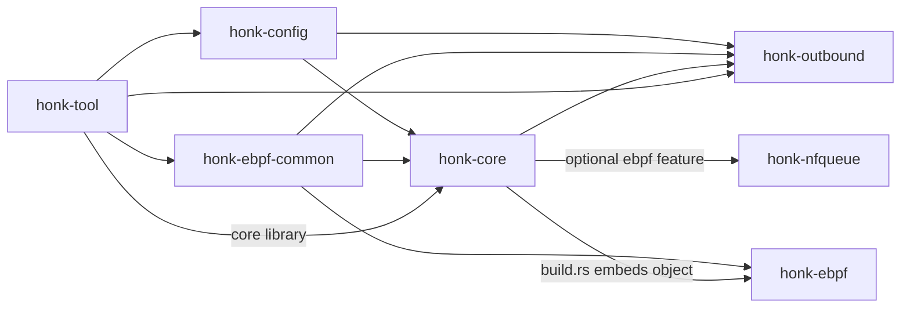
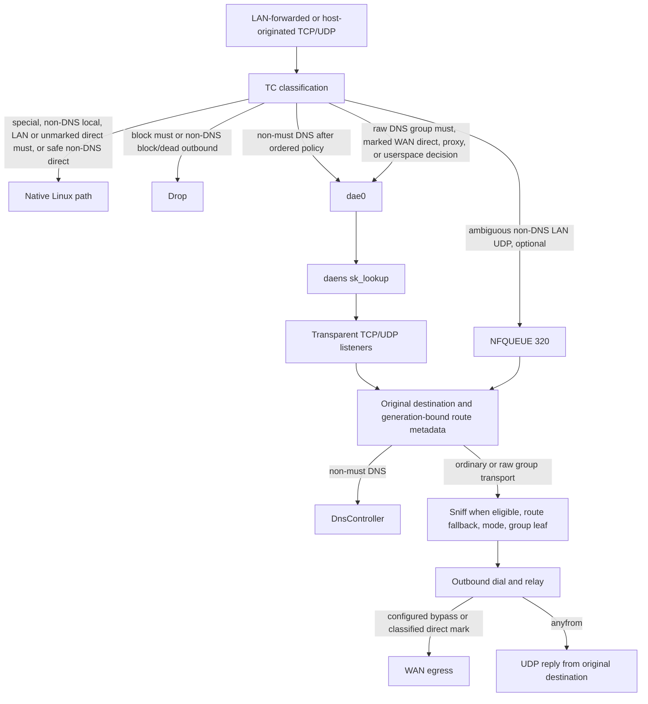

# 架构概览

`honk` 是 Linux eBPF 透明代理引擎，代理网关转发的流量和本机发起的流量。项目处于实验性 alpha 阶段，使用 `GPL-3.0-only` 许可证，仓库为 `daeuniverse/honk`。

`honk` 的配置语法和 TC 数据路径来自 dae，在文档声明的范围内与 dae 兼容。出站 handler、代理组和 Clash API 采用 sing-box 风格的设计。它是独立实现，与两者都有明显差异。

## 目标与非目标

### 目标

- 在 Linux 上通过 eBPF 透明代理数据路径，代理 LAN 转发流量和本机发起的流量。
- 以原生 `.dae` 语法作为主要配置格式，也是唯一写入文档的格式。
- 提供多协议出站、Selector/URLTest/LoadBalance/Fallback/Score 组、健康检查，以及 Clash 兼容控制 API。
- 只发布一个 `honk-core` 引擎，不另设 GraphQL 服务。`native-ui` 可选内嵌固定版本的 doona 客户端。

### 非目标

- 不追求与 Clash Meta/mihomo 完全对齐。honk 没有 FakeIP 引擎，也不追求远程 rule provider/rule-set 对齐。
- 不支持在 Windows 或 macOS 上透明代理。数据路径只支持 Linux。

## Crate 分工

根 workspace 包含六个 crate。`honk-ebpf` 的目标是 `bpfel-unknown-none`，因此不在 workspace 内，单独作为一个 Cargo 项目并维护自己的 `Cargo.lock`。

| Crate | Workspace | 职责 |
| --- | --- | --- |
| `honk-config` | 成员 | 共享配置模型、dae 语法解析器、include 处理、分享链接解析和订阅解码。 |
| `honk-ebpf-common` | 成员 | 内核程序与用户态 map 写入端共享的 `no_std`、`#[repr(C)]` 常量和 ABI 类型。 |
| `honk-nfqueue` | 成员 | raw `NETLINK_NETFILTER` 队列 `320`、verdict 所有权和自有 nftables 事务。 |
| `honk-outbound` | 成员 | 协议 handler、逐节点 runtime、出站组、健康状态、URLTest 探测和始终编译的 Score 评分器。 |
| `honk-core` | 成员 | 引擎库与二进制：eBPF/NFQUEUE runtime、控制面、DNS、路由、中继和 Clash API。 |
| `honk-tool` | 成员 | 用于订阅/节点探测、数据路径诊断、已固定 map 检查和 geo 资源查询的 CLI 工具箱。 |
| `honk-ebpf` | 排除 | TC、`sk_lookup` 和 cgroup eBPF 程序；单独构建，并在启用真实 eBPF 时嵌入 `honk-core`。 |

共享 map 的 key、值、常量或布局有改动时，必须同时修改 `honk-ebpf-common`、`honk-ebpf` 和 `honk-core` 的 map 写入逻辑。

`honk-config` 提供共享配置模型与解析器。它依赖的纯 Rust crate 有 serde、regex、url、base64、chrono、uuid。接口地址通过 `libc` 的 `getifaddrs` 枚举，不调用 `ip` 子进程。

- `from_file` 按文件扩展名选择格式。扩展名是已知的 `.json`、`.yaml` 或 `.toml` 时，先尝试对应格式，失败后只在 TOML、YAML、JSON 之间回退，不会尝试 dae。扩展名未知或缺失时，依次尝试支持 `include` 的文件级 dae、TOML、YAML、JSON。serde loader 是未写入文档的兼容接口，dae 才是主格式。
- Node 单独反序列化时，会报告因协议不兼容而被忽略的字段。这些 warning 每条只记录一次，即使后续转换失败也不会丢失。诊断里只有配置字段名，没有节点名称或字段值。`node::NodeSeed` 把 warning 写进调用方提供的列表，不自己记录日志。`FlatNode` 仍是唯一的扁平格式适配器。
- `ConfigSeed` 用 Node 适配器处理节点数组里的每个原始条目。结构化输入失败时，诊断保留节点、组和订阅的原始序号、安全的配置字段路径，以及解码器给出的行列号。解码器的原始错误文本不保留。映射和按字段声明顺序排列的序列都保留序号。详细文件与 JSON 加载接口失败时，保留调用方已有的诊断；格式回退成功时，只删掉已放弃尝试的诊断。所有格式都失败时，诊断按尝试顺序保留，最后附一个终止错误。dae 语义错误会终止加载，但有一种例外：完整文档能按 YAML、TOML 或 JSON 解码成映射，且至少含一个已知 Config 顶层 key 时，交给结构化格式加载器处理并报告结果。包含文件的错误和不支持的策略错误仍会终止加载。
- 解析器和分享链接的数据接口只返回安全的诊断，不自己记录日志。标量值、名称、链接和原始错误内容都不会出现在诊断里，但固定错误原因和 `dns.hosts_file` → `dns.use_host` 这类迁移说明会保留。组、过滤器、订阅和条目按原始序号定位。详细 dae 诊断共用一张只含元数据的来源表，表中保留 include 父来源的关联和能取得的物理行号。只有最外层加载尝试会追加终止错误。
- `src/node/validation.rs` 做集合 admission 和共享检查。`src/node/vless.rs` 独占规范 `VlessConfig` 的规范化、路径选择和组合校验。`src/node/protocol.rs` 保存其他协议配置以及共享的 TLS/stream/QUIC 选项。详细加载接口保留类型化错误原因和从 1 开始计数的原始节点坐标。
- `src/parser/mod.rs` 处理文件级 `include` 和有序的顶层分派。`lexer.rs` 和 `cursor.rs` 保留带源文本的词法单元、注释范围和有界片段。`read.rs` 提供共享的标量与表达式读取接口。各配置节分别由 `scalars.rs`、`experimental.rs`、`entries.rs`、`groups.rs`、`dns.rs` 和 `routing.rs` 读取。包含文件的 glob 以入口文件所在目录为基准解析，匹配文件的规范化路径不能超出该目录。重复包含和循环包含都会被拒绝。允许忽略未知内容的读取器会整块跳过未知嵌套块，不应用其中的子项。节点与订阅的兼容包装块仍会继续遍历。`experimental` 外层和 NFQUEUE 错误仍会终止解析。

  各读取器直接返回类型化错误，只有最外层尝试发布终止诊断。诊断提示在尝试结束时统一排序：每个来源维护一个前缀最大值索引，保留原来的追加顺序和调用方已有的诊断，不再反复插入向量。

  片段会区分已接纳和已忽略的语句，也会区分紧凑块和普通花括号块，读取器不再根据末尾词法单元猜结构。语句 admission 在紧凑块切分和续接状态更新之前完成。组的动态块头和条目值分开处理：条目值开始后，不再提前切分声明。涉及结构注释和花括号的诊断按游标当前作用域判定，并在 EOF 检查前统一发出。过滤器诊断保留原始词法单元的错误来源。遍历节点、订阅和组的同级声明时，语义诊断的归属会重置。

  遍历语法区分单行条目和多行表达式。括号保护状态只随实际返回的表达式语句跨越同源分段，并在来源边界重置。已建立索引的起始花括号保留原来的块头和子树归属。订阅原始字段独立于结构块头视图，保留完整起始词法单元的字节。
- `src/share_link.rs` 是唯一的 `Node::from_share_link` 解析器。`src/share_link/options.rs` 把 URI 报文编码和独立的复用控制项归入规范协议模型，先规范化和校验，再派生身份，不保留第二套 VLESS 模式模型。
- `src/node/wire.rs` 是唯一的扁平 serde 适配器。VLESS 输入只要含有已移除的旧字段，即使值为 `null`，也会被拒绝。同一字段在非 VLESS 输入上仅为兼容而保留。`VlessConfig.network`、`udp_encoding` 与 `multiplex` 参与身份派生，因此切换规范模型会改变 VLESS `Node.id`，但不会改变 VMess 的行为或身份。
- 行为概要见[出站设计](./outbound.md#vless-wire-契约)，字段语法见[节点参考](../reference/nodes.md)。
- `src/experimental.rs`：`ExperimentalConfig` 持有 `clash_api: ClashApiConfig`、`cache_file: CacheFileConfig` 和 `native_api`。原生设置严格校验、独立启用，而且都需要重启。`native-api` 要显式编译，可用 `--features native-api` 或 `native-ui` 构建，full 与 `-native-api` 发布产物都包含它。它提供用户态观测、有界历史、由源文件管理的组 PATCH 和主文件条目管理，以及已验证 geodata 的激活。listener 仍默认关闭。`.dae` 仍是唯一的配置权威。原文披露与写入权限各自独立。带凭据的来源只读。接口返回正文时会遮蔽 listener secret 的值，而不是省略整段正文。按网络的自动策略 pin/clear 已启用；pin 归属于当前 `GroupManager`，激活后失效。原生 mode 与完整内核透明仍未开放。`native-ui` 默认关闭，打包时通过 `ci/fetch-doona.sh` 和 `.github/ci/pins.env` 获取带许可及版本记录的 doona 发行资产。`build.rs` 读取绝对路径 `HONK_DOONA_DIR`，运行时不会获取资产或构建前端。dae 解析器目前显式允许 `clash_api` 和 `cache_file` 这两个嵌套节。旧的 `udp_nfqueue` 只作为迁移输入：解析时发出 warning，且只在没有配置 `global.nfqueue_enable` 时，把 `enabled` 复制到 `GlobalConfig::nfqueue_enable`。
- `src/subscription.rs`、`src/types.rs`、`src/error.rs`。`src/types.rs` 里 `NodeProtocol` 有 11 个变体，Direct/Block 留给内置节点；`DialMode` 为 ip/domain/domain+/domain++；还有 `SubscriptionType`、`DnsProtocol` 以及共享的 `default_true`/`parse_duration_secs` helper。`src/error.rs` 定义 `ConfigError`。

## 高层数据路径

### 报文路径

1. [数据路径](./datapath.md)在 LAN TC 分类转发的 LAN 流量，在 WAN TC 分类本机发起的 TCP/UDP。既有的入口规则和控制面排除规则先执行。普通 LAN 端口 53 的流量不能借本地 socket 跳过策略；非 DNS 的本地探测行为不变。LAN `direct(must)` 和路由时已判定安全的非 DNS direct 决策走 Linux 原生路径。非零 mark 的 WAN 直连改用用户态 socket，并重新执行带 mark 的路由查找。
2. [流量规则所有权](../reference/routing.md#出站目标与-must)决定哪些端口 53 查询进入[DNS 管线](./dns.md)。已通过 admission 的透明查询、可选的 host-netns `dns.bind`，以及流关联的 reality/目标查询，共用按 generation 固定的 DNS 策略、缓存与 singleflight、上游池和路由投影。
3. [数据路径](./datapath.md)把普通 proxy 和用户态决策经 `dae0` 重定向。进入 `daens` 后，`sk_lookup` 把它们交给[控制面](./control-plane.md)的透明 TCP 或 UDP listener。
4. [NFQUEUE 暂存](./nfqueue.md)由 `global.nfqueue_enable` 控制，默认开启，但只有启动前置条件通过时才真正激活。它只在 LAN TC 之后、conntrack/NAT 之前拦住仍有歧义的 LAN 转发 UDP。每个暂存流分配一个持久化的唯一 decision token，并在进入固定队列 `320` 之前发布绑定该 token 的 Pending 状态。本机发起的 WAN 流量继续走规范 TPROXY 路径。Direct/proxy/block 的终态由 `honk-core` 的 `control/nfqueue/` 执行。direct 不创建用户态 socket，不复制或重传报文，也不创建 `Ready` endpoint 或连接条目。
5. [控制面](./control-plane.md)恢复原始目的地址。TCP 用 `SO_ORIGINAL_DST` 或 `IP6T_SO_ORIGINAL_DST`，两者都失败时回退到透明 socket 的 `local_addr`；UDP 用 IPv4 `IP_ORIGDSTADDR` 或 IPv6 `IPV6_ORIGDSTADDR` cmsg。TCP 先确认 accepted FD 的 SYN 所有权，再用不可变的 handoff；UDP 以非破坏性方式读取经过身份校验的 tuple 元数据。所有权已确认但尚未终结的决策可以进入 `Router::route_action`。端口 53 另有一套 [TCP handoff 与 UDP 逐报文 admission 规则](./control-plane.md#透明代理入口)。
6. [路由路径](./routing.md)会嗅探 TLS SNI、HTTP Host 或 QUIC Initial SNI，在内核结果尚未终结时运行用户态 `Router`。命中 must 规则、配置了 `dial_mode: ip` 或命中负缓存时跳过嗅探。`dial_mode: domain` 会执行 DNS reality check。
7. [组层](./groups.md)应用 Clash 模式覆盖，但不改写最终的 `must`/`block` 结果。然后 `SharedGroupManager` 把策略选择解析成一个叶节点。Score 只用逐目标的 TCP/UDP 证据，在健康合格的成员中排名。TCP/UDP 通常只使用一个叶节点。只有冷启动的顶层 URLTest 会错开各候选的启动时间，且只有胜出的候选提交 endpoint 或 source transport。
8. [出站层](./outbound.md)通过 `TcpOutbound` 或可能失败的 prepared UDP commit 拨号该叶节点。普通 packet path 给 endpoint 绑定一条 `PacketTransport`。来源共享协议改为提交一条 source association，包括 XUDP/Mux.Cool、Hysteria2、TUIC 和各个 `MultiTargetTransport`。这条 association 由 core 所有，多个规范五元组 endpoint view 共用。嗅探得到的 TCP 字节先转发，之后普通 TCP 使用 splice，有包装的流使用 copy。未启用 Encryption 的 Vision TLS/REALITY carrier 在两个方向都进入 Direct 后，可以把 socket 借给 splice。
9. 控制面出口使用 `global.so_mark_from_dae`，值为零时选用默认的 `0x100`。带 mark 的直连使用规则 mark 加 `CLASSIFIED_MARK`。WAN TC 识别这两种标记，不再额外叠加默认旁路位。代理 UDP 和透明 53 端口的回包使用绑定原始目的地址的 [anyfrom socket](./control-plane.md)，让[返回数据路径](./datapath.md)保持源地址。

## 运行时不变量

- bypass mark 纪律：拨号、探测、DNS 上游、HTTP 下载、QUIC endpoint 和透明 listener 都会携带进程配置的 bypass mark。非零直连规则 mark 会替换 bypass mark 的低 30 位，并携带 `CLASSIFIED_MARK`；策略路由必须使用 `0x3fffffff` 掩码。accept 之后的 TCP socket 会清除 listener 标记；普通 host-netns `dns.bind` 入口 socket 则有意保持无标记。
- Anyfrom UDP 回包：代理 UDP 和透明 53 端口的 DNS 回包，使用在 `daens` 中创建并绑定到流量原始目的地址的透明 socket。直接从 TPROXY listener 回包会暴露 `dae0` 源地址，并在返回路径上失败。来自其他 full-cone 来源的回复通过仅含客户端的 `CLIENT_REPLY_TRACK` 帧信息返回，不经过主机转发。数据路径也不会因此为客户端随后发往该来源的包学到原生反向方向。
- DNS 来源边界：透明入口和 `dns.bind` adapter 从 socket peer 得到逻辑客户端来源；流关联查询使用已通过 admission 的流的来源。缓存只有在路由选出与来源无关的 scope 之后才复用。每个 policy generation 的域名谓词投影仍是全局的，不区分来源。
- UDP source 边界：来源共享协议的复用按以下四项区分：复用的 runtime、规范化后的 client、协议与 UDP path，以及 actual-peer 或 original-destination 的 reply projection。完整五元组 endpoint map 仍持有 route、token/generation 与逐 flow Score；source association 持有唯一的 receiver 和 transport health。关闭 `rprx` 时，除 VLESS 外各协议的 source ownership 仍可用。
- 网络命名空间纪律：进程常驻 host netns。它只通过有作用域且完全同步的 `with_daens_netns` 调用进入 `daens`。`setns` 跨度内不得出现 `.await`；恢复原命名空间失败时，进程必须中止。
- 数据路径 admission：在全部 listener FD 发布、全部接收循环运行之前，`DATAPATH_STATE_MAP[0]` 保持关闭；拆除 listener 之前它也会关闭。gate 关闭期间，TC 原样放行流量。
- NFQUEUE readiness 与所有权：启用但尚未 ready 时，只丢弃需要暂存的新流。honk 独占队列 `320` 和 nftables `inet honk_nfqueue` / `udp_decision`。ready 变更必须经过 fence，生命周期有歧义就是 fatal，同一 netns 的防火墙管理器不得修改这些对象。
- Token 校验终态：暂存 UDP token 必须在 skb mark、内核状态、handoff、redirect track、用户态 verdict 状态、lease/endpoint 和后端转换之间保持一致。Direct 遵循 Arm → 全部带标记 verdict → Activate；proxy 在唯一的规范拨号/发送路径之前发布最终状态。
- `must`/`block` 终结性：Clash 模式覆盖永远不会替换 `block` 结果或 dae `(must)` 结果。
- 失活出站 fail-closed：`lan_ingress` 丢弃路由到失活出站的新流。未配置 `final` 且只有一个叶节点的 TCP 组，会让同一个代理继续作为用户态的最后尝试。UDP 以及叶节点全部失活的多叶节点组仍保持 fail-closed。含有 `direct`/`block` 内置成员的组永远不会失活：内置节点不会被判定失活，因此 group-OR 槽保持开放。TCP 与 UDP 端口 `53` 不受该健康检查丢包影响，但仍遵循用户的终局 `must` 结果。
- 显式本地路由：网关管理访问由用户[显式配置](../reference/routing.md#显式本地路由)，不会自动生成接口规则。WAN egress 仍会旁路目的地址匹配 `PARAM.local_ip` 的流量，但这不保证一般管理访问可达。`PARAM.local_ip` 是启动时的快照。选取过程如下：先选出第一个已解析、存在且能绑定到规范根接口的 LAN 项，没有则选 WAN；跳过被拒绝的根接口，再取该根接口的第一个 IPv4 地址。规范化遵循接口计划器：bond/bridge 成员使用其规范 master，`vrf`/`openvswitch` 成员保持自身。没有可选的根接口，或所选根接口没有 IPv4 地址时，该值为 0，该旁路保持关闭。之后的接口或地址变化不会更新快照；LAN 缺席时选中的 WAN 地址也会在整个进程生命周期内保持不变。接口观察仍用于拓扑、ECS 和健康检查；非 DNS TCP 纯 SYN 的现有本地探测跳过策略不变。
- 组 OR 连通性：一个组的 eBPF alive slot 是组内全部叶节点成员状态的 OR，并包含上面单叶 TCP 最后尝试的例外。多叶节点组中的单个成员失活，不得使整个组 fail-closed。
- Score 隔离与原因：健康过滤与业务目标地址族保持独立。首次选择的 utility 仍是启发式的。健康晋升会在一个评估集内比较所有合格挑战者与固定现任：评估集有界，大小按需确定；比较依据共同的目标与时间证据，而不是无关的聚合值或 setup 均值。可选试用共享一份保留的组／网络／地址族预算，额度由原始业务开始赚取，时间流逝不产生额度；试用不会取得已提交现任的身份。真实业务的连续失败保留退避与三连败排除。精确证据与聚合证据各有一个 4,096 项 LRU；比较存储最多 512 个 cell、1 MiB 逻辑分配，这不是进程 RSS。重叠计数不相加。reload 保留已通过 admission 的业务结果，并撤销近期可用性与探测基线。公开摘要与计数始终有明确范围，不导出原始目标 key。详见[组设计](./groups.md#score-评分与生命周期)。
- Score 按需反馈：setup／首响应与有界的分方向进展可以在终态前发布，不会增加 Beta 完成次数。业务、配置健康和预热三种来源承担不同作用；任意手动 delay 测量都不会变成业务可靠性或配置基线。Score 的 TCP 建立失败可以在原 deadline 内通过另一个合格叶节点恢复一次，不打开新的 final、不绕过 Selector、也不重放负载。
- 条件性验证接口：Score 代理组会发布聚合的临时／可用状态、新鲜的成对挑战者响应关系、证据问题与等待原因，这些内容与同一次只读选择出的成员一致。不存在全组范围的比较结论。`/stats` 增加固定的组／网络验证以及预算／成本字段，还有经嵌套去重的根业务计数；观察到的试用失败不会被计为额外的因果失败。两者都不导出原始目标 key 或最优概率。详见 [API 验证](../reference/api.md#score-验证信息)。
- 内部与特殊流量：honk 的内部链路地址范围 `169.254.0.0/16` 和 `fd00:686f:6e6b::/64` 永不代理。L2 广播/组播、IPv4 广播/组播/未指定目的地址以及 IPv6 组播会在路由或 conntrack 之前直通。

## 构建 feature 与 mock 模式

`honk-core` 默认启用 `clash-api`、`jemalloc` 和 `rprx`；真实 eBPF 需显式启用。

| Feature | 默认 | 作用 |
| --- | --- | --- |
| `ebpf` | 否 | 引入 `aya`、`aya-obj`、`aya-log` 和可选 `honk-nfqueue`；`build.rs` 嵌入静态 `honk-ebpf` 对象，用户态在运行时编译 policy extension。运行时要求 Linux kernel 6.12+。 |
| `clash-api` | 是 | 引入可选 `axum` 与 `tower-http`，提供 Clash 兼容 REST/WebSocket 服务。 |
| `native-api` | 否 | 独立的 HTTP/1.1 原生观测、可选历史、管理已接受来源的 reload API，以及本地目录 UI。连接有界并由它管理生命周期，严格校验 bearer/Host/Origin，不依赖 Clash。 |
| `native-ui` | 否 | 隐含 `native-api`，让 `ui: embedded` 内嵌固定版本的 doona 发行资产；`ui: embedded-lite` 选择更轻量的 doona lite 预览版，同样需要这个 feature。运行时不解压、不下载、不构建前端。 |
| `jemalloc` | 是 | 引入 `tikv-jemallocator`，把 jemalloc 安装为 `honk-core` 二进制的 allocator；该 crate 从 C 源码构建 jemalloc。在 Linux 上，程序会在启动 Tokio 之前对当前进程禁用透明大页。运行期选项使用 `_RJEM_MALLOC_CONF`，不用 `MALLOC_CONF`：crate 以 `_rjem_` 前缀构建 jemalloc，环境变量名也被加上该前缀。 |
| `rprx` | 是 | 启用 `honk-outbound/rprx`，注册 VLESS 与 VMess handler，包括受支持的 VLESS Encryption 和 `xtls-rprx-vision` 路径。 |

`mock-ebpf` 不是 Cargo feature。不带 `ebpf` 的构建使用 `MockEbpfBackend`，`--mock-ebpf` 则显式选择无特权开发路径。若请求 `global.nfqueue_enable = true`，启动会记录 warning，仅在本进程关闭 NFQUEUE 暂存，配置文件保持不变。

嵌入 eBPF 时，`build.rs` 使用内核 crate 固定的编译器和独立的 release 策略重建，不继承 host 的 `RUSTFLAGS`、`CARGO_ENCODED_RUSTFLAGS` 或 `CARGO_PROFILE_*` 性能分析覆盖。编译器 sidecar 不能早于嵌入构建脚本，所以修改嵌入策略会使既有对象失效。显式 `--bpf-object` 资产和手动内核构建仍由调用方负责。

## 作者与分工说明

- 项目维护者主要负责 eBPF 数据路径的人工设计、实现审查与验证，包括 `honk-ebpf`、`honk-ebpf-common` 以及 `honk-core` 中的 attach/map 路径。
- 其余多数用户态子系统主要由 AI 辅助编写，包括配置解析器、出站 handler、组与健康检查、用户态 DNS、Clash API 和大量控制面衔接代码。维护者做了部分代码审查，并没有逐行负责。

## 相关文档

- [配置指南](../configuration.md)
- [数据路径设计](./datapath.md)
- [Global 配置参考](../reference/global.md)
